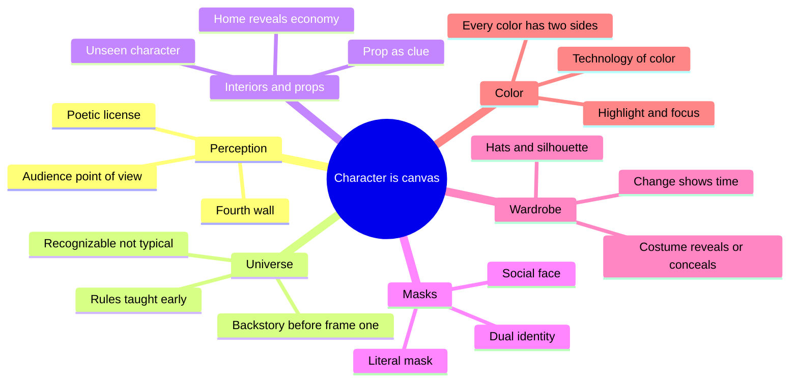
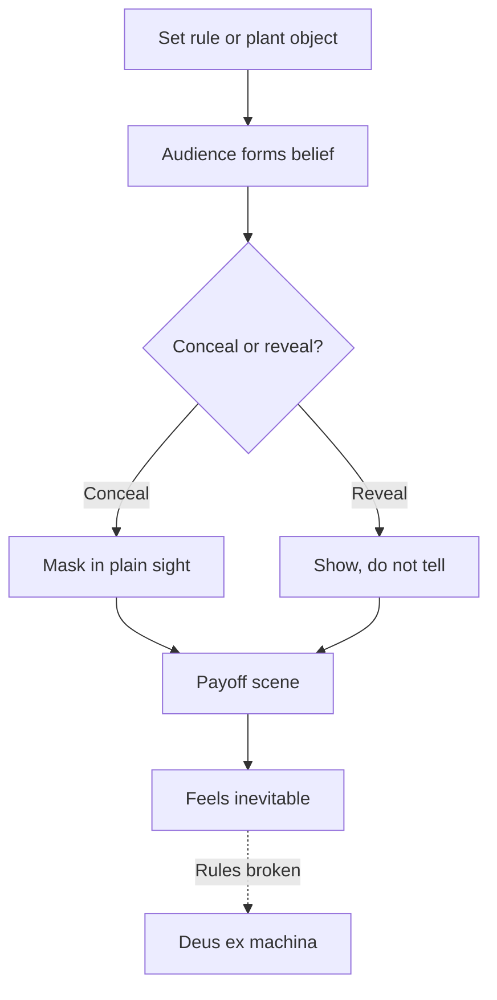
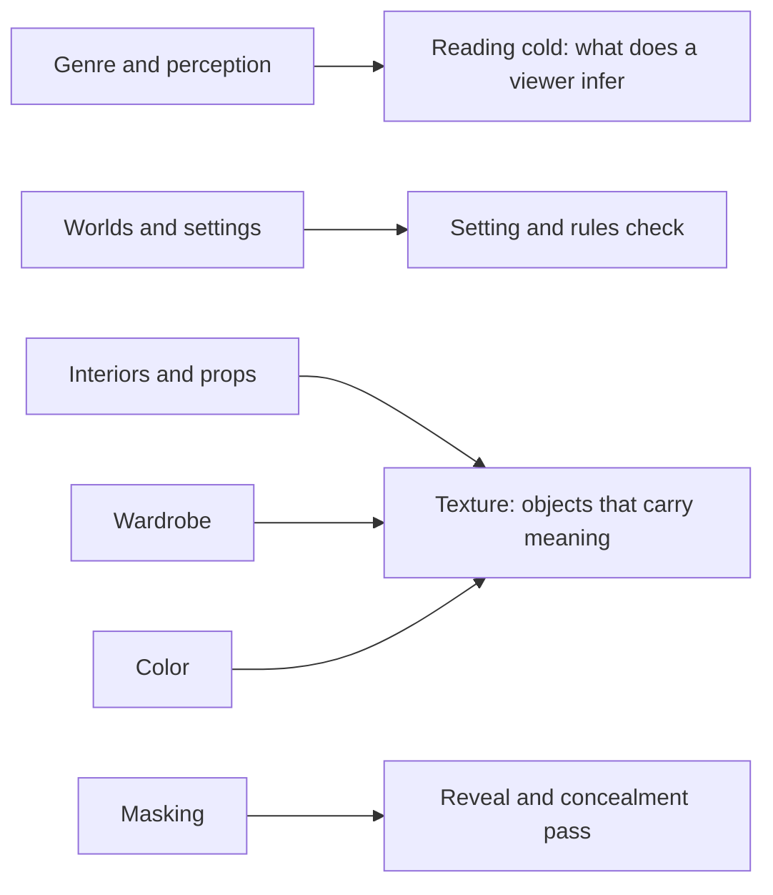

# BVX.0255 — Visual Character Development in Film and Television — Hanly and Rowney (2020)
### Knowledge Entry — Distill

A film-school craft book that teaches screen character as something painted into the frame: world, home, props, masks, wardrobe and color, each illustrated with a fine-art work and a film or TV case. It is in the library as a craft basis for scripts that must show character, not state it.

## TABLE OF CONTENTS
- [Core Thesis](#1-core-thesis)
- [Mind Models](#2-mind-models)
- [Framework](#3-framework--structure)
- [Key Concepts](#4-key-concepts)
- [Heuristics](#5-heuristics--decision-rules)
- [Invariants](#6-invariants)
- [Pitfalls](#7-pitfalls--myths)
- [Application](#8-application)
- [Cross-References](#9-cross-references)
- [Provenance](#10-provenance--confidence)

---

## 1 · CORE THESIS

Everything in the frame should reveal character, drive the story, or both. Character is read through perception: the audience sees what the storyteller shows and conceals. World, home, objects, masks, clothes and color are the tools, and they only work inside rules the audience has been taught.

---

## 2 · MIND MODELS

**Diagram 1 — the whole argument.**
Caption: six layers of visible character, from the widest frame (world) to the narrowest (color), all filtered through audience perception.

**Diagram 2 — the central mechanism.**
Caption: the reveal loop. Plant a visible object or rule, let the audience form a belief, then pay it off so the reveal feels earned (Goldie Wilson's sign, the 88 mph rule, the handlink).

**Diagram 3 — the book mapped onto the Command's editing work.**
Caption: where each chapter lands when an editor reads a script cold for what is on the page and what is only in the writer's head.

---

## 3 · FRAMEWORK / STRUCTURE

The book is built as a "choose your own adventure" of self-contained chapters. Each pairs a fine-art case with a film or TV case, which is how it argues that painters were the first visual storytellers: the same questions (what to put in the frame, what to reveal, what to conceal) apply to both.

| Ch | Topic | Core claim | Cases |
|---|---|---|---|
| Intro | Why visual | The page cannot hold everything; "if it's not on the page, it's not on the screen" is not always true | Michelangelo, awards-show question "Who are you wearing?" |
| 1 | Genres and perception | Character is what the audience perceives; belief is built from a true-seeming base | Obi-Wan, Donna Noble, Ferris Bueller and Seurat, "Vincent and the Doctor", Miranda |
| 2 | Worlds and settings | You build a universe with rules; "typical" depends on where you stand in it | Back to the Future, Raphael, Delacroix, Moran, Marvel |
| 3 | Interiors, accessories | Home, props, vehicles and signs reveal character and plot | Quantum Leap, Fun with Dick and Jane, TARDIS, Burton Batman, Arnolfini |
| 4 | Masking, unmasking | Faces, costumes and identities conceal; the reveal is the story | The Mask, Longhi, Zorro, Superman, Kirk and Spock |
| 5 | Character and wardrobe | Costume introduces, conceals and marks time | Princess Bride, Joe Versus the Volcano, Sherlock, Thomas Crown, Rodin |
| 6 | Color | Meaning plus technology of color | Red, yellow, blue, green; Technicolor, LUTs |
| Epilogue | Pay-off | Answers the intro questions | Goldie Wilson, Kirk, the Turtles |

---

## 4 · KEY CONCEPTS

1. **Perception over intent.** "To be is to be perceived." What a character is on screen is what the viewer concludes, shaped by the viewer's beliefs and background. Matters because the storyteller must model what the audience will assume.
2. **Poetic license.** Start from a believable fact, then bend it. Doctor Who opens in the real Musee d'Orsay mood so the audience accepts the fantasy. Matters because exposition can hide inside immersion.
3. **Willing suspension of disbelief.** The audience supplies the willingness; the storyteller supplies rules and detail. "For a lie to work, it must have some truth."
4. **Universe, not world.** The storyteller controls cause and effect of everything, so the rules must be known to the creator before they are shown.
5. **Recognizable, not typical.** Typical is relative to the universe's own sample (the neighborhood lawns). Anchor the audience in a recognizable reality before leaving it.
6. **Layered rule delivery.** Back to the Future hides the 88 mph rule inside a spectacle and technical noise. The rule is then at the heart of later conflict. Rules do not have to be shouted by a character.
7. **Backstory and last frame.** Know where the character was just before frame one and where the story ends. The unwritten past is felt, never shown in full.
8. **Houses lie.** A home's size, upkeep and objects signal economy and state of mind. The decaying lawn in Fun with Dick and Jane shows desperation; the patchwork stolen lawn shows the breaking point.
9. **Props as clues.** A prop can identify (Marat's bath and quill), foreshadow (the "Brown Mansion Destroyed" headline), or become the character's emotional anchor (Mrs. Wolowitz's frozen meals).
10. **Unseen character.** A voice or objects can sustain a full character offstage and drive plot.
11. **Vehicle as plot engine.** The DeLorean carries Doc's lost fortune, vanity and the plot's key physical events. A vehicle need not have wheels (David's rearing horse).
12. **Sign as setup.** The campaign poster plants Goldie Wilson so the audience says "Mayor" with Marty. Cheap visuals can do the heavy payoff work.
13. **Mask forms.** Literal mask, social smile, role (Clark Kent, Don Diego), emotional false face, hat or costume that becomes the person. The true face may be the mask.
14. **Dual identity needs separation.** The world of the story should see only one half at a time. Bruce Wayne in a tuxedo at a costume ball is Batman in the Wayne costume.
15. **Desperate man.** A controlled face that hides an obsession (Kirk and the Enterprise, Spock's suppressed emotion) pays off when the mask slips.
16. **Costume as time marker.** A costume change tells the audience years have passed without a line of dialogue (Buttercup).
17. **Costume as arc.** Take a character shopping to show change (Joe Versus the Volcano). The silhouette stays consistent enough to keep the character recognizable.
18. **Color has two sides.** Red: love and hate. Yellow: hope and cowardice. Blue: freedom and depression. Green: renewal and greed or illness. Context decides which side is live.
19. **Color as focus.** Color pulls the eye (the red box, Stark's gauntlet, Judith's candlelight). Earth tones make a character meek and background.
20. **Technology of color.** Light changes color; film grain, pixels, Technicolor and LUTs are all choices. A writer should know the palette to use it.

---

## 5 · HEURISTICS & DECISION RULES

| Situation | Do this | Not this |
|---|---|---|
| Introducing a character | Show them in their home turf or costume before they speak | Open with a dialogue summary of who they are |
| Establishing a fantasy rule | Bury it in action and noise, then use it later | Have a character recite it in a block |
| Setting a story in "the real world" | Find what is recognizable to this character, not generic "typical" | Fill the frame with the average, the ordinary |
| Showing a character's money or state | Use the house, lawn, car, furniture | Say "he's broke" |
| Needing a late rescue | Plant the tool and its limits early, then use them | Drop in new information to save the day |
| Planting a future reveal | Put the object or sign in plain view early | Rely on the audience knowing it from outside |
| Hiding a truth | Mask it in plain sight, leave clues | Hide it by omitting it entirely |
| Dual identity | Keep the two halves visibly distinct | Ask the audience to ignore obvious similarity |
| Showing time passing | Change costume or setting | Add a title card or line of dialogue |
| Making a character look different without a new actor | Change one clear signal (palette, silhouette, hat) and keep the rest stable | Change everything at once |
| Using color symbolically | Pick the side of the color the scene needs, support it with context | Assume red always means danger |
| Using a prop in a period or niche piece | Check the audience still understands it | Rely on knowledge only the original audience had (Marat's letter) |
| Doing research for a setting | Go and look: stores, listings, real rooms | Imagine from memory only |
| Reading the frame | Ask "why this object, why here, why this color" | Treat every item as decoration |
| Adapting a known universe | Keep the recognizable core and vary the take | Rebuild the rules |

---

## 6 · INVARIANTS

1. Almost everything in the frame should reveal character, drive the story, or both.
2. Audiences arrive with beliefs; the character on screen is the character they perceive.
3. A made-up world needs rules, and the rules must be fair and shown before they matter.
4. Reality on screen is built from details; invented details need some truth to carry them.
5. A character had a life before frame one and implies one after the last.
6. Home and objects speak for the character more cheaply than dialogue.
7. A mask is a choice with a purpose; its removal is the dramatic event.
8. Costume is read before dialogue; first impressions come from clothes.
9. Color works in contrasts and has no fixed meaning outside its context.
10. Time on screen is fleeting; images must be set so they stay in memory.

---

## 7 · PITFALLS / MYTHS

- **"If it's not on the page, it's not on the screen."** The authors call this only partly true. Writers can see more than they can write, and the visual team can carry meaning the script cannot hold.
- **Treating "typical" as universal.** What is typical in one neighborhood is odd in another.
- **Shouting the rule.** Over-explained worlds feel like exposition and lose the audience.
- **A random rescue.** New information that saves the day is deus ex machina; it only works when the rule was planted.
- **Hero not heroic before the mask.** Modern films often make the hero visibly heroic first, which blurs the dual identity and asks the audience to ignore the link.
- **Over-reading symbols.** Matisse's green stripe may be only shadow. Sometimes color is just color.
- **Context-blind props.** An object that meant something to its first audience may mean nothing to today's.
- **Drifting costume.** A change in clothing that breaks the silhouette makes the audience lose the character.
- **Believing the picture.** Realtor photos, tourism art, and propaganda portraits show the advertised reality, not the actual one. A storyteller can use that, but should know it.
- **Expecting universal color meaning.** Blue for boys was a twentieth-century swap from pink.
- **Pushing the button without knowing it.** Easy color tools make it easy to ruin a palette.

---

## 8 · APPLICATION

- **Spine level:** TEXTURE. This book lives below plot structure: it governs how the frame, props, wardrobe and color carry character.
- **12-layer character stack:** none directly. The book is craft, not psychology, so `feeds: []`.
- **plot_systems:** none.
- **Setting:** the world-building and interior chapters support Setting checks (rules, recognizable base, house as economy).

These are the Command's own uses, kept apart from the source.

For the OXO script editors (`.claude/agents/editing-*.md`, `reading-cold.md`), the book supplies a vocabulary for what a cold reader can infer from the page. Useful passes:

1. **Rule plant pass.** Mark each rule of the OXO universe, find where it is first shown, and check it is shown before it matters. A late power or tool is a deus ex machina unless it was planted.
2. **Object inventory.** List recurring props and ask what each tells the reader. Props with no job are decoration; props with a job should appear before the payoff.
3. **Home and setting read.** For each home or workplace, ask what economy, habits and state of mind the description implies, and whether the implied picture matches the character.
4. **Mask check.** For each character with a hidden side, list what the audience is shown versus what is concealed. Check that the concealment is in plain sight and the clue is on the page.
5. **Costume as shorthand.** Where a character appears first, check that clothing or a signature item introduces them, and that changes later mark time or arc.
6. **Color as emphasis.** Use color only where the scene needs the pull. Neutral costume lets a red object land.
7. **What is not on the page.** Because the authors accept that a page cannot hold everything, flag places where a visual choice is implied but not written; a reader coming to the page cold cannot supply it.

Cautions for use: the book's examples are mostly Western film and TV and mostly 1980s to 2010s. Its color symbolism is Western and general; for OXO, set the meaning inside the story's own culture.

---

## 9 · CROSS-REFERENCES

| Related entry | Relation |
|---|---|
| [[BVX.0064]] | McKee-style Character: the three levels of self (this book supplies the visible surface of that structure) |
| [[BVX.0066]] | Cinematic Storytelling: the director's and cinematographer's tools for the same visual reveals |
| [[BVX.0056]] | Active Setting: setting as active, a prose counterpart to the world and interior chapters |
| [[BVX.0100]] | Fictional Worlds: theory behind the rules-of-the-universe argument |
| [[BVX.0141]] | Worldbuilding craft: a writer's version of the rules and recognizability advice |

---

## 10 · PROVENANCE & CONFIDENCE

- **Sourced from full text:** the whole pdftotext file (front matter, Introduction, Chapters 1 to 6, Epilogue, index), read in runs of about 700 to 1,000 lines. No chapter left unread.
- **Inference:** the Command application (section 8, diagram 3) and the heuristic table's phrasing are the distiller's synthesis. The book itself gives no checklist.
- **Source-type notes:** a teaching text by film and art-history instructors, rich in anecdote and light on systematic method or evidence. Several factual details are loose (for example the Napoleon painting commission date appears as 1880, and the Smithsonian pink and blue history is a news-level citation). Confidence is medium: the craft ideas are sound and widely shared, but the book is not a rigorous source.
- **Text note:** the pdftotext output has a few encoding artifacts (replacement characters for dashes and accents); meaning is unaffected.

## META
- Template: BVX-LEARN-v4.0
- Source classification: book, craft (film and television visual design)
- Created / Updated: 2026-10-30 / 2026-10-30
