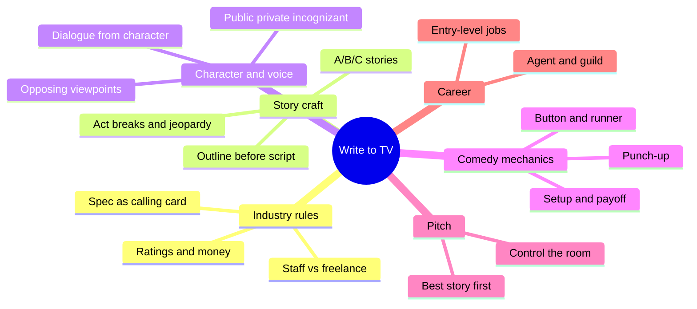
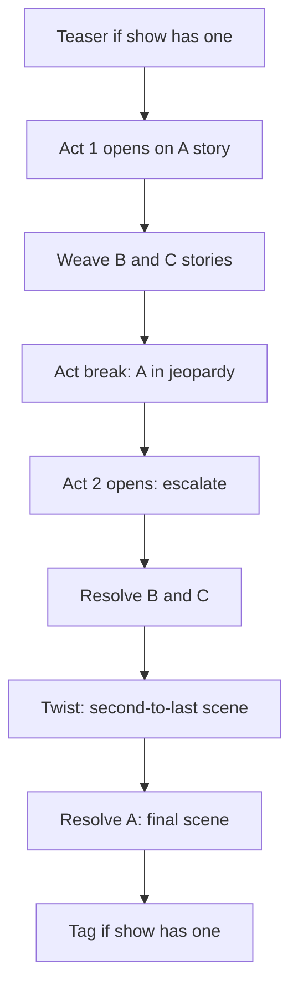
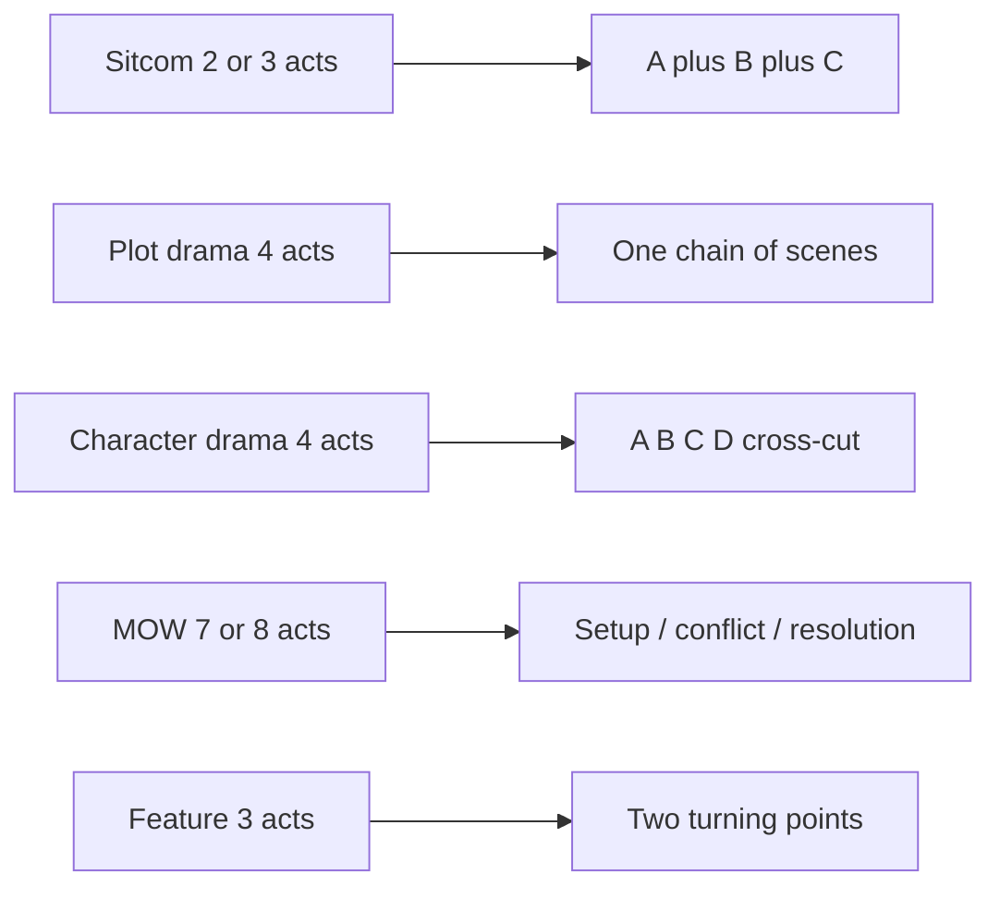
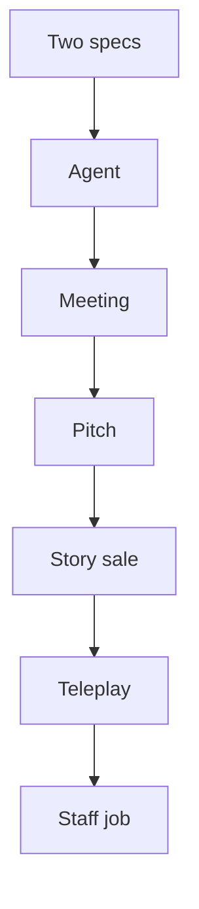

# BVX.0262 — Write to TV — Martie Cook (2007)
### Knowledge Entry — Distill

A working TV writer's handbook for the spec-to-staff route: sitcom and one-hour drama structure, pilots, characters, dialogue, pitching, plus the Hollywood business around them. It is in the library as a craft basis for the script editors.

## TABLE OF CONTENTS
- [Core Thesis](#1-core-thesis)
- [Mind Models](#2-mind-models)
- [Framework](#3-framework--structure)
- [Key Concepts](#4-key-concepts)
- [Heuristics](#5-heuristics--decision-rules)
- [Invariants](#6-invariants)
- [Pitfalls](#7-pitfalls--myths)
- [Application](#8-application)
- [Cross-References](#9-cross-references)
- [Provenance](#10-provenance--confidence)

---

## 1 · CORE THESIS

Television is a business that buys proven execution. Write inside the show's existing characters, sets and act shape; make the story fresh through character, not through changing the show. Outline first, put the jeopardy at the act breaks, and rewrite until every page earns its place.

---

## 2 · MIND MODELS

**Diagram 1 — the whole argument.**
Read the five working parts: the industry that sets the rules, the story-craft core, the character and dialogue layer, the pitch, and the career.

**Diagram 2 — the central mechanism (sitcom structure).**
Read the order: each act opens and closes on A, the jeopardy rises across the break, the twist sits second-to-last, and A resolves last.

**Diagram 3 — the formats compared.**
Read how act count and story count change with format; plot drama has few secondary stories, character drama borrows the sitcom braid.

**Diagram 4 — from idea to staff job.**
Read the career path as a gated sequence: each gate needs the previous credit.

---

## 3 · FRAMEWORK / STRUCTURE

The book has thirteen parts. The craft parts, in the order a writer works:

1. **Know the machine (Ch 1-2).** Networks, studios, affiliates, syndication, sweeps, ratings. Staff writers sit in a room; freelancers sell stories from outside. The spec script is the entry ticket.
2. **Sitcom (Ch 3-8).** Find the story, structure it, outline act by act and scene by scene, then script. Jokes are built from setup and payoff.
3. **Drama (Ch 9-11).** Two kinds: plot-driven (Law & Order: one scene builds on the last) and character-driven (ER: braided stories). Both run four acts, about 55 to 59 pages, with the biggest cliffhanger at the end of Act Two, which falls on the half hour.
4. **Original series (Ch 12-14).** Pilot, premise, market timing, treatment. Cook advises against a pilot early in a career, except as a sample.
5. **Movies of the week (Ch 14-15).** Seven or eight acts, about 110 pages. She advises writing a feature in classic three-act shape that can double as a movie of the week.
6. **Characters (Ch 15)** and **Dialogue (Ch 16).**
7. **Pitching (Ch 17).** Meeting mechanics.
8. **Other forms.** Animation, late night, news, reality, children's television.
9. **Business and career.** Agents, the Writers Guild, partners, entry-level jobs, interviews.

Craft backbone: story first, outline second, script third, rewrite always.

---

## 4 · KEY CONCEPTS

| Concept | What it is | Why it matters |
|---|---|---|
| Spec script | An unpaid sample episode of a current show | Proves you can write the show as it exists, on time |
| A / B / C / D stories | Primary story and secondary stories | Uses the whole cast; secondary stories cut away to build tension |
| Act break | Mini-cliffhanger at the commercial | Keeps the audience through the break |
| Jeopardy | The character in hot water, escalating | The engine of every act |
| Twist | Something the audience does not see coming | Linear stories are boring |
| Teaser / tag | Cold open and end segment | Tag never resolves A, since syndication may cut it |
| Button | A strong joke ending a scene | Transitions scenes; lets the audience laugh |
| Runner | A small joke that repeats across the episode | Acts like a tiny C story |
| Superior position | Audience knows what a character does not | Reliable source of comedy |
| Plot-driven vs character-driven drama | Story drives vs people drive | Decides how many stories you braid |
| Three personas | Public, private, incognizant | The clash between layers makes a character |
| Backstory | Life-altering past events that set point of view | Write the few big events, not a notebook of trivia |
| Subtext | What is meant, not said | Good dialogue never hits the nail squarely |
| Premise vs non-premise pilot | Origin story vs "looks like episode three" | Buyers now prefer the second |
| Page-one rewrite | Staff scraps the freelancer's script | Costs you the next assignment |

---

## 5 · HEURISTICS & DECISION RULES

| Situation | Do this | Not this |
|---|---|---|
| Picking a spec target | Choose a current, respected show you relate to; pick a second of a different type | Cancelled show, flavor of the month, or a show you do not watch |
| Writing a spec | Use all main characters and standing sets; one swing set at most | Marry off, impregnate, move or travel the cast |
| Starting an act | Open on the A story | Open on B |
| Ending an act | End on A, with the character in jeopardy | Cliffhanger on a secondary story |
| Stuck for a story | Browse bookstores, episode guides, quotation books for theme | Copy the plot (take the age-old theme only) |
| Familiar story idea | Dig into this character's backstory for a fresh spin | Pitch the first idea that arrived in ten seconds |
| Using real events | Take the seed; rebuild with the show's characters and escalate | Transcribe what happened |
| Real event is small | Demote it to B or C story | Stretch it to carry an hour |
| Opening a scene | Enter at the last possible moment | Show the packing and phone calls |
| Joke fails | Fix the setup first | Rewrite only the punchline |
| Dialogue feels flat | Add subtext; shorten the speeches; read it aloud | Have characters state the problem |
| Voices sound alike | Take one character through the whole script, then the next | Assign lines to whoever is handy |
| Need backstory out | Find a natural scene | Stuff it into a conversation |
| Pitch meeting | Pitch best story first; add a one-line B story; keep detail light | Memorize, read, or argue after a "no" |
| Story changes in the room | Smile, nod, add to it | Defend your version |
| Research a field | Ask a professional with a short list of questions | Brainstorm with experts or trust random web pages |

---

## 6 · INVARIANTS

1. Story is the foundation; weak story sinks everything built on it.
2. Conflict comes from characters with opposing viewpoints and clear agendas.
3. Each act ends with something that makes the audience want the next.
4. Every scene has a beginning, middle and end, and gives actors something to do.
5. Jokes and dialogue come from character, not from the writer.
6. Comedy gives the audience the information; drama withholds it until it hurts most.
7. An outline is the blueprint; a script without one gets rebuilt.
8. Writing is rewriting; a first draft is not a sample.
9. Format and show-specific style are part of the credential. Readers spot errors fast.
10. Audiences need one character to care about before they commit.

---

## 7 · PITFALLS / MYTHS

- "My story is true, so it is good." A real event may be too small, too wrong for the show, or too static.
- Writing a spec of a cancelled or obscure show.
- Guessing where a serialized character drama is heading; write a generic episode that fits the show as it stands.
- Stories with a predictable end (the family will not move) or that alter the show's franchise.
- Long phone conversations and talking heads.
- Backstory dumped in dialogue; names overused in dialogue.
- Dated topical jokes; shock for its own sake.
- Stepping on a joke by running past the laugh.
- Character bios so thick the script never starts.
- A pilot that introduces people but has no story or act breaks.
- Too many despicable characters with no one to root for.
- Cheating margins to fake page count.
- Believing producers will steal your pitch (logline logs make it unlikely).

---

## 8 · APPLICATION

- **Spine level:** TEXTURE. Cook teaches episodic and act-break craft, which is surface technique for scenes, not the story spine itself.
- **12-layer character stack:** none. Her three personas (public, private, incognizant) and 20 questions are craft aids, not LEECHSEED fields, so `feeds: []`.
- **plot_systems:** none.
- **Setting:** none.

Use for the script editors. Four rules transfer cleanly to the OXO episode and reading-cold checks:

1. **A/B/C weave test.** Does each act open and close on the A story, and does every secondary story have a beginning, middle and end?
2. **Jeopardy ladder.** Does each break leave a character worse off, and does the next act escalate before cutting away?
3. **Voice test.** Read each character's lines alone; if two sound alike, flag it.
4. **Scene entry/exit test.** Does the scene start late, end on a button, and give actors action?

Dialogue checks (subtext, no phone scenes, backstory in action) fit reading-cold. The business chapters are context only and do not apply to the OXO pipeline. Treat the industry-practice claims (page counts, pay figures, trends) as of 2007.

---

## 9 · CROSS-REFERENCES

| Related entry | Relation |
|---|---|
| [[BVX.0064]] | McKee's character cast design; Cook's opposing-viewpoint and three-persona ideas are the TV-craft version |
| [[BVX.0075]] | Compelling characters across film and TV; overlaps Cook Ch 15 |
| [[BVX.0250]] | TV writing in the digital era; a later view of the same market |
| [[BVX.0228]] | Process of screenwriting; compare Cook's feature three-act turning points |
| [[BVX.0221]] | Nutshell technique; another structure-first craft source |

---

## 10 · PROVENANCE & CONFIDENCE

Sourced from the full pdftotext at `_PRIVATE/distill_wave/BVX.0262.txt` (PDF not in repo; came from the PDF drop). Read in full or in large runs: Ch 1-2 (industry, getting read), Ch 3-6 (sitcom craft; outline and format chapters read in part), Ch 7 (joke craft), Ch 8 (animation, start only), Ch 9-11 (drama), Ch 12-13 (pilots), Ch 14 (movie of the week structure), Ch 15 (characters), Ch 16 (dialogue), Ch 17 (pitching, most of it), Ch 24 (children's TV).

**Not read in full (skimmed by heading only):** formatting detail in Ch 6-7 (about lines 3650-4500), late night, mock assignment and Ch 18-22 (TV news, edit bay, ethics), reality TV (Ch 23), agents and WGA (Ch 25-27), writing partners, and the career-launch chapters (Ch 28-32). Their claims are not in this card. Hence confidence medium. Business facts and dollar figures date from the 2007 edition.

## META
- Template: BVX-LEARN-v4.0
- Source classification: craft handbook (practitioner), secondary quotes from working producers
- Created / Updated: 2026-10-30 / 2026-10-30
