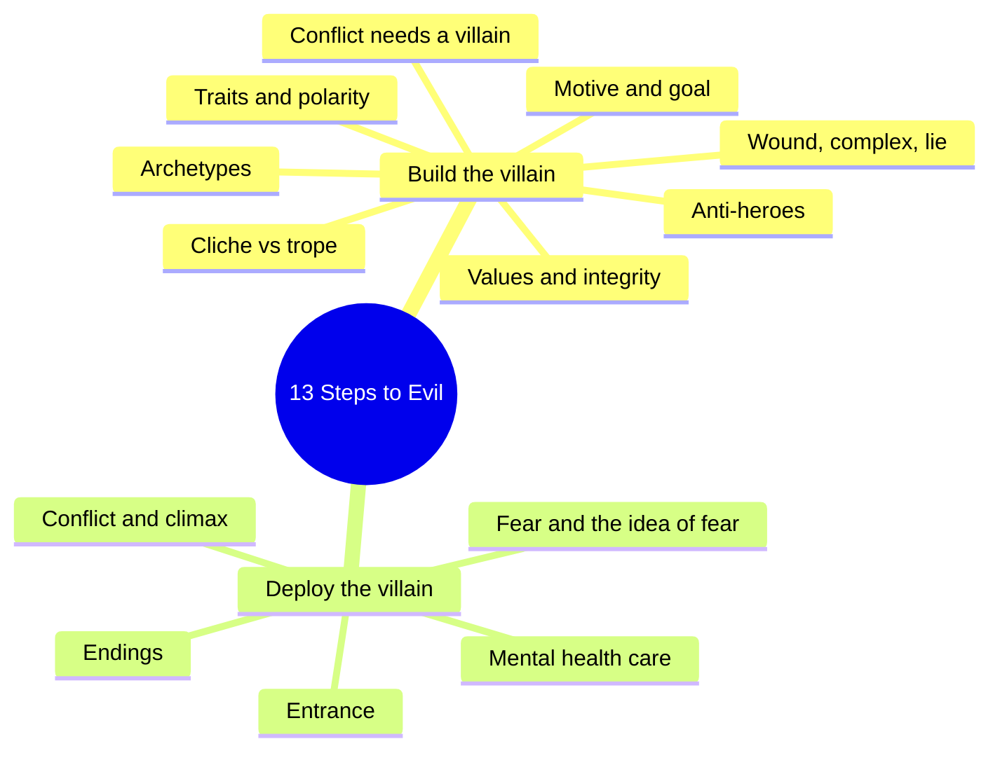
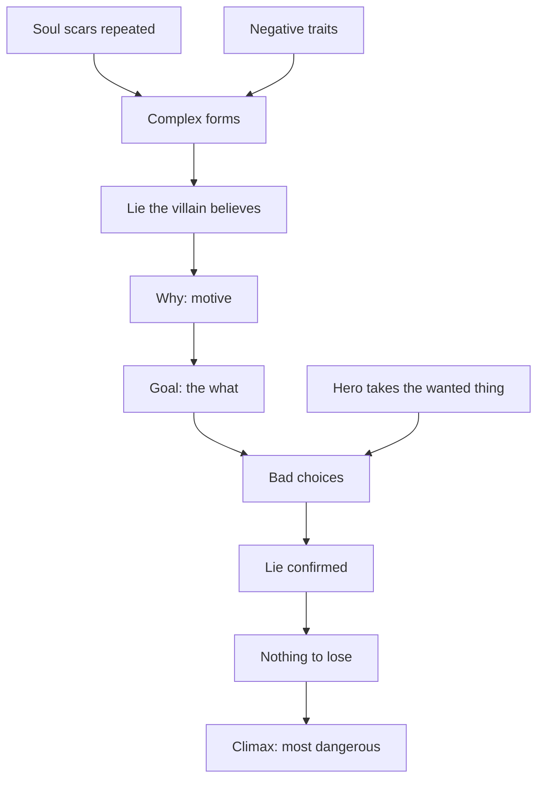
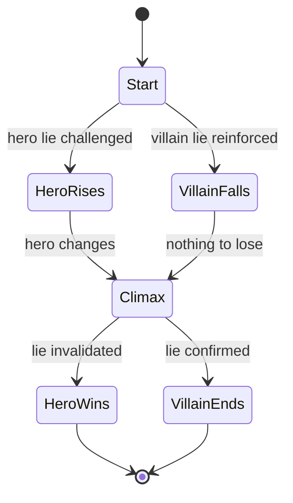
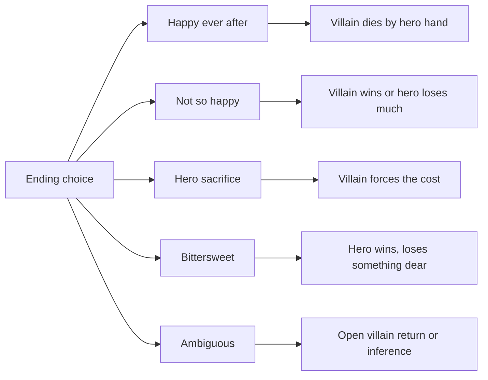

# BVX.0264 — 13 Steps to Evil: How to Craft Superbad Villains — Sacha Black (2017)
### Knowledge Entry — Distill

A genre-writer's craft manual on building the villain first: traits, motive, wound, values, archetype, fear, conflict, climax, demise, entrance. Kept as craft basis for the OXO script editors, not as a psychology source.

## TABLE OF CONTENTS
- [Core Thesis](#1-core-thesis)
- [Mind Models](#2-mind-models)
- [Framework](#3-framework--structure)
- [Key Concepts](#4-key-concepts)
- [Heuristics](#5-heuristics--decision-rules)
- [Invariants](#6-invariants)
- [Pitfalls](#7-pitfalls--myths)
- [Application](#8-application)
- [Cross-References](#9-cross-references)
- [Provenance](#10-provenance--confidence)

---

## 1 · CORE THESIS

The villain, not the hero, is the most important character, because the villain's wants create the conflict that makes plot and arc. Build the villain from a wound, a lie, a motive, values kept with integrity, and expertise, so the hero must change to win.

---

## 2 · MIND MODELS

**Diagram 1 — the whole argument.**
Read off it: the book runs in two halves, building the villain (steps 1 to 8) and deploying the villain in the story (steps 9 to 13).

**Diagram 2 — the central mechanism (the villain formula).**
Read off it: a villain's evil is a causal chain from wound to lie to choice, and the hero's contact with the wanted thing is what lights the fuse.

**Diagram 3 — hero and villain arcs as mirrors.**
Read off it: the villain falls as the hero rises, and the hero's lie is broken while the villain's is proved.

**Diagram 4 — endings by who wins.**
Read off it: pick the ending first by genre, then foreshadow it if it is not the happy default.

---

## 3 · FRAMEWORK / STRUCTURE

Thirteen steps, each ending with a summary and questions. Black's own grouping: the first part develops the villain; the last part covers complexity (mental health, conflict, climax, fear).

| Step | Topic | Load-bearing rule |
|---|---|---|
| 1 | Villainy 101 | Conflict is the base of plot and character; the villain supplies it. |
| 2 | Traits | A few traits, shown consistently; at least one negative, one positive. |
| 3 | Motive and goals | Why is the cause, goal is the what; no motive, no conflict. |
| 4 | History and psychology | Soul scars, complex, lie, bad decisions; the villain arc mirrors the hero's. |
| 5 | Credibility | Values, integrity, expertise, transparency plus secrets. |
| 6 | Archetypes | Eight villain types, plus the female villain section. |
| 7 | Anti-heroes | Means and ends scale; the anti-arc rarely changes the person. |
| 8 | Cliche vs trope | Tropes tell genre; cliches bore. Study the genre. |
| 9 | Fear | Readers supply the fear; the idea beats the monster. |
| 10 | Mental health | Do the research; avoid stereotype. |
| 11 | Conflict and climax | Specific, targeted, personal; hero delivers the final blow. |
| 12 | Demise | Five ending types; ending must fit genre. |
| 13 | Introduction | Introduce the concept of the villain early, even if hidden. |

Appendices hold villain and anti-hero lists, plus trait lists (positive, negative, neutral).

---

## 4 · KEY CONCEPTS

1. **Villain vs antagonist.** An antagonist opposes; a villain is an antagonist who is also evil. Draco is an antagonist, Voldemort a villain.
2. **Hero vs protagonist.** Protagonist is who the story is about; hero does extraordinary good. They can split (Lecter is protagonist, Starling is hero).
3. **Plot device.** The villain moves the plot by opposing the hero's goal with equal determination.
4. **Traits and polarity.** Traits give consistent behavior, so out-of-character moments land. Hero and villain can hold opposite traits (friction) or the same traits with different choices (Thor and Loki).
5. **Anti-theme.** The hero embodies the book's theme, the villain its opposite (Katniss self-sacrifice, Snow sacrifices others).
6. **Why, motive, goal.** Why is the root cause, motive the driving effect, goal the tangible outcome. Chain: why plus motive gives villain action, then hero reaction.
7. **Soul scar.** A formative experience with large impact, positive or negative. Sustained or repeated scarring, not one event, usually builds a complex.
8. **Complex.** An unconscious pattern formed by experience that drives overcompensation. It proves itself in a different arena from where it failed, and refuses to own the failure.
9. **The lie.** The false belief born of the complex. The hero's lie is invalidated; the villain's is confirmed, leaving nothing to lose.
10. **Choice.** Experiences shape, but choices define. The villain takes the easy road and plays the victim.
11. **Values and integrity.** Everyone has values. A villain either enacts a positive value badly (loyalty, manners) or holds a negative value. Sticking to values, even warped, is integrity and creates credibility.
12. **Expertise.** The villain must be better than the hero at something and look unbeatable for about 85 percent of the book.
13. **Transparency plus secrets.** The hero knows that and why the villain is coming, but not how or when.
14. **Archetypes.** Omnipotent, arch nemesis, deranged lunatic, revenge, secret squirrel (betrayer), invisible internal, seductress, jealous one. Villains need not be people.
15. **Anti-hero.** Mostly hero, with real flaws and bad behavior, plus a line never crossed. Does the right thing (late), often for wrong reasons or the wrong thing for right ones. Contrast with the flawed hero, who heals.
16. **Means and ends.** Two measures for placing an anti-hero on a good to bad scale.
17. **Cliche vs trope.** Cliche is overused to predictability; trope is a genre pattern that stays fresh if told freshly. Exception: cliches grounded in history.
18. **Psychological fear.** Fear is a perceived threat and is irrational. Implication, withheld information, the protagonist's own fears and sensory detail do the work; gore needs emotional context.
19. **Specific, targeted conflict.** Tied to what both sides value most, or the stakes mean nothing.
20. **Hero change.** The hero must be wounded and changed to win. The final blow is the hero's own.
21. **Villain speech.** Two jobs: state the intention clearly, and for a moment make the reader agree.

---

## 5 · HEURISTICS & DECISION RULES

| Situation | Do this | Not this |
|---|---|---|
| Choosing villain traits | A small handful, shown loudly and consistently; one or more negative, at least one positive | A full human profile that dilutes the villain |
| Making conflict | Give hero and villain opposing traits, or matching traits with different choices | Neutral traits that never rub |
| Giving a motive | State a why that justifies the act in the villain's own eyes | "Evil because he is" |
| Building the backstory | Ask wound questions (what would they die for, what lie do they believe) | Hobbies, favorite colors |
| Forming a complex | Layer repeated scars of one kind (rejection, failure) | A single trauma as the whole cause |
| Setting the arc | Run villain down while hero rises; have the hero take what the villain wants | Villain flat from page one, unless serial or evil-from-start |
| Villain threats | Follow through exactly | Empty threats that make the villain flaky |
| Hiding the plan | Show the intent, hide the method and timing | Hide everything, or reveal everything |
| Sympathy early on | Plant a seed of doubt about "goodness" | A twist that cheats the reader |
| Clichés | Check against the list; reduce, disguise, or ground in history | Strip every convention and leave the genre |
| Genre study | Read widely, mark tropes, sample the bestseller list (two top ten, two mid, one near 100) | Writing without the market in view |
| Scary scene | Imply, withhold, use senses, aim at the protagonist's own fear | Gore alone |
| Raising stakes | Tie the object to the hero, add time pressure when all seems lost | Overused ticking clocks |
| Climax | Reduce to hero versus villain, hero delivers the finish | Side characters landing the blow |
| Mystery villain | Introduce the concept early; seed one or two dubious suspects | One obvious red herring; repeated clues |
| Mental health trait | Research symptoms, treatment, triggers, severity | Stereotype or lazy disorder labels |

---

## 6 · INVARIANTS

1. No conflict, no plot and no arc; the villain's want is the first source of conflict.
2. Every villain has a reason for the act, even if hidden.
3. The goal is what, the motive is why; both are required.
4. Everyone has values; the reaction when values break shows hero or villain.
5. A villain follows through on threats and values.
6. A villain looks unbeatable until the climax.
7. The hero cannot win without changing.
8. The villain's lie is confirmed, not broken.
9. Whatever the genre, the climax is about the hero and villain.
10. Introducing the villain, at least as a concept, belongs early.

---

## 7 · PITFALLS / MYTHS

- Hero worship starves the villain of page time and attention.
- Villain as one trait, "angry and world ending".
- Evil for its own sake, "because I do".
- Lazy disorder labels: psychopath for male, borderline for female. Black flags both as cliché; schizophrenia is confused with split personality and falsely linked to violence; OCD and OCPD are mixed up.
- Female villains defined by motherhood, or by the seductress type (which she calls a cliché).
- Flawed hero mislabeled as anti-hero. If the flaw is removed by the end, it was a flawed hero.
- Removing every cliché, including historically grounded ones, or every trope, and writing out of genre.
- Villain monologue that waffles, or fails to make a case.
- Not-so-happy endings without foreshadowing; ambiguous endings with other threads left open.
- Scares built from gore with no emotional context.
- Treating the reader as slow: repeating clues, or an obviously fake red herring.

---

## 8 · APPLICATION

- **Spine level:** TEXTURE. Craft for how to render a villain and a clash, not a structure for the whole story.
- **12-layer character stack:** none wired (`feeds: []`). The wound, complex, lie, values pipeline echoes a psychology layer, but the book is pop-craft with a clinical review only on one chapter, so it is not a data source.
- **plot_systems:** conflict, climax, stakes and ending taxonomy are usable as checklists. The anti-hero arc percentages (self-doubt about 50 percent, better decisions 60 to 80, redeeming choice 85 to 95) are a rule of thumb from one film breakdown, not a law.
- **Setting:** none.

For the OXO script editors the useful cuts are: the villain formula (§2 diagram 2) as a question list for any antagonist; the "what separates villain from hero is choice, not scar" test; the transparency versus secrets rule for threat scenes; the "hero delivers the final blow, villain drives the road" rule for climaxes; and the cliché list as a quick editing screen. `reading-cold.md` can use the fear section (withhold, imply, aim at the protagonist's own fear) to judge scenes. Treat the anti-hero chapter carefully: it defines "anti" as an unhealed flaw plus a line he will not cross, which is a narrow definition. The mental health chapter is secondhand craft help; check any real-world detail against clinical sources before use.

---

## 9 · CROSS-REFERENCES

| Related entry | Relation |
|---|---|
| [[BVX.0265]] | Writing About Villains, also in this library; the nearest sibling on antagonist craft. |
| [[BVX.0064]] | McKee on Character; supplies the dimension and arc structure that Black's trait advice simplifies. |

---

## 10 · PROVENANCE & CONFIDENCE

Source: full pdftotext of the book (path `_PRIVATE/distill_wave/BVX.0264.txt`, PDF not in repo). Read in sections through the front matter, steps 1 to 13, the closing chapter, acknowledgments, references and the start of the appendices (villain and anti-hero lists, start of the trait lists). The remaining trait-list pages near the end are OCR-garbled word tables and were not read in full; the soul-scar and core-value appendix lists the text refers to did not appear in the extraction. Everything else comes from the full text, with film and book examples as the author gives them. Black wrote the mental-health chapter with a clinical psychologist and cites a BA in psychology; the rest is her own craft view and a reader survey, so confidence is medium. The anti-hero arc percentages come from her single Deadpool breakdown and are not general.

## META
- Template: BVX-LEARN-v4.0
- Source classification: craft manual, genre fiction, trade press (self-published)
- Created / Updated: 2026-10-30
