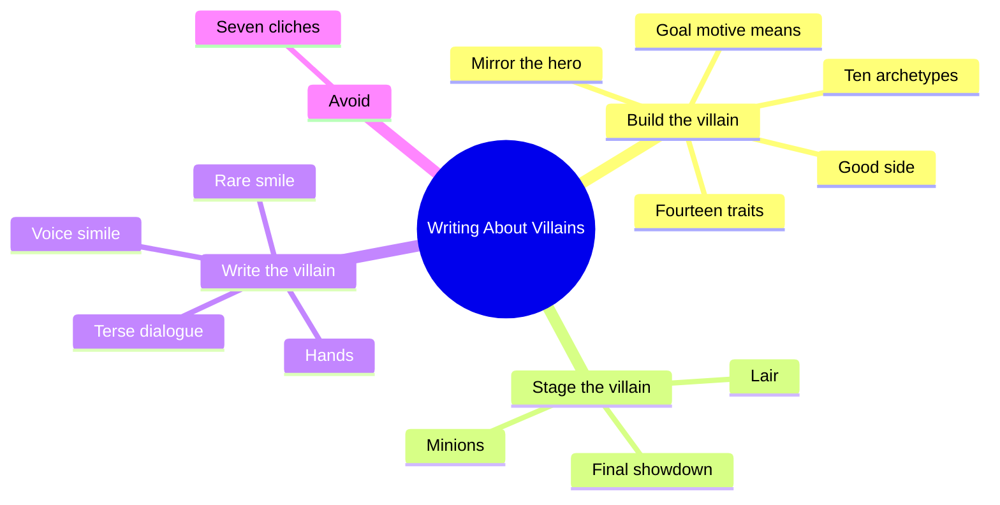
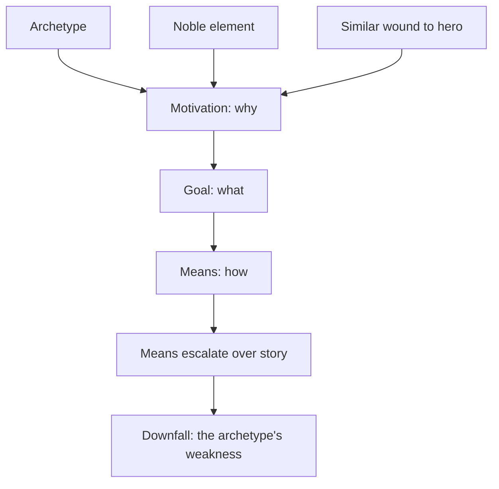
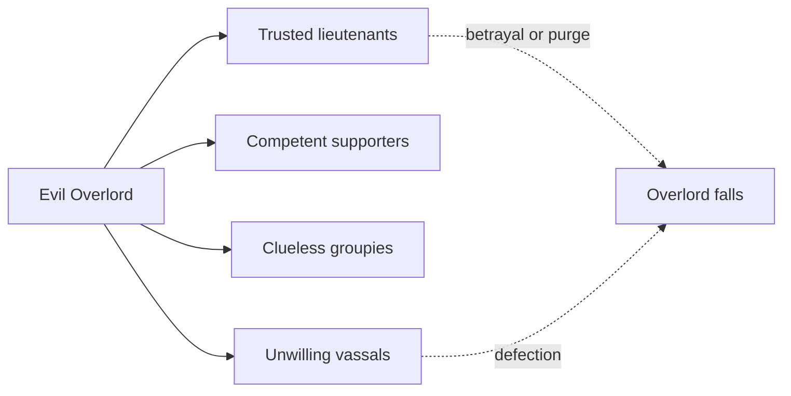

# BVX.0265 — Writing About Villains — Rayne Hall (2013)
### Knowledge Entry — Distill

A short craft manual for building a villain: pick an archetype, fix goal and motive, add a good side, then render the villain on the page with voice, hands and smile. It sits in the library as craft basis for the script editors.

## TABLE OF CONTENTS
- [Core Thesis](#1-core-thesis)
- [Mind Models](#2-mind-models)
- [Framework](#3-framework--structure)
- [Key Concepts](#4-key-concepts)
- [Heuristics](#5-heuristics--decision-rules)
- [Invariants](#6-invariants)
- [Pitfalls](#7-pitfalls--myths)
- [Application](#8-application)
- [Cross-References](#9-cross-references)
- [Provenance](#10-provenance--confidence)

---

## 1 · CORE THESIS

A memorable villain starts from one archetype, found by motivation, and gains depth from a clear goal, a noble or good element, and a likeness to the hero. Then the page work (terse speech, voice, hands, rare smiles) makes the reader feel the danger.

---

## 2 · MIND MODELS

**Diagram 1 — the whole argument.**
Read it as two halves: build the villain (left branches), then stage and write the villain (right branches).

**Diagram 2 — the central mechanism.**
Motivation is the core and everything flows from it, so identify the archetype by motive, not by surface behaviour.

**Diagram 3 — the Overlord's four follower rings.**
Trust falls and coercion rises as you move outward; only the inner two choose him.

---

## 3 · FRAMEWORK / STRUCTURE

The book has sixteen short chapters, each ending in an assignment.

1. **Characterisation (ch. 1-7):** choose an archetype (1), settle overlaps by motivation (2), define goal, motivation, means (3), run the 14-trait profile (4), build hero-villain likeness (5), add a genuine good side (6), mine real-life villains (7).
2. **Staging (ch. 8-10):** the lair as a mirror of the mind (8), the follower structure (9), the final showdown (10).
3. **Prose technique (ch. 11-13):** dialogue and voice, hands, smiles.
4. **Reference (ch. 14-15):** definitions, then seven clichés.
5. **Worked example (ch. 16):** Kirral from *Storm Dancer*, an Obsessed Scientist, shown across several viewpoints.

**The ten archetypes** (motive, fear or weakness):

| Archetype | Motive | Weakness |
|---|---|---|
| Evil Overlord | Power, control | Distrusts followers, purges loyalists |
| Schemer | Ambition | Blind to others' schemes, own trap |
| Obsessed Scientist | Proof, acknowledgement | Hubris |
| Smothering Mother | Control of family | Family turns on her |
| Fanatic | Conviction, often religious | Narrow focus, used by an Overlord |
| Seductress | Security, self-esteem | Self-interest only |
| Sadist | Pleasure, thrill | Fearless, taunts pursuers |
| Confidence Trickster | Greed | Arrogance, fear of poverty |
| Social Reject | Acceptance, vengeance | Emotion clouds judgement |
| Bully | Short-term ego boost | Coward, no loyalty |

---

## 4 · KEY CONCEPTS

1. **Archetype vs stereotype:** the archetype is a timeless model; the stereotype is the same model left undeveloped. Clothe the archetype with values, quirks and habits.
2. **Goal / motivation / means:** what he wants, why he wants it, how he gets it. State goal and motive in short plain sentences and keep them visible.
3. **Escalating means:** the villain may begin with honourable means and slide, step by step, into atrocity (the kidney-transplant mother, the Roman emperors).
4. **Noble element:** a goal or motive the reader approves of, joined to horrific means. Works best for Overlord, Mother, Scientist, Fanatic; poorly for Sadist and Bully.
5. **Fourteen traits:** intelligent, psychologically astute, single-minded, good-looking, popular, trauma survivor, liar, suspicious, hubris, self-centred, ambitious, unscrupulous, enjoys challenge, has a good side. Most, not all, should apply.
6. **Hero-villain likeness:** same goal, motive, position, origin, backstory, or wound. The shared wound is strongest: it shows the villain had a choice.
7. **Genuine good side:** real, shown in action, not faked philanthropy. It blocks the hero (gratitude, disbelief of others) and creates plot.
8. **Lair:** tools, values, projected image, status, security, intimidation, communication, escape route. Each reads as character.
9. **Carrot and stick:** loyalty through generous rewards and small gestures, plus severe punishment for betrayal only.
10. **Sociopath vs psychopath:** sociopath is sane, chooses to ignore right and wrong, looks normal; psychopath is out of touch with reality. The book says these are not clinical definitions.
11. **Voice simile:** compare the villain's voice to something dangerous from the viewpoint character's experience; no dialogue tag needed after it.
12. **Hands and smile:** slow the pace and describe the hands just before cruelty; give a smile a full sentence, and use it rarely.

---

## 5 · HEURISTICS & DECISION RULES

| Situation | Do this | Not this |
|---|---|---|
| Torn between archetypes | Pick by motivation; borrow tactics from others as trim | Blend several archetypes into one hodgepodge |
| Archetype feels stale | Swap gender, or put an unexpected archetype in the role | Abandon the archetype's core drives |
| Villain feels flat | Add a good side and show it in a live scene | Tell the reader he is kind |
| Sympathy needed | Give a wound the hero shares; make the villain choose differently | Let the trauma excuse the choice |
| Writing villain dialogue | Short, tight lines; one catchphrase; let others babble | Long speeches, evil monologue |
| Introducing the villain | Hint danger in a voice simile before the reveal | Announce evil early and loudly |
| Building tension before cruelty | Slow down, describe the hands | Rush the act |
| Handling several villains | Defeat the minor ones first, keep the top villain for the climax | Spend the big villain early |
| Planning the climax | Stack the odds for the villain; raise stakes; force the hero's phobia; use a strange place the villain knows | A fair fight on neutral ground |
| Needing minions | Reward service, retrain failure, punish betrayal | Kill them for every failure |
| Villain must leave the hero alone | Give him a compelling reason to take the risk | Let him walk away from a "dead" hero |
| Using a real person | Blend traits; change gender and name | Expose them recognisably (libel) |

---

## 6 · INVARIANTS

1. Motivation sits at the core; it leads to goal, goal leads to means.
2. A villain needs a clear goal and a strong motive; evil for its own sake is forgettable.
3. Each archetype has a built-in weakness that supplies the downfall.
4. Intelligence makes the adversary worthy; a stupid villain makes a dull story.
5. The best villains are cruel to some and kind to others; behaviour varies with the target.
6. Loyalty bought is sturdier than loyalty forced; forced followers defect at the first safe chance.
7. The rarer the smile and the villain's laughter, the stronger the effect.
8. Archetypes resonate most when kept pure; added tactics are embellishment.

---

## 7 · PITFALLS / MYTHS

- **Evil laughter** ("Mwahahaha"): reads as a joke. Use a cruel smile, or describe the sound.
- **Ugly equals evil:** a Victorian prejudice. Attractive villains get away with more and fit Trickster and Seductress.
- **Hot stinking breath:** overused; describe the actual smell if needed.
- **Punishing minions for failure:** implausible and breeds defection; punish treachery instead.
- **Stupid villain:** only to flatter the hero; the story pays for it.
- **Total evil:** cardboard; the archetype tells you who the villain spares.
- **Leaving the captured hero to die:** an intelligent Overlord, Scientist, Social Reject, Bully or Sadist stays to watch and confirms the death.
- **Naked archetype:** an undeveloped archetype is a stereotype.
- **Smiling too often:** novices smile every character on every page.
- **Villain PoV for a whole novel:** readers tire of the inside of an evil mind; it suits short stories and horror better.
- **Copying the author's sample sentences:** the book asks the reader to write their own.

---

## 8 · APPLICATION

- **Spine level:** TEXTURE. This is craft for rendering and shaping antagonists, not a structure source.
- **12-layer character stack:** none wired (`feeds: []`). The archetype-by-motivation table is a handy sanity check on an antagonist's drive, but the book is craft advice rather than psychology.
- **plot_systems:** not applicable.
- **Setting:** the lair chapter is a quick way to dress a villain's room as characterisation.

The editing agents can use the book as a checklist. When reading an antagonist, ask: which archetype is the core, what is the one-sentence goal and motive, where is the good side shown in action, and what is the weakness that brings the fall? On the page, look for dialogue that is short, a voice or hands description placed before cruelty, smiles that are rare, and a climax weighted toward the villain. Flag any of the seven clichés. Where a story has several antagonists, check whether the Overlord-style top villain is saved for the end and whether his followers are a believable mix of the four groups rather than terrified drones.

The sample prose is one author's genre fantasy taste; treat the technique list (simile, hands, smile) as prompts, not rules.

---

## 9 · CROSS-REFERENCES

| Related entry | Relation |
|---|---|
| [[BVX.0064]] | Cast design: where the antagonist sits among circles of dimension |
| [[BVX.0061]] | Characters and viewpoint: complements the book's short PoV note |

---

## 10 · PROVENANCE & CONFIDENCE

Sourced from the full text of all sixteen chapters (pdftotext, read in four sections); no chapter skipped. The Kirral excerpts in chapter 16 were read but not distilled beyond the techniques they demonstrate. The sociopath/psychopath definitions are the author's own and are flagged by her as non-clinical. Section 8 application notes are inference. Confidence high for content, medium for how well it transfers to the Command's own material.

## META
- Template: BVX-LEARN-v4.0
- Source classification: trade craft manual (self-published ebook)
- Created / Updated: 2026-10-30
