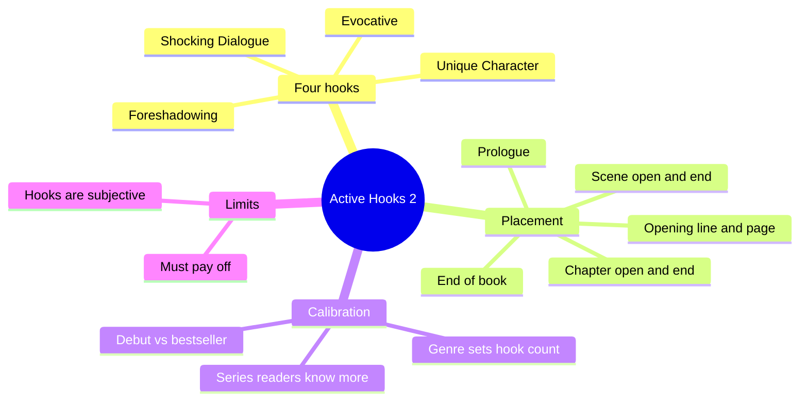
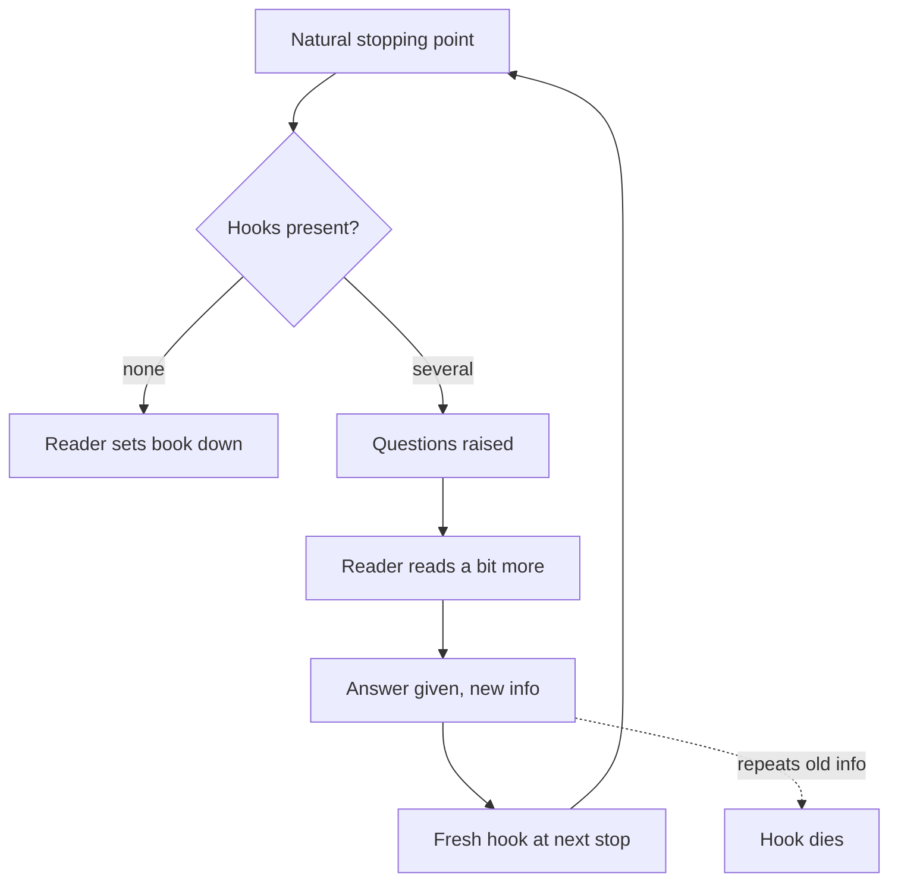

# BVX.0267 — Writing Active Hooks Book 2 — Buckham (2015)
### Knowledge Entry — Distill

A craft manual on four reader-engagement hooks (Unique Character, Evocative, Foreshadowing, Surprising or Shocking Dialogue) and the nine places in a manuscript where hooks pay off. It is in the library as the craft basis for the script editors' opening, scene-end and chapter-end checks.

## TABLE OF CONTENTS
- [Core Thesis](#1-core-thesis)
- [Mind Models](#2-mind-models)
- [Framework](#3-framework--structure)
- [Key Concepts](#4-key-concepts)
- [Heuristics](#5-heuristics--decision-rules)
- [Invariants](#6-invariants)
- [Pitfalls](#7-pitfalls--myths)
- [Application](#8-application)
- [Cross-References](#9-cross-references)
- [Provenance](#10-provenance--confidence)

---

## 1 · CORE THESIS

A hook is a line that raises a question or a reaction in the reader. Stack several at the places where a reader might stop (first line, page end, scene end, chapter end), and match their number to the genre's pace. A hook cannot rescue a weak story.

---

## 2 · MIND MODELS

**Diagram 1 — the whole argument.**
Read off the two halves: four hook types (what), and nine placements (where), both governed by genre pace.



**Diagram 2 — the central mechanism.**
Read off the loop: a stopping point invites exit, hooks raise questions, and the answer must be new information that raises the next question.



**Diagram 3 — hook count against genre pace.**
Read off the scale: more hooks mean more tension, so the right count is set by what the core reader expects, not by maximum.

```mermaid
quadrantChart
    title Hook count by story pace
    x-axis Slow pace --> Fast pace
    y-axis Few hooks --> Many hooks
    quadrant-1 Thriller, action
    quadrant-2 Wrong: too tense for slow
    quadrant-3 Cozy, literary, category romance
    quadrant-4 Wrong: too flat for fast
    Cozy mystery: [0.2, 0.25]
    Literary: [0.25, 0.3]
    Romantic suspense: [0.7, 0.7]
    Thriller: [0.9, 0.9]
```

---

## 3 · FRAMEWORK / STRUCTURE

The book has two sections.

**Section 1, the four hooks.** Each hook gets a definition, annotated openings (often with an invented weak "rough draft" beside the real line), a "no such hook" counter-example, assignments and a recap. These four extend the five from Book 1 (Action/Danger, Overpowering Emotion, Surprising Situation, Totally Unexpected, Question(s) Raised). All nine are counted together when a line is dissected.

**Section 2, placement.** Hooks can sit anywhere, but the book names the spots where a reader can stop:

1. Opening sentence of the book (prologue counts)
2. Opening of the paragraph after the first sentence
3. End of the first paragraph
4. End of the first page (about 225 to 250 words)
5. End of the third page (the editor's usual stopping read)
6. End of the third chapter, or the end of the submitted sample
7. Opening and ending of each chapter
8. Opening and ending of each scene
9. Near the end of the book (series hook or closure)

Seven short parts cover these: opening paragraph and page, prologues, opening a chapter, ending a chapter, scenes, end of book, and common questions.

The method throughout is the same: take a real line, name every hook in it, then show the flat draft that lacks them.

---

## 4 · KEY CONCEPTS

| Concept | What it is | Why it matters |
|---|---|---|
| Hook | Any line that raises a question or reaction in the reader | Gives the reader a reason to read a little more |
| Unique Character | A person the average reader has not met, or not expected in this place or genre | Context decides: a nun is common in a church, unique refereeing mud wrestling |
| Evocative | Strong voice, word painting or a fresh slant that makes the reader slow down | Most subjective hook; readers love it or leave; it usually stands alone |
| Foreshadowing with Warning | A hint that this will matter later, plus a sense of threat | Warning makes it stronger than plain foreshadowing |
| Foreshadowing without Warning | A hint that this matters, with no threat | Fits slower genres such as romance, cozy and gothic |
| Shocking or Surprising Dialogue | Internal or spoken words the reader did not expect from this speaker in this context | Context-bound: "F**k" from a nun shocks, from a biker does not |
| Author intrusion | Narrator announces a future event the character cannot know | Once common; pulls reader out of deep POV; tolerated mostly in an opening line or from bestsellers |
| Hook stacking | Several hooks in one sentence, a different one at each key spot | Hooks are subjective, so a second hook catches readers the first misses |
| New-info rule | Each later hook must reveal something not already told | Restating a known fact gives no new hook |
| Beat build | Two or three short beats build to a final line (door closes, key turns, locked in) | Builds the final hook; telling the same event flattens it |
| Closure vs open end | Stand-alone books end on closure; series books end on an open question | The end-of-book hook sells the next book |

---

## 5 · HEURISTICS & DECISION RULES

| Situation | Do this | Not this |
|---|---|---|
| Rough draft states a plain fact | Revise: add one unexpected detail, a contrast or a stake | Leave a telling line at a stopping point |
| Writing a fast thriller | Aim for 5 to 7 hooks in the opener; short sentences | A long convoluted opener loaded with background |
| Writing cozy, literary or category romance | 2 to 3 hooks suit the pace | Piling on tension the reader did not sign up for |
| Using the Evocative hook | Commit to the voice on page one and keep it through the book; accept it will be the only hook | Tack a poetic line on top of a plain book |
| Unique Character | Take the stereotype and twist it one step | Quirk for its own sake, or a reveal buried mid-paragraph |
| Character already established as unique | Build new hooks from what is known | Re-using the same reveal as a hook |
| Hook count unknown | Study 20 to 30 recent debuts in the target genre | Copy old or bestseller openings; they earn leeway you lack |
| Mid-book chapter after a big ending | Fewer hooks as a breathing space | Same density every chapter |
| Approaching midpoint crisis or climax | More hooks, shorter chapters | Flat chapter endings near turning points |
| Target audience is mixed (e.g. YA mystery history) | Serve every intended market in count and type | Writing only to your own preferred hook |
| Content might repel the core reader (e.g. death in YA) | Come at it obliquely, off-page or as interruption | Shock the reader the genre protects |
| Younger or sensitive core audience | Build empathy first, reveal the unique trait second (Green) | Opening with the heaviest hook |
| Scene end in a long chapter | Treat it as a chapter end | Assuming the reader is committed by page 18 |
| End of a series book | Resolve the plot, leave one relationship or threat open | Tidy wrap-up with nothing pending |
| Foreshadowing used | Pay the question off later, even if it resolves fast | Raise it and drop it |
| Humor | Use only if it is the author's voice | Joke added for its own sake |

---

## 6 · INVARIANTS

1. Every hook works by raising a question or a reaction.
2. Hooks are subjective, so a key spot carries more than one.
3. Whether a hook counts depends on the genre and what the reader knows by then.
4. The natural stopping points stay the same for every genre; only the hook count changes.
5. A hook that repeats known information does not count again.
6. A prologue gets the same care as chapter one.
7. A hook promises; the story has to deliver, or the reader feels cheated.
8. Too many hooks hurt as much as too few.
9. Foreshadowing must be answered later in the story.

---

## 7 · PITFALLS / MYTHS

- Hooks as wallpaper: they cannot hide a weak plot or cliched story.
- "One strong hook is enough": it fails whenever that hook misses the reader.
- "Evocative means long and obscure": it means voice, not obscurity, though it usually runs longer and slows pace.
- Ignoring later chapters: hook work stops after chapter one, and the middle sags.
- Great opening buried: new writers hide the best line deeper on the page; move it to sentence one.
- Telling instead of showing at scene ends: "Now they were locked in with a killer" is flatter than the door-and-key beats.
- Author intrusion as a crutch: it breaks deep POV and signals the narrator survives, lowering tension.
- Misleading the reader for a hook: the unique trait must be true to the story.
- Ignoring the series reader: returning readers weigh a hook differently from new ones.
- Copying a bestseller's rule-breaking: established names get latitude that debuts lack.
- Mismatch of pace: a Le Cordon Bleu meal at a fast-food counter.

---

## 8 · APPLICATION

- **Spine level:** TEXTURE. It is sentence-level and beat-level craft for openings, scene ends and chapter ends, not structure.
- **12-layer character stack:** none. `feeds: []`; the Unique Character hook is a reader-effect tool, not a character-psychology model.
- **plot_systems:** none directly. The turning-point and midpoint guidance (more hooks, shorter chapters near the first turning point, midpoint, climax) is the only structural note.
- **Setting:** the Evocative hook ties to place when setting is inseparable from the plot.

The `.claude/agents/editing-*.md` and `reading-cold.md` editors can use this as a checklist. For each scene end and chapter end, count which of the nine hooks are present, compare to the count the genre allows, and flag any ending that is a plain summary. Check that the first line and the first-page end carry a hook; check that a new reveal, not a repeat, drives each later hook. Check that the openings of the OXO scripts fit the show's intended pace so tone does not outrun the promise. Hook count is a diagnostic, not a target: the book's own rule is to match the genre, so judge against comparable titles. Rewrite tests from the book work well as editor prompts: "state the flat version, then ask what single detail makes it a hook."

---

## 9 · CROSS-REFERENCES

| Related entry | Relation |
|---|---|
| [[BVX.0056]] | Active Setting, same author's craft line; supports the Evocative hook through setting |
| [[BVX.1190]] | Active Setting Book 2, same author; emotion and conflict in setting |
| [[BVX.0121]] | Dialogue craft; complements the Shocking Dialogue hook |
| [[BVX.0084]] | Dialogue techniques; how to write dialogue that surprises |
| [[BVX.0064]] | Character (McKee); character-reveal background for the Unique Character hook |

---

## 10 · PROVENANCE & CONFIDENCE

Sourced from the full pdftotext of the book (154 pages), read in sections: introduction, all four hooks, all seven parts of placement and the bibliography. No chapter was left unread. Examples are the author's choices and several "rough drafts" are invented by the author for contrast; hook counts per line are her judgment, not measured facts. Cross-referenced ids were each checked to exist in KNOWLEDGE_AREAS. Application to OXO is inference, not source claim. Mild OCR damage on accented names; the text file uses a legacy encoding.

## META
- Template: BVX-LEARN-v4.0
- Source classification: craft book (genre fiction, how-to)
- Created / Updated: 2026-10-30 / 2026-10-30
