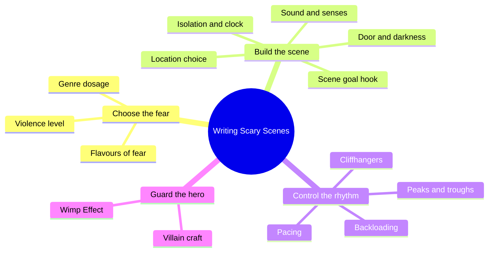
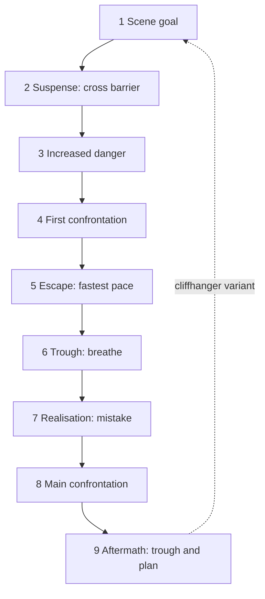
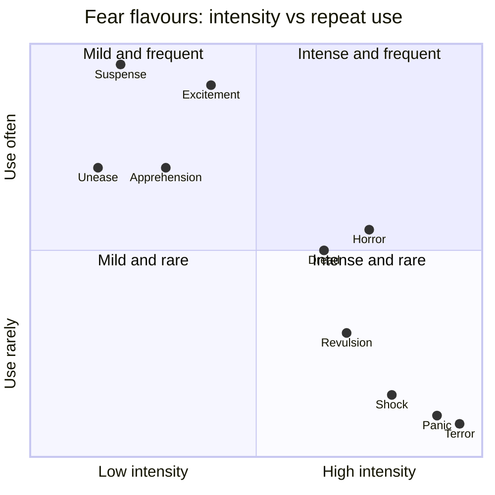

# BVX.0281 — Writing Scary Scenes — Rayne Hall (2014)
### Knowledge Entry — Distill

A practical toolkit of sentence-level and scene-level techniques for producing fear, suspense and dread in fiction; in the library as craft basis for scene editing and cold-read checks.

## TABLE OF CONTENTS
- [Core Thesis](#1-core-thesis)
- [Mind Models](#2-mind-models)
- [Framework](#3-framework--structure)
- [Key Concepts](#4-key-concepts)
- [Heuristics](#5-heuristics--decision-rules)
- [Invariants](#6-invariants)
- [Pitfalls](#7-pitfalls--myths)
- [Application](#8-application)
- [Cross-References](#9-cross-references)
- [Provenance](#10-provenance--confidence)

---

## 1 · CORE THESIS

Fear transfers from a deep-POV character to the reader through physical detail, sound, darkness, isolation and a stated goal under pressure. Each technique is a dial, not a constant: vary intensity, alternate peaks with troughs, and never let the protagonist read as a wimp.

---

## 2 · MIND MODELS

**Diagram 1 — the whole argument.**
Read off the three families: choose the fear, apply the scene-building levers, then police the prose so the hero still reads as brave.

**Diagram 2 — the central mechanism: nine-part scary scene.**
Read off the rhythm: tension climbs in steps, with two short troughs and a long main confrontation near the end.

**Diagram 3 — pace and fear intensity by flavour.**
Read off which flavours are cheap and repeatable (left) versus rationed to once per book (right).

---

## 3 · FRAMEWORK / STRUCTURE

The book has 26 short chapters, each a single technique with the same shape: what it is, how to do it, examples, drawbacks. It groups naturally into five layers.

1. **Choose the emotion (Ch 1, 20, 25).** Pick one or several flavours of fear per scene; set violence and genre dosage to reader expectation.
2. **Hook and aim (Ch 2, 16).** State the scene goal early (want, need, must), add motivation, time limit, obstacles; end on a cliffhanger.
3. **Environment levers (Ch 3 to 8, 14, 15, 18).** Door, darkness, sound, isolation, undressing, ticking clock, location, all senses.
4. **Prose mechanics (Ch 9 to 12, 22).** Visceral showing, short vs long sentences, euphonic sounds, peaks and troughs, backloading.
5. **Whole-story placement (Ch 13, 17, 19, 21, 23, 24, 26).** Nine-part scene shape, villains, chases, humour, openings and endings, black moment and climax, the Wimp Effect.

Chapter 13 is the assembly diagram; the others plug into its nine slots.

---

## 4 · KEY CONCEPTS

| Concept | What it is | Why it matters |
|---|---|---|
| Deep POV transfer | Reader feels what the POV character feels | Scare the character to scare the reader; can also play dramatic irony (reader knows, character doesn't) |
| Flavours of fear | Suspense, unease, anxiety, apprehension, foreboding, excitement, dread, terror, revulsion, shock, panic, horror | Each has its own body signs and its own frequency limit |
| Instant hook | One sentence stating the scene goal, optionally motivation, deadline, obstacles | Cheapest suspense engine; restate in new words mid-scene |
| Door effect | Linger on a threshold before entry; describe the door and the sound of it closing | Reader reads the door as a barrier and screams "don't"; payoff must be real danger |
| Darkness | Remove light, gradually if possible | Shifts weight to hearing, touch, smell, cold |
| Background-sound insertion | An irrelevant noise inserted at a peak moment | Slows pace without lowering tension |
| Total isolation | Remove allies, phones, and anyone who knows her location | Lone prey is scarier; phones are the writer's nuisance |
| Strip to tease | Shedding clothing signals vulnerability | Works when reader senses danger and character does not; ridiculous if repeated |
| Ticking clock | Visible deadline with dire stakes, shown passing repeatedly | Win in the last second; vary clock types across scenes |
| Visceral showing | Fear as body sensation, not named emotion | "Fear prickled her scalp" beats "she was scared" |
| Euphonics | Vowel and consonant clusters tuned to mood (OW/OO foreboding, S spooky, EE acute fear, T/P/K fights, R speed, TR trouble) | Subtle; amplifies, never replaces, other techniques |
| Peaks and troughs | Relief beats between frights | Peaks only read high against troughs |
| Cliffhanger | Scene ends with the goal met but complicated, partly met, or lost | Keeps reader turning; resolve it on stage, not in summary |
| Backloading | Strongest word last in sentence, strongest sentence last in scene | Cheap revision pass |
| Noble villain | Villain with a genuine noble trait shown at the confrontation | Raises hope, which is then dashed |
| Wimp Effect | Prose tics that read as weakness (sigh, shrug, hesitate, try, feel, tears, nervous habits) | Scored with "Wimp Points"; cap about 3 in the scariest scene |

---

## 5 · HEURISTICS & DECISION RULES

| Situation | Do this | Not this |
|---|---|---|
| Opening a scary scene | State the goal (want, need, must) in the first paragraph; vary its placement across scenes | Open every scene identically, or open on extreme terror |
| Protagonist about to enter danger | Slow down at the threshold: door description, sound of opening and closing | Skip the threshold, or use a door where nothing happens behind it |
| Tension peak | Insert one irrelevant background sound | Add more visual description |
| Describing fear | One physical sentence; cluster two or three at the scariest beat | Name the emotion ("he felt frightened") |
| Fast action (fight, chase) | Short words, short sentences, fragments, no description | Long sentences, adverbs, interior thought |
| Waiting, hiding | Longer sentences, several senses, description | Rush it |
| Chase | Write from the fleeing POV; show pursuer by sound; add pursuers one at a time; shift to worse terrain | Describe the pursuer closing in; make her faint or surrender meekly |
| After a scare | Short trough, one paragraph, then the next peak | Non-stop peaks, or long relaxation |
| Choosing sense detail | At least three senses; lean on sound, smell, touch, temperature; use sight sparingly | Sight alone |
| Scene ending | Goal met with a new complication; or POV in peril | Everything resolved cleanly |
| Maximum tension | Cut away to another POV, return later | Resolve the peril in summary |
| Early story | Suspense, unease, foreboding | Terror, panic, shock before reader cares |
| Novel ending | Relief and pay-off; fear residue allowed in horror and thriller | Kill the heroine (novel); anticlimax such as "it was a dream" |
| Gore | Short, graphic, one or two details, innocuous item beside it | A gore-fest; long revulsion |
| Revising for fear | Run a Wimp Point count; backload paragraph ends; swap sight sentences for sound or smell | Rely on adjectives |
| Genre dosage | Romance and cosy: subtle flavours; thriller: dread and terror; horror: all, varied | One intensity for every genre |

---

## 6 · INVARIANTS

1. The reader feels fear through the POV character's body, not through the narrator's labels.
2. Every technique decays with repetition; vary type, placement and intensity.
3. Intense flavours (terror, panic, shock) are rationed to about once per book; mild ones may recur.
4. Tension needs contrast: peaks need troughs, and troughs stay short.
5. Writing pace must match action pace.
6. Raised expectation demands delivery; a door, a clock, a cliffhanger needs a real payoff.
7. A scene needs the character acting (doing something), not only feeling.
8. Genre and expected reader set the allowed intensity and violence.
9. The hero may be frightened but not shown through weakness tics.

---

## 7 · PITFALLS / MYTHS

- Myth: a scary scene must be gory. Gore is a spice; psychological horror works without it.
- Opening on an atrocity: readers feel nothing before they care, and there is nowhere to build.
- Overusing a single device (every scene starts with a door, a goal sentence, a ticking clock).
- Constant darkness or constant terror numbs the reader.
- Clichés: "a shiver ran down her spine", hot stinking villain breath, maniacal laughter, long-nailed male villain, author or painter whose creation comes alive.
- Leaving mobile phones working in a scene meant to be isolated.
- Summarising the escape from a cliffhanger.
- Series-ending cliffhangers can anger readers.
- Anticlimax endings: harmless monster, secretly friendly villain, "only a dream".
- Wimp Effect: sighs, shrugs, deep breaths, hesitation, tears, long thinking, internal dialogue between "parts of him", "tried to", "found himself", "felt", body parts acting alone. Novices can hit twenty points in chapter one.
- Euphonics with the wrong meaning, or too many matching sounds, turns comic.
- Humour forced into scary scenes; it works as a familiar element from earlier placed in the scary context.

---

## 8 · APPLICATION

- **Spine level:** TEXTURE. Scene-level craft and prose rhythm, not plot architecture.
- **12-layer character stack:** none directly. The book touches fear responses and the "noble villain" idea, but treats them as prose technique, so `feeds` stays empty.
- **plot_systems:** minor: the black moment lands about two-thirds in; the climax is the scariest, goriest scene, ideally placed in a dangerous location and forcing the hero to face a phobia.
- **Setting:** location taxonomy (dark, cold, spooky, unfamiliar, familiar, isolated, dangerous, trapped) is reusable when scouting set pieces.

Use as a checklist for the script editors and cold reader. A scene review can ask: Is the goal stated early? Is there a threshold beat? Is there at least one sound at the peak? How many senses? Does the pace shift with the action? Is there a trough after the peak? What flavour of fear is the scene, and was it used recently? How many Wimp Points does the protagonist accrue (cap about 3 in the worst scene, 10 to 15 per book)? Does the scene end on a hook? The book is written for horror, thriller and romantic suspense; for other tones apply the genre-dosage table in Chapter 25 and scale intensity down. Where adult and dark material is involved, its erotica note applies: fear in bondage or dominance play serves the thrill, so stay on suspense and apprehension, not terror or panic.

---

## 9 · CROSS-REFERENCES

| Related entry | Relation |
|---|---|
| [[BVX.0273]] | Deep POV: the mechanism by which fear transfers to the reader |
| [[BVX.0279]] | Emotional-impact techniques; wider palette beyond fear |
| [[BVX.0267]] | Hooks and foreshadowing; companion to the scene-goal and cliffhanger chapters |
| [[BVX.0265]] | Villain craft; extends Chapter 17 |

---

## 10 · PROVENANCE & CONFIDENCE

Sourced from the full pdftotext of the main body: introduction and all 26 chapters (Ch 1 to 26) read in sequence. The three appended sample stories (Druid Stones, Through The Tunnel, Only A Fool) and the closing "Dear Reader" note were not read beyond the first ~70 lines of Druid Stones; they are illustrations, not argument. Chapter 12 is missing from the text's own table of contents but present in the body and read. The author's claims (e.g. about men falling in love in danger, or clothing as protection) are craft opinion, not research. Cross-references verified to exist in KNOWLEDGE_AREAS. Page count and Zotero key from the brief. Confidence high for technique content.

## META
- Template: BVX-LEARN-v4.0
- Source classification: craft handbook (single-author, practitioner)
- Created / Updated: 2026-10-30
