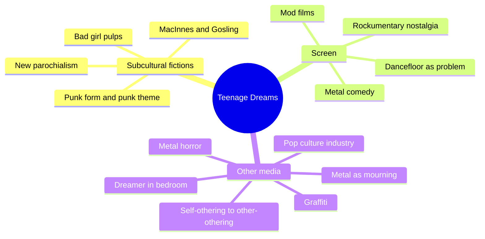
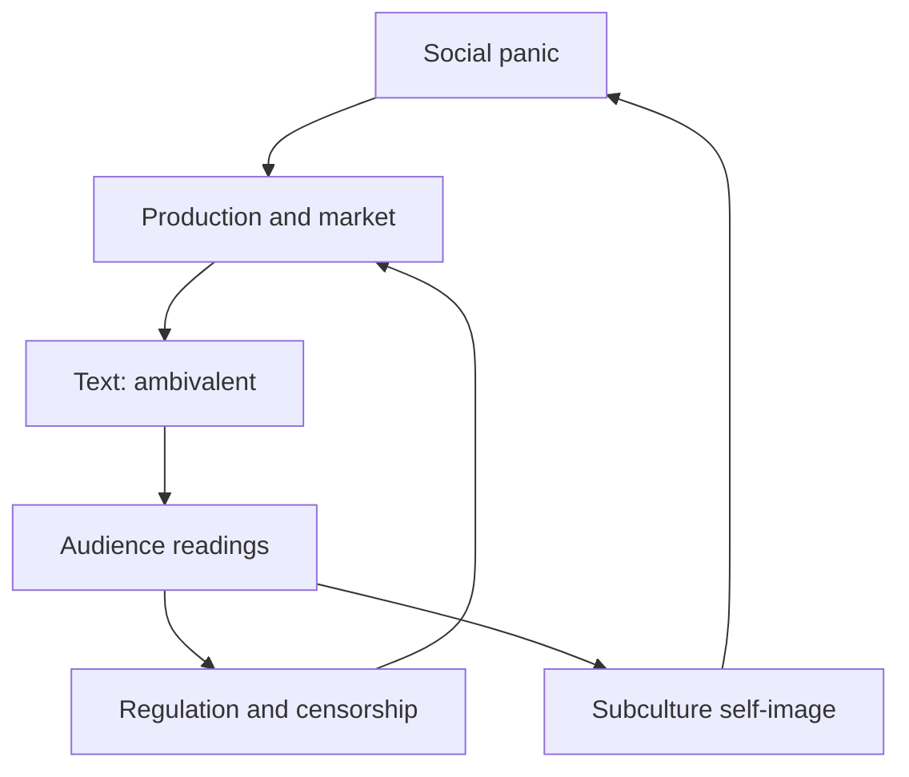
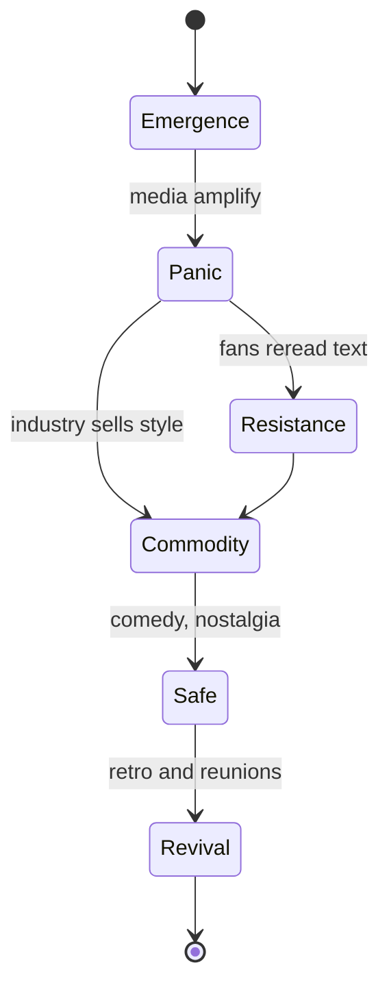
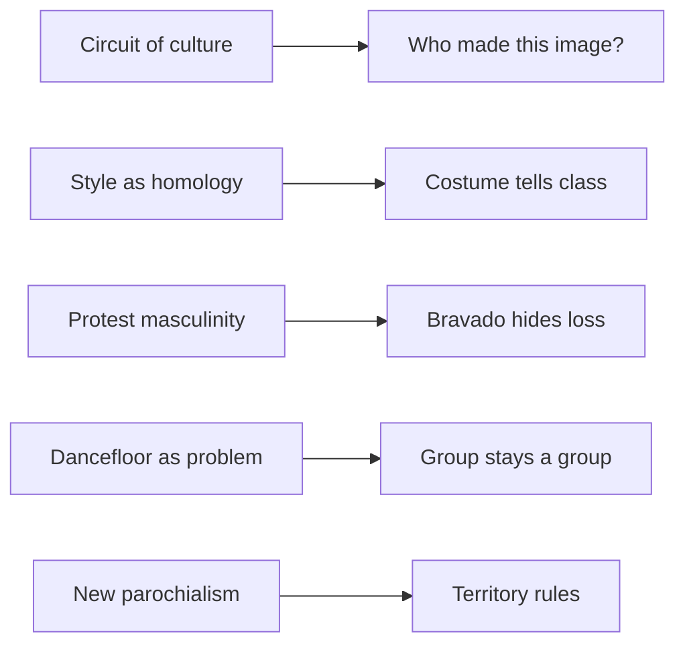

# BVX.0290 — Youth Subcultures in Fiction, Film and Other Media: Teenage Dreams — Bentley, Johnson, Zieleniec (2018)
### Knowledge Entry — Distill

An edited collection of 14 chapters on how fiction, film and other media construct youth subcultures (mods, punks, metalheads, club kids, taggers, black British youth). It is in the library as craft basis for writing and editing teen-subculture stories.

## TABLE OF CONTENTS
- [Core Thesis](#1-core-thesis)
- [Mind Models](#2-mind-models)
- [Framework](#3-framework--structure)
- [Key Concepts](#4-key-concepts)
- [Heuristics](#5-heuristics--decision-rules)
- [Invariants](#6-invariants)
- [Pitfalls](#7-pitfalls--myths)
- [Application](#8-application)
- [Cross-References](#9-cross-references)
- [Provenance](#10-provenance--confidence)

---

## 1 · CORE THESIS

A youth subculture on the page or screen is partly an imaginative construction. Media build it from social panic, market incentive and genre habit, then audiences reread it. Authentic portrayal means showing who made the image, who profits, and which class and place pressures sit behind the style.

---

## 2 · MIND MODELS

**Diagram 1 — the whole argument.**
Three parts (fiction, screen, other media) share one claim: the subculture you see is a made thing, shaped by production, panic and reception.

**Diagram 2 — the central mechanism.**
The circuit of culture: panic feeds product, product reaches audiences who reread it, and the loop pays the market that funds more product.

**Diagram 3 — how a subculture's media life runs.**
Hebdige's cycle appears in several chapters; the book's twist is that fiction speeds up each step and audiences can flip a step.

**Diagram 4 — mapped onto the Command's systems.**
Chapter findings map to editing checks on subculture scenes in OXO.

---

## 3 · FRAMEWORK / STRUCTURE

The book has three parts and a short introduction. The editors state the unifying claim: the narrative construction of subcultures is "in part an imaginative and fictive construction." Theory runs from the Chicago School and the Birmingham CCCS to post-subcultural work (Thornton, Muggleton, Hodkinson). They say identity formation and representation stay central.

| Part | Chapters | Lens |
|---|---|---|
| I Fiction | Osgerby (bad girl pulps); Robinson and Jones (MacInnes, Gosling); Bentley (punk); Ellis (black British writing) | Form of the novel, publishing context, identity and place |
| II Screen | Glynn (mod films); Cheeseman and Forrest (dancefloor); Brown (metal comedy); Johnson (rockumentaries) | Genre labels, narrative device, nostalgia |
| III Other media | Wilson (metal and mourning); Hassan (metal horror); Hyder (Privilege); Zieleniec (graffiti); Croft (dreamer); Hughes (Quadrophenia, Ill Manors) | Psychoanalysis, Frankfurt School, space, class |

The book names one gap: digital and online subcultures. It left them for later work.

---

## 4 · KEY CONCEPTS

| Concept | What it is | Why it matters |
|---|---|---|
| Circuit of culture (Johnson, via Osgerby) | Production, text and reception each change the form and depend on each other | Never explain a youth text by author intent or content alone |
| Moral panic / amplification | Overblown alarm that feeds itself; the 1950s "juvenile crime wave" was partly a change in statistics | Panic is a story engine and a sales engine |
| Youth-sploitation | Pulp and film that preach against delinquency while selling its thrill | The moral frame is a disguise for the appeal |
| Domestic containment | Cold War push to keep women in home roles; psychoanalysis recast girl delinquents as "mad not bad" | Explains why bad-girl heroines get a damaged-home backstory |
| The Boy as queered subject | MacInnes's teen and Gosling's self-made "Dream Boy" blur fact/fiction, class and sexuality | The writer and the model make each other up |
| Punk homology vs diversity | Hebdige saw one consistent style; punk fiction shows many forms, from realism to cut-up | Do not flatten a subculture to one trait list |
| Subcultural capital | Cultural knowledge and objects earn status (Thornton, after Bourdieu) | Outrage earns rank, so shock is a currency |
| Authenticity vs performativity | Charlie in The Buddha of Suburbia switches tribes fast; Karim says they lack the hate and the estates | The outsider's costume is a recurring conflict |
| New parochialism (Ellis, after Bhabha) | Postcode, estate and local myth replace migration history as the identity map | Territory and reputation drive plot and violence |
| Face and Ticket | Mod elite and mass follower | A group has rank; leaders get challenged |
| Dancefloor as narrative problem | British film uses the club to individuate a lead and restore order | Group joy gets subordinated to one person's arc |
| Post-subcultural theory | Styles are a porous menu; individual choice over class resistance | Characters may shop identities, but class still shows |
| Protest masculinity (Connell) | Compensatory outlaw manliness of men with no real power | Reads bravado as a claim made without resources |
| Metal as mourning (Wilson) | Sabbath's sound as grief for working-class culture lost to deindustrialisation | Style can be a grief ritual |
| Culture industry (Adorno, via Hyder) | Standardised pop pacifies the masses | The pop star as tool of control |
| Teenage dreamer / borderline space (Croft) | The youth caught between bedroom and street, fugue-like drifting | Liminal states refuse a clean arc |
| Self-othering vs external-othering (Hughes) | Mod styles itself to differ; Ill Manors youth are othered by outsiders | Who names the group changes what the group is |

---

## 5 · HEURISTICS & DECISION RULES

| Situation | Do this | Not this |
|---|---|---|
| Writing a delinquent or "bad" teen | Give a home, class or market reason and a pull of belonging; leave a reading open | Pure monster, or pure victim |
| A subculture scene must feel real | Choose objects with history: scooters, parkas, black band tees, tags; show how they were altered | A generic leather-and-mohawk costume |
| Showing an outsider joining a tribe | Let a peer question their right (Karim: no estates, no hate) | Instant total conversion with no cost |
| A leader or Face dominates | Plant a challenger early; show the leader's low status elsewhere (Ace Face is a bellboy) | A leader with no job, family or fall |
| Club, gig or party scene | Keep the group alive as a character with its own rules; use the phase arc: going out, coming up, coming down | Using the crowd only as a backdrop for the lead's romance |
| Moral-panic frame in the story | Show who profits from the panic and who is hurt by it | Letting adults' view be the story's view |
| Showing the style as a grief or class signal | Tie the look to work, wages and what was lost | Style as mere rebellion |
| Place-based gang stories | Map the territory (postcodes, estates) and make reputation the currency | Race or origin as the only division |
| Mixing documentary and fiction | Mark the line; let a teller admit invention | Passing invention off as testimony (Gosling's confession cost him) |
| Girls and women in a boys' scene | Give them their own acts, fashion and desires (Steph, Monkey) | A romantic prize with no agency |
| Fan or revival material | Ask what the present needs from the past | Pure nostalgia |

---

## 6 · INVARIANTS

1. Every youth subculture reaches an audience through a medium with its own interests (publisher, studio, label, programmer).
2. Texts about delinquents are ambivalent: they condemn and sell the thrill together.
3. Subculture is a response to a parent culture's problem (Phil Cohen); class pressure sits under the style.
4. Mainstream attention starts dilution; core members move on (the mod "diffusion and defusion").
5. Gender is usually marginal in the first telling, and women in the scene are written back in later.
6. Panic arrives before the evidence.
7. The insider/outsider position of a narrator (MacInnes, Gosling, Kureishi) shapes what counts as authentic.
8. Place binds identity; the map changes between generations.
9. Leaders are challenged.
10. A teen text that ends on failure can still be loved; the young "don't have to be great."

---

## 7 · PITFALLS / MYTHS

- Treating one theory as the whole story: Hebdige's homology, or the CCCS resistance model, explains some cases and not others (Bentley, Brown, Cheeseman and Forrest).
- Reading fiction as social documentary; MacInnes said he made the language up.
- Assuming a panic means a real crisis. The 1950s juvenile crime wave was largely a statistical and policing artefact.
- Believing the dancefloor on screen is free. British film often turns it into a problem to be solved, even when the club is shown as utopian.
- Taking a moral warning at face value; the exploitation film delivers the thrill the warning names.
- Treating a "mainstreamed" subculture as dead; metal stayed subversive even at its peak (Brown).
- Reducing violence to race. Ellis shows reputation and postcode doing the work.
- Authenticity policing: punk was parodic and self-reflexive, so real/fake tests often fail.
- Forgetting female and queer readers who reclaim pulp meant for others (lesbian pulps).
- Mistaking a revival for the original; the documentaries mythologise the recent past.
- Forcing a tidy teen arc; the dreamer wavers and the Bildungsroman fails.

---

## 8 · APPLICATION

- **Spine level:** TEXTURE. It supplies telling detail, costume, scene rules and social pressure, not structure.
- **12-layer character stack:** none wired (`feeds: []`). The book is about representation and media, not character psychology. Chapter 12 (Croft) gives a borderline-state lens that a later pass may wire.
- **plot_systems:** not applicable.
- **Setting:** useful for teen social world texture (turf, rank, wages, ritual objects, media panic). Not a setting source for any one place.

The OXO editors should use this as a checklist for subculture scenes. A scene passes when the group has rank, a shared object-language, a class reason and a place. It also passes when someone outside the group is reading it, and when the viewpoint character cannot be sure they belong. Spoof or satire of the group (metal comedies, Bill and Ted) is allowed to carry real protest underneath. Hughes's shift from self-othering to external-othering is a ready question for a story that runs across eras: who names the group in each era?

This section is the Command's use, kept apart from the book's own claims.

---

## 9 · CROSS-REFERENCES

| Related entry | Relation |
|---|---|
| [[BVX.0064]] | McKee, Character. Pairs with Hughes and Bentley on how to turn a type into a character |

---

## 10 · PROVENANCE & CONFIDENCE

Full-text reading, pdftotext at `_PRIVATE/distill_wave/BVX.0290.txt`. The PDF is not in the repo.

**Read in full:** Introduction; chapters 1 Osgerby, 2 Robinson and Jones, 3 Bentley, 4 Ellis.

**Read in part, opening sections and argument only:** ch5 Glynn (mod films and Quadrophenia, about 520 of 700 lines, the Brighton Rock comparison read to the point where it is cut off); ch6 Cheeseman and Forrest (framework and theory, about 230 lines; the five club-film case studies are unread); ch7 Brown (moral panic, protest masculinity, start of Bill and Ted section, about 230 lines; the film analysis is unread); ch8 Johnson (setup, band histories, openings, genre labels, about 190 lines); ch9 Wilson (Black Sabbath and Leader's four stages, about 190 lines; Bolt Thrower is unread); ch10 Hassan (thesis, exploitation and conventions, about 190 lines; the reception evidence for Trick or Treat is unread); ch11 Hyder (culture industry and Privilege setup, about 190 lines; the film's later plot is unread); ch12 Zieleniec (theory and context, about 140 lines; the photoessay captions are unread); ch13 Croft (Aichhorn section only, about 200 lines; Thrasher and Donnie Darko unread); ch14 Hughes (Quadrophenia half, about 200 lines; the Ill Manors half is unread, so its claims rest on the introduction and the chapter's opening).

Claims about the unread parts rely on chapter openings and the editors' introduction. Confidence is medium for chapters 5 to 14 and high for the first four chapters. Status stays `draft` for that reason.

## META
- Template: BVX-LEARN-v4.0
- Source classification: edited academic collection (secondary scholarship), book
- Created / Updated: 2026-10-30
