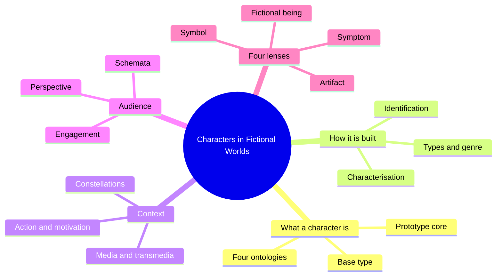
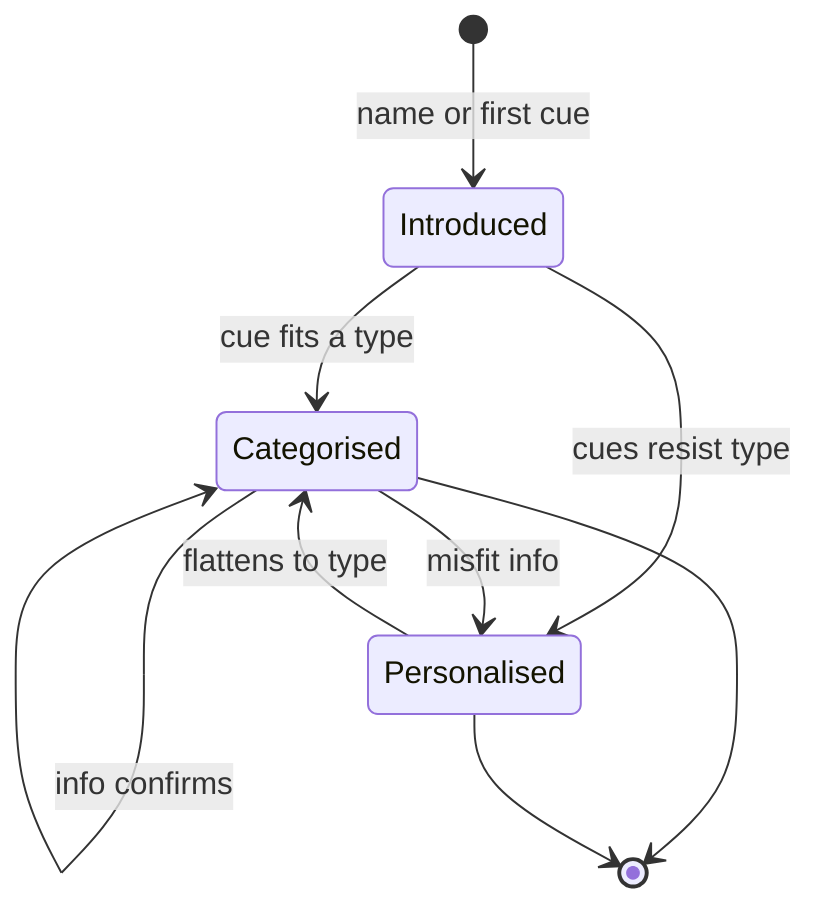
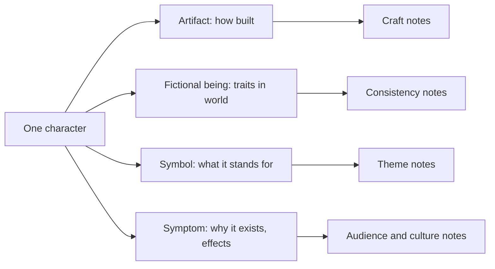
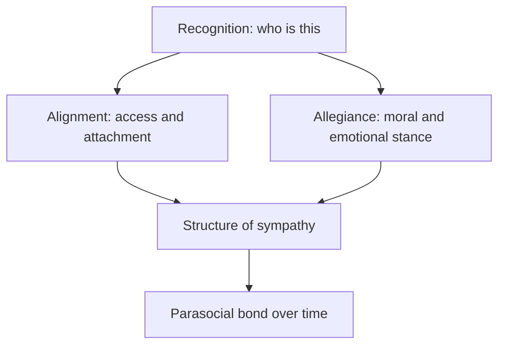

# BVX.0563 — Characters in Fictional Worlds — Eder, Jannidis, Schneider (2010)
### Knowledge Entry — Distill

An edited academic volume (De Gruyter, 22 chapters) that surveys how character works across prose, drama, film, comics, games and fan culture. It is in the library as craft theory for the OXO script editors: what a character is, how an audience builds one, and where that goes wrong.

## TABLE OF CONTENTS
- [Core Thesis](#1-core-thesis)
- [Mind Models](#2-mind-models)
- [Framework](#3-framework--structure)
- [Key Concepts](#4-key-concepts)
- [Heuristics](#5-heuristics--decision-rules)
- [Invariants](#6-invariants)
- [Pitfalls](#7-pitfalls--myths)
- [Application](#8-application)
- [Cross-References](#9-cross-references)
- [Provenance](#10-provenance--confidence)

---

## 1 · CORE THESIS

A character is a recognisable fictional being with a mind, built in the audience's head from sparse text plus stored knowledge of people, types and genres. It is also artifact, symbol and symptom. Good craft controls what the text supplies and which stored schemata it triggers.

---

## 2 · MIND MODELS

**Diagram 1 — the whole argument.**
Read off the introduction's skeleton: what a character is, how it is built, and how audiences respond.

**Diagram 2 — the central mechanism.**
Read off how one character model forms: a type triggers it, and the model either stays a category or becomes a person.

**Diagram 3 — the four lenses on one character.**
Read off that every question about a character belongs to exactly one lens; mixing them produces confused notes.

**Diagram 4 — layers of audience engagement.**
Read off that recognition comes first, and alignment and allegiance are separate dials.

---

## 3 · FRAMEWORK / STRUCTURE

The book has five parts. The introduction (pp. 3-66) is a self-contained primer and carries most of the framework used here.

1. **General topics.** Research survey, ontology of characters, characters and plots.
2. **Characters across media.** Social minds in a novel, dialogue and activity types in drama, poetry, film engagement, paradoxical film characters, stereotypes, pop clips, comics, virtual characters.
3. **Audiences.** Moment-by-moment reading, scenario assumptions, kinds of readerly engagement, empathy, parasocial relations.
4. **Culture and identity.** Multi-protagonist film, ethnic stereotypes, gender.
5. **Transtextual characters.** Identity across works and media; a Cinderella case study.

The introduction's twelve sections run in a useful order: definition and ontology, characters vs people, media specifics, action, constellations, identification, characterisation, types, genre, functions and meanings, audience reactions.

**Four dominant paradigms** the editors name: hermeneutic (character as representation of a human), psychoanalytic (psyche of character and recipient), structuralist-semiotic (character as sign set), cognitive (character as mental construct). The editors favour a cognitive-plus-ontology blend and admit they disagree on whether a character is a mental construct or an abstract object.

---

## 4 · KEY CONCEPTS

| Concept | What it is | Why it matters |
|---|---|---|
| Prototype core | A recognisable fictional being credited with thought and action; other criteria (human, alive, bodied) can fail | Agency plus inner life is the minimum. A thing that cannot act dissolves into setting |
| Base type | Three areas every character has: body, psyche, sociality; each can be static or dynamic | A checklist of what a model needs filled in |
| Ontological incompleteness | Whatever the text does not state is a gap in the world, not a hidden fact | Lady Macbeth's children cannot be answered; do not write as if they can |
| Character schemata | Stored expectations linking two pieces of information (drinks, so drunk) | Writers get inferences free; audiences fill gaps from them |
| Text-internal anthropology | The whole set of person-schemata a text uses or implies | The hidden theory of people in a work; editors can audit it |
| Four lenses | Artifact, fictional being, symbol, symptom (Eder, after Phelan's mimetic/thematic/synthetic) | Keeps craft, consistency, theme and culture questions apart |
| Identification vs characterisation | Introduction and re-identification (name, description, pronoun, face, voice) come before trait ascription | Deferred or false identification is a trick that must be signposted |
| Characterisation | Attaching information to a figure about body, mind, behaviour, relations | Direct vs indirect is a continuum, not a binary |
| Altero- and self-characterisation | What others say about a character vs what the character says | Any statement about X also characterises the speaker; may be unreliable |
| Abduction | Inferring a trait from behaviour plus an assumed rule | Audiences guess; the rule may be wrong, which is how misdirection works |
| Categorisation vs personalisation | Top-down slotting into a type vs bottom-up building an individual model | Categorised models feel complete early; personalised ones draw more emotion and tolerate change |
| Telling names | Names as characterisation devices on a scale from direct to indirect | A direct telling name triggers a top-down model at first mention |
| Character type | A fixed trait gestalt in a cultural milieu (archetype = broad, stereotype = derogatory typing of groups) | Types can be complex and can change, but change in a typical way |
| Constellation | Structure of all relations: importance, contrast, conflict, power, perspective | Meaning comes from comparisons across characters, not single ones |
| Motivation | The interface between character and action | Without a motivated agent the plot has no engine; even surreal work invites motive-hunting |
| Scenario and role slots (Emmott/Sanford) | Settings pre-activate unnamed participants (waiter, clerk); principal vs scenario-dependent characters | Low-prominence roles can be promoted later for a twist |
| Social minds / intermental thought (Palmer) | Thought done by groups, not just inner monologue | Characterisation and consciousness are one job; a mind is partly shared |
| Activity types (Culpeper/McIntyre) | Conventional speech events (interview, dinner) with inference schemata | Dialogue characterises by how it uses or violates the event's norms |
| Mimetic hypothesis (Smith) | We treat characters as person-analogues without being committed to it | Allows both emotional response and awareness of artifice |
| Alignment and allegiance (Smith) | Alignment = spatial attachment and subjective access; allegiance = moral/emotional stance | Separate dials; "identification" lumps them together |
| Perspective (Gaut, Eder) | Four aspects: perceptual, epistemic, evaluative, affective; each can match or differ between audience and character | Closeness is made of several adjustable parts |
| Parasocial relationship (Giles) | One-way felt intimacy with a media figure | Explains fan behaviour; extra-textual facts get absorbed into the "person" |
| Transtextual identity (Richardson) | Same name does not guarantee same character; illusory variants exist | Sequels, retcons and reboots need an identity rule |
| Maximal vs sub-maximal character (Reicher) | Expert's detailed model vs ordinary audience's core | Identity across media rests on the core traits |

---

## 5 · HEURISTICS & DECISION RULES

| Situation | Do this | Not this |
|---|---|---|
| Judging whether a thing is a character | Check agency and inner life; recognisable as an individual | Require human shape, speech or a body |
| Note about a trait the text never states | Ask whether the audience can be expected to fill it, and whether the story cares | Treat it as a hidden fact the writer must settle |
| Introducing a character | Give a stable referent (name, face, voice, costume piece) at once and keep it | Switch labels mid-scene without a cue |
| Wanting a quick, legible character | Use a type or telling name to trigger a top-down model | Pile on traits that never cohere |
| Wanting emotional depth and change | Spread information over time, include items that resist the type | Front-load the whole profile |
| Surprise or reveal | Plant a scenario-dependent minor role, keep it low prominence, then promote it | Introduce the reveal character with no earlier slot |
| Characterising by dialogue | Check what the speaker reveals about the speaker, and the event's norms | Take altero-characterisation as the author's verdict |
| Reading a cast | Compare pairs (parallels, foils) and who shares scenes, but also count relations never shown together | Count screen time alone |
| Reader sympathy is off | Separate the dials: access, moral stance, recognition | Say "make him more relatable" |
| A type looks stereotyped | Check the whole cast for individualised members of the group and who gets the protagonist slot | Judge one character in isolation |
| Continuing or rebooting a character | Keep the core traits and diegetic facts, or declare a new character | Reuse the name with incompatible traits and no explanation |
| Same character in a new medium | Keep fictional-being and symbol properties; allow artifact properties to change | Port media-specific devices (interior monologue, game function) unchanged |
| Judging genre fit | Name the genre schema, then measure the deviation | Treat deviation as an error by default |

---

## 6 · INVARIANTS

1. A character needs the ability to think or act, or it collapses into setting or prop.
2. What the medium does not supply is a gap in the fictional world, not a concealed fact.
3. Audiences always infer; they use social knowledge, media knowledge and genre knowledge together.
4. Every character exists on four planes at once: artifact, fictional being, symbol, symptom.
5. A character belongs to a constellation; meaning arises from relations and contrasts.
6. Motivation links character to action; action-only analysis misses what the audience attends to.
7. Characterisation is graded from direct to indirect, never a clean binary.
8. Categorised models complete early; individualised models need diffuse or resistant information.
9. Types may be complex and may change; their defining mark is agreement with established schemata, not simplicity.
10. Stereotype evocation is cheap and works on small cues, so an audience's cultural knowledge decides what a text says.
11. Identity across texts depends on shared core traits and authority over the original.

---

## 7 · PITFALLS / MYTHS

- "Identification" is not one thing; recognition, alignment and allegiance differ, and audiences engage with unlike characters.
- "Types are flat and static" is false; Moliere's imaginary invalid is typed and detailed.
- "Action is character" (Aristotle, Propp, Greimas) fails: characters can exist without action, but not the reverse; features independent of action drive empathy and theme.
- Character-as-human-shape is too narrow; Lassie, robots, aliens, plants qualify.
- Over-asking questions of fiction: counting Lady Macbeth's children, or reading historical text with later psychology (anachronism).
- A modern audience may read a historical stereotype differently from the original one; check the historical constellation.
- Equating screen-time with importance (Romeo and Juliet share few scenes).
- Reading a character's remarks about another as fact; the speaker has aims.
- Treating a same-name sequel or fan rewrite as automatically the same character; another author's later account does not alter the original.
- Assuming a pure text-based or pure audience-based account of a character; the characters exist in interaction (Culpeper/McIntyre), and the text can only pre-focus reactions.
- Assuming a universal emotional script; some situations are near universal (a child's suffering), but most are culture and period bound.

---

## 8 · APPLICATION

- **Spine level:** TEXTURE. This is telling-craft, not story structure.
- **12-layer character stack:** none wired (`feeds: []`). The book is about how an audience builds a character, not character psychology. The base type (body, psyche, sociality) loosely echoes the stack but should not be treated as a mapping.
- **plot_systems:** Hogan's chapter ties plot prototypes (romantic, heroic, sacrificial) to character goals; the introduction's actant models (Propp, Greimas) and mention of Dramatica fit there.
- **Setting:** scenario theory (Emmott et al.) shows that settings arrive with pre-installed role slots.

For the OXO script editors the book gives a vocabulary for notes. A note can name its lens (a craft note is not a consistency note). It can name the dial being adjusted (recognition, alignment, allegiance). It can check whether a character is meant to stay categorised or become personalised, and whether the information schedule serves that. It supplies tests for reveals (scenario slots), for dialogue (who is characterised, speaker or subject), for casts (the constellation, including relations only remembered), for stereotype risk (who gets the protagonist slot and who is individualised), and for returning characters across the Outliers material (core traits kept, or declared a new character).

For a cold reader (`reading-cold.md`), the gap rule helps: record what the page actually states and treat the rest as the reader's own filling, not as the story's facts. For long-running continuity the transtextual rule applies: same name with incompatible traits and no explanation is an illusory variant, not growth.

---

## 9 · CROSS-REFERENCES

| Related entry | Relation |
|---|---|
| [[BVX.0064]] | McKee's cast map and dimensions: craft-side counterpart to constellation and characterisation theory here |
| [[BVX.0061]] | Characters and viewpoint: craft treatment of perspective and focalisation |
| [[BVX.0089]] | Dramatica: the introduction cites it as one actant-style role model |
| [[BVX.0057]] | Archetypes and heroic journeys: practitioner version of the types and monomyth material |

---

## 10 · PROVENANCE & CONFIDENCE

Sourced from the extracted full text, read partially. **Read in full:** the Introduction (Eder/Jannidis/Schneider, pp. 3-52 of 66; the final pages on affect and lasting effects were not read), which supplies §3 to §7. **Read in part (opening 150-230 lines, roughly the first 8 to 15 pages):** Hogan (characters and plots), Palmer (social minds), Culpeper/McIntyre (activity types), Smith (engaging characters), Gerrig (moment-by-moment), Emmott/Sanford/Alexander (scenarios), Giles (parasocial), Richardson (transtextual).

**Unread, named per the coverage rule:** Heidbrink (research survey), Reicher (ontology; her maximal/sub-maximal point is taken from the introduction's footnote only), Winko (poetry), Riis (paradoxical film characters), Schweinitz (stereotypes in film), Huck/Kiefer/Schinko (pop clips), Aldama (comics), van Vugt/Hoorn/Konijn (virtual space), Margolin, Mellmann, Trohler (multiple protagonists), Florack (ethnic stereotypes), Gymnich (gender), Wunderlich (Cinderella), and the bibliography. Remainders of the read chapters were also not covered. Status is therefore `draft`, confidence medium. Chapter-specific claims (Gerrig on trait inferences, Giles, Richardson) are limited to what the opening pages state. The source text is an OCR extraction with encoding damage; quotes were checked against the readable lines only.

## META
- Template: BVX-LEARN-v4.0
- Source classification: edited academic volume, theory (full text, partial)
- Created / Updated: 2026-10-30 / 2026-10-30
