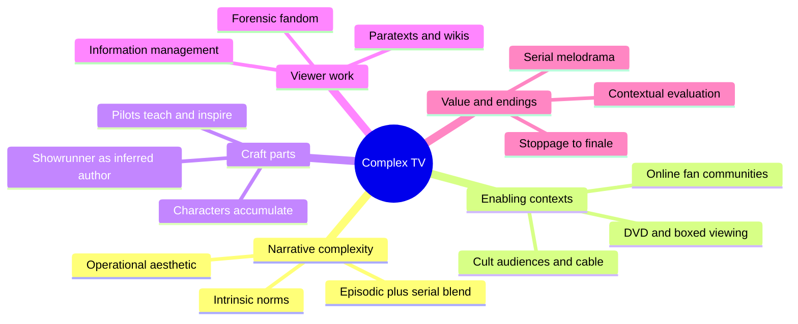
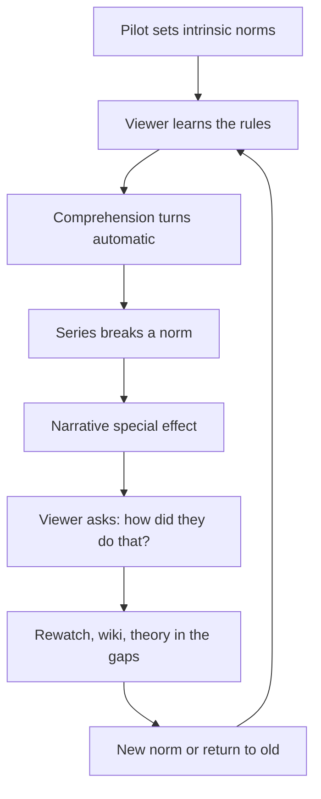
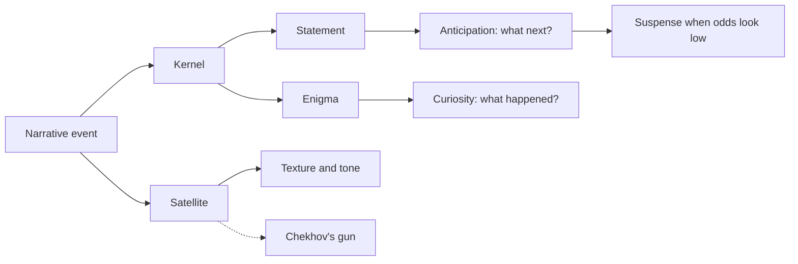

# BVX.0565 — Complex TV: The Poetics of Contemporary Television Storytelling — Jason Mittell (2015)
### Knowledge Entry — Distill

A media-studies book on how serial television tells stories and how viewers read them. It is in the library as craft basis for the OXO script editors: pilots, serial memory, character stability, information management and endings.

## TABLE OF CONTENTS
- [Core Thesis](#1-core-thesis)
- [Mind Models](#2-mind-models)
- [Framework](#3-framework--structure)
- [Key Concepts](#4-key-concepts)
- [Heuristics](#5-heuristics--decision-rules)
- [Invariants](#6-invariants)
- [Pitfalls](#7-pitfalls--myths)
- [Application](#8-application)
- [Cross-References](#9-cross-references)
- [Provenance](#10-provenance--confidence)

---

## 1 · CORE THESIS

Since the 1990s, television has developed its own storytelling mode, narrative complexity: episodic closure blends with serial accumulation, and viewers are invited to enjoy how the story is built as well as what happens. It is a form specific to TV, shaped by industry, technology and viewing habits, and should not be judged as "novelistic" or "cinematic".

---

## 2 · MIND MODELS

**Diagram 1 — the whole argument.**
Read it as one claim with nine probes: complexity is a mode, and each chapter examines one working part of it.

**Diagram 2 — the central mechanism.**
Read it as a loop: a series teaches its own rules, then earns its best pleasures by bending them.

**Diagram 3 — event types and the questions they raise.**
Read it as a sorting rule: every event is a kernel or satellite, and a kernel is either a statement or an enigma.

---

## 3 · FRAMEWORK / STRUCTURE

**Method: historical, cognitive and reader-oriented poetics.** The guiding question is "how does this text work?", not "what does it mean?". Form is read alongside industry, technology and reception. Mittell's own corpus is mostly The Wire, Breaking Bad and Lost, with Veronica Mars, The Sopranos, Buffy, Battlestar Galactica and others as supporting cases.

**The four serial variables.** A serial is built from storyworld, characters, events and temporality. Each can be serialized or not. Nearly every show serializes world and characters. Only some serialize events, meaning that what happened stays happened. Seriality is therefore a dial, not a switch.

**Three clocks.** Story time is how time passes inside the world. Discourse time is the order and duration of telling, so flashbacks and ellipses live here. Screen time is the viewer's actual time. The gaps between installments are what define serial form.

**The ten chapters, one function each.**

| Ch. | Topic | Function |
|---|---|---|
| 1 | Complexity in context | Defines the mode, the enabling conditions, the operational aesthetic |
| 2 | Beginnings | Pilot as tutorial plus invitation |
| 3 | Authorship | Showrunner and the inferred author function |
| 4 | Characters | Recognition, alignment, allegiance; accumulation over development |
| 5 | Comprehension | Knowledge management, memory, suspense, curiosity, spoilers |
| 6 | Evaluation | A series sets its own terms; evaluation as persuasion |
| 7 | Serial melodrama | Emotional appeal separated from soap form |
| 8 | Orienting paratexts | Wikis, guides, forensic fandom, drillability |
| 9 | Transmedia | Extensions, canon, audience segmentation |
| 10 | Ends | Spectrum of endings; metafiction; criticism's own ends |

**The ending spectrum.** Stoppage (abrupt, unplanned), wrap-up (season-end, planned unity, no finality), conclusion (final episode known), cessation (limbo), resurrection (return later or in another medium), finale (conclusion plus hype).

---

## 4 · KEY CONCEPTS

| Concept | What it is | Why it matters |
|---|---|---|
| Narrative complexity | A mode where episodic and serial forms mix and a series accumulates rather than resetting | The book's unit of analysis; defined by unconventionality |
| Operational aesthetic | Pleasure in "how did they do that?" alongside "what happens?" (from Neil Harris on Barnum) | Lets viewers care and admire the craft at once |
| Narrative special effect | A moment that flexes storytelling to amaze, like the one-shot year jump in Battlestar | Spectacle for narrative, built on established norms |
| Intrinsic vs extrinsic norms | Intrinsic = rules a series sets for itself; extrinsic = medium and genre habits | Surprise needs a norm to break |
| Kernel / satellite | Plot-critical event vs texture event (Chatman) | Serial viewers hunt for satellites that turn into kernels |
| Narrative statement vs enigma | A clear event raising only "what next" vs one raising what, who, why or whether | Most serials run on statements; enigma-only shows tend to fail |
| Curiosity, anticipation, suspense | Backward gap, forward guess, forward guess with low odds | Different engines; suspense is the narrow case |
| Pilot as educator and inspirer | The pilot teaches how to watch and makes viewers want to | Defines the first-act brief of any serial |
| Recognition, alignment, allegiance | Murray Smith's three steps of character engagement | Replaces vague "identification" |
| Attachment | Whose experience the story follows; a series spreads it across an ensemble | A scheduling choice and an intrinsic norm (Lost "centric" episodes) |
| Character accumulation | Characters gain history and traits without much moral change | Stability serves premise; real change is rare and shows as shifted allegiance |
| Parasocial relationship | Ongoing one-way bond with a character | Holds viewers across gaps; legitimate, not pathology |
| Boxed vs serial aesthetic | Binge viewing favors unity; weekly viewing favors gaps and group theorizing | Each gains and loses something |
| Paratexts | Wikis, recaps, interviews, in-character blogs | Part of the text as lived, not extras |
| Forensic fandom / drillability | Close, collective investigation of a text; text built for digging | Shows can be dense and still be followed |
| Vast vs dense seriality | Extent of world and cast vs depth of detail (named in the front matter) | Two ways to be complex |
| Stoppage to finale | Spectrum of endings | Planning for an end is a design choice, not an accident |

---

## 5 · HEURISTICS & DECISION RULES

| Situation | Do this | Not this |
|---|---|---|
| Writing or judging a pilot | Show the form in the first minutes: tone, narrator, time rules, ensemble | Spend the opening on setup that does not teach how to watch |
| Setting a continuity rule | Show characters remember and the set carries scars; viewers will then expect strictness | Say "you're not supposed to think about that" after teaching close attention |
| Planting a payoff | Hang a satellite early that later becomes a kernel; keep the gap honest | Plant a mystery with no answer planned |
| Building suspense | Make the bad outcome probable inside the world | Rely on stakes the cast's safety already cancels |
| Serial with a mythology | Alternate arc and one-offs that still touch the arc | Let one-offs contradict the mythology (X-Files decline) |
| Surprise | Establish a norm for several episodes, then break it with a reason | Break rules in episode one, before there is a rule |
| Killing a lead-tier character | Weigh credits, contracts and the viewer's safety assumption; kill second tier for stakes | Expect a first-season lead death to land without backlash |
| Showing a character change | Cue it through repeated exterior markers; actions outweigh dialogue | State it in a line ("I've changed") with no behavior |
| Elevating a background figure | Commit to the arc or play it as an overt joke | Half-promote them and then ignore them |
| Mixing tones | Tell the viewer what voice to expect early | Pair a realist style with absurd plots and pretend they match (the 24 problem) |
| Ending | Pick a mode from the ending spectrum early; give "curtain calls" to the people and places | Defer all answers into a final act that asks for faith |
| Writing for mixed viewers | Write for novice, erratic and comprehensive viewers at once | Assume everyone saw the last episode |

---

## 6 · INVARIANTS

1. A serial is defined by its gaps; gaps are where theory, memory and desire work.
2. Nearly every series keeps world and characters serialized; event serialization is the variable.
3. Viewers infer interior states from exterior markers; screens have no adverbs.
4. Continuity expectations are set by the series itself, via how much characters and sets remember.
5. A norm must exist before it can be broken.
6. Main characters are treated as safe; stakes come from second tier or from odds inside the world.
7. Most TV characters accumulate and deepen more than they transform.
8. Industry facts (contracts, credits, actor availability, schedules) shape the story and cannot be ignored.
9. An ending is never neutral: stoppage, wrap-up, conclusion and finale differ in planning and in how a story must close.
10. Evaluation is persuasion, and a text sets its own terms for success.

---

## 7 · PITFALLS / MYTHS

- "Television is simple and formulaic." The most conventional of the 2001 spy trio failed; the innovative ones lasted.
- Calling complex TV "novelistic" or "cinematic" hides what is specific to TV.
- Equating serialized with mystery-driven. Enigma-only shows (Reunion, FlashForward, The Event) failed; forward-moving statements carry most serials.
- The Sopranos is not highly serialized; The Wire is nearly all serial. Episodic and serial are a spectrum.
- "Identification" as the model of character bond is too crude.
- Character growth as the default pleasure; the usual one is accumulation.
- Promising answers to every enigma and then leaning on faith or theme in the end.
- The "one third carryover audience" figure is industry folklore, not measured.
- Treating the broadcast schedule as arbitrary; it is productive, giving time to theorize.
- Treating evaluation as off-limits or as proof; it is argument.

---

## 8 · APPLICATION

- **Spine level:** L4 and L5 (pilot function, arcs, midpoint structure of seasons) and L6 (endings and wrap-ups); TEXTURE for tone, satellites and intrinsic norms.
- **12-layer character stack:** none wired. `feeds: []`. The Characters chapter (alignment, allegiance, accumulation) is craft, not a psychology layer.
- **plot_systems:** season shape (the Wire model of season-long plot vs the Sopranos model of discrete stories under theme); big-bad arcs; centric episodes.
- **Setting:** storyworld persistence and "settings have memories" bear on DCUS continuity and the era structure.

This is the craft basis for the OXO script editors and `reading-cold.md`. Use it as a checklist, not as doctrine:

1. **Pilot test.** Does the pilot teach the rules (time, voice, ensemble, tone) and hook? A cold reader should be able to state the intrinsic norms after one episode.
2. **Continuity test.** Does the script's world remember events at the level it taught? If characters discuss powers or rules, readers will police them.
3. **Information audit.** Mark each event as kernel or satellite and as statement or enigma. Too many unresolved enigmas without a plan is the documented failure mode.
4. **Safety test.** If the stakes depend on a lead's peril, say what makes the outcome uncertain beyond plot armor.
5. **Allegiance check.** If a character's moral core shifts, the shift must show in exterior markers over time; plan it, because it changes who the reader sides with.
6. **Ending plan.** Name the intended ending type for each arc, season and series, so editors can judge the middle against it. The "infinite middle" is the commercial default; the Command's fabula-first rule favors planned conclusions.
7. **Paratext readiness.** Wikis and guides are part of how a dense series survives; a dense OXO bible is a feature, not an apology.

Caveat: the book describes American commercial television, weekly and seasonal. OXO's format, release model and length may differ. Treat the industry chapters as context, not as constraints.

---

## 9 · CROSS-REFERENCES

| Related entry | Relation |
|---|---|
| [[BVX.0064]] | McKee on character; compare dimensions and true character with Mittell's accumulation and exterior markers |

---

## 10 · PROVENANCE & CONFIDENCE

- Read in full from the pdftotext file: front matter and Introduction; Chapter 1 (most); Chapter 2 opening (pilot function and cases); Chapter 4 (character contexts, recognition, alignment, allegiance, change); Chapter 5 opening through curiosity and suspense; Chapter 6 opening and the Alias/24 comparison; Chapter 10 (ending spectrum, metastorytelling, curtain calls).
- Taken from Mittell's own chapter previews in the Introduction only, not read in the body: Chapter 3 (authorship), the rest of Chapter 6 (complexity as value), Chapter 7 (melodrama), Chapter 8 (paratexts, drillability), Chapter 9 (transmedia), the Breaking Bad antihero case, the Lost and Sopranos finale sections.
- "Vast vs dense seriality" is from the acknowledgments' article list; its definition here is inference.
- Confidence is medium: strong on §3 framework and §5 heuristics for the chapters read; thinner on authorship, melodrama, transmedia.

## META
- Template: BVX-LEARN-v4.0
- Source classification: book, media studies / narratology
- Created / Updated: 2026-10-30
