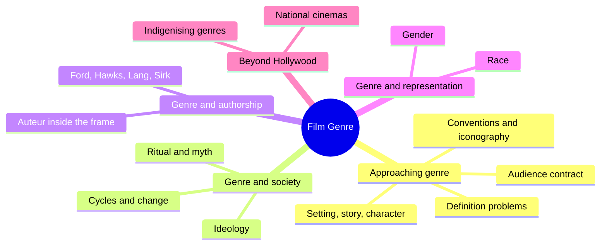
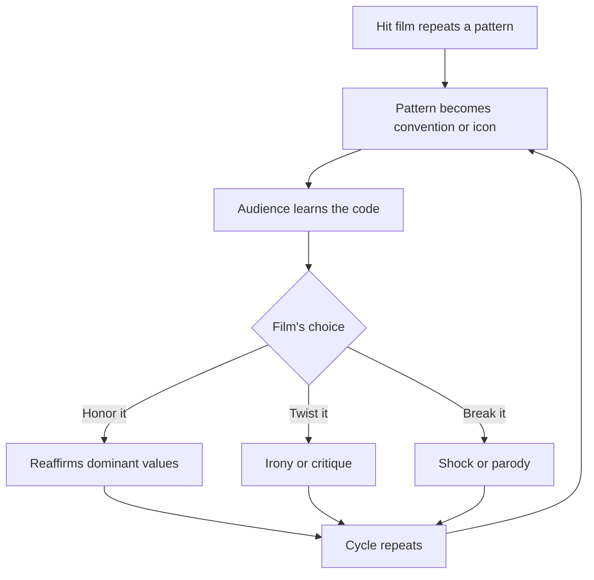
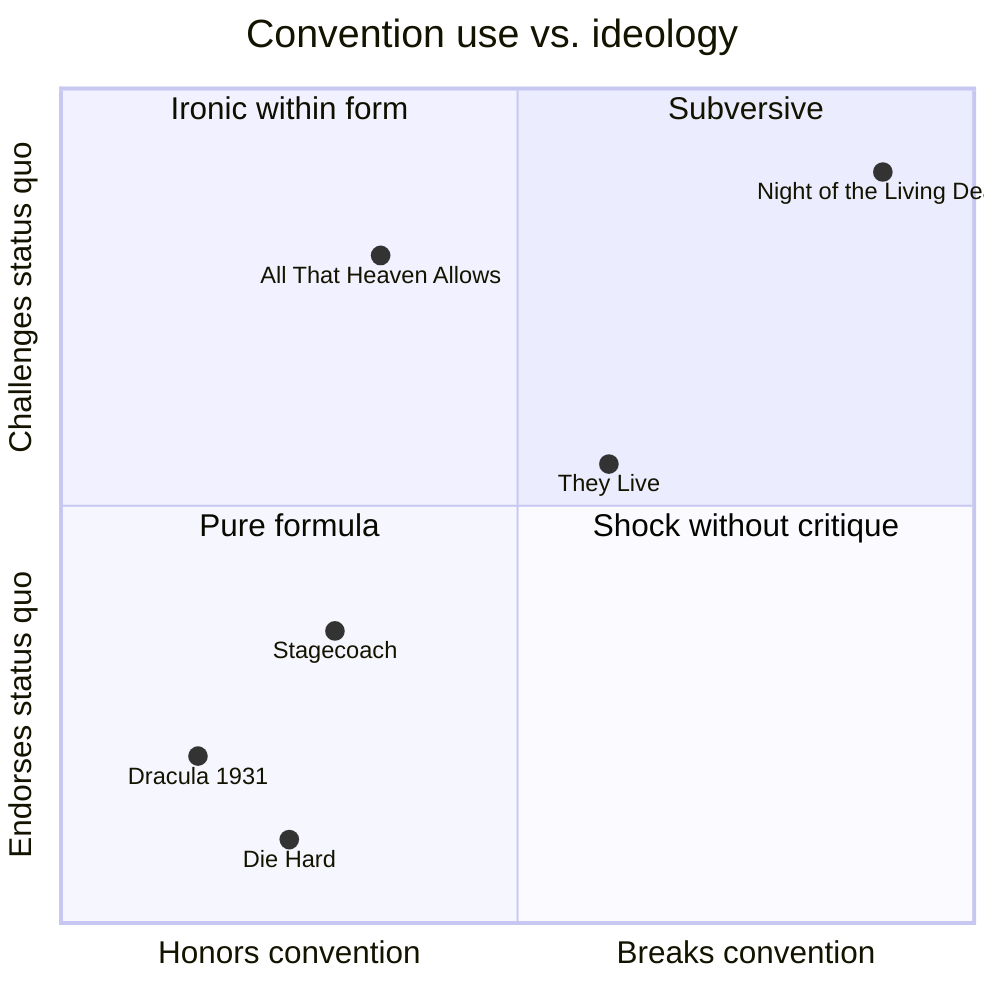

# BVX.0577 — Film Genre: From Iconography to Ideology — Barry Keith Grant (2007)
### Knowledge Entry — Distill

A short Wallflower "Short Cuts" primer on how genre films work (conventions, icons, audience contract), what they say about their culture, how authors work inside them, and how they represent gender and race. It is in the library as craft basis for the OXO script editors: it explains why a convention carries meaning and what it means to bend one.

## TABLE OF CONTENTS
- [Core Thesis](#1-core-thesis)
- [Mind Models](#2-mind-models)
- [Framework](#3-framework--structure)
- [Key Concepts](#4-key-concepts)
- [Heuristics](#5-heuristics--decision-rules)
- [Invariants](#6-invariants)
- [Pitfalls](#7-pitfalls--myths)
- [Application](#8-application)
- [Cross-References](#9-cross-references)
- [Provenance](#10-provenance--confidence)

---

## 1 · CORE THESIS

Genre films tell familiar stories through repetition and variation, and that familiarity is what makes them carry meaning. Conventions and icons are a shared shorthand between maker and audience. How a film handles them, by endorsing, bending or breaking them, shows its ideology and its author.

---

## 2 · MIND MODELS

**Diagram 1 — the whole argument.**
The book runs from what genre is (ch.1), to what it says about society (ch.2), to who shapes it (ch.3), to who it includes (ch.4), to where it travels (conclusion).

**Diagram 2 — the central mechanism.**
Read the loop: a convention becomes a shared sign, the audience learns it, and that learning is what lets a later film hit, twist or break it for effect.

**Diagram 3 — the phases and the ideological stance, side by side.**
A film's stance toward its own genre (rows) is a different question from its place in the genre's life (columns); do not read one as the other.

---

## 3 · FRAMEWORK / STRUCTURE

**Tom Ryall's three levels** (cited in the intro): the generic system (genres against each other and the industry), individual genres (their shared elements), individual films (read within their genre).

**Seven elements of a genre film** (ch.1):
1. Conventions: repeated techniques and devices, from lines of dialogue to musical styles, lighting and credit fonts.
2. Iconography: objects, costumes, character types and even actors that carry meaning from earlier films.
3. Setting: place and time, which define some genres (the western) more than others (the musical).
4. Stories and themes: a hero, a disequilibrium, closure, a romance subplot.
5. Characters: flat types that work by shorthand.
6. Actors and stars: persona that adds to or clashes with the type.
7. Viewers: genre needs an audience that knows the code.

**The book's chapter spine:** approach (what genre is) then society (what genre means) then authorship (who bends it) then representation (who it leaves out) then nation (where else it lives). Each chapter ends in case studies: noir, musical, horror, Ford, Hawks, Lang, Sirk, Die Hard, Blue Steel, Do the Right Thing, Little Big Man and Posse.

---

## 4 · KEY CONCEPTS

| Concept | What it is | Why it matters |
|---|---|---|
| Convention | A repeated technique or device, an implied deal between maker and audience to accept an artifice | Makes parody and violation possible; the deal only works in context |
| Iconography | Second-order symbols whose meaning comes from prior films (Panofsky via Alloway) | Fast visual shorthand; the *treatment* of an icon shows the film's attitude |
| Inner and outer form (Buscombe) | Outer = objects; inner = themes | Same icon (the town) can mean stability, vice or violence |
| Semantic and syntactic (Altman) | Building blocks vs. the structure they are arranged into | Explains why the western survived by moving into science fiction |
| Determinate vs. indeterminate space (Schatz) | Arena of physical conflict (western, gangster) vs. conflict coded in a romance (musical, melodrama) | Different genres resolve social threat differently: eradication vs. courtship |
| Flat and round characters (Forster) | One-idea types vs. layered people | Flat types are efficient in genre, not automatically a flaw |
| Propp's functions; Frye's modes | Repeating character acts; hero scale from myth to irony | Lets you classify a hero and the kind of story he gets |
| Typage | Casting by look so the audience reads role at a glance (Eisenstein) | Star and genre reinforce each other; casting against type hits harder |
| Empiricist dilemma (Tudor) | To define a genre you need its films; to pick the films you need the definition | Genre is "what we collectively believe it to be" |
| Body genres (Williams) | Horror, melodrama and porn judged by the body's response | Different genres are defined by different criteria |
| Hybridity | Genres were always mixed (Staiger, Neale) | Purity is a myth; Stagecoach was "Grand Hotel on wheels" |
| Cycle vs. subgenre | A short intense run of similar films (the Speed runaway-vehicle films) | Explains sudden waves and their collapse |
| Myth as ideology (Barthes) | Myth turns history into nature; proverbs; the Other made monstrous or exotic | The genre film presents a culture's view as the natural order |
| Return of the repressed (Wood) | The monster is what a culture denies and projects outward | The normal/monster relation sets a horror film's politics |
| Comolli and Narboni category a and e | Film that merely conducts ideology vs. film whose style and content pull apart | Gives a test for whether a genre film critiques itself |
| Closure | Tidy resolution is artificial; its absence or irony is political | Reading the ending is reading the stance |
| Auteur inside genre | Personality shows as tension between director and material (Sarris) | Style is read against the background of icons |
| Signifying (Gates) | Revising a dominant text from a marginal position | How Do the Right Thing and Posse work |
| Indigenising | Reworking a Hollywood genre for local concerns | How other nations keep identity inside the genre system |

---

## 5 · HEURISTICS & DECISION RULES

| Situation | Do this | Not this |
|---|---|---|
| Reading a scene full of genre icons | Ask what *this* film does with the icon (the town, the crucifix, the horse) | Assume the icon has one fixed meaning |
| Judging a hero or villain | Check how much of the type is shorthand and where the film adds a detail (Stagecoach's silver cup) | Mark flat types as flawed on sight |
| Reading an ending | Ask whether closure is full, ironic, or withheld, and what that says about the film's politics | Treat a happy ending as endorsement automatically |
| Judging a film's politics | Compare what it says (content) with how it says it (style, casting, music) | Judge on plot summary alone |
| Reading an old genre film | Ask what moment of the *making* it addresses, not the time it is set in | Read a western as about the 1880s |
| Separating categorising from evaluating | Describe the genre pattern first, then judge | Use "classic" as both a period term and praise |
| Starting a parody or a violation | Be sure the audience knows the convention; set it up, then turn it | Subvert a convention the viewer was never taught |
| Casting | Use type for shorthand; cast against type when you want shock (Fonda in Once Upon a Time in the West) | Cast against type with no setup |
| Setting a story | Weigh whether setting is a genre rule; consider moving the story to a familiar contemporary place for fear (Rosemary's Baby) | Default to the exotic location |
| Writing the Other | Check who the threat is and what the film fears behind it | Make the Other monstrous or exotic without noticing |
| Giving a role to a woman or minority character | Rework the structure, the gaze and the stakes (Ballad of Little Jo) | Drop them into a role built for a white male hero (the Thelma & Louise "gimmick" trap) |
| Lifting a plot from another genre or country | Translate the *code*, not just the plot (samurai to western) | Copy surface icons only |

---

## 6 · INVARIANTS

1. Genre films are always about the time and place they are made, whatever era they depict.
2. A genre exists only through audience recognition; "genre is what we collectively believe it to be."
3. Repetition with variation is the base mechanism; pure repetition and pure novelty both fail.
4. Icons and conventions are shorthand, and shorthand is how the form keeps pace and economy.
5. Heroes embody a culture's virtues; villains embody its fears.
6. Genre stories mostly dramatise the individual against society, or desire against restraint.
7. Genres change by cycles and overlap, not by a clean line of evolution.
8. Parody needs a literate audience; shock needs an expected pattern.
9. The ending's closure (or refusal) carries political meaning.
10. Hybrid mixing is the norm, not the exception.

---

## 7 · PITFALLS / MYTHS

- "Genre equals popular, art cinema equals non-genre." Art cinema is itself a genre (Bordwell); Godard, Truffaut and Chabrol all worked in genre.
- "Genres evolve toward sophistication." Gallagher finds cycles, and parody of the western predates the "intellectual" phase.
- "Genre purity once existed" (Collins's 1980s hybridisation). Staiger: only sincere attempts to find order were pure.
- "Classic" confuses a period with a value; "genre fixity" treats a historical norm as permanent.
- The empiricist circle: picking the films that fit a definition drawn from those films.
- Treating genre films as pure ideology machines (Frankfurt School): the same convention enables irony and appropriation. "Conventionality is the very paradoxical reason for its creativity" (Bourget).
- Equating flat character with failure.
- Over-reading the auteur (Chabrol's thinner plot, more director) or killing the author wholesale; both overshoot.
- Genre-swapping as a progressive fix: plugging women or minorities into male-hero roles repeats the same values.
- Letting the genre swallow the critique, as in They Live, which attacks escapist media and ends as escapist action.
- Treating noir as a fixed genre or a mere style; the book argues the question is open and the return after 1974 suggests it is a durable tradition.
- Taking the Hollywood system for the whole of genre; Williams: "we need to get out of the United States."

---

## 8 · APPLICATION

- **Spine level:** TEXTURE. The book does not teach plot structure; it teaches how recognisable forms, signs and endings feel and what they signify.
- **12-layer character stack:** none directly. The flat/round, Propp function, Frye mode and typage tools could inform casting and type design, but `feeds: []` stays since this is not character psychology.
- **plot_systems:** none.
- **Setting:** genre setting as thematic weight (landscape as objective correlative, the town as civilisation, contemporary buildings making the future unnerving).

**For the script editors (`editing-*.md`, `reading-cold.md`).** Use it as a lens for notes: (a) name the genre contract the pages have made with the reader, then check whether the next scene honors, twists or breaks it, and on purpose; (b) ask what each recurring prop, location or costume has come to *mean* and whether the pages treat it consistently; (c) read the ending's closure and ask what it claims about the world; (d) flag flat-type shorthand as acceptable when it is efficient and a problem when it carries a stereotype (the Other made monstrous or exotic, women as lure or helper); (e) when a story borrows a scene from a classic (Star Wars from The Searchers), check that the borrowing earns its meaning in the new context. Cold readers can also use the three-way test for a work's politics: content, style and casting, and whether they agree.

---

## 9 · CROSS-REFERENCES

| Related entry | Relation |
|---|---|
| [[BVX.0576]] | Film Genre for the Screenwriter; the same topic from the writing side |
| [[BVX.0580]] | Genre and Hollywood; the industrial and theory counterpart |
| [[BVX.0581]] | Genre: history, theory, research; wider theory of genre |
| [[BVX.0049]] | Action Story: the Primal Genre; deepens the action genre and the masculinity discussion here |
| [[BVX.0064]] | Character (McKee); flat and round types against dimensional casting |
| [[BVX.0057]] | A Writer's Guide to Characterization; archetypes echo Propp and Frye here |
| [[BVX.0056]] | Active Setting; setting as thematic weight |

---

## 10 · PROVENANCE & CONFIDENCE

Source: the full pdftotext body, read in sections: introduction, chapters 1 to 4 (including every case study), the conclusion, and the filmography. The bibliography was only sampled, not read. No chapter is unread. Pages: the text covers the printed book (about 118 pages) inside a 142-page PDF.

Extraction is from full text. §5 and §7 turn the author's argument into rules and so contain inference, marked by phrasing like "check" and "ask". The Application paragraph (script editors) is inference, not source. The text is OCR with some noise (names, dates); film facts quoted follow the book, not external checking. The book is a survey: most theory is relayed from named critics (Altman, Schatz, Wood, Barthes, Staiger, Sarris), so confidence in attribution is high but in originality is not the point.

## META
- Template: BVX-LEARN-v4.0
- Source classification: book, academic primer (film studies, genre theory)
- Created / Updated: 2026-10-30 / 2026-10-30
