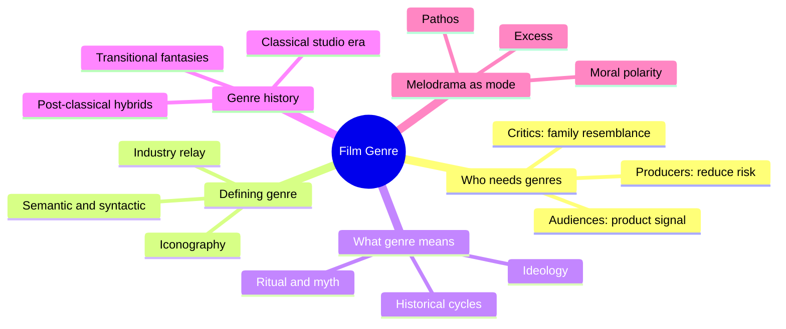
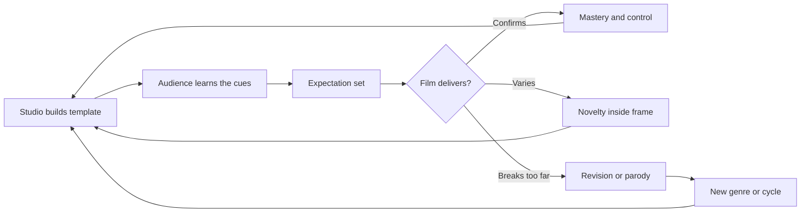
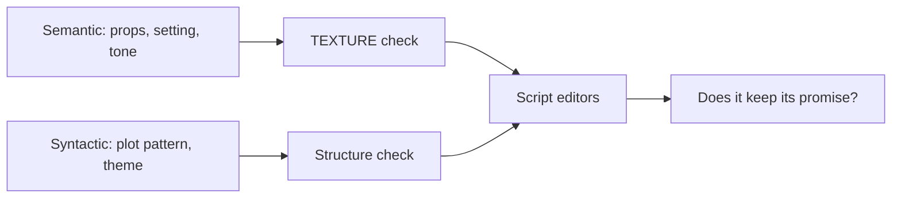

# BVX.0578 — Film Genre: Hollywood and Beyond — Barry Langford (2005)
### Knowledge Entry — Distill

A university-press survey of how film genre is defined, used and theorised, chapter by chapter across the major Hollywood genres. It is in the library as craft basis for the script editors: what a genre promises an audience, and how that promise can be bent.

## TABLE OF CONTENTS
- [Core Thesis](#1-core-thesis)
- [Mind Models](#2-mind-models)
- [Framework](#3-framework--structure)
- [Key Concepts](#4-key-concepts)
- [Heuristics](#5-heuristics--decision-rules)
- [Invariants](#6-invariants)
- [Pitfalls](#7-pitfalls--myths)
- [Application](#8-application)
- [Cross-References](#9-cross-references)
- [Provenance](#10-provenance--confidence)

---

## 1 · CORE THESIS

Genre is a process, not a fixed list: producers, audiences, critics and marketers keep remaking the categories. It works as a contract of familiarity plus variation. Use it as a provisional tool; every genre has blurry edges, and the genre film outlasts the genre system.

---

## 2 · MIND MODELS

**Diagram 1 — the whole argument.**
Read off the three jobs genre does (industry, audience, critic) and the three ways critics have explained it.

**Diagram 2 — the central mechanism: the generic contract.**
Read off that pleasure comes from tension between the expected and the new, and that the audience is an active party.

**Diagram 3 — Altman's two axes, mapped onto the Command's editing work.**
Read off that the semantic layer is cheap surface and the syntactic layer is where the story's meaning sits.

---

## 3 · FRAMEWORK / STRUCTURE

The book is built as a pair of sections around a core argument.

- **Preface and Chapter 1, "Who Needs Genres?"** Sets the theory. Covers uses of genre, problems of definition, problems of meaning (ritual, myth, ideology), problems of history (evolution models and their critics).
- **Chapter 2, "Before Genre: Melodrama."** Treats melodrama as a mode that sits under and across genres, not one genre.
- **Part 1, Classical Paradigms.** Western, Musical, War/Combat Film, Gangster Film (Chs 3 to 6).
- **Part 2, Transitional Fantasies.** Horror, Science Fiction (Chs 7, 8).
- **Part 3, Post-Classical Genres.** Film noir, the Action Blockbuster, "Genre: Breaking the Frame" (documentary, Holocaust film, pornography), and a conclusion on "transgenre" (Chs 9 to 12).
- **Every chapter** pairs a genre history with the critical approaches it has drawn, ends with a short case study of one or two films, and a closing note on non-Hollywood versions.

The three-part sorting is stated as a heuristic, not a definition.

---

## 4 · KEY CONCEPTS

| Concept | What it is | Why it matters |
|---|---|---|
| Generic contract | Audience pays for familiarity leavened by novelty (Pye's "narrow enough to recognise, wide enough for variation"). | Explains why repetition pleases and how much variation a genre tolerates. |
| Circularity (Tudor) | To list a genre's traits you must first pick its films, but you pick them by the traits. | Warns that every genre definition is provisional. |
| Iconography | Visual conventions (settings, costume, props) that mark a genre. | Fast genre signal; strong for Westerns and gangster films, weak elsewhere. |
| Semantic and syntactic (Altman) | Semantic = the "words" a genre uses; syntactic = how they are arranged into meaningful plots. | Separates surface kit from structure; the same props can serve different syntax. |
| Verisimilitude | Each genre has its own rules of what counts as plausible. | Musicals, SF and the Western each set their own "unmarked" realities. |
| Industry relay | Trade press, promotion and criticism that circulate genre terms. | Genre history is also the history of a word and its shifting boundaries. |
| Ritual and myth | Genres as repeated cultural conversation that works through social tensions. | Supports reading cycles as responses to their time; weak on real audiences. |
| Ideological criticism | Genre as a closed system of conformity. | Over-reductive; cannot explain why genres turn critical (1970s). |
| Evolutionary model | Genre moves from transparent to self-aware to parodic (Cawelti, Schatz). | Handy but teleological; early films were often already self-conscious. |
| Revisionism | A genre scrutinised for what it still says about the world. | Often driven by outside events (Vietnam), not by an internal life cycle. |
| Cycles and local genres | Short, topical waves (Klinger's teen delinquent films). | In the post-studio era, cycles matter more than long-lived genres. |
| Melodrama as mode | Pathos, moral polarity, sensation, overwrought emotion, non-classical plot (Singer's five factors). | Explains why melodramatic features turn up in Westerns, gangster films and action. |
| Excess | Over-stated emotion, colour, music or coincidence. | Read either as a symptom of repression or as melodrama's own native register. |
| Integrated vs non-integrated musical | Songs that advance plot or character vs. songs as self-standing spectacle. | Shows that integration and spectacle alternate; neither "wins". |
| Noir as critical construct | A term made by French critics, then adopted by the industry. | Example of criticism creating a genre; also mood, style, or genre. |
| Transgenre / genre film | Individual films that work with generic tradition after the system ended. | The practical case today: allusion and hybrid, not a stable system. |

---

## 5 · HEURISTICS & DECISION RULES

| Situation | Do this | Not this |
|---|---|---|
| Naming a script's genre | Ask what the audience is promised and which cues signal it | Force the script into one pure label |
| Judging a script against genre | Check both semantic kit and syntactic pattern | Count props and call it done |
| A beat feels "cliché" | Ask whether it is a contract element the audience wants, and whether it carries a variation | Cut every familiar beat as a reflex |
| Reading a hybrid | Identify which genre supplies the plot pattern and which the surface | Treat the mix as a flaw by default |
| A script is emotionally heavy and morally black-and-white | Test it as melodrama: does pathos come from helplessness within a fixed order? | Dismiss it as unrealistic |
| Evaluating a "subversive" take | Check how much of the convention it bends vs. breaks (Berliner: revisionist films mostly bend) | Credit any deviation as depth |
| Claiming a genre "means" something about society | Look at many films across a time, and cite outside events | Read one film as a one-to-one mirror |
| Judging audience reaction | Mark it as unknown unless there is evidence | Assume a uniform audience |
| Comparing to the canon | Remember canons favour the prestige, the complex, the auteur-friendly | Treat the canon as the whole genre |
| Setting up a payoff | Deliver the promised climax of the genre (showdown, number, scare) | Withhold the climax with no replacement pleasure |

---

## 6 · INVARIANTS

1. Every text is placed by genre expectation to be readable; none belongs wholly to one genre (Derrida's law of genre, as the book frames it).
2. Genre pleasure rests on repetition plus variation, never one alone.
3. Genre categories are made and remade by industry, audiences and critics; none is fixed.
4. A genre's boundaries are drawn by usage, so the corpus and the definition shift together.
5. Each genre has its own verisimilitude; "realism" is a separate norm, not the default.
6. Cycles and hybrids are normal, not a postmodern novelty; genres mixed even in the studio era.
7. Melodrama's pathos comes from the gap between moral clarity and the power to change things.
8. Audience response to a genre is rarely known; claims about it are inference.
9. Genre change tracks industrial and social events as much as internal evolution.

---

## 7 · PITFALLS / MYTHS

- **"Classical genres were pure."** Mixing is old: western musicals, horror-westerns, and more appear well before the 1990s.
- **"Genres follow a life cycle."** The evolution model is neat but teleological, and early films were often self-aware too.
- **"The canon is the genre."** Most Westerns were B and series films, mostly ignored by critics; the canon is a small postwar sample.
- **"Genre box office proves audience values."** A ticket is not assent.
- **"Genre means conformity."** Pure ideology critique cannot explain 1970s revisionism.
- **"Melodrama equals women's weepie."** The industry used the term for action and crime too; the gendered sense is a critical construction.
- **"Melodramatic excess is a flaw or a symptom."** It can be the form's native way of showing moral stakes.
- **"Auteur beats genre."** Auteurism treated genre as a thing to transcend and so ignored what the genre does.
- **"Integration is the highest musical form."** That is a preference, not a rule.
- **"More genre reference means more history."** Allusion today often points only to other post-classical films.

---

## 8 · APPLICATION

- **Spine level:** TEXTURE. The book describes how stories are labelled and received, not story structure levels.
- **12-layer character stack:** none; `feeds: []`.
- **plot_systems:** none.
- **Setting:** none.

For the OXO script editors (`editing-*` agents and `reading-cold`) the useful parts are the contract model (section 4), the semantic/syntactic split (section 5), and the pitfalls on purity and canon. Used as an editor's test, the question is not "is this a pure genre piece" but "which cues set expectation, which does the draft keep, which does it bend, and does the bend carry meaning".

The melodrama chapter is the closest fit to OXO's register. A high-school ensemble with moral stakes, pathos and heightened reversals reads as melodramatic mode; the editors can use Singer's five factors (pathos, overwrought emotion, moral polarisation, non-classical structure, sensationalism) as a checklist rather than a verdict. The same list guards against dismissing emotional excess as a flaw.

The hybrid note is also practical. A superpowered-school story will mix genres; the book supports naming which genre gives the plot pattern and which gives the surface, then checking each promise is paid off. Treat all of this as craft vocabulary, separate from the book's own extraction.

---

## 9 · CROSS-REFERENCES

| Related entry | Relation |
|---|---|
| [[BVX.0580]] | Genre and Hollywood, a companion genre-theory text |
| [[BVX.0581]] | Genre: introduction to history, theory and research, overlapping definition debates |
| [[BVX.0191]] | The Anatomy of Genres, a writer-facing genre taxonomy to set against Langford's critical view |
| [[BVX.0175]] | McKee's Story, genre conventions as craft |

---

## 10 · PROVENANCE & CONFIDENCE

Source: pdftotext of the full book; OCR is poor (garbled characters), which slowed reading. Sourced from full text, with read-through limits:

- **Read in full or near full:** Preface, Chapter 1 (Who Needs Genres), Chapter 2 melodrama (about 85 percent: stage origins, silent melodrama, realism and excess, start of the woman's film).
- **Read in part (opening pages, roughly 7 to 15 pages each):** Ch 3 Western, Ch 4 Musical, Ch 7 Horror, Ch 9 Film Noir, Ch 12 Conclusion.
- **Not read:** Ch 5 War/Combat Film, Ch 6 Gangster Film, Ch 8 Science Fiction, Ch 10 Action Blockbuster, Ch 11 Genre: Breaking the Frame (documentary, Holocaust film, pornography), the case studies in all chapters, and the "beyond Hollywood" sections. Entries on these genres are inferred only from chapter openings and cross-mentions elsewhere in the book, so the table above makes no claim on them.

Confidence: medium on Chapters 1 and 2 material, low on any specific genre chapter. Status is draft because of the unread chapters.

## META
- Template: BVX-LEARN-v4.0
- Source classification: book, full-text distill, partial coverage
- Created / Updated: 2026-10-30
