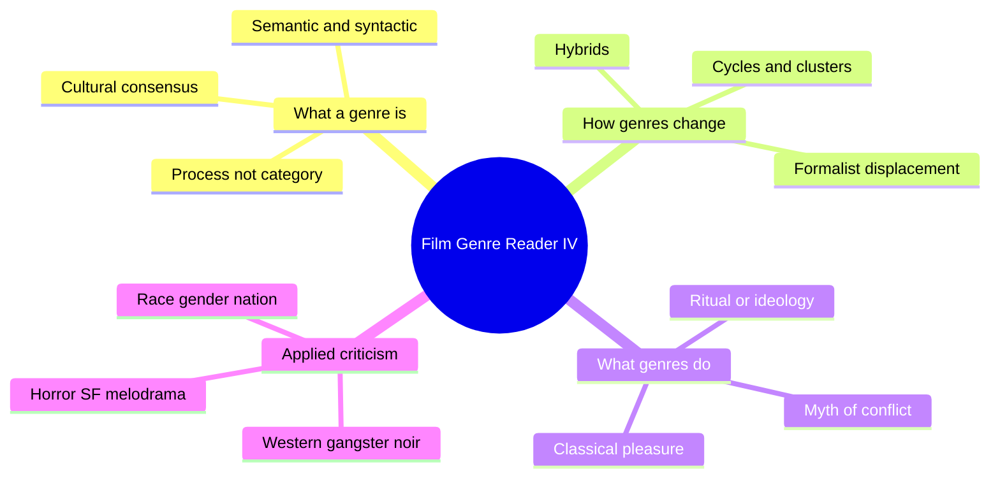
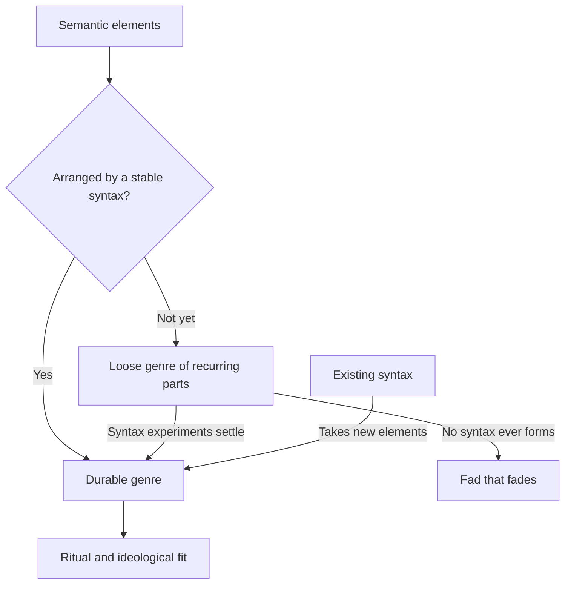
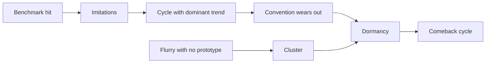
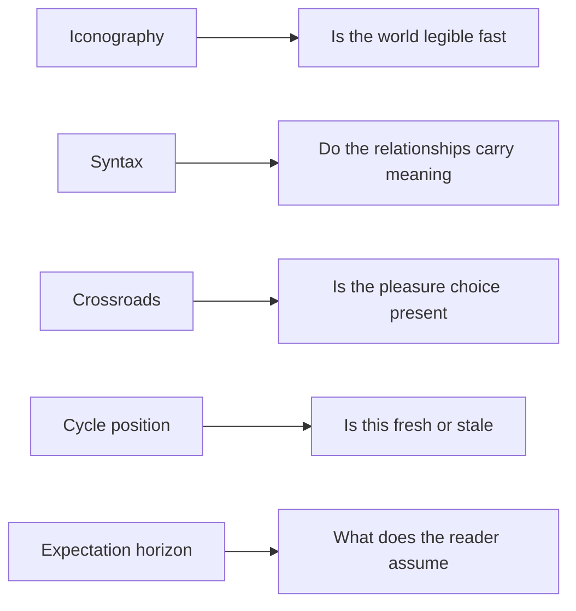

# BVX.0579 — Film Genre Reader IV — Barry Keith Grant, ed. (2012)
### Knowledge Entry — Distill

An anthology of 36 essays on film genre, theory first and genre case studies second. It is in the library as craft basis for the OXO script editors: what a genre promises, how it varies, and how it changes.

## TABLE OF CONTENTS
- [Core Thesis](#1-core-thesis)
- [Mind Models](#2-mind-models)
- [Framework](#3-framework--structure)
- [Key Concepts](#4-key-concepts)
- [Heuristics](#5-heuristics--decision-rules)
- [Invariants](#6-invariants)
- [Pitfalls](#7-pitfalls--myths)
- [Application](#8-application)
- [Cross-References](#9-cross-references)
- [Provenance](#10-provenance--confidence)

---

## 1 · CORE THESIS

Genre films tell familiar stories through repetition and variation. A genre is a shared set of audience expectations, not a fixed list of traits. It is a process: each new film extends, tests or transforms the conventions, and the conflicts it dramatizes shift with the culture.

---

## 2 · MIND MODELS

**Diagram 1 — the whole argument.**
Read off the book's two halves: Part One argues over what a genre is, and Part Two applies a different lens to each genre.

**Diagram 2 — the central mechanism (Altman's semantic/syntactic model).**
Read off how a genre forms: stable building blocks get a stable arrangement, or an old arrangement takes new blocks.

**Diagram 3 — one genre's life (Grindon's cycle model).**
Read off that a benchmark hit starts a cycle, and a flurry with no prototype is only a cluster.

**Diagram 4 — the book mapped onto the editing desk.**
Read off which genre idea answers which editor question.

---

## 3 · FRAMEWORK / STRUCTURE

**Part One, Theory (ch. 1-16).** Defining and explaining genre:
- Definition problem: Tudor (circular), Buscombe (outer and inner form), Altman (semantic/syntactic).
- History and change: Grindon (cycles), Neale, Staiger (hybrids), Deleyto (boundaries).
- Politics: Wright (genre as conservative), Bourget (genre as subversive), Wood, Klinger.
- Function: Schatz (myth and ritual), T. Sobchack (classical experience), Grant (experience), de Cordova (performance), Williams (body genres).

**Part Two, Criticism (ch. 17-36).** Each essay applies a lens to one genre:
- Western (Pye), gangster (Mitchell), noir (Schrader), generic transformation (Cawelti, Gallagher).
- Disaster, historical epic, horror vs science fiction, Freudian horror, alien Other.
- Melodrama, screwball, cross-dressing, Vietnam film, action family, musical.
- Black gangster film, teen film, heritage film, global noir.

Grant suggests reading by theme: ideology, genre and auteur, viewing experience, representation.

---

## 4 · KEY CONCEPTS

| Concept | What it is | Why it matters |
|---|---|---|
| Empiricist dilemma (Tudor) | To find a genre's traits you first need its films; to pick the films you need the traits | Definitions are circular, so rest them on audience consensus |
| Genre as cultural convention | "Genre is what we collectively believe it to be" | The reader's expectation is the real unit |
| Semantic elements (Altman) | The building blocks: characters, props, settings, shots | Broad coverage, little explanatory power |
| Syntactic structure | The relationships that arrange the blocks | Carries the genre's meaning, but fits fewer films |
| Pennsylvania western | A film with western syntax in the wrong place and century | Tests any definition; combine both approaches |
| Generic crossroads (Altman via Grindon) | The hero picks the option that gives genre pleasure, and the ending restores the sanctioned value | Pleasure and moral order coexist in one plot |
| Cycle and cluster (Grindon) | A cycle follows a prototype hit; a cluster is a burst with no prototype | Maps change as breaks, not smooth evolution |
| Mode, genre, cycle | Mode is broad (comedy, melodrama); genre a set of conventions; cycle a short run | Pick the right scale before analysing |
| Family resemblance and prototype | Membership is by degrees around exemplars | Allows borderline films without breaking the category |
| Dramatic conflicts | Persistent social problems a genre keeps restaging (boxing has six) | Explains why a genre rises, mutates or dies |
| Genre as myth (Schatz) | Myth is defined by function, not content: it resolves cultural contradiction | Genre acts as a society talking to itself |
| Classical experience (T. Sobchack) | Known plot, fixed characters, closed form, iconography as shorthand | Satisfaction comes from fulfilled expectation |
| Iconography | Visible shorthand: costumes, objects, places | Saves exposition |
| Horizon of expectation (Neale, from Jauss) | What audience remembers of the corpus and its publicity | Every film is read against it |
| Canonization of the junior branch (Shklovsky) | When a dominant form stalls, a low form takes over | Explains why genres rise from "vulgar" strata |
| Body genres (Williams) | Porn, horror, melodrama: the spectator body mimics the screen body | Excess is a system, not gratuitous |
| Ritual vs ideological readings | Genre either relieves anxiety or manipulates | Grindon and Altman: both operate at once |

---

## 5 · HEURISTICS & DECISION RULES

| Situation | Do this | Not this |
|---|---|---|
| Defining a genre for a project | List semantic parts and the syntax separately | Define by one checklist or one canon |
| A work half-fits a genre | Ask which elements and which relations it shares | Argue over the label |
| Judging freshness | Place the work in a cycle: before, at or after the prototype | Treat the genre as timeless |
| A twist or rule-break | Check the audience knows the rule first | Break rules nobody has learned |
| Writing a protagonist's big choice | Offer the transgressive option that gives genre pleasure, then restore order | Resolve with no cost to the sanctioned value |
| Needing fast world-building | Use iconography as shorthand | Spend dialogue on what an icon can say |
| Mixing genres | Name which genre supplies the blocks and which the syntax | Call it a new genre by default |
| Reading a genre politically | Ask what conflict it dramatizes and for whom | Assign it a fixed ideology |
| Judging a body-genre scene | Ask what bodily response it is built to produce | Dismiss the excess as gratuitous |
| Dating a convention | Check the early history before claiming a change | Assume a neat evolution |

---

## 6 · INVARIANTS

1. A genre exists only where audience and makers share expectations.
2. Genres change; any definition is historically specific.
3. Every genre film is a selection from a repertoire, and each addition shifts the repertoire.
4. Hybrids are normal. Classical Hollywood films combined a genre plot with a romance plot.
5. A durable genre needs a stable syntax; recurring semantics alone fade.
6. Genre pleasure is usually regulated: transgression is offered, then contained.
7. Conflicts that animate a genre are social; when they fade, the genre fades or moves media.

---

## 7 · PITFALLS / MYTHS

- Treating a genre as a fixed list of traits (Tudor's circle).
- Naming one canon of "real" examples and ignoring the rest of the corpus.
- Assuming genres evolve like organisms through growth, flowering, decay. Neale (citing Williams and Gallagher) shows early silent films were already self-conscious.
- Reading genre as pure ritual or pure manipulation. Both coexist.
- Confusing a film's setting with its genre syntax (Star Wars is not simply a western).
- Calling hybrids rare. They are the rule.
- Judging excess genres by realism. Their logic is bodily and repetitive.
- Judging genre by its cheap imitations. Sobchack notes later versions tend to decorate the original design.
- Equating genre films with unoriginality. Grant's introduction stresses that familiar does not mean completely familiar.

---

## 8 · APPLICATION

- **Spine level:** TEXTURE. Genre is the telling layer, not a spine level.
- **12-layer character stack:** none; `feeds: []`.
- **plot_systems:** the crossroads and dramatic-conflict ideas inform how a protagonist's choices are staged.
- **Setting:** iconography and mode help OXO settings read at once.

For the script editors, the useful kit is: audit a draft's semantic parts and syntax separately; locate the work in a cycle to judge freshness; check that the big choice is a crossroads (pleasure option, then restoration); and check that any rule-break rests on a rule the reader knows. Hybrid scripts should state which genre supplies the syntax. Treat the political essays (Wright, Bourget, Wood) as a reminder that the same conventions can reaffirm or critique, so the editor's question is which, and for whom. This section is application, not source extraction.

---

## 9 · CROSS-REFERENCES

| Related entry | Relation |
|---|---|
| [[BVX.0142]] | Earlier popular writing on film before genre theory |
| [[BVX.0580]] | Genre and Hollywood; same field, one author |
| [[BVX.0191]] | Story-form genre taxonomy from the craft side |
| [[BVX.0236]] | Editor's genre conventions and obligatory scenes |

---

## 10 · PROVENANCE & CONFIDENCE

Sourced from the full text (pdftotext) for: Grant's introduction and contents, Tudor (ch. 1, most), Altman (ch. 3, nearly all), Grindon (ch. 4, first 60 percent), Schatz (ch. 9, first half), T. Sobchack (ch. 10, first half), Williams (ch. 13, opening), Neale (ch. 14, middle).

**Not read, so not distilled:** Buscombe (2), Wright (5), Bourget (6), Wood (7), Klinger (8), Grant (11), de Cordova (12), Staiger (15), Deleyto (16), and all of Part Two (17-36) beyond the editor's one-line summaries in the introduction. Claims about those essays rest on the introduction only. Status is therefore draft and confidence medium. Bibliography and index skipped.

## META
- Template: BVX-LEARN-v4.0
- Source classification: anthology, academic
- Created / Updated: 2026-10-30
