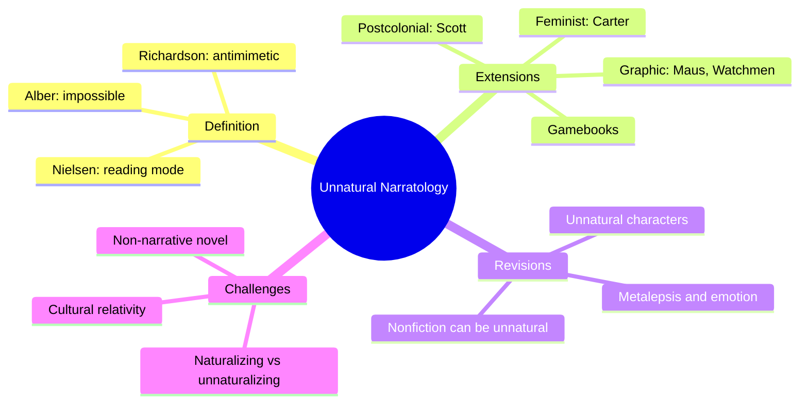
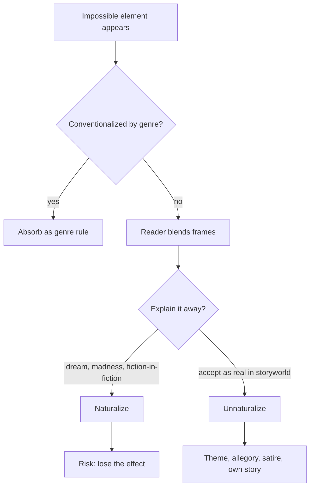
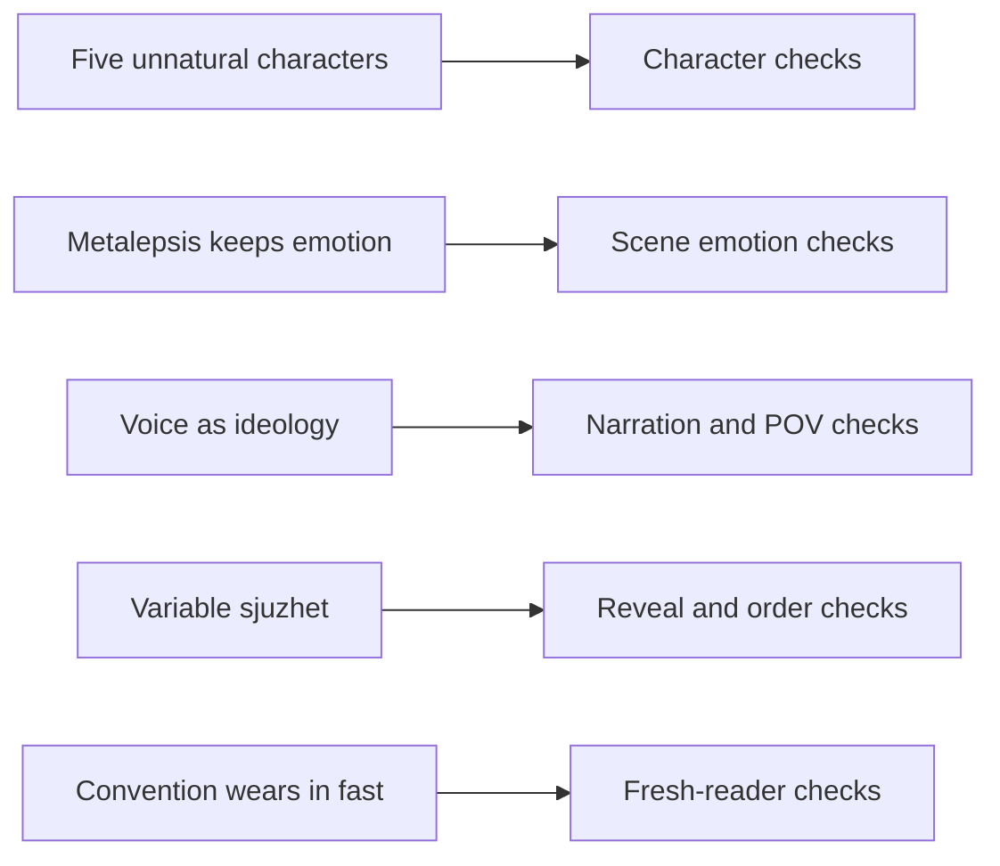

# BVX.0654 — Unnatural Narratology: Extensions, Revisions, and Challenges — Alber & Richardson (2020)
### Knowledge Entry — Distill

An edited collection that tests "unnatural narratology" (the study of impossible and antimimetic story elements) against feminism, postcolonial writing, empathy, comics, character and gamebooks; kept as craft basis for editors who must judge deliberate impossibility, metalepsis and non-realist characters.

## TABLE OF CONTENTS
- [Core Thesis](#1-core-thesis)
- [Mind Models](#2-mind-models)
- [Framework](#3-framework--structure)
- [Key Concepts](#4-key-concepts)
- [Heuristics](#5-heuristics--decision-rules)
- [Invariants](#6-invariants)
- [Pitfalls](#7-pitfalls--myths)
- [Application](#8-application)
- [Cross-References](#9-cross-references)
- [Provenance](#10-provenance--confidence)

---

## 1 · CORE THESIS

Narrative theory built only on realism cannot explain stories that break reality's rules. A second, antimimetic poetics must sit beside the mimetic one. The nine essays show impossible narrators, characters, times and media each carry meaning, emotion and politics, and they argue over where "unnatural" ends.

---

## 2 · MIND MODELS

**Diagram 1 — the whole argument.**
Read off the three jobs the book does: define the unnatural, apply it to new material, and let the critics push back.

**Diagram 2 — the central mechanism.**
Read off how a reader meets an impossibility: first try to explain it, then decide whether to keep it as written.

**Diagram 3 — mapped onto the Command's systems.**
Read off which chapter serves which editing question.

---

## 3 · FRAMEWORK / STRUCTURE

An introduction, nine essays and an afterword where the editors answer each author. Three clusters.

1. **Ideology and culture (ch. 1 to 3).** Romagnolo reads Angela Carter's *Nights at the Circus* as unnatural narration serving a feminist aim. Patron tests Mouawad's *Anima* against naturalization. Klein asks "unnatural for whom?" using Kim Scott's *Benang*.
2. **Reception and emotion (ch. 4 to 6).** Kilgore finds unnatural technique in graphic memoir. Punday argues metalepsis can deepen feeling. Sommer reads Abish's *Alphabetical Africa* and doubts the theory's scope.
3. **New material (ch. 7 to 9).** Richardson catalogues unnatural characters across media. Baroni reworks time in comics. Wake treats the interactive gamebook.

Underneath all of it is the editors' "dual model": mimetic poetics plus antimimetic poetics, used together ("binocular vision"), not a replacement.

---

## 4 · KEY CONCEPTS

| Concept | What it is | Why it matters |
|---|---|---|
| Unnatural (Alber) | Physically, logically or humanly impossible scenario, even if a genre has made it familiar | Wide net: talking animals count |
| Antimimetic (Richardson) | Contravenes nonfiction presuppositions and realist practice; not just genre-conventional | Narrower net: separates parody and defamiliarization from fairy tale |
| Nonmimetic | Conventional non-realism (fable, ghost story) | Same impossibility, different effect |
| Naturalizing | Explaining the impossible as dream, madness or fiction-in-fiction | Often kills the effect (Patron on *Anima*) |
| Unnaturalizing reading (Nielsen) | Trust the strange as authoritative in the storyworld | Lets the strangeness stay |
| Reading strategies (Alber) | Subjectify, foreground theme, allegorize, blend frames, enrich frames, "Zen" acceptance | A menu for interpreting a break |
| Impossible blend | Merging frames that cannot coexist in life | How readers build the unnatural storyworld |
| Cultural encyclopedia (Klein) | A reader's world knowledge plus literary knowledge | Same event, different strangeness by reader |
| Epistemic consistency | A character-narrator cannot know another mind | Violation (paralepsis) is a cue for the unnatural |
| Metalepsis | Crossing levels: rhetorical (telling) or ontological (story world) | Not always cold; can raise feeling |
| Five unnatural characters (ch. 7) | Imperfect (too few or contradictory traits, fusions), multiple versions, parodic, fabricated, metafictional | A checklist for non-human-like persons |
| Phelan's tripartite character | Mimetic, synthetic, thematic; Richardson adds intertextual | A character can serve four functions at once |
| Variable sjuzhet | Panels co-present, readable in several orders | Order of reveal is medium-bound |
| Braiding (Groensteen) | Non-adjacent panels echo each other | A form of rhyme, not only sequence |
| "Empathy the long way round" | Feeling built through effortful reconstruction of an autographic narrator | Difficulty can create closeness |
| Autotelic "you" | Second person that merges reader and character | Gamebooks use it for identification, not empathy |

---

## 5 · HEURISTICS & DECISION RULES

| Situation | Do this | Not this |
|---|---|---|
| A strange element appears in a mostly realist draft | Ask: is it conventional (genre) or defamiliarizing? Judge it by that intent | Flag it as an error because it is impossible |
| A twist explains the strangeness as dream or hallucination | Check whether the twist covers all the earlier strangeness (the *Caligari* test) | Accept the explanation just because it is stated |
| The narrator knows what they could not know | Check for a signal: genre, "we" voice, or a cue that knowledge is authoritative | Treat it as a continuity slip by default |
| A meta moment (author voice, character knows they are fiction) | Test whether feeling survives; ask if the loss or ending frame carries the emotion | Assume meta always cools the scene |
| A character is minimal, contradictory or doubled | Name which of the five types it is and what it is for | Demand roundness and a consistent psychology |
| A metacharacter learns they are fictional | Keep them mimetically human in other ways so the reader still cares | Make them shrug off stakes |
| Voice or POV is fractured | Ask what authority or ideology the fracture performs | Resolve it to one clean narrator |
| Order of reveal in a comic or page-laid script | Count what is visible at once on the page | Judge suspense as if the reader sees panels one at a time |
| An "unnatural" device is old to the audience | Expect it to read as convention and to need a fresh twist | Call it shocking because it was once |
| Cultural material uses what looks like magic | Ask "unnatural for whom?" and who the audience is | Gloss it as metaphor |
| Reader's feeling contradicts their knowledge | Trust the local emotional trigger; do not "fix" it with logic | Cut a scene because its logic is undone elsewhere |

---

## 6 · INVARIANTS

1. Pure mimetic theory cannot cover antimimetic work; both poetics are needed.
2. Impossible elements are almost always grafted onto realist ones; no character or text is unnatural in every aspect (Gregor Samsa is a plausible salesman and a bug).
3. A conventionalized impossibility stays impossible; familiarity changes its effect, not its status (Richardson), or its effect only (Alber). Editors should track effect.
4. Naturalizing an impossibility by in-story explanation can destroy the reading it was meant to protect.
5. Unnatural texts usually break one narrative parameter at a time (narrator, character, time or space); too many at once overloads the reader.
6. Narrative form carries no fixed ideology; value comes from use (Romagnolo).
7. Feeling and cognition can run apart; readers weep at things they know are staged.
8. Medium sets what counts as strange: comics can show time at once, film cannot.
9. The terms "natural" and "unnatural" carry no moral claim here, whatever the cultural baggage.

---

## 7 · PITFALLS / MYTHS

- Treating "unnatural" as "deviant." The editors say plainly it is not.
- Assuming anti-realist form is automatically progressive (Romagnolo cites Richardson against this) or that realist form is automatically conservative.
- Reading *Nights at the Circus* as a simple reversal of male and female authority; the narration fractures instead (Romagnolo).
- Assuming metalepsis always estranges (Punday).
- Fitting every odd character to a human psychology (Richardson on cognitivist character theory). Alber's counter: do not stretch categories until everything counts.
- Reading a final reveal as a second-read key. Patron argues the second reading should often stay unnaturalized.
- Taking the Western rationalist reader as the default (Klein). The editors reply the reader/culture binary is too crude and favor multiple authorial audiences.
- Calling comics' page layout unnatural. Baroni: simultaneity is the medium's baseline.
- Treating gamebook "you" as empathy; Wake says it is identification, and death scenes expose the seam.
- Over-claiming. Sommer says some experiments (*Alphabetical Africa*) are non-narrative; Alber agrees it is not unnatural; Richardson rejects "non-narrative novel." The question is open.
- Collapsing fiction and nonfiction. Kilgore blurs them; the editors keep the distinction (nonfiction can be checked against outside sources).

---

## 8 · APPLICATION

- **Spine level:** TEXTURE. The book governs how a story tells, not what its beats are.
- **12-layer character stack:** none (`feeds: []`). The character chapter is about literary construction, not psychology.
- **plot_systems:** not applicable.
- **Setting:** not applicable.

For the OXO script editors and `reading-cold`, the useful parts are the sorting questions. Before flagging an impossibility, an editor can ask: conventional or defamiliarizing? Does an explanation (dream, framing device, "it was a story") cover everything, or does it flatten what came before? Which of the five character types is this, and what does it do? Is a meta moment keeping the feeling or cutting it? Whose cultural encyclopedia does the audience share?

Two pieces of the book matter most for editing. First, Punday's finding that a meta frame can sit beside real emotion and sometimes produce it, especially through a coming end or loss. An editor should not cut a self-aware beat on instinct. Second, Richardson's rule that metafictional characters hold the audience only if they stay mimetically human in other ways. Both are craft checks, not rules to impose on the work.

Keep source and Command separate: the claims above are the book's; the editor use is an inference. The book offers no tests for pacing, structure or dialogue, and it studies mostly literary and avant-garde texts, so its reach into episodic script work is untested.

---

## 9 · CROSS-REFERENCES

| Related entry | Relation |
|---|---|
| [[BVX.0064]] | McKee on character: a mimetic baseline to set beside Richardson's five unnatural types |

---

## 10 · PROVENANCE & CONFIDENCE

Source: pdftotext of the full book. Introduction, chapters 1, 2 (most), 3, 5, 6, 7, 8 and 9, and the afterword were read in long runs. Chapter 4 (Kilgore) was read for its framing, opening argument and conclusion only; the pages on *Maus* levels and the two Bechdel memoirs (roughly text lines 3310 to 3880) were not read, so the detail of its panel-level claims is secondhand from the conclusion and the afterword. The middle of chapter 2 (lines 1870 to 2020), the middle of chapter 6 (lines 5220 to 5480) and part of chapter 8 (lines 7230 to 7440) were skipped; none changes the stated argument. Bibliographies were not read. No outside research. The editors' cross-references in the afterword supply the disagreement summaries, so the "challenges" section leans on them.

Confidence is medium: the argument is clear, but the chapters differ in their definitions of "unnatural," and a few are summarized from partial reads.

## META
- Template: BVX-LEARN-v4.0
- Source classification: edited academic collection, full text
- Created / Updated: 2026-10-30 / 2026-10-30
