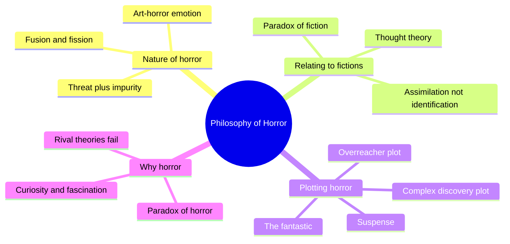
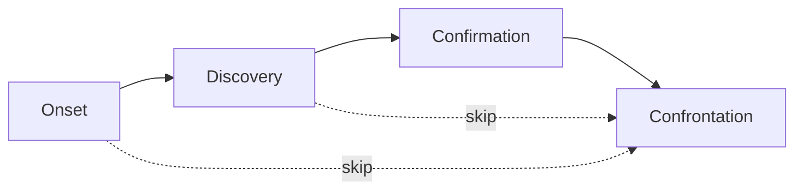
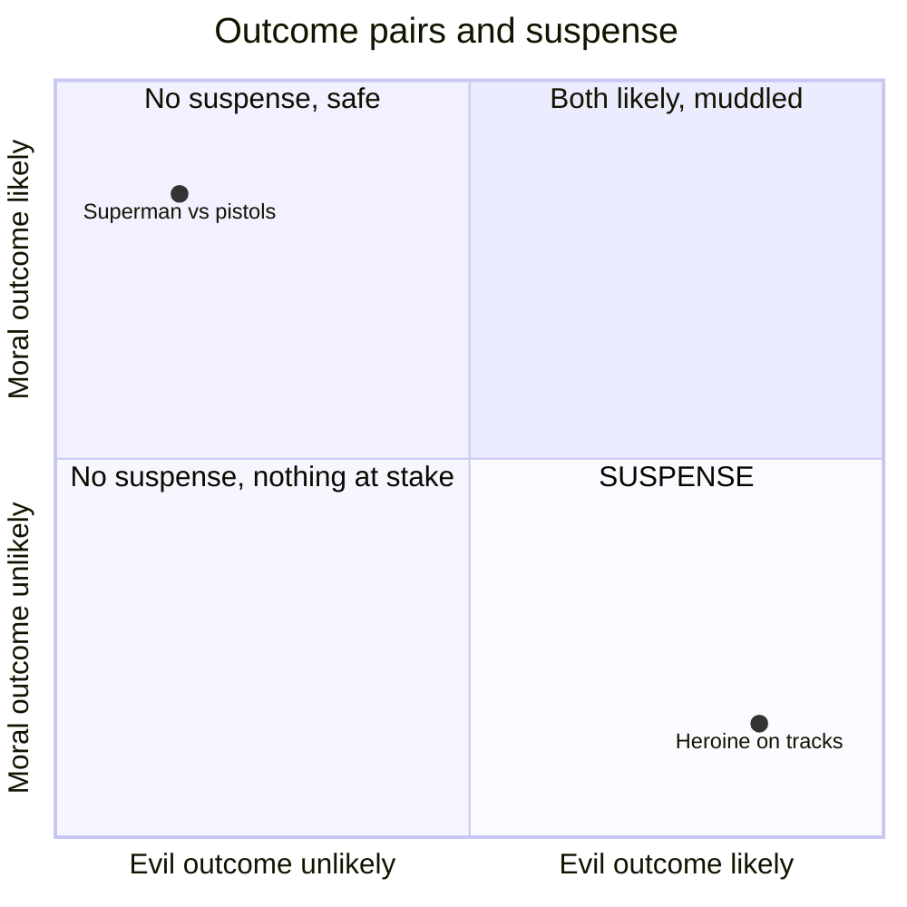

# BVX.0840 — The Philosophy of Horror, or Paradoxes of the Heart — Noel Carroll (1990)
### Knowledge Entry — Distill

An analytic-philosophy theory of the horror genre: what the emotion is, how monsters and plots are built to raise it, and why audiences want it. Held in the library as craft basis for the script editors (suspense, discovery plotting, withheld evidence, audience response to characters).

## TABLE OF CONTENTS
- [Core Thesis](#1-core-thesis)
- [Mind Models](#2-mind-models)
- [Framework](#3-framework--structure)
- [Key Concepts](#4-key-concepts)
- [Heuristics](#5-heuristics--decision-rules)
- [Invariants](#6-invariants)
- [Pitfalls](#7-pitfalls--myths)
- [Application](#8-application)
- [Cross-References](#9-cross-references)
- [Provenance](#10-provenance--confidence)

---

## 1 · CORE THESIS

Horror is defined by the emotion it aims to raise: art-horror, fear fused with disgust at a monster that violates cultural categories. We feel it genuinely through thoughts, not beliefs. We seek it because category-breaking beings fascinate, and discovery plots reward that curiosity.

---

## 2 · MIND MODELS

**Diagram 1 — the whole argument.**
Read it as four moves: define the emotion, explain the response to fiction, catalogue the plots, resolve the attraction.

**Diagram 2 — the central mechanism.**
Read it as one cause chain: the monster's two evaluated properties, plus the thought of it, produce a felt agitation. Remove either property and you get plain fear or plain disgust.

```mermaid
flowchart TD
    M["Monster: not in science"] --> T["Evaluated as threatening"]
    M --> I["Evaluated as impure"]
    I --> C["Category violation"]
    C --> K["Interstitial, contradictory, incomplete, formless"]
    T --> E["Art-horror"]
    I --> E
    TH["Thought of monster, no belief"] --> E
    CH["Character reactions cue audience"] --> E
    E --> A["Felt agitation: recoil, nausea, chill"]
    C --> F["Also fascinates"]
    F --> W["Curiosity outweighs distress"]
```

**Diagram 3 — the plot family.**
Read it as a four-function line where any function can be dropped, giving Carroll's fourteen formats. Order is conceptual, not necessarily telling order.

**Diagram 4 — suspense quadrant.**
Read it as: suspense lives only where the moral outcome is unlikely and the evil outcome is likely.

---

## 3 · FRAMEWORK / STRUCTURE

Four chapters, each answering one question.

1. **What is horror?** The genre is named for its affect. Art-horror is distinct from "natural horror" (real atrocity). Definition: a physically felt agitation caused by the thought of a monster evaluated as threatening and impure, usually with a wish to avoid contact. Monster = any being science does not countenance, defined independently of danger or disgust so the definition is not circular. Impurity comes from Mary Douglas: things that break a culture's categories. Monsters are built by five structures: fusion, fission, magnification, massification, horrific metonymy.
2. **How do we respond to fictions?** The paradox of fiction: we are moved, we know it is not real, and we seem to need belief to be moved. Illusion theory, willing suspension of disbelief and Walton's pretend theory are rejected. Thought theory is kept. Character-identification is replaced by assimilating the character's situation.
3. **How is horror plotted?** Complex discovery (onset, discovery, confirmation, confrontation) and its subtractions; the overreacher plot (preparation, experiment, boomerang, confrontation); erotetic narration and suspense; Todorov's fantastic and the film devices that sustain "fantastic hesitation."
4. **Why horror?** The paradox of horror (we seek what repels). Rival answers (cosmic awe, psychoanalysis, ideology) fail on generality. Carroll's answer is a universal theory (anomalies fascinate) plus a general theory (disclosure plots stage and reward the curiosity). A closing, speculative section ties the current cycle to social anxiety.

---

## 4 · KEY CONCEPTS

| Concept | What it is | Why it matters |
|---|---|---|
| Art-horror | Occurrent emotion: felt agitation caused by the thought of a threatening, impure monster | Names what the genre is for; the target effect |
| Formal object | The evaluative category (threat + impurity) that makes an emotion this emotion | Threat alone gives fear, impurity alone gives disgust; both are needed |
| Impurity | Category trouble: interstitial, contradictory, incomplete or formless | Gives a testable design rule for monsters |
| Fusion | Opposed categories in one body at one time (vampire, ghost) | Monster-building tool |
| Temporal fission | Opposed identities take turns in one body (werewolf, Hyde) | Monster-building tool |
| Spatial fission | Opposed aspects split into doubles (Dorian portrait, doppelganger) | Monster-building tool; doubles carry a repressed aspect |
| Magnification / massification | Scale up or swarm things already phobic (spiders, ants) | Only works on already-disgusting things; rabbits fail |
| Horrific metonymy | Impurity by association: vermin, corpses, filth around a clean-looking monster | Lets a handsome monster still disgust |
| Cognitive threat | Monsters threaten knowledge as well as bodies | Explains madness reactions and why weak monsters feel unstoppable |
| Character cueing | Positive characters' reactions model the intended audience response | Lets an editor read intended effect from the page |
| Thought theory | Real emotion is caused by entertaining a proposition without asserting it | Solves the paradox of fiction without pretending or illusion |
| Assimilation | We grasp the character's appraisal and also see the whole situation from outside | Replaces "identification"; explains pity and suspense |
| Complex discovery plot | Onset, discovery, confirmation, confrontation | The backbone of most horror |
| Confirmation | Convincing a skeptical authority the monster exists | Source of delay, proof drama and suspense |
| Overreacher plot | Forbidden knowledge tested, then it boomerangs | The "some things better left unknown" mirror of discovery |
| Erotetic narration | Scenes link as question and answer, not only as cause and effect | Explains page-turning; macro- and micro-questions |
| Suspense | Question with two opposed outcomes: moral/unlikely vs evil/likely | A recipe, and a different emotion from horror |
| Fantastic hesitation | Reader stays split between natural and supernatural explanation | Delay device; pure fantastic is not horror |
| Universal / general theory of appeal | Fascination with category-breakers; plus disclosure plots amplify it | Why audiences accept disgust |
| Art-dread | Unease from an uncanny event with no monster | Carroll's named neighbour; no theory given |

---

## 5 · HEURISTICS & DECISION RULES

| Situation | Do this | Not this |
|---|---|---|
| Making a monster feel horrific | Give it a real threat and a category violation (fuse, split, scale, swarm) | Rely on gore or ugliness alone |
| Monster looks ordinary or handsome | Surround it with vermin, rot, contamination (metonymy) | Describe disgust the monster does not carry |
| Telling the audience how to feel | Show a character shudder, recoil, wrinkle the nose before the reveal | Let the character stay calm while asking the audience to be sick |
| Building suspense | Make the moral outcome unlikely and the evil one likely; state the odds aloud | Give the hero a clear edge |
| Keeping suspense in the final fight | Leave doubt whether the countermeasure works | Make the weakness a sure thing |
| Establishing a monster's menace | Spend page time on its invulnerability and powers, in talk before it acts | Spend it proving it is evil (assumed) |
| Delaying the reveal | Route evidence through unreliable witnesses, weak modals ("seemed"), dark or obscured shots, offscreen sound | Show the monster early and then ask for doubt |
| Resolving doubt | Give eyewitness-grade proof: clear, close, sustained, from a reliable character | Settle it by inference alone |
| Scene links | Ask what question the scene raises, sustains, partly answers or answers | Rely on causation alone |
| A scene does none of that | Treat it as establishing material or a digression, and justify it | Let it sit unlabelled |
| Authority figure denies the monster | Use confirmation as a ticking clock (monster gains power while they argue) | Make the skeptic merely stupid |
| Sympathy for the monster | Shift the audience's moral reading first, then run suspense on its death | Switch sympathies with no setup |
| Describing the unnameable | Use "It", "Them", indescribability | Pin it to a tidy label |

---

## 6 · INVARIANTS

1. Art-horror needs both threat and impurity; drop one and the emotion changes.
2. Audience emotion converges with, but never duplicates, the positive characters' emotion.
3. Thought-driven emotion is genuine, so the audience stays seated.
4. A monster is outside the culture's category scheme; a "violation of nature" needs a norm of nature to violate.
5. The four plot functions have a conceptual order in the story (fabula): the monster must exist to be discovered, be discovered to be confirmed, be known to be confronted. Telling order (sujet) may scramble it.
6. Suspense depends on the structure of the question, not on how it resolves.
7. Horror and suspense are different emotions with different objects (entity vs situation), though they often travel together.
8. Disgust and fascination come from the same property: the category violation.
9. Most horror plots carry some ratiocination: argument, proof, hypothesis.

---

## 7 · PITFALLS / MYTHS

- **Illusion myth:** viewers do not believe the monster is present; if they did they would leave.
- **Pretend myth:** the fear is real, not a game of make-believe. Failed monsters cannot be rescued by "just pretending."
- **Suspension of disbelief:** belief cannot be willed, and the viewer must hold the belief "this is fiction" to run it.
- **Identification:** a strict symmetry the data contradict (we feel suspense, pity, concern; the character feels terror). Say "assimilate the situation" instead.
- **Monster = ugly or evil:** monsters can be beautiful or good (E.T., Langella's Dracula); definition rests on science's denial.
- **Counting every scary story as horror:** Psycho, Jaws-as-shark, Cujo are borderline; tales of dread are a separate effect.
- **Lovecraft's cosmic awe as the genre test:** it marks high achievement, not membership.
- **Religious-experience analogy:** monsters are not wholly other and nobody worships them.
- **Psychoanalysis as total theory:** some monsters (Wells's cephalopods) carry no repressed content.
- **Horror is always subversive, or always reactionary:** neither holds; case by case. King's "agent of the norm" fails on stories where the monster survives.
- **Plot summary as horror theory:** pure fantastic ambiguity is a different genre.
- **Monster must be the pleasure:** the pleasure is often the disclosure plot, with disgust as the price.

---

## 8 · APPLICATION

- **Spine level:** TEXTURE. This is telling and audience-effect craft, not story-spine structure; it does not key to L0-L7.
- **12-layer character stack:** none (`feeds: []`). The character material is about audience response, not psychology of figures.
- **plot_systems:** the discovery and overreacher plot families are usable as scene-function checklists; they are not part of the spine.
- **Setting:** category violation as a world-building test (what does this culture treat as natural?). Fits any setting with a clear norm of nature.

The script editors can use this as a diagnostic, not a template. Three checks carry the most weight. First, **effect-reading**: read the positive characters' reactions to a threat and ask what response they instruct the audience to have; flag a scene where the cue and the intended feeling disagree. Second, **suspense audit**: for any tense scene, state the question, the moral outcome and the evil outcome, and rate their likelihoods; if the hero holds the odds the scene reads as busywork. Third, **evidence ledger**: for any mystery or supernatural thread, list each piece of evidence, who reports it and how reliably, so the writer knows when proof is eyewitness-grade and when the reader is still inferring. A cold reader (the reading-cold role) can also use the question/answer map: note every question the pages raise and whether the next scenes sustain, answer or drop it. Everything above applies whether or not the project is horror; the monster-building and fantastic-hesitation sections apply only where the story has an unexplained presence.

The book says nothing about the Command's own setting or characters. Any link to OXO is the Command's, not Carroll's.

---

## 9 · CROSS-REFERENCES

| Related entry | Relation |
|---|---|
| [[BVX.0279]] | Writing for emotional impact: practical counterpart to Carroll's theory of audience response |
| [[BVX.0175]] | McKee, Story: structure and expectation, compare erotetic narration and suspense |
| [[BVX.0089]] | Dramatica: alternative story-structure vocabulary for the same plot-function thinking |
| [[BVX.0064]] | McKee on character: contrast with Carroll's assimilation instead of identification |

---

## 10 · PROVENANCE & CONFIDENCE

- **Full-text read:** front matter, introduction, chapters 1 to 4 (pp. 1-210), including Horror and Ideology and most of Horror Today.
- **Not read:** the last stretch of Horror Today (the postmodernism analogy, pp. ~210-214), the endnotes (pp. 215-250) and the index (pp. 251-269). Claims from those parts are absent from this entry.
- **Inference:** the application section (editor checks, spine keying, `feeds: []`) is the distiller's, not Carroll's. Carroll writes about 1970s-80s horror and treats his own account as provisional; his mass-culture examples are dated.
- **Caveat:** the pdftotext file has encoding damage (accents), no effect on argument. Confidence medium because of the unread tail.

## META
- Template: BVX-LEARN-v4.0
- Source classification: book, academic philosophy (aesthetics of genre)
- Created / Updated: 2026-10-30
