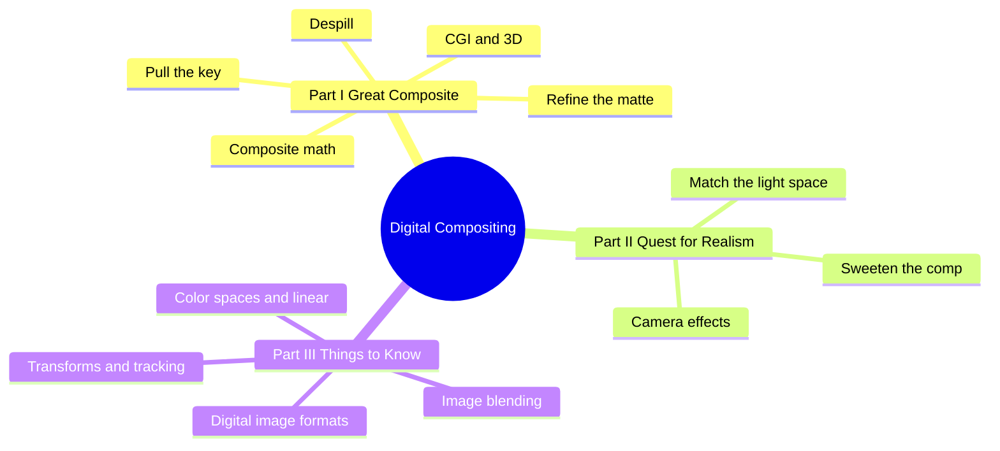
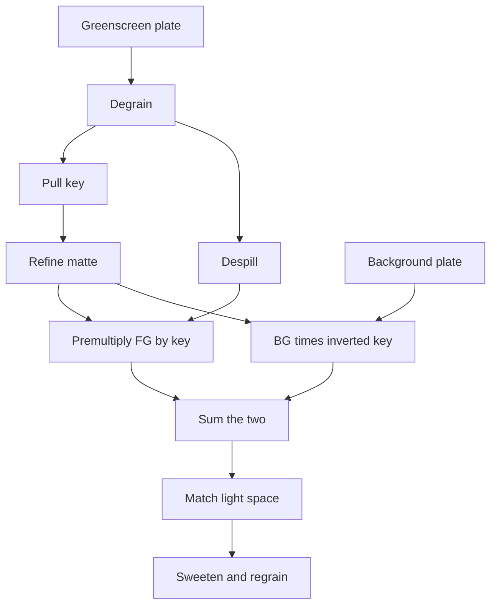
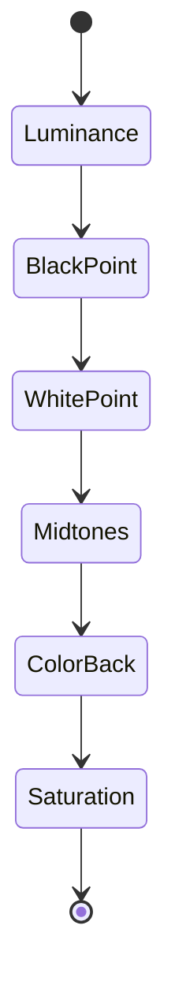
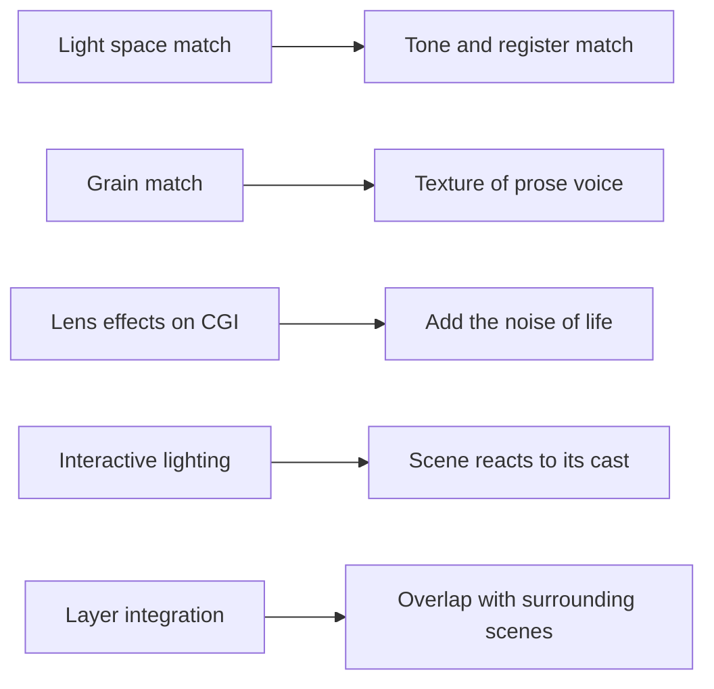

# BVX.0868 — Digital Compositing for Film and Video — Wright (2018)
### Knowledge Entry — Distill

A software-agnostic craft manual for building composites that read as one photograph. It is in the library as the craft basis for judging how layered images (and, by analogy, layered scenes) get stitched into one believable whole.

## TABLE OF CONTENTS
- [Core Thesis](#1--core-thesis)
- [Mind Models](#2--mind-models)
- [Framework](#3--framework--structure)
- [Key Concepts](#4--key-concepts)
- [Heuristics](#5--heuristics--decision-rules)
- [Invariants](#6--invariants)
- [Pitfalls](#7--pitfalls--myths)
- [Application](#8--application)
- [Cross-References](#9--cross-references)
- [Provenance](#10--provenance--confidence)

---

## 1 · CORE THESIS

A composite succeeds when separately shot layers share one light space, one lens, one grain and one edge softness. Technical correctness (clean key, despill, linear math) is the floor. Realism comes from deliberately adding the small imperfections of a real camera and a real room.

---

## 2 · MIND MODELS

**Diagram 1 — the whole argument.**
Read off the three-part order: make it technically clean, make it look photographed, then know the plumbing underneath.

**Diagram 2 — the central mechanism (the greenscreen pipeline).**
Read off the split: the plate forks into a matte branch and a despill branch, and they only meet at the composite.

**Diagram 3 — the light-space match order (Chapter 9 workflow).**
Read off the sequencing: tone scale first in luminance, colour second, and the blacks and whites before the midtones.

**Diagram 4 — mapped onto the Command's systems.**
Read off the analogy: Wright's matching rules become the checklist for whether an inserted scene sits in the same world as its neighbours.

---

## 3 · FRAMEWORK / STRUCTURE

The book has fifteen chapters in three parts, ordered by the working sequence on a shot.

**Part I, Making a Great Composite (ch. 2 to 8).** Pulling keys (luma, chroma, difference, bump, blur-and-grow, rotoscoping). Working with keyers (how they work, problem screens, screen correction, degraining first). Refining mattes (gamma slamming, garbage mattes, filtering, resizing, edge masks). Spill suppression. The composite (premultiply, Over, KeyMix, AddMix, inside or outside the keyer, stereo). Compositing CGI (multi-pass, AOVs, EXR, HDR, deep). 3D compositing (camera tracking, projections, Alembic).

**Part II, The Quest for Realism (ch. 9 to 11).** Colour correction as light matching. Sweetening: layer integration, interactive lighting, edge blending, light wrap, shadows, haze, glow, grain, clipping. Camera effects: ten lens behaviours plus lens-distortion and rolling-shutter workflows.

**Part III, Things You Should Know (ch. 12 to 15).** Colour spaces, linear and ACES. Image blending maths, Photoshop modes, retiming, VR stitching. Transforms, warps, morphs, point and planar tracking. Digital image types: HD, digital cinema, film scans, log, light field.

Structure principle stated by the author: task-oriented, not tool-oriented. A topic such as blur appears wherever a task needs it, and the index ties it together.

---

## 4 · KEY CONCEPTS

| Concept | What it is | Why it matters |
|---|---|---|
| Key / matte / mask / alpha | Four historical names for one grayscale inside/outside image | Pick the word by task; the object is the same |
| Luma "mountains" | A luminance image seen as terrain; the threshold is a clipping plane | Explains why luma keys snare unwanted regions and how to raise only the peak you want |
| Custom luminance | Luma keyers accept any one-channel input, so build your own RGB mix | Often separates a target better than the default 0.30R+0.59G+0.11B |
| Key what you can, roto the rest | Wright's rule for combining keys with hand-drawn shapes | Sets the effort split on every awkward shot |
| Control point coherency | Each roto point stays on one physical landmark | Prevents edge jitter, the hardest roto flaw to cure |
| Shape breakdown and hierarchy | Many small shapes linked as a skeleton, animated by whole-shape transforms | Faster and smoother than point twiddling |
| Despill | Removing excess backing colour by a rule (e.g. green limited by red) | No single algorithm fits all colour; roll your own as a backup |
| Premultiplied composite | FG times key plus BG times inverted key | Every keyer does this; knowing it lets you composite outside the keyer |
| Over / KeyMix / AddMix | Three composite set-ups | AddMix fixes dark edges and wispy elements by shaping FG and BG matte curves separately |
| Multi-pass CGI | Render lighting passes separately, rebuild by addition in the comp | Changes take minutes, not a week of render farm |
| Process verification | Recombined passes must equal the renderer's hero render | The one undisputable test of a correct workflow |
| Light space | The shared lighting environment two plates must imply | The real target of colour correction |
| Black point / white point | Darkest pixels (not zero) and a 90% diffuse white (not a specular) | Measurable anchors for a match; mid-tones remain judgment |
| Interactive lighting | Mask and animate light the foreground would receive | Thinking 3D inside a 2D comp binds layers together |
| Edge blending | Blur a 2 to 4 pixel edge matte that straddles the comp edge | Matches edge softness without blurring the matte detail |
| Grain management | Degrain to key, regrain per channel to match the reference plate | Grain is part of the look; three channels, three patterns |
| Lens effects | Distortion, depth of field and eight more | CGI has a perfect lens, so the artist must add the flaws |
| Linear working space | Code value proportional to brightness; view through an sRGB LUT | Maths of gain, blur and blending is only correct in linear |

---

## 5 · HEURISTICS & DECISION RULES

| Situation | Do this | Not this |
|---|---|---|
| Luma key snares extra areas | Garbage matte it, or rebuild the luminance image so your target is the tallest peak | Accept a broad, unselective key |
| Roto a complex moving figure | Break into rigid-unit shapes, link as a hierarchy, key on 2s when motion is fast | One giant shape with point twiddling |
| Choosing a spline | Bezier for organic and sharp corners, B-spline for smooth mechanical curves | Always the same type |
| Planning keyframes | Ping-pong the shot, one body part at a time, start on the most complex frame | Start at frame one and add points later |
| Spill remains after the keyer | Add a post-keyer despill, or roll your own channel-limit rule | Trust the built-in despill to fix discolouration |
| Judging a colour match | Work in a true luminance view first, set blacks and whites by sampling, then mids by eye | Match colour first or use plain desaturate as luminance |
| Setting black and white points together | One colour curve mapping sampled FG values to BG values | Brightness then contrast, which interact |
| No white or black reference in a plate | Find a similar-density element in each plate and use that | Pick a specular highlight as white |
| Foreground edge too hard | Edge-blend after the comp with a small blur (1 to 2 px) | Blur the whole matte |
| Dark fringe on a composite | Check double premultiply, then try AddMix | Stack more matte shrink |
| Matching grain | Use the background plate as reference, check at full resolution, full rate, one channel at a time | Eyeball a proxy; one grain on all channels |
| CGI over live action | Be aggressive with lens effects and regrain | Leave the perfect render untouched |
| Choosing a shot's effects | View the shot in context of its neighbours | Add all ten lens effects everywhere |
| Combining lighting passes | Add (sum) in linear float, verify against the hero render | Rely on what you "heard" (screen vs multiply) |

---

## 6 · INVARIANTS

1. Inside/outside is a one-channel image; naming differs, function does not.
2. Both layers must appear lit by the same environment; colour correction serves that, not "looks nice".
3. Black point is the darkest pixel, never exactly zero; white point is a diffuse 90% white, not a specular.
4. Filtering, blurring, scaling and colour operations are only physically correct in linear light.
5. Grain has three independent channels and differs per capture device.
6. Perfect CGI is sterile; the eye wants visual complexity.
7. A good key and a good despill are separate branches that meet at the composite.
8. Fewest control points and whole-shape transforms give the cleanest roto.
9. Edge softness in a composite must match the other edges in the same shot.

---

## 7 · PITFALLS / MYTHS

- "Desaturate gives luminance": it may not use the correct weights, so the tone-scale judgment fails.
- Averaging RGB by thirds makes skies too bright and forests too dark.
- Setting black point at zero invites clipped flat regions and robs the grain of foot room.
- Using a specular highlight as the white reference.
- Brightness and contrast fight each other when set in sequence.
- Light wrap used as a blanket rim light: it has constant width and ignores surface curvature.
- Blurring the matte to soften the edge destroys fine edge detail.
- Double premultiply, the usual cause of dark halos.
- Degrain too hard and the plate goes soft; dial back or degrain only blue.
- Proxy-resolution grain checks give false comfort.
- Over-applying effects: not every comp needs all ten lens effects.
- Working in sRGB on feature work; small errors accumulate, and on film "you absolutely must" use linear.
- Adding more points to a roto shape in the middle of the job, which shifts the spline unpredictably.

---

## 8 · APPLICATION

- **Spine level:** TEXTURE. The book is a technique manual, not a story-structure text.
- **12-layer character stack:** none (`feeds: []`).
- **plot_systems:** none directly.
- **Setting:** none.

The use here is analogical. For the script editors (`.claude/agents/editing-*.md`) and `reading-cold.md`, the book gives an editing frame: a scene transplanted from one draft or lineage into another is a "layer" that must share the light space of its neighbours. Check the mismatch signs Wright lists: contrast that differs (register too flat or too heightened), black and white points that differ (how dark or how light the story goes), and edges that are too hard or too soft (how scenes begin and end). Wright's "think 3D in a 2D comp" maps onto implied space around a scene: the cast, the rooms, the offstage that a scene should react to. His "noise of life" rule suggests that a flawless scene reads as sterile and that small specific imperfections sell it. Treat these as heuristics for the reader, not as claims the book makes about writing.

Process lesson worth keeping: separate passes so a late change costs minutes. In the OXO draft, keep beats, voice and continuity as separable layers so a revision touches one layer and not all.

---

## 9 · CROSS-REFERENCES

| Related entry | Relation |
|---|---|
| [[BVX.1103]] | Visual structure of film; the shot-level design that compositing realises |
| [[BVX.0255]] | Visual character development; the look a composite must preserve |

---

## 10 · PROVENANCE & CONFIDENCE

Source: pdftotext extract at `_PRIVATE/distill_wave/BVX.0868.txt` (about 17,000 lines). Read in full: the author's overview of all fifteen chapters; the whole of the Chapter 2 opening and luma key theory; the roto section (control points, shape breakdown, hierarchy, spline types, keyframe strategies up to "on 2s"); Chapter 5 sources of spill and the first despill algorithm; Chapter 6 compositing (Over, KeyMix, AddMix); Chapter 7 multi-pass opening and process verification; Chapter 9 section 9.4 opening (black and white points); Chapter 10 sections 10.1 to 10.3 and the grain section 10.8 start; Chapter 11 start (lens effects, distortion, depth of field); Chapter 12 section 12.2 start (linear).

**Not read in depth (inferred from the author's chapter overview and section headings only):** Chapter 3 (keyers, screen correction), Chapter 4 (matte refinement), Chapter 8 (3D compositing and Alembic), Chapter 13 (blending, slot gags, retiming, VR stitching), Chapter 14 (transforms, warps, tracking), Chapter 15 (digital images, log, light field); also the later halves of Chapters 5, 7, 9, 10, 11 and 12. Their claims in this card rest on the overview and are marked in Key Concepts only where named there. This is a DONE_WITH_CONCERNS entry; confidence medium, status draft. The Application section's writing analogies are inference by the distiller, not from the book.

## META
- Template: BVX-LEARN-v4.0
- Source classification: book, technical craft manual (professional VFX)
- Created / Updated: 2026-10-30 / 2026-10-30
