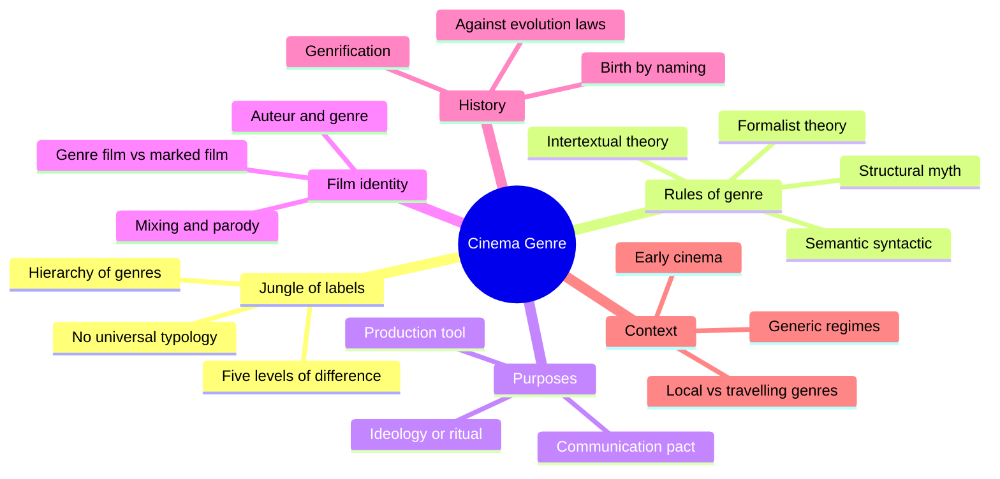
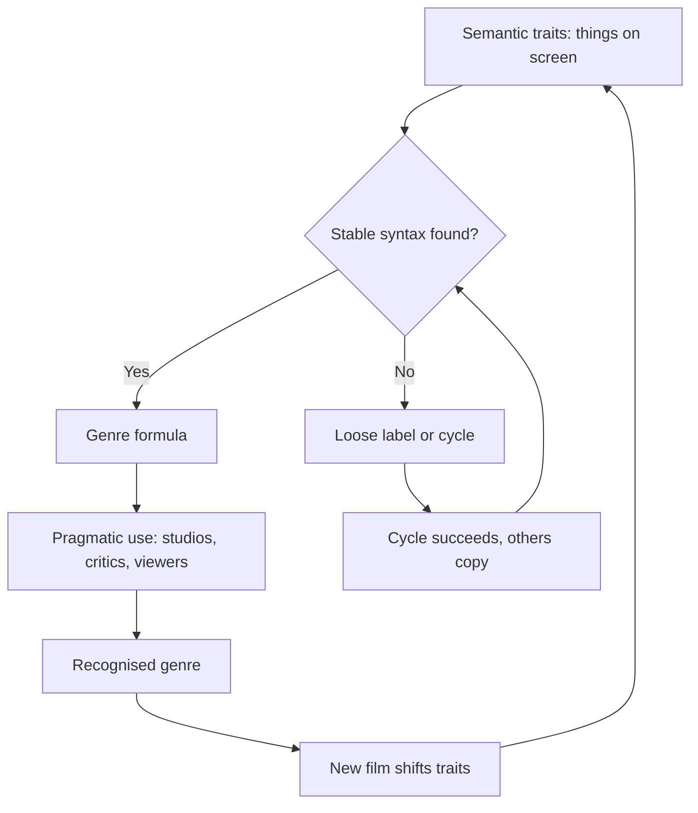
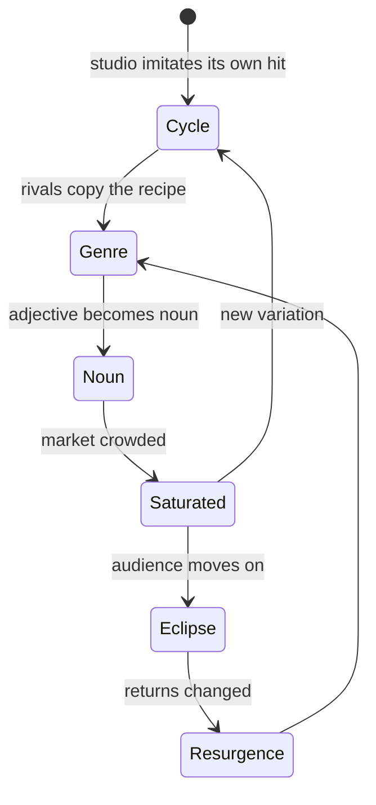
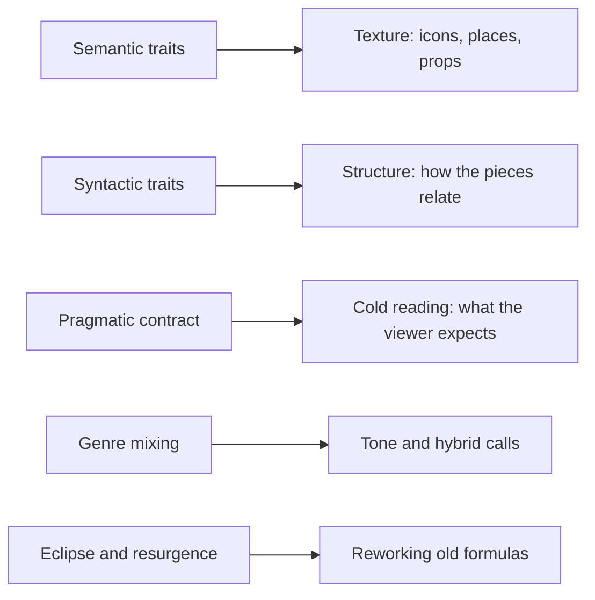

# BVX.1021 — Cinema Genre — Raphaelle Moine (2008)
### Knowledge Entry — Distill

A theory-of-genre survey that treats genre as a negotiated label, a set of text traits, a tool of production and a reading frame, all moving through history. It is in the library as craft basis for the OXO script editors: how a story signals its genre, keeps a promise to the viewer, and mixes genres without breaking it.

## TABLE OF CONTENTS
- [Core Thesis](#1-core-thesis)
- [Mind Models](#2-mind-models)
- [Framework](#3-framework--structure)
- [Key Concepts](#4-key-concepts)
- [Heuristics](#5-heuristics--decision-rules)
- [Invariants](#6-invariants)
- [Pitfalls](#7-pitfalls--myths)
- [Application](#8-application)
- [Cross-References](#9-cross-references)
- [Provenance](#10-provenance--confidence)

---

## 1 · CORE THESIS

A genre is not a box a film sits in. It is a shared agreement between makers, viewers and critics, built from recurring traits (semantic and syntactic) and renegotiated by every new film. Its identity is plural, historical and context-bound.

---

## 2 · MIND MODELS

**Diagram 1 — the whole argument.**
Read off the six chapters: from classifying, to defining, to function, to a film's identity, to history, to context.

**Diagram 2 — the central mechanism (semantic-syntactic-pragmatic).**
Read off how a genre stabilises: traits alone do nothing until a syntax binds them and a community recognises the result.

**Diagram 3 — genrification, the life of a label.**
Read off the loop: a cycle becomes a genre, saturates, then seeds the next cycle.

**Diagram 4 — mapped onto the Command's editing work.**
Read off where each Moine idea lands in a script edit.

---

## 3 · FRAMEWORK / STRUCTURE

1. **Ch 1, In the Genre Jungle.** Genre as an empirical category: it names, differentiates and classifies. Film guides, dictionaries and critics all disagree on number, name and content. Five levels of difference (enunciation, destination, function, semantic, syntactic, after Schaeffer) explain why. No tidy taxonomy is possible.
2. **Ch 2, Looking for the Rules.** Four attempts at a definition: formalist (genres as properties of the cinematic image), intertextual (Genette, Metz: genre as one vast open text), structural (plot types, Levi-Strauss binary oppositions) and Altman's semantic-syntactic model, which Moine favours.
3. **Ch 3, Purpose.** Genre as production tool (standardisation versus differentiation), as social function (ideological repression versus collective ritual) and as communication (the horizon of expectation).
4. **Ch 4, Generic Identities.** The same film holds several identities: genre film, generically marked film, auteur film, series film. Mixing is normal, not exceptional.
5. **Ch 5, History.** Rejects life-cycle laws. A genre is born when it is named, not when the first example is shot. Altman's genrification describes the cycle-to-genre loop.
6. **Ch 6, Context.** Genres are local as well as travelling. A generic regime is the whole system of genres in one place and time. Early cinema had labels but not genres in the later sense.

---

## 4 · KEY CONCEPTS

| Concept | What it is | Why it matters |
|---|---|---|
| Genre as class and group | The abstract category plus the body of films in it | A film joins a series of films, not just a label |
| Five levels of difference | Who speaks, to whom, with what effect, what is said, how | Explains why "comedy" (effect) and "western" (content) cannot sit on one list |
| Semantic traits | The materials: characters, settings, props, themes, techniques | Cheap to list, weak at explaining |
| Syntactic traits | How those materials relate; the plan of the building | The strong explainer; genre fully exists only once semantics sit in a stable syntax |
| Pragmatic dimension | Uses by viewers, producers, critics | A genre exists socially only when a community recognises it |
| Horizon of expectation | The viewer's system of references (Jauss) | The film is read against it; early signals set it |
| Generic contract or promise | Casetti's pact; Jost softens it to a promise tested by the film | Gives room to renegotiate, so surprise is legitimate |
| Standardisation and differentiation | Repeat enough to be efficient, vary enough to sell | The engine of genre production |
| Genre film and marked film | Modeled by genre versus shaped by it (Neale) | Parody, pastiche, homage and neo-noir are marked, not modeled |
| Altman's seven traits of the Hollywood genre film | Dual protagonists, repetition, cumulative economy, predictability, intertextual reference, symbolic key images, social function | A checklist of what the viewer already knows |
| Descending and ascending perception | Top-down schema versus bottom-up discovery (Perron) | Genre viewing is mostly top-down; novelty flips it |
| Genrification | Cycle, genre, noun, saturation, new cycle | Shows how hybrids become labels |
| Generic regime | The set and ranking of genres in a context | Hierarchy and status vary by country and era |
| Melodrama as mode | A register running across genres (Williams) | Explains the pathos beat inside war and action films |
| Alliances and ruptures | Temporary pairings of a genre with another (Leutrat) | Mixing follows the dominant form of the era |
| Resurgence, not return | A dead genre resurfaces with new composition | Revivals are new equilibria |

---

## 5 · HEURISTICS & DECISION RULES

| Situation | Do this | Not this |
|---|---|---|
| Naming a story's genre | Name it as a viewer would, then list the 2 or 3 identities it carries | Force one box |
| Defining a genre for a draft | List semantic traits, then ask which syntax ties them together | Stop at the prop list |
| Opening pages | Plant genre indicators early (title, look, music, first scene types) | Leave the viewer guessing which story this is |
| Subverting a convention | Signal the departure so the viewer can renegotiate | Break the promise silently |
| Mixing genres | Keep one syntax in charge, borrow semantics from the other | Pile traits from both with no governing structure |
| Borrowing a structure | Move the same syntax onto new semantics (war film to western) | Copy surface icons only |
| Judging whether a story is "typical" | Compare against the audience's own genre memory | Compare against an ideal pure form |
| Marketing or pitch line | Lead with the unique hook (character, cycle, star) and mention genre lightly | Rely on the bare genre name |
| Reading a film as a critic or editor | Ask who is naming it and why | Treat the label as a fact of the text |
| Writing a parody | Reproduce the semantic and syntactic traits clearly first | Parody without the viewer knowing the target |
| Writing across cultures | Check whether the label and its expectations exist for that audience | Assume "melodrama" or "comedy" mean the same everywhere |
| Reviving an old genre | Rebuild the balance for the present audience | Reproduce a golden-age template |

---

## 6 · INVARIANTS

1. Genre is a category of both production and interpretation, never only a property of the text.
2. A genre needs enough similar films before it can be recognised; the number cannot be fixed.
3. Every classification selects, groups and excludes.
4. No typology is universal; each use (guide, industry, criticism) has its own.
5. A genre fully exists only when semantics are tied into a stable syntax and a community agrees.
6. Naming comes after practice: genres are made retroactively.
7. The generic identity of a film is plural and can change with context.
8. Genre mixing is the rule; pure genre is the exception.
9. Repetition and variation always coexist in genre production.
10. Genres are historical; they cannot be reduced to a universal essence or archetype.
11. Hierarchies of genres reflect cultural legitimacy, not only money.

---

## 7 · PITFALLS / MYTHS

- **The pure genre.** Hybrids are the norm; purity is a snapshot of a "nucleus" that never existed as an origin.
- **Genres as biology.** Birth, maturity, decline and death (Brunetiere, Bazin, Schatz) fails against early self-aware westerns and gore films.
- **Golden age thinking.** Calling Stagecoach "classical" hides that its own audience already read it as citation.
- **Reflexivity means decline.** Parody and self-reference appear from the start.
- **Genre equals formula equals low art.** Auteur films are also generically marked; the split between genre and auteur cinema is ideological.
- **First film origin myths.** The Great Train Robbery was not a "western" in 1903.
- **Ideology only, or ritual only.** Both assume a passive, uniform audience; viewers are situated and varied (Klinger's five reasons for repeat viewing).
- **Hollywood as the measure.** Treating studio genre systems as the standard makes other cinemas look genre-less.
- **Structural tables prove their own premise.** The Kitses and Wright frameworks are built from films already chosen as representative (the circularity charge).
- **Theoretical genres as real ones.** Todorov's strict fantastic fits very few films; it is a deduction, not an observation.
- **Adjective equals genre.** "Romantic" in front of comedy makes a sub-genre or cycle, not a genre.
- **Rails as a metaphor.** Too much emphasis on predictability; viewers renegotiate the pact.

---

## 8 · APPLICATION

- **Spine level:** TEXTURE. Moine speaks to how a story reads, not to its spine.
- **12-layer character stack:** none (`feeds: []`).
- **plot_systems:** none.
- **Setting:** indirect. Semantic traits such as places and props are the genre's iconography.

This entry serves the OXO script editors (`.claude/agents/editing-*.md`) and `reading-cold.md`. Three uses:

**1. A cold read can test the promise.** A cold reader hits page one with only genre memory. The editor can ask: what horizon of expectation do the first pages set, and does the story honour it or renegotiate it with a visible signal? Moine's Thin Red Line example (viewers expecting a war film, leaving angry) is the warning case: mismatch between authorial and spectatorial regimes.

**2. A hybrid needs a governing syntax.** Moine's semantic-syntactic model gives a rule: the hybrid works when one syntax organises borrowed semantics (the musical folding in western songs, Star Wars taking western syntax, Taxi Driver read two ways). For a mixed-genre script, the editor can name the governing syntax and flag borrowed semantics that never plug into it.

**3. Different readers will name different genres.** The same film is melodrama, noir and woman's film depending on the reader (Mildred Pierce). Notes should log which identity a reader used before treating their reading as a defect.

The pitch rule (Ch 3) also applies to logline work: studios sell on cycle, star or character, and keep the bare genre word secondary.

---

## 9 · CROSS-REFERENCES

| Related entry | Relation |
|---|---|
| [[BVX.0064]] | McKee on character and cast; genre conventions decide which dimensions a role carries |
| [[BVX.0089]] | Dramatica as a structural system; compare Moine's syntactic level and her warning about structure tables proving their own premise |

---

## 10 · PROVENANCE & CONFIDENCE

Full text read from the pdftotext file `_PRIVATE/distill_wave/BVX.1021.txt`: front matter, foreword, introduction, all six chapters, conclusion (read to the "site" analogy). Not read: the closing conclusion paragraphs after the anthropological-site passage, the Select Bibliography, the Filmography and the Index, which carry no argument. Chapter endnotes were read only where they sat in the reading runs.

The book is a theory survey of film studies, not craft advice. Section 8 and the Heuristics table are inference from Moine's concepts, tuned to script editing; the source does not give writing rules. Examples are mostly Hollywood and French cinema. Text has OCR encoding damage on accented names (rendered here without diacritics).

Source note: filed under VIS, craft use only. No private detail.

## META
- Template: BVX-LEARN-v4.0
- Source classification: book, film genre theory (translated from French)
- Created / Updated: 2026-10-30
