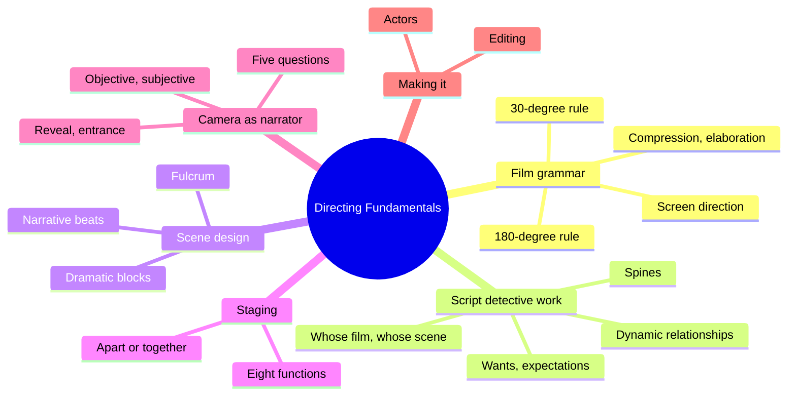
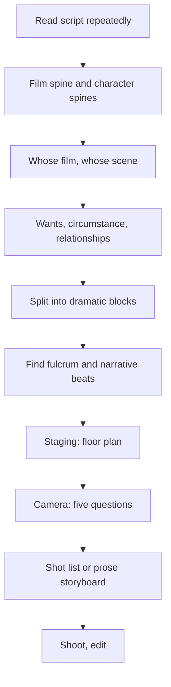
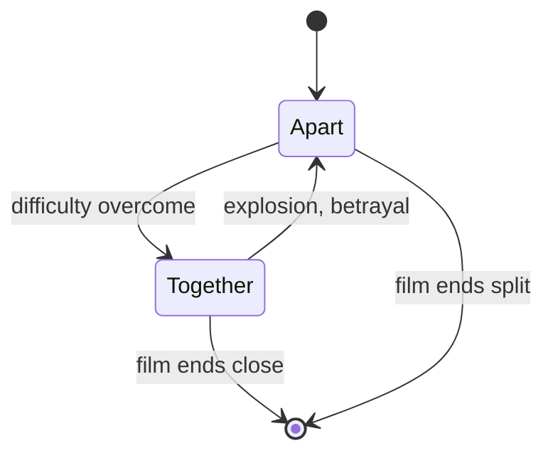
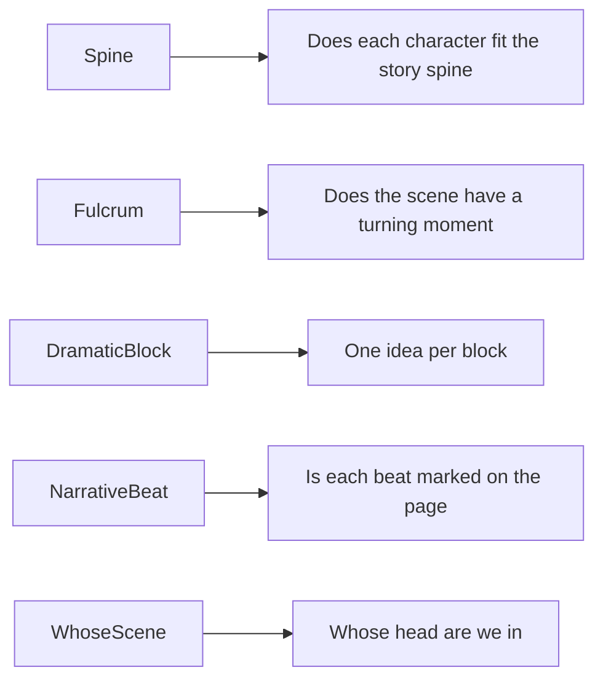

# BVX.1036 — Film Directing Fundamentals: See Your Film Before Shooting — Proferes (2005)
### Knowledge Entry — Distill

A Columbia University directing text. It gives a director's method for turning a screenplay into staging and camera decisions, and it is in the library as the craft basis for the script editors.

## TABLE OF CONTENTS
- [Core Thesis](#1-core-thesis)
- [Mind Models](#2-mind-models)
- [Framework](#3-framework--structure)
- [Key Concepts](#4-key-concepts)
- [Heuristics](#5-heuristics--decision-rules)
- [Invariants](#6-invariants)
- [Pitfalls](#7-pitfalls--myths)
- [Application](#8-application)
- [Cross-References](#9-cross-references)
- [Provenance](#10-provenance--confidence)

---

## 1 · CORE THESIS

A director designs the film in the head before shooting. Read the script like a detective for spine, wants, and dynamic relationships. Divide each scene into dramatic blocks and a fulcrum. Then use staging and camera, as narrator, to make each narrative beat clear to the audience.

---

## 2 · MIND MODELS

**Diagram 1 — the whole argument.**
Read off the chain: script analysis feeds staging and camera, and all three serve one audience-facing job, clarity.

**Diagram 2 — the central mechanism.**
Each step produces the input for the next; the director never starts at the camera.

**Diagram 3 — the scene's dramatic movement.**
Only two movements exist between characters, and both can be made physical; staging an accordion is the repeat of both.

**Diagram 4 — mapped onto the Command's editors.**
The book supplies the checks an editor agent runs on a scene.

---

## 3 · FRAMEWORK / STRUCTURE

The book has three parts.

**Part One, learning how to draw (ch. 1 to 6).** Film grammar, the dramatic elements, scene organization, staging, camera, and a shot-by-shot reading of the Patio scene in Hitchcock's *Notorious*.

**Part Two, making your film (ch. 7 to 12).** The method applied to the author's short script *A Piece of Apple Pie*: detective work, staging and camera, marked shooting scripts, actors, management, postproduction.

**Part Three, film analysis (ch. 13 to 17).** Full design readings of *Notorious*, *The Truman Show*, *8 1/2*, *Tokyo Story*, and a final chapter with script questions.

The method ladder, in order:

1. Spines (film, then each character).
2. Whose film is it; whose scene is it.
3. Character (past), circumstance, dynamic relationships, wants, expectations, actions.
4. Dramatic blocks and the fulcrum.
5. Narrative beats.
6. Staging, using a floor plan.
7. Camera design, using the five questions.
8. Prose storyboard, then shot list.

---

## 4 · KEY CONCEPTS

| Term | What it is | Why it matters |
|---|---|---|
| Spine | The driving concept of the film; each character also has a spine, the goal desired above all. Character spines sit under the film's spine. | If a character's spine does not fit under the film's spine, the character performs no function (Clurman). |
| Whose film / whose scene | The character we go through the film with, and the head the audience must be in to appreciate a scene. They can differ. | It decides where the camera goes. |
| Character | Everything in the past that made the person. Film is present; character is past. | Bring only baggage needed for this trip. |
| Circumstance | The situation the characters are in, real or imagined. | Actors need it clear on day one. |
| Dynamic relationship | How one character sees another right now ("knight in shining armor," "ball and chain"). Not husband or wife. | It is the source of "dramatic juice" and changes during the film. |
| Want vs. spine vs. need | Wants are smaller goals on the way to the spine; need is what they get instead. | Conflict between want and spine is better drama; the want/need gap gives irony. |
| Expectation | Whether a character expects to get the want, fears, or is confident. | Opposed expectations create tension. |
| Action and activity | One action at a time, an action verb ("to reprimand"). Activity accompanies the action (reading while waiting). | Dialogue is action. Actors play actions, not emotions. |
| Acting beat | Unit of action; changes whenever the action changes. Awareness comes first. | Basic unit of the actor's score. |
| Dramatic block | A "paragraph" of the scene with one overriding dramatic idea (reason, seduce, threaten, beg). | Gives each idea its own spatial rendering. |
| Narrative beat | An acting beat the director articulates through staging or camera, marking an escalation or key plot point. | Explains why a shot changes or a character moves. |
| Fulcrum | The moment in a scene where it can go either way for the character. | A feature of ten scenes has ten fulcrums but two turning points. |
| Compression and elaboration | Shorten what is dull; stretch what is interesting. | Duration is a dramatic category. |
| Reveal | A dramatic disclosure that carries weight. | Hold it back to build curiosity. |
| Entrance | Introduction of a character: personality, class, function. | Announce principals, never slide them in. |
| Familiar image | An image planted early that returns, giving symmetry and economy. | Orients the audience without exposition. |
| Separation and resolution | A character shot in a frame apart from others, resolved by a two-shot, a pan, or entering the frame. | Hold separation to show psychological distance. |
| Objective and subjective camera | Third-person narrator vs. a shift to the character's perceived experience. POV is not subjective. | Give the subjective voice to one person only. |

**The eight functions of staging:** render the obligatory physical action; make the internal physical; show the nature of a relationship; orient the viewer; resolve spatial separation; direct attention; punctuate; make a frame for the camera.

**The five camera questions ("What jobs must be done?"):** whose scene is it; what is the essence of the moment; what story points, location, character or props need introducing or keeping alive; what stylistic motifs must be introduced; must separation be resolved, or the audience oriented to place or time.

---

## 5 · HEURISTICS & DECISION RULES

| Situation | Do this | Not this |
|---|---|---|
| First reading of a script | Reread several times, set aside between reads, check what you remember | Trust first impressions or an audience's reaction |
| Choosing the protagonist | Ask whose film is it: whom do we hope or fear for | Insist on the one who drives all the action |
| A character's movement is planned | Tie it to the overt action or to making the internal physical | Move people "to liven up" the scene |
| Planning a scene | Name one idea per dramatic block; change the spatial rendering at each block | Run all ideas in one setup |
| Placing the camera | Start from "whose head must the audience be in" | Start from what looks cool or the master-medium-close default |
| A moment's essence is internal | Place the camera inside the character's dynamics (POV plus close shot) | Render only the surface action |
| Introducing a special style (slow motion, jump cut) | Plant it early in the film | Spring it late and let it read as a mistake (exception: farce) |
| Camera height | Eye level as a constant; any move up or down must have a reason | Unmotivated extreme angles |
| Characters to flip sides of the frame | Do it at a dramatic punctuation | Do it by accident |
| Rehearsal with actors | Talk circumstance and wants; put detective work away | Hand out labels like "my happiness" |
| Auditions | Give sides ahead; look for listening, moment-to-moment work, absence of anticipation | Cold readings; expecting a finished performance |
| Fine cut | Ask "does it serve the overall story?" and cut to shorten | Keep a joke or line you love |
| Feedback after a screening | Act on specific, fixable comments | Weigh general praise or dislike |

---

## 6 · INVARIANTS

1. Every shot is a sentence with a subject and a verb; its meaning comes only from context (the wristwatch example). No angle carries inherent meaning.
2. Four grammar rules exist (180-degree, 30-degree, screen direction, and the time rules) and all may be broken for dramatic effect, but only on purpose.
3. In film no one sits, stands, or moves unless it fulfills the story's action or makes the internal physical.
4. Only two overall dramatic movements exist between characters: apart then together, together then apart. Stasis is not dramatic.
5. A character performs one action at a time.
6. Character spines live under the film's spine.
7. The camera is the narrator and the director's voice. The audience prefers a strong narrator.
8. Duration is a dramatic category; screen action feels slower than it did on the set.
9. Directing finally consists of turning psychology into behavior (Kazan).

---

## 7 · PITFALLS / MYTHS

- "Coverage" as a safety net. Wide, medium, close is a prescription for mediocrity; still, sometimes the ordinary is right (long conversations, unrepeatable action).
- Subjective camera overuse, or giving it to more than one person.
- Confusing a POV shot with a subjective camera.
- Acting emotions. Emotion comes from action, want, relationship and circumstance.
- Arbitrary staging, the "greatest anathema to dramatic tension."
- Fear of the 180-degree rule so strong that nobody breaks it, even where breaking it would help.
- Treating the director as a rescuer for the editor; the director designs the film so editing is not salvage.
- Handing the first assembly to an editor you do not know well.
- Expecting actors to deliver at auditions or blaming them in the edit. Performance problems are the director's.
- Letting the ordinary bury the essence of a moment.
- Chasing perfection when editing; it "is not an aesthetic category."

---

## 8 · APPLICATION

- **Spine level:** TEXTURE. The book is about rendering story, not building it. Its spine concept maps loosely to the Command's story spine, but the book's "spine" means a unifying through-line, not an L0 to L7 level.
- **12-layer character stack:** none. `feeds: []`. Character analysis here is performance-oriented (wants, dynamic relationships), not the psychological variables LEECHSEED stores.
- **plot_systems:** none directly.
- **Setting:** floor plan and "changing the stage" are tools for scene location use.

How it serves the OXO editors. The Command's editors read prose and screenplay pages, so the useful parts are the checks that work without a camera:

- **Spine fit.** For each major character, state the spine in one verb phrase; test it against the story's spine.
- **Scene audit.** Name whose scene it is, each character's want, expectation, and how each sees the other. Mark the fulcrum. If a scene has no moment that can go either way, flag it.
- **Blocks and beats.** A scene that carries several ideas without a visible shift in space, tone, or action needs separate blocks. Beats that only the page's author can see (no staging or camera marker) are weak.
- **Movement test.** Does the scene move characters apart or together? If the relationship is static at the end, the scene is stasis.
- **Cold reading.** The book backs a first-pass reading for clarity: does the reader know where each character is, whose head we are in, and what changed? Specific, fixable comments only.
- **Economy.** Familiar-image planting (introduce a door, a prop, a room once; reuse it) as a way to cut exposition.
- **Cut test.** "Does it serve the overall story?" Duration counts as a dramatic variable.

The camera and lens chapters only matter for adaptation of OXO to screen, not for prose edits.

---

## 9 · CROSS-REFERENCES

| Related entry | Relation |
|---|---|
| [[BVX.0064]] | McKee, *Character*: the dimension and cast ideas pair with spines, wants and dynamic relationships |

Other BVX ids not checked; add when the neighbors in VIS are known.

---

## 10 · PROVENANCE & CONFIDENCE

Sourced from the full text via pdftotext, read by section: contents, chapters 1 to 5, 7, 10, 12, and the Patio scene synopsis in chapter 3. Chapters 6, 8, 9, 11, and Part Three (13 to 17) were not read; their content here is taken from the table of contents only. The year (2005) is inferred from the printing line, not confirmed; the Zotero key and page count were not in the brief. The OXO application is inference, kept apart from source claims in section 8.

## META
- Template: BVX-LEARN-v4.0
- Source classification: book, craft text (film directing)
- Created / Updated: 2026-10-30
