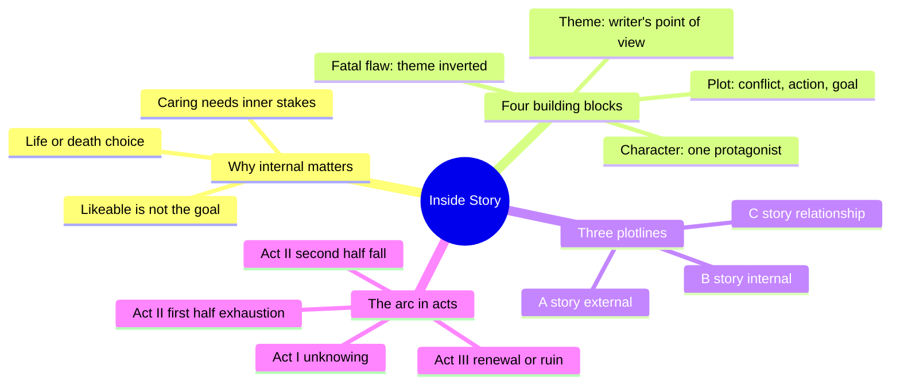
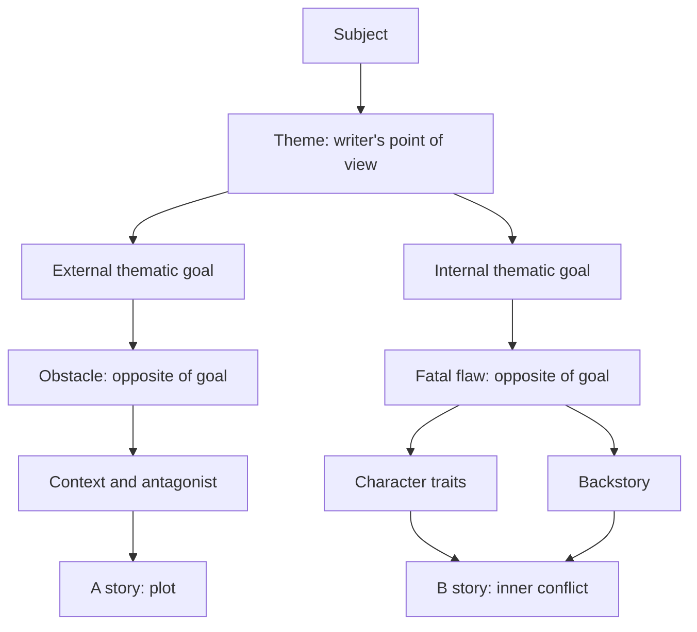
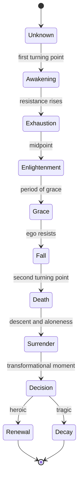
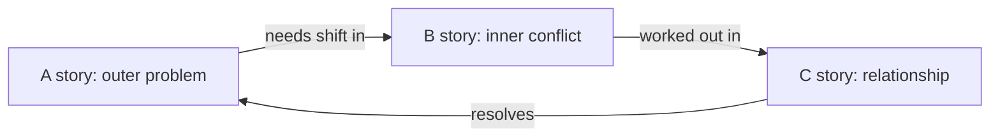

# BVX.1046 — Inside Story: The Power of the Transformational Arc — Dara Marks (2007)
### Knowledge Entry — Distill

A screenwriting craft book by a script consultant. It teaches how to build a protagonist's inner change into plot, theme and act structure. It is in the library as the craft basis for the OXO script editors.

## TABLE OF CONTENTS
- [Core Thesis](#1-core-thesis)
- [Mind Models](#2-mind-models)
- [Framework](#3-framework--structure)
- [Key Concepts](#4-key-concepts)
- [Heuristics](#5-heuristics--decision-rules)
- [Invariants](#6-invariants)
- [Pitfalls](#7-pitfalls--myths)
- [Application](#8-application)
- [Cross-References](#9-cross-references)
- [Provenance](#10-provenance--confidence)

---

## 1 · CORE THESIS

Every story runs two lines: the external plot and the protagonist's transformational arc. The arc starts at a fatal flaw, a survival system that has outlived its use, found by inverting the theme. Plot conflict breaks that system, and the protagonist then grows or fails by conscious choice.

---

## 2 · MIND MODELS

**Diagram 1 — the whole argument.**
Read off the two parts: Part I builds the four materials (plot, character, theme, flaw); Part II lays them along the four-quadrant arc.

**Diagram 2 — the central mechanism.**
Read off the sequence: theme is converted step by step into flaw, plot context and antagonist, so no choice is random.

**Diagram 3 — the arc through the acts.**
Read off the states: the protagonist moves from not knowing to knowing, and the midpoint is the breaking point, not the end of the work.

**Diagram 4 — the A, B, C triad.**
Read off the loop: the relationship story is the hinge that turns inner change into outer victory.

---

## 3 · FRAMEWORK / STRUCTURE

**The book.** Part I (chapters 1 to 5) lays the foundation. Part II (chapters 6 to 10) builds the arc over four quadrants. The epilogue closes on Pandora.

**The four-line pattern.** A person (character) succeeds or fails to grow (arc) within the conflict that unfolds (plot) from the writer's point of view (theme).

**Part I materials.**
1. **Plot** is conflict, action and goal. Heightened conflict makes jeopardy, jeopardy demands resolution, resolution forms a goal, and the struggle for the goal makes tension. Name the plot in one line: conflict, action, goal.
2. **Character.** One plot, so one protagonist. The protagonist carries the goal of the plot and the internal goal in the subplots. Co-protagonists must share both goals.
3. **Theme.** A point of view on a subject, drawn from the writer's own truth. It splits into an external thematic goal (plot) and an internal one (subplot).
4. **Fatal flaw.** Invert the internal thematic goal. Derive traits, backstory and the antagonist's nature from that inversion.

**Part II structure.** Marks reads structure as resistance and release. Conflict rises as an arc, so what goes up must come down. Arcs chain into a spiral. Four quadrants carry the protagonist: Unknown, Exhaustion, Known, Renewal.

| Beat | Place | Job |
|---|---|---|
| Inciting incident, call to action | Act I, first 20 pages | Set up A, B and C clearly. Never trade clarity for mystery |
| Defining moment | Act I | One scene that makes the inner conflict plain |
| First turning point | About page 25 | Raises stakes; internally an awakening |
| Act II, part one | To the midpoint | Resistance, ego in charge, still unknowing |
| Midpoint | About the middle | Breaking point; a moment of enlightenment; theme spoken |
| Period of grace | After midpoint | Rest and a glimpse of the possible; optional |
| Fall | Late Act II | Ego fights the new knowing; lies come due |
| Second turning point | End of Act II | Death experience: the worst thing, drawn from the theme |
| Descent | Early Act III | Aloneness, surrender, a blood sacrifice |
| Transformational moment | Before or in the climax | The conscious choice; often the B story's climax |
| Climax and resolution | End | Antagonist neutralized; a glimpse of the new life |

**Outcomes.** Marks sets four endings from the three plotlines: heroic (inner and outer win), tragic (both lose), hollow victory (outer win, inner loss), and a wise loss (inner win, outer loss).

---

## 4 · KEY CONCEPTS

1. **Transformational arc** → the second line of structure wrapped inside the plot → it makes the action matter.
2. **Fatal flaw** → a struggle to keep a survival system after it stopped working → it names what the story must break.
3. **Survival system** → a belief or behavior that once kept the character safe → it explains why the flaw feels sensible to the character.
4. **A, B, C stories** → plot, inner subplot, relationship subplot → sub means foundational, not lesser.
5. **Heroic and tragic** → goals for inner growth, not traits → the drama needs both outcomes to be possible.
6. **Inversion** → find the opposite of a thematic value → one move gives flaw, obstacle and antagonist.
7. **Midpoint as enlightenment** → new information or view that releases the story toward resolution → the best place to read the writer's theme.
8. **Period of grace** → a plateau that shows what winning might feel like → it also lulls the protagonist into a false safe.
9. **Death experience** → loss that attacks the inner gain → the toll to enter renewal.
10. **Blood sacrifice and Underworld** → a price paid at the edge of the known self → shows the depth the arc may go.
11. **Transformational moment** → the conscious choice to grow or not → "Transformation is always a conscious choice."
12. **Antagonist as shadow** → the outer form of the protagonist's inner conflict → keeps villain and flaw tied.
13. **Image** → conflict and theme carried by picture, not talk → how Act I shows inner stakes cheaply.
14. **Imbalance** → conflict is two values out of balance → the ending restores balance or deepens it.

---

## 5 · HEURISTICS & DECISION RULES

| Situation | Do this | Not this |
|---|---|---|
| Studio asks for a likeable lead | Give the lead a flaw tied to the theme | Idealize the hero with beauty, brains, brawn |
| Script feels flat despite action | Ask what the protagonist gains inside that they lacked at the start | Add bigger set pieces |
| Two plotlines pull apart | Find one shared goal (The Fugitive: justice) | Let two goals fight for the climax |
| More than one lead | Link goals into one external and one internal goal | Tag two unrelated protagonists |
| Picking a flaw | Invert the internal thematic goal | Guess by trial and error |
| Designing the villain | Invert the external thematic goal | Pick a generic bad guy |
| Writing the flaw | Look at the winter of the character: what has run dry? | Judge morals; sex or drink is not the flaw |
| Backstory | Start from the flaw and ask how it formed | Invent a random biography |
| Act I | Show A, B and C in 20 pages; use a defining moment | Hide the conflict to build mystery |
| Midpoint | Let the protagonist learn something true that shifts the goal | Add an explosion with no inner turn |
| Theme speech wanted | Put it at the midpoint | Spread speeches through the third act |
| Second turning point | Ask "worst thing for the inner gain?" then design the boom | Start from the biggest external disaster |
| Third act rescue urge | Keep the descent going; let aloneness bite | Make up the lovers within two pages |
| Climax | Make the fight carry the theme | Tack on an unrelated issue (Million Dollar Baby) |
| Ending | Show a glimpse of the new life, with work still ahead | Settle everything forever |
| Stuck on theme | Read your own midpoint and what the protagonist learns there | Wait for a speech to appear |
| Self-check | "What can the protagonist do at the end they could not at the start?" | Accept "nothing" |

---

## 6 · INVARIANTS

1. External action is driven by internal need; no action has value except as it is internalized.
2. One story has one plot, one protagonist (or co-protagonists sharing a goal), one theme.
3. The protagonist carries both the external and the internal goal.
4. The fatal flaw is the opposite of the theme's internal goal, and it cannot be a moral verdict.
5. Conflict exists because the protagonist does not yet know how to resolve it; the protagonist enters Act I unknowing.
6. The arc rises then falls; non-linear telling still keeps that rise and fall.
7. The midpoint carries the writer's thematic truth, and the second turning point attacks it.
8. Transformation needs a death experience and a conscious choice; understanding alone is not change.
9. A story's end either restores balance between opposed values or deepens the split.
10. The audience enters the story through the protagonist.

---

## 7 · PITFALLS / MYTHS

- **Likeability as a goal.** It strips the traits the conflict needs. Marks calls it possibly the most destructive force in modern film.
- **The ringmaster hero** who only moves plot pieces (Apollo 13). Nothing is learned, so nothing is felt.
- **Subtlety mistaken for ambiguity** in the setup. The audience cannot care about what it does not understand.
- **Plot split in two** (Heat). Two goals leave the climax unclear.
- **Subplot as lesser.** Subplots carry the meaning; the plot is the train, the subplots the cargo.
- **The flaw with no pain.** A protagonist who lacks the quality the theme asks for cannot gain it (Don Juan DeMarco's doctor).
- **Idealized good guys with a dirty side kept apart** (Ransom's Tom Mullen). The audience finds no way in.
- **The midpoint as the finish.** Insight is the gate; the work follows in the fall and death experience.
- **Boom-first second turning points.** The external crisis must grow from the inner stakes.
- **Rescuing the protagonist at once** in Act III, or a deus ex machina that makes the hero's work pointless.
- **Passive victim stories.** Pity without an inner goal (the abandoned wife draft).
- **Technique as rules.** Marks warns the method is for finding your own process, not filling a form.
- **Mystical drift.** The book leans on Jungian and mythic claims (wholeness, Underworld). They are craft lenses, not facts.

---

## 8 · APPLICATION

- **Spine level:** TEXTURE. The book governs how scenes and acts carry inner change; it does not set the Command's L0 to L7 story levels.
- **12-layer character stack:** none wired (`feeds: []`). The book is craft, not character psychology. Its "flaw" is a story device, not a LEECHSEED field.
- **plot_systems:** reads as an editing lens for a single A story with B and C beneath it.
- **Setting:** not applicable.

Craft use for the OXO editors (`editing-*.md`, `reading-cold.md`):

1. **Per-scene test.** Ask which of A, B or C the scene advances and what the protagonist knows after that they did not know before.
2. **Cold-read checklist.** Locate inciting incident and call to action by page 20; first turning point near 25; midpoint with a stated truth; second turning point that hits the inner gain; a conscious choice before the climax.
3. **Flaw audit.** For any protagonist, write theme, inverted internal goal, flaw, traits, in that order. If a trait cannot trace back, flag it.
4. **Antagonist audit.** The antagonist should be the outer face of the flaw. Check that the opponent embodies the inverted external goal.
5. **Hollow-victory check.** If the outer goal is won without the inner gain, mark it hollow and decide on purpose.

Mark all this as Marks's craft model. Where the Command has its own rulings (research versus canon, systems first), those rule. This entry gives editors a vocabulary, nothing more.

---

## 9 · CROSS-REFERENCES

| Related entry | Relation |
|---|---|
| [[BVX.0064]] | McKee on character: true character shown under pressure; same insight as flaw plus conflict |
| [[BVX.0089]] | Dramatica: a rival structural theory; compare its throughline model to the A, B, C triad |
| [[BVX.0092]] | A screenplay structure primer; gives the plain act beats Marks fills with inner states |
| [[BVX.0054]] | Premise lines; pairs with naming the plot in one line |
| [[BVX.0068]] | Genre conventions and obligatory moments; a check against over-reading the arc |
| [[BVX.0053]] | Alternative structures beyond the Hollywood formula; limits of Marks's model |
| [[BVX.0075]] | Compelling characters for screen; companion on flaw and want |

---

## 10 · PROVENANCE & CONFIDENCE

Sourced from the full text (pdftotext, 12,200-odd lines), read in sections. Read closely: introduction; chapters 1, 2 (to the plot-naming section), 3 (to the co-protagonist section), 4 (thematic goal and first case study), 5 (almost whole, to the "turning theme into plot" section), 6 (to the Romancing the Stone case study), 7 (to the first-turning-point diagram), 8 (to the Romancing the Stone case study), 9 (to the same), 10 (to the climax, resolution and happily-ever-after sections), and the epilogue.

**Not read (named per the coverage rule):** the case-study sections that close chapters 2 to 10 (Romancing the Stone, Casablanca, The Fugitive, Dead Poets Society and others, worked beat by beat); the middle of chapter 3 after the Sea of Love passage; chapter 4's Lethal Weapon and later case studies and the closing "Write What You Don't Know" section; chapter 5's case studies; the glossary and filmography; the index. Their content applies the framework above to named films and adds no new framework, but this is not confirmed. Page numbers cited in the book's own contents list; no page mapping to PDF pages was checked.

Confidence is medium: the framework is complete; film-by-film applications are partial. Cross-reference relations are inferred from titles, not from reading those entries.

## META
- Template: BVX-LEARN-v4.0
- Source classification: book, craft theory (screenwriting)
- Created / Updated: 2026-10-30 / 2026-10-30
