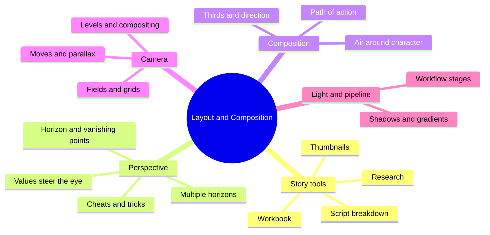
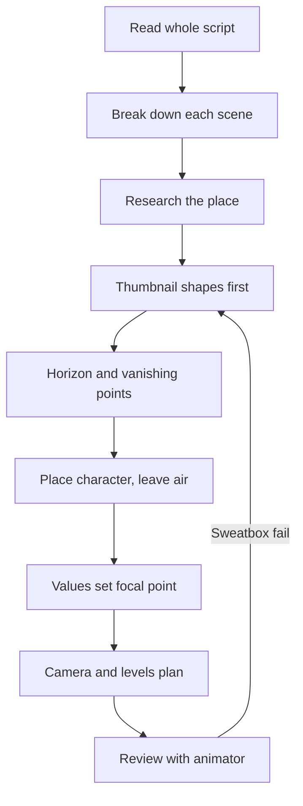
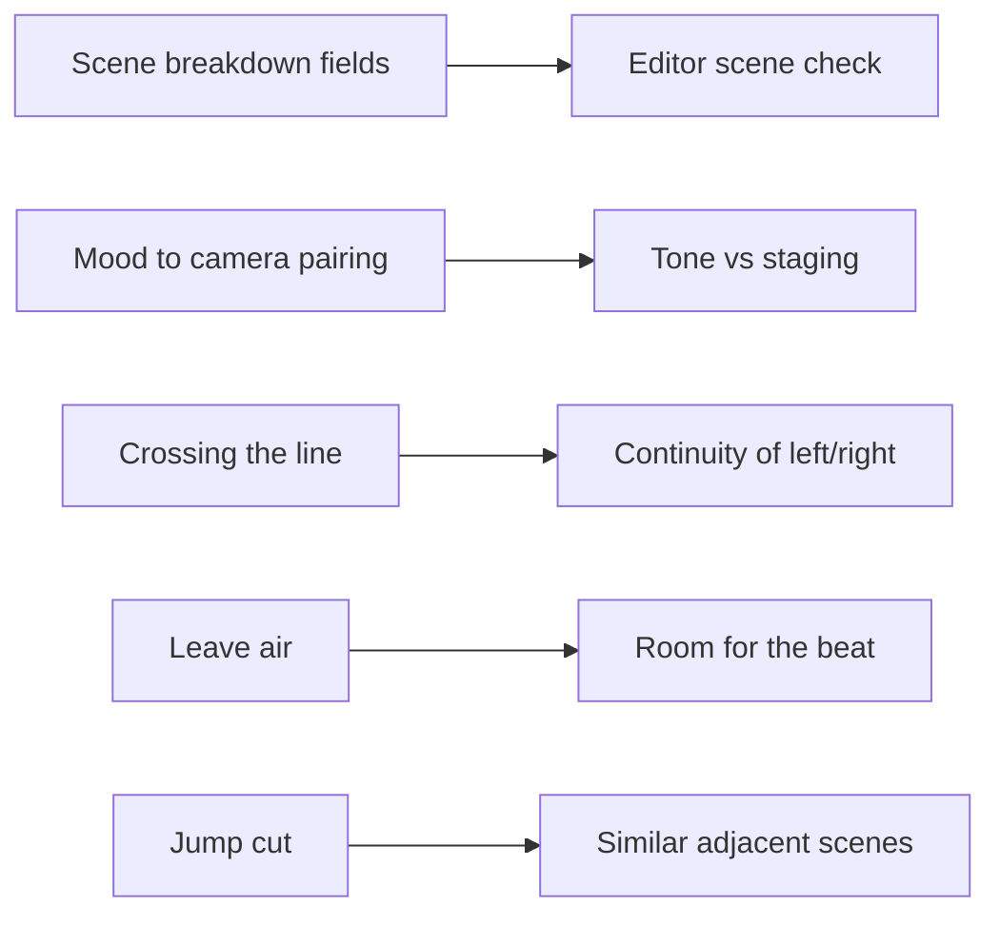

# BVX.1047 — Layout and Composition for Animation — Ed Ghertner (2010)
### Knowledge Entry — Distill

A Disney layout artist's teaching book on building the stage a scene plays on: story breakdown, perspective, composition, camera, light, and the production pipeline. It is in the library as craft basis for the script editors, who judge staging, camera and continuity in prose.

## TABLE OF CONTENTS
- [Core Thesis](#1-core-thesis)
- [Mind Models](#2-mind-models)
- [Framework](#3-framework--structure)
- [Key Concepts](#4-key-concepts)
- [Heuristics](#5-heuristics--decision-rules)
- [Invariants](#6-invariants)
- [Pitfalls](#7-pitfalls--myths)
- [Application](#8-application)
- [Cross-References](#9-cross-references)
- [Provenance](#10-provenance--confidence)

---

## 1 · CORE THESIS

Every place has a story, and layout builds the stage that story is told on. The layout artist reads the script, then shapes space, perspective, light and camera so the audience always knows where they are, where to look, and what the scene feels like. The camera serves the character, never leads.

---

## 2 · MIND MODELS

**Diagram 1 — the whole argument.**
Read off the five jobs layout does, from reading the script to handing off to the pipeline.

**Diagram 2 — the central mechanism.**
Read off the order of work: read, shape, build, then check against the camera. Skipping an earlier step costs rework later.

**Diagram 3 — mapped onto the Command's systems.**
Read off how the book's scene-breakdown fields become the questions an editor asks of a scripted scene.

---

## 3 · FRAMEWORK / STRUCTURE

The book has six chapters plus an introduction and "Ghertner's Gallery" plates of production art.

1. **Story Tools.** Scene vs sequence; the script breakdown checklist; workbook; thumbnails; research.
2. **Perspectives.** Models, the horizon line, vanishing points, perspective grid, multiple horizons, values and vanishing points, tricks for curved pans and tilts.
3. **Composition.** Film language shot sizes, directional cues, jump cuts, air, angles, path of action, blue sketch.
4. **Camera.** Fields and grids, pan and truck terms, crossing the line, moving with the camera, match cuts, bi-pack, bezier and slow-in/out, repeat pans, multi-level and multi-plane, overlays and underlays, compositing, backgrounds.
5. **Lighting Effects.** Restraint, shadow construction, three-value rendering, gradients, reflections.
6. **Workflow.** Development, pre-production, production, post, marketing.

The breakdown checklist (ch. 1) is the book's spine. For each scene it asks: scene number, description and point, lead character, movement and path of action, camera move, time of day, point of view, atmosphere, mood, color and technique, timing, size of layout, object specifics.

---

## 4 · KEY CONCEPTS

| Concept | What it is | Why it matters |
|---|---|---|
| Layout | The department that designs the stage, camera and lighting for each scene | The audience reads the world through it |
| Script breakdown | Question list applied to each scene, with margin thumbnails to count difficulty | Gives accurate cost and keeps the whole story consistent |
| Workbook | Layout drawings of composed shots with camera moves, built from the storyboard | Storyboards show acting; the workbook adds cinematography |
| Thumbnail | Small, quick shape sketch before any detail | Shapes first so changes stay cheap |
| Draw through | Draw the full volume (the tree's turn, the earth's curve) before details | Same logic as drawing a character before clothing |
| Horizon line | Eye level; all vanishing points sit on it | Anchor of every drawing; sets up shot, down shot, or eye level |
| Interior limit | Back wall must sit forward of the horizon, not on it | Otherwise the room looks huge and the character shrinks |
| Multiple horizons (the cheat) | Two horizons and vanishing points, with lines split between them | Lets one fixed field hold a character at two depths |
| Contact points | Feet agree with the background horizon | Any character perspective is believable if contacts match |
| Values and focal point | Darken the area with the vanishing point so the lead is the lightest | Convergence lines pull the eye away from the character |
| Air | Space around the character | Room for acting, movement and breath; tight reads as trapped |
| Path of action | A cleared route the character moves through | Controls where detail goes and where animation will cross |
| Crossing the line | Flipping left/right relationship between cuts | Confuses the audience; usually caught at storyboard |
| Field | Numbered frame size (4-field is 4 inches wide) | Language between layout, scene planning and camera |
| Parallax | Near objects move faster than far ones in the same move | Gives depth in multi-level, multi-plane and 3-D |
| OL / UL / BG | Overlay, underlay, background levels, numbered bottom to top | Splits art so layers can move and be reused |
| Held cell | Object or character drawn by animation that stops and holds | Painted in the character style, not the background style |
| Blue sketch | Animation and rough layout combined on one sheet | Shows the background painter where action falls |
| Three-value rendering | Light, medium, dark, plus black and white for accents | Cleaner reading; cast shadows darkest, light side lightest |
| Sweatbox | Directorial review of shot scenes | Where staging and continuity failures send work back |

---

## 5 · HEURISTICS & DECISION RULES

| Situation | Do this | Not this |
|---|---|---|
| Starting any scene | Read the whole script, then break down the scene | Work from the scene at hand only |
| Starting a drawing | Thumbnail simple shapes | Commit to design detail early |
| Self-checking | Keep your own short checklist and glance at it hourly | Wait for the director to find drift |
| Place not yet defined | Research several candidate locations (the lake case) | Invent a generic placeholder |
| Camera move | Move only when a lead character moves off-screen or the story needs it | Let the camera lead the action |
| Handheld or shaky camera | Use as an effect for a woozy or confused moment | Use as a constant |
| Character against busy set | Split a similar shape with light or shadow; keep lead clear | Put a background object of the same shape and size behind the character |
| Strong one-point perspective | Accentuate it in the establishing shot, ease it in the acting close-up | Make the animator act along a steep perspective line |
| Perspective problem in a fixed field | Add a second horizon and split the lines | Add a camera move just to dodge it |
| Vanishing point steals focus | Darken that region, keep the lead lightest | Rely on line work alone |
| Main light source | Keep it off screen unless the story needs it; drop its contrast so eyes stay highest | Put the brightest object beside the lead |
| Effects and lighting | Use a little: a color shift of a shade or two as the character crosses light | Highlights and contact shadows through the whole scene |
| Tight shot | Give the character air | Trap them in a tight field |
| Neighboring scenes | Review the shots on both sides before composing | Match two similar compositions almost exactly (jump cut) |
| Landscape | Keep the ground plane uneven | Draw a flat plane; even streets slope to the curb |
| Shapes in frame | Let some shapes run outside the field | Tidy everything inside the edges, which shrinks the world |
| Zoom into art | Start at the widest field; don't go below a 7-field | Shoot so close that linework or paint fails |
| Moving the camera far | Split into levels with a hole in the overlay | Stretch a single piece of art |
| Parallax in realistic shots | Keep level movements in ratio to one another | Independent speeds, unless a cartoon look is intended |
| Animation feels slow | Truck in on the character | Re-animate |
| Animation crosses a lot of perspective | Have the move run nearly parallel to the picture plane | Fight the grid |

Mood-to-camera pairings from the breakdown list: happy, long shots with lots of air; sad, down shot with space above; bored, static and symmetrical; excited or chase, chaotic with strong moves; claustrophobic, tight shots. Point of view: submissive, down shot; leader, upshot; anger, upshot with slight tilt; lost or hiding, small in the field or large and crowded to one side; psychotic, tilted angles.

---

## 6 · INVARIANTS

1. Every vanishing point sits on a horizon line (multiple horizons are the stated exception).
2. A character at waist height against the horizon stays waist height wherever they stand on a flat plane; only a changing ground plane (stairs, hills, flight) alters it.
3. Ninety percent of camera moves exist because a lead character moves.
4. The camera never leads the action unless the story calls for it (establishing shots, a dissolve to sky).
5. The nearer a shadow-casting object is to the surface, the darker and sharper the shadow.
6. Cast shadows are darkest, the dark side of an object medium, the lit side lightest.
7. The highest contrast in the frame becomes the focal point.
8. In a parallax move the foreground travels faster than the background, locked to one vanishing point.
9. Left/right relationships between characters stay fixed across a sequence.
10. Production is not linear. Storyboard, layout, animation, scene planning, camera, editing and review pass work back and forth.

---

## 7 · PITFALLS / MYTHS

- Putting objects or back walls on the horizon; the room balloons.
- Placing two vanishing points too close together, which warps lines near the picture plane.
- Calling "cheat" a cover for not knowing perspective. A good cheat corrects what is drawn right but looks wrong.
- Mistaking a lead for a background shape of the same size.
- A flat ground plane.
- Moving the camera too much, especially in the same diagonal the character moves, which cancels the action.
- Crossing the line: staging that flips screen direction.
- Jump cuts from near-identical compositions.
- Over-lighting: extra effects work that raises cost and weakens the effect.
- A bright on-screen main light that outshines the lead.
- Getting lost in detail before shapes are set.
- Treating research as optional ("there's no excuse for not doing research").
- Hiding perspective changes without knowing the scene timing; the cover-up must match the speed.

---

## 8 · APPLICATION

- **Spine level:** TEXTURE. The book governs how scenes are staged and shot, not what the story is.
- **12-layer character stack:** none. `feeds: []`; the book touches character only as placement and point of view.
- **plot_systems:** none directly.
- **Setting:** Strong support. The research chapter argues that story and characters are rooted in where the story takes place.

For the OXO script editors the useful parts are the scene-breakdown checklist (a ready set of questions to ask of every scripted scene), the mood-to-camera pairings (check that described staging matches intended tone), the crossing-the-line and jump-cut rules (continuity of screen direction and adjacent beats), and the air and path-of-action ideas (does a beat give a character room to move and act). A cold reader can use the "what is the statement of this scene" test from the Composition chapter. The book's camera-never-leads rule translates to prose as: point of view should follow a character's attention, not the narrator's showmanship. Technical chapters on grids, bi-pack and compositing are 2-D production craft and carry little editorial weight.

---

## 9 · CROSS-REFERENCES

| Related entry | Relation |
|---|---|
| [[BVX.0064]] | McKee, Character: pairs character dimension with the staging that shows it |

---

## 10 · PROVENANCE & CONFIDENCE

Sourced from the full pdftotext of the book (`_PRIVATE/distill_wave/BVX.1047.txt`), read in sections: introduction, chapters 1 to 6, workflow, and the start of the index. All six chapters were read. Gallery plates are image-only and carried no extractable text beyond captions; the index was only skimmed, and the final index pages and some figure labels are unread. Confidence is high on the stated rules, since most are quoted directly. Section 8 is inference for the Command's editors, not the author's claim. Note the text has OCR noise in diagram labels and the file has non-UTF-8 bytes.

## META
- Template: BVX-LEARN-v4.0
- Source classification: book, craft handbook (VIS)
- Created / Updated: 2026-10-30
