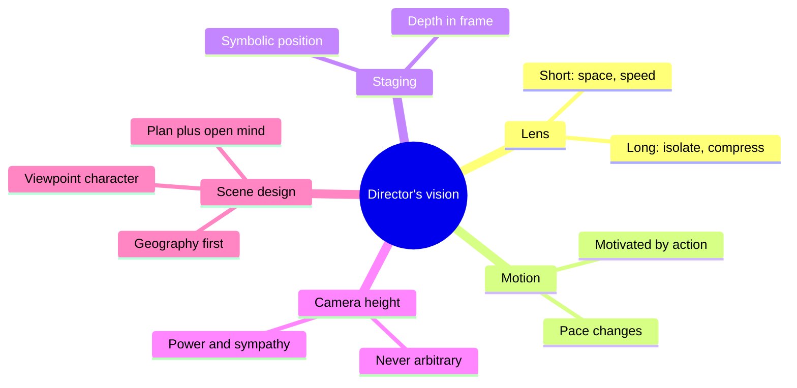
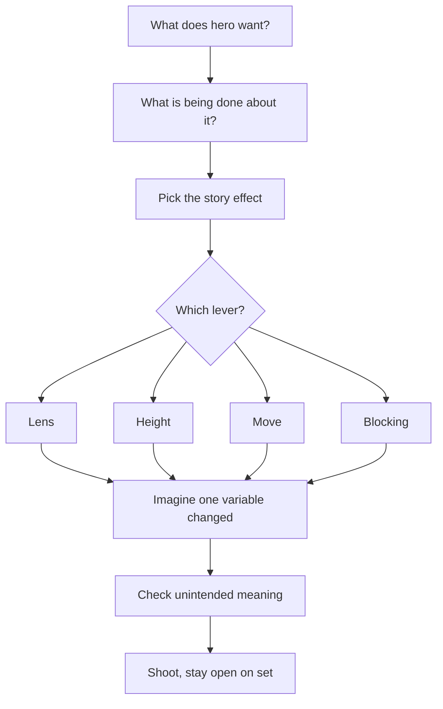
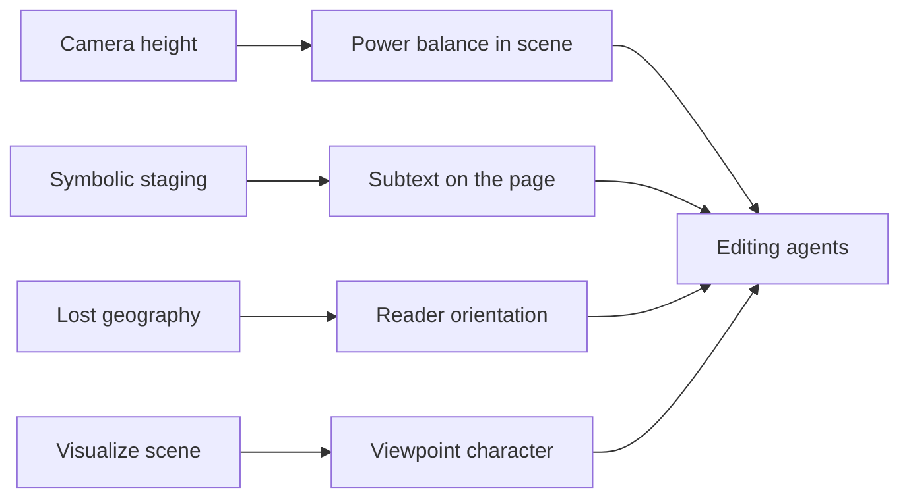

# BVX.1054 - Master Shots Vol 3: The Director's Vision - Kenworthy (2013)
### Knowledge Entry - Distill

A shot-design handbook: 100 camera, lens, height and blocking choices, each tied to a story effect. In the library as craft basis for judging whether a scene's staging does story work.

## TABLE OF CONTENTS
- [Core Thesis](#1-core-thesis)
- [Mind Models](#2-mind-models)
- [Framework](#3-framework--structure)
- [Key Concepts](#4-key-concepts)
- [Heuristics](#5-heuristics--decision-rules)
- [Invariants](#6-invariants)
- [Pitfalls](#7-pitfalls--myths)
- [Application](#8-application)
- [Cross-References](#9-cross-references)
- [Provenance](#10-provenance--confidence)

---

## 1 · CORE THESIS

Every shot should reveal story, expose emotion, explore character, or capture the film's feeling. Lens, camera height, movement and actor position each carry meaning, so none is a default. Choose them from what the character wants in the scene, not from coverage habit.

---

## 2 · MIND MODELS

**Diagram 1 - the whole argument.**
Read off the five levers a director controls and the story question that selects among them.

**Diagram 2 - the central mechanism.**
Read off the loop: ask the story question first, then pick one variable, then check what it says unintentionally.

**Diagram 3 - mapped onto the Command's systems.**
Read off which book chapter answers which script-editing question.

---

## 3 · FRAMEWORK / STRUCTURE

Eleven chapters, ten or fewer shots each, moving from single tools to whole-scene design.

| Ch | Topic | What it teaches |
|---|---|---|
| 1 | Advanced lensing | Long and short lens, each distant, close, still, moving; medium lens; cutting the lens |
| 2 | Essential motion | Blended moves, character drives camera, reveals, straight, sideways and angled moves |
| 3 | Depth staging | Actors crossing, moving to frame, reflection, reversed push, velocity dolly |
| 4 | Expert framing | Line cross, break cut, push through, tilt reveal, silhouette |
| 5 | Symbolic staging | Position and movement as meaning: attraction, power, indecision, isolation, group fracture |
| 6 | Production design and location | Anti-establishment shots, dirty frame, foreground, fake wall, reflections |
| 7 | Dynamic action | Action shift, misdirection, speed, turn cut |
| 8 | Shooting performance | Opening a scene, body acting, extreme close-ups, owning a scene, separating characters |
| 9 | Camera height | Head height, canted low, mismatched heights, flattening, high angle, seated power |
| 10 | Complex camera moves | Spins, long tracks, push to close-up, group in motion |
| 11 | The advanced director | Deep blocking, motivation, geography, story points, viewpoint, on-set creation |

Each shot entry: a film example, the setup, then the story effect. Chapters 1 to 10 use overhead diagrams (white arrows camera, black arrows actors); chapter 11 withholds them on purpose so the reader reconstructs the move.

---

## 4 · KEY CONCEPTS

1. **Long lens** -> narrows view, compresses depth, throws foreground and background out of focus -> isolates a face or traps a character. Exaggerates sideways wobble.
2. **Short lens** -> exaggerates distance and motion toward or away from camera -> space, speed, urgency, and dream-like distortion up close.
3. **Dirty frame** -> props or people between camera and subject, soft by long lens -> richness, hidden story objects, a sense of being hidden or trapped.
4. **Double push** -> two over-the-shoulder shots each dolly in on the other character -> unspoken attraction (Heavenly Creatures).
5. **Isolating push** -> two cameras push in on separate groups at different levels -> a third party is excluded.
6. **Power by proximity** -> whoever is closer to the camera seems in control; a camera that stays with one character after a cut hands them the scene (The Book of Eli).
7. **Camera height as sympathy** -> height shows who is dominant and whose feelings we follow; lean to shrink the gap, then shoot each person from above or below the other's eyes.
8. **Flattening** -> crane from high to head level -> a settling feeling, useful misdirection before an attack.
9. **Indecision framing** -> lock the character centre frame while he moves toward and away; release him when he decides (Love Actually).
10. **Group break** -> start a tight group, then move actors so each sits in their own frame -> disagreement made visible.
11. **Motivated move** -> camera follows an object or gesture in the frame so the viewer notices the story, not the move.
12. **Lost geography** -> first ten seconds fix who sits where, anchored by a distinctive item or one constant face; then edit freely.
13. **Character view** -> show the looker, an oblique angle and a head turn, then cut to what is seen, so the glance reads as their point of view.
14. **Viewpoint character** -> shoot the scene as that person experiences it (House of Sand and Fog).

---

## 5 · HEURISTICS & DECISION RULES

| Situation | Do this | Not this |
|---|---|---|
| Showing attraction without dialogue | Close the camera in on both, fast for comedy, slow for tension | Cut to cheap reaction shots |
| Showing a power shift | Move the camera, or a character, closer to the dominant person | Level, equal coverage |
| A reluctant pull toward a conversation | Hold the camera; let body turn and approach do it | Over-cut |
| Character is indecisive | Centre-lock frame, move him in and out | Frame with certainty |
| Large group dinner or meeting | Spend ten seconds on geography cues up front | Edit by speaker with no map |
| Camera must move | Find a motivation in the action: an object, a hand, a look | Move, then wait for the viewer to follow |
| Long continuous take | Use only if the tension is drawn out; hide a cut at same actor size | Long take just to impress |
| Handheld or constant motion | Vary the pace; contrast rush with stillness | Drift at one speed |
| Establishing a place | Let a move reveal a story point (the abandoned cart) | Stock wide shot |
| Tense scene needs release | Bring both characters to one height | Keep the low angle |
| Short on time | Have actors play the scene plainly, watch where attention lands | Wait for perfection |
| Combining moves | Mix two or three ideas for a new shot | Copy one verbatim |

---

## 6 · INVARIANTS

1. Camera placement always tells a story, even when left on default.
2. Whoever is closer, taller in frame, or followed longer reads as stronger.
3. Where a character looks matters; broken eye contact reads as broken intimacy.
4. The viewer must always know the geography before the scene relies on it.
5. A motive for each move (who wants to go where, look at what, talk to whom) makes extreme staging read as natural.
6. Change one variable (angle, actor position, height) and the emotion changes.
7. Shooting is for story, not for the location or the technique.

---

## 7 · PITFALLS / MYTHS

- Head height for every scene gives a lackluster film; but unusual height used only to look good is equally wrong.
- Myth: the editor will rescue basic coverage.
- Myth: a scene needs a wide establishing shot first. A well planned single shot can do the work.
- Actor movement just for the sake of it, or into position artificially.
- Props added only to motivate a camera move.
- Centre frame in the middle of the room with nothing to fill the frame.
- Long takes exhausting actors; shoot the intro separately.
- A short lens close-up distorts faces (nose); shoot from slightly above or tilt.
- Long lens on shaky handheld or steadicam exaggerates every wobble.
- Cutting away from a dominant shot to a weaker one deflates it.
- Over-repeating a signature move.
- Chasing perfection past the schedule; the book values speed under pressure.

---

## 8 · APPLICATION

- **Spine level:** TEXTURE. This is telling craft: how a scene's physical staging carries subtext and power, not story structure.
- **12-layer character stack:** none directly (`feeds: []`).
- **plot_systems:** none.
- **Setting:** none.

For the script editors, this is a test for stage directions and scene blocking in the OXO pages. The useful questions: whose scene is it (viewpoint character)? Where is power at each beat, and does position, height or proximity move with it? Can a reader place everyone in the opening lines of a group scene? Does a character's movement have a want behind it? Does the subtext (attraction, exclusion, reluctance, indecision) have a physical action, or is it only said aloud? Scenes that rely on lines alone to state a shift in power or intimacy are the ones to flag, as the book offers a visual correlate for each of these.

The book is film-only; it does not address prose rhythm, so use it as a staging check, not as a style rule.

---

## 9 · CROSS-REFERENCES

| Related entry | Relation |
|---|---|
| [[BVX.1052]] | Likely sibling Master Shots volume (unverified id) |
| [[BVX.1053]] | Likely sibling Master Shots volume (unverified id) |

---

## 10 · PROVENANCE & CONFIDENCE

Sourced from the pdftotext of the full book: introduction, contents, chapters 5 (all) and 9 (first seven shots), chapter 11 (11.2 to 11.10) and the conclusion read directly. Chapters 1 (to 1.8), 2, 3, 4, 6 to 8 and 10 were read only through the contents list and partial passages, so the framework table for those rests on titles and inference. Pages and Zotero key not recorded.

## META
- Template: BVX-LEARN-v4.0
- Source classification: craft handbook, film (full-text partial)
- Created / Updated: 2026-10-30
