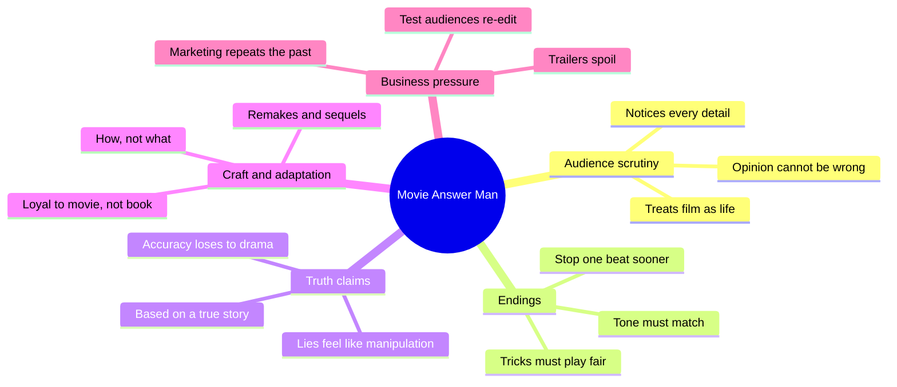
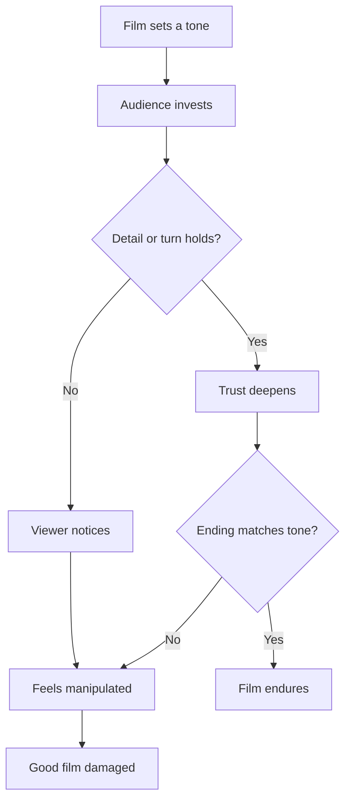
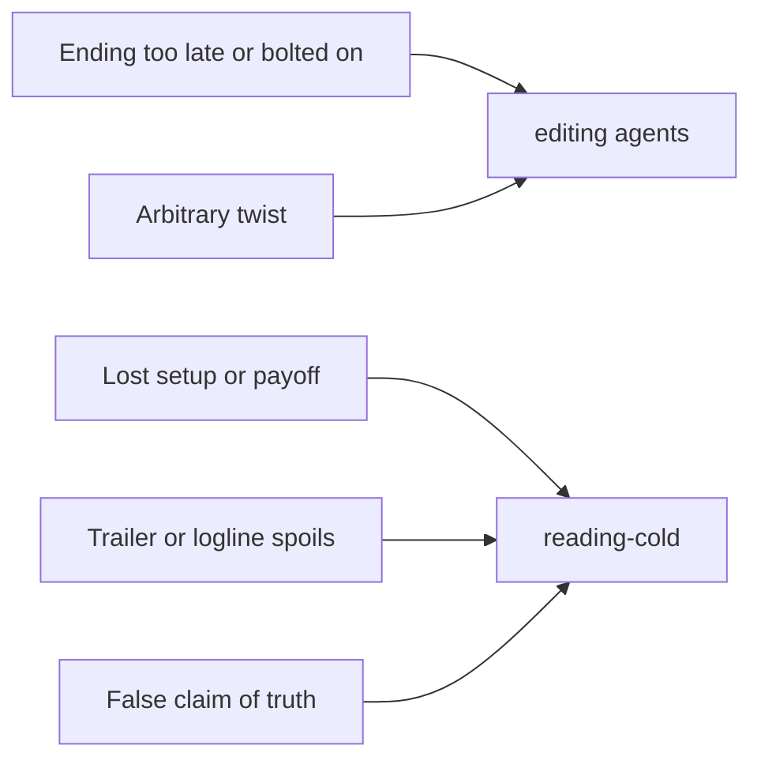

# BVX.1076 — Questions for the Movie Answer Man — Ebert (1997)
### Knowledge Entry — Distill

A Q&A collection from Ebert's weekly column: reader questions, short answers, a few expert guests. It is craft by anecdote, useful to the script editors as a catalogue of how audiences notice mistakes, endings, tricks and lies.

## TABLE OF CONTENTS
- [Core Thesis](#1-core-thesis)
- [Mind Models](#2-mind-models)
- [Framework](#3-framework--structure)
- [Key Concepts](#4-key-concepts)
- [Heuristics](#5-heuristics--decision-rules)
- [Invariants](#6-invariants)
- [Pitfalls](#7-pitfalls--myths)
- [Application](#8-application)
- [Cross-References](#9-cross-references)
- [Provenance](#10-provenance--confidence)

---

## 1 · CORE THESIS

Audiences watch closely and treat a film as a life, so every detail must hold up. A film is judged by how it handles its subject, not what the subject is. Endings, honesty with the viewer, and trust in the audience decide whether a good film stays good.

---

## 2 · MIND MODELS

**Diagram 1 — the whole argument.**
Read off the five clusters: the audience's close watching, then the four places a story keeps or breaks faith with it.

**Diagram 2 — the central mechanism.**
Read off the loop: audience trust is spent by each broken promise and is rarely recovered by a late fix.

**Diagram 3 — mapped onto the Command's systems.**
Read off which editor takes which of Ebert's complaints.

---

## 3 · FRAMEWORK / STRUCTURE

The book has no argument in sequence. It is an alphabetical set of about 130 topics (Actors to Yessss!), each a run of reader questions with Ebert's answers. Entries mix craft (Dialogue, Movie Endings, Explanations, Books into Films, Spoilers, Sequels/Remakes/Ripoffs, Writers/Scripts/Deals, Comedy, Based on a True Story), trade (Budgets, Box Office, MPAA Ratings, Trailers), and trivia (Boom Mikes, Hitchcock's Cameos).

For craft use, read the book as three layers:

1. **The audience layer.** Readers catch plot holes, continuity breaks and unexplained props, and expect answers.
2. **The maker layer.** Answers come from producers, writers and technicians: why a line survived, how a cut came about.
3. **The critic layer.** Ebert states a rule or taste, such as "A movie is not about what it is about. It is about how it is about it."

---

## 4 · KEY CONCEPTS

| Concept | What it is | Why it matters |
|---|---|---|
| Ebert's Law | "A movie is not about what it is about. It is about how it is about it." | Plot summary does not rate a script. Execution does. |
| Early ending | When a Man Loves a Woman should have ended one speech sooner; a tacked-on upbeat speech and kiss followed. | The last beat can undo the film. Cut to the true last image. |
| Tone-consistent ending | Clerks' original killing of the hero was cut as gratuitous and against the film's tone. | An ending must belong to the film's register. |
| Fair vs arbitrary trick | Pulp Fiction's time shuffle "plays fair"; The Usual Suspects' narrative trick strikes Ebert as arbitrary. | A twist needs clues the audience could have used. |
| Narrative burp | Lethal Weapon 3 line made sense only with a scene cut during on-set rewriting. | Setups lost in rewrites leave lines no one can decode. |
| Based on a true story | Accuracy "always finishes second to the devices of drama, pacing, and storytelling." | Treat "true" as inspiration, not record. |
| False truth claim | Fargo and Texas Chainsaw open with a true-story card; viewers feel manipulated on learning otherwise. | The claim buys emotional investment, then costs trust. |
| Ironic hero | Schrader: the existential hero asks if life is worth living; the ironic hero asks who cares. | Explains why modern films wink at the true-story gambit. |
| Loyalty to the movie | Reviewing the movie, not the book; the director keeps what works and drops the rest. | Adaptation is judged by the result, not fidelity. |
| Double error | The Scarlet Letter: a bad film about a book people have read. | Familiar sources raise the cost of weakness. |
| Marketing recycles | Marketing "can only recommend refinements of what has been done before." | Pre-tested work cannot be original. |
| Spoiling trailers | Terminator 2 hid that Arnold was the good one; the trailer gave it away. | Reveals are a story asset; protect them in loglines and pitches. |
| Same idea in the air | Groundhog Day and 12:01; Heat and L.A. Takedown. | Overlap happens; originality lives in execution. |
| Hack economics | About 350 films made against 30,000 registered scripts; roughly 120:1 for an original. | Volume of drafts, not one draft, builds skill. |
| Opinion is right | "You can never be wrong about your own opinion." | A reader's reaction is data, not an error to correct. |

---

## 5 · HEURISTICS & DECISION RULES

| Situation | Do this | Not this |
|---|---|---|
| Ending feels over-explained | Cut back to the last honest beat | Add an upbeat speech to reassure |
| Dark ending proposed | Test it against the film's tone first | Shock for its own sake |
| Twist at the end | Plant clues so a rewatch confirms it | Withhold a fact that was never in play |
| A line only works with a missing scene | Restore the setup or rewrite the line | Leave the line and hope |
| Story marked "true" | Say "inspired by" or imply it | Open with a false truth claim |
| Adapting a known book | Judge the scenes as film; keep what plays | Count fidelity to the page |
| Reader loves what you cut | Check whether the cut broke setup or payoff | Dismiss the reader as wrong |
| A small gag works only for a laugh | Ask if the tone can hold it | Add cheap laughs |
| Draft is weak | Write more drafts; ten scripts to learn the form (guest Martell) | Send early work out |
| Writing for a known genre | Find the angle of execution | Rely on the formula alone |
| A plot has many schemes | Make the stakes of each clear (the Fargo money question) | Stack motives the viewer cannot track |

---

## 6 · INVARIANTS

1. Viewers notice small details, and the more the film is like life, the more they expect.
2. Execution outranks premise. Old structures (Njal's Saga, the shoot-out ladder) still work if done well.
3. The ending is read last and remembered first; a wrong one costs the whole.
4. A lie told to the viewer at the top is felt as manipulation when found out.
5. A trick works only if the audience could have seen it coming.
6. Marketing and test screenings favor the already-done.
7. Familiarity with a source raises the bar for the adaptation.
8. Opinions of audience members cannot be corrected, only understood.

---

## 7 · PITFALLS / MYTHS

- **"Based on a true story" means accurate.** It means inspired. Characters get invented dialogue and traits.
- **Fidelity makes an adaptation good.** Cooper and Scott films escaped complaint because they worked.
- **Sneak-preview polling fixes films.** Ebert says re-editing on audience reactions does mischief.
- **A surprise ending is always a plus.** Arbitrary tricks leave viewers feeling let down.
- **Plot holes are the viewer's confusion.** Often they are the writers' (The Big Sleep: Chandler, asked to explain, said he was as confused as Faulkner).
- **Visible flaws are always the maker's fault.** Boom mikes often show only through bad projection; check before blaming. (Craft trivia, low value for scripts.)
- **A bigger third-act speech clarifies theme.** It often just states what the scenes had shown.
- **Trailers are neutral.** They can spend the reveals the script protected.
- **Ebert is a reliable fact-checker.** He admits errors in the book (reading fees correction), and the answers are 1990s.

---

## 8 · APPLICATION

- **Spine level:** TEXTURE. The book sits beside the story spine as an editor's test list, not a structure. Ending advice touches the top of the spine; setup and payoff advice touches the scene levels.
- **12-layer character stack:** none (feeds is empty).
- **plot_systems:** not applicable.
- **Setting:** not applicable.

For the OXO script editors and the cold reader, the useful moves are narrow. First, the ending test: does the last beat match the register of the whole, and could it end one beat sooner? Second, the fair-twist test: list each clue the audience was given before a reveal. Third, the lost-setup test: for every line that lands oddly, find its setup in the draft. Fourth, the truth-claim check: any in-world document, epigraph or "true story" frame must not promise what the story cannot back. Fifth, the spoiler check on loglines and trailers.

One caution for the Command: the book is a chatty set of opinions. Use the rules above as prompts for a reader, not as hard law. Where a rule conflicts with a ruling in SOP or the fabula, the ruling wins.

---

## 9 · CROSS-REFERENCES

| Related entry | Relation |
|---|---|
| [[BVX.0064]] | McKee on character; pairs with the audience-trust view of endings |

---

## 10 · PROVENANCE & CONFIDENCE

Sourced from the full text (pdftotext, `_PRIVATE/distill_wave/BVX.1076.txt`), read by section: front matter, Based on a True Story, Books into Films, Boom Mikes, Comedy, Dialogue, Directors, Explanations, Movie Endings, MPAA, Sequels/Remakes/Ripoffs, Spoilers, Time Compression, Writers/Scripts/Deals. About 30 of roughly 130 topics were read; the rest (trivia, trade, specific films) were skimmed by contents only. The Zotero key and page count are not known. The synthesis in Heuristics and Application is inference from Ebert's answers. Confidence is medium because the form is anecdotal and sampled.

## META
- Template: BVX-LEARN-v4.0
- Source classification: popular film criticism, Q&A
- Created / Updated: 2026-10-30
