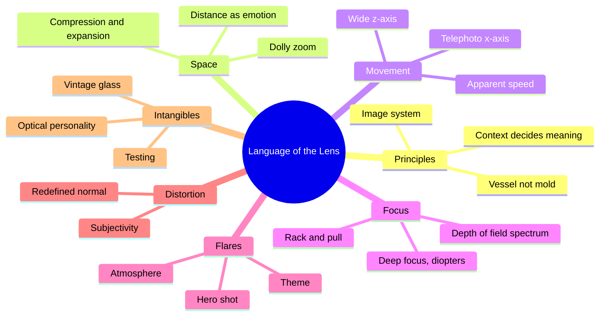
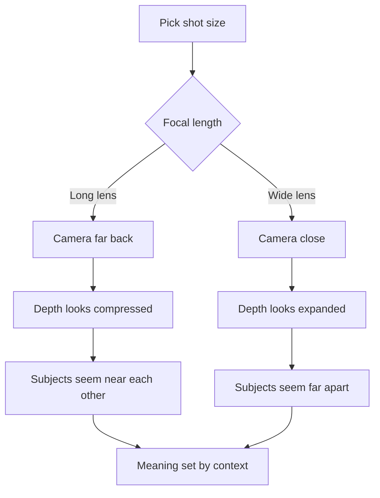
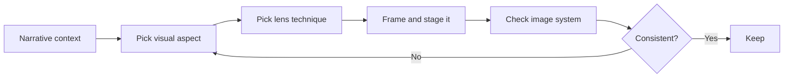
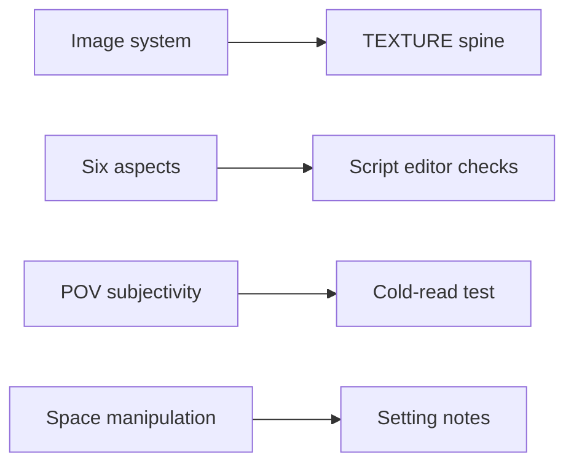

# BVX.1090 — The Filmmaker's Eye: The Language of the Lens — Mercado (2019)
### Knowledge Entry — Distill

A working cinematographer-teacher's catalogue of how lens choice (space, movement, focus, flares, distortion, intangibles) carries story meaning, taught through about 55 film case studies. In the library as craft basis for the script editors: it turns "what does this shot say" into a checkable question.

## TABLE OF CONTENTS
- [Core Thesis](#1-core-thesis)
- [Mind Models](#2-mind-models)
- [Framework](#3-framework--structure)
- [Key Concepts](#4-key-concepts)
- [Heuristics](#5-heuristics--decision-rules)
- [Invariants](#6-invariants)
- [Pitfalls](#7-pitfalls--myths)
- [Application](#8-application)
- [Cross-References](#9-cross-references)
- [Provenance](#10-provenance--confidence)

---

## 1 · CORE THESIS

A lens technique is a vessel, not a mold. It means nothing alone; meaning comes from the technique, the shot composition and the narrative context together, and from how it sits in the film's image system. Choose by the visual aspect you need to control, not by copying another film.

---

## 2 · MIND MODELS

**Diagram 1 — the whole argument.**
Read off the six controllable aspects; the book is organized by them, not by lens type.

**Diagram 2 — the central mechanism: how focal length changes space.**
Read off that focal length acts only through camera distance: the lens "reveals" the perspective, it does not create it.

**Diagram 3 — the meaning test every lens choice must pass.**
Read off the order: context first, effect second, consistency third.

**Diagram 4 — mapped onto the Command's systems.**
Read off that the book feeds texture and the editor craft checks, not the character layers.

---

## 3 · FRAMEWORK / STRUCTURE

The book has four parts.

1. **Front chapters (pp. 1-54).** The Lens Revolution (cheap interchangeable lenses on DSLRs gave everyone shallow depth of field); A Lens Language (the vessel-not-mold argument, the Midnight Cowboy vs. Tootsie pair); Lenses and Image Systems (the Kuleshov effect scaled to a whole film, with Elizabeth as the model); Technical Concepts (a compact glossary of optics).
2. **Six aspect chapters.** Space, Movement, Focus, Flares, Distortion, Intangibles. Each opens with a short principle essay, then one case study per two-page spread, each titled by the feeling or idea it carries (confinement, vastness, awkwardness, urgency, shock, malevolence, and so on).
3. **Case spread formula.** A technique stated as a principle, one film example, how every other element supports it, and what would have failed if one element were changed.
4. **Back matter.** References (interviews and commentary tracks), filmography, index.

Order of aspects runs from the most structural (where things are) to the most subtle (what the glass itself feels like).

---

## 4 · KEY CONCEPTS

| Concept | What it is | Why it matters |
|---|---|---|
| Image system | The pattern of shots, lens choices, color and lighting whose relations across a film carry theme and arc | Lets one image echo another; an opening/closing pair shows an arc |
| Vessel, not mold | A technique carries whatever meaning its context supplies | Stops trope-copying |
| Telephoto compression | Long lens plus long camera distance flattens z-axis depth | Confinement, closeness, peril, crowd |
| Wide-angle expansion | Short lens plus close camera exaggerates depth and distance | Vastness, awkwardness, speed, vulnerability |
| Field of view vs. angle of view | Angle is fixed per lens; field changes with camera placement | Explains why background content shifts with lens and height |
| Distance, not lens | Flatter or distorted faces come from camera distance | Close-ups choose "inside vs. outside" a character |
| Depth of field | Set by aperture, focus distance, focal length (at fixed subject size, not focal length) and sensor size | The tool behind all selective focus |
| Selective focus spectrum | Levels of blur, not sharp vs. blurry | Controls how much of the background still tells the story |
| Rack / pull focus | Moving the focus plane in a take | Speed sets rhythm: fast like a cut, slow like suspense |
| Deep focus, split-field diopter | Everything sharp; or two focus planes with a seam | Dread, tension, audience chooses what matters |
| Dolly zoom | Move camera and zoom opposite to hold subject size | Epiphany, shock, rage; flashy, use rarely |
| Hitchcock's Rule | On-screen size proportional to importance | A macro shot inflates a detail's significance |
| Flare | Stray light reflecting inside the lens | Hero shot, heat, mystery, physicality; dilutes with overuse |
| Redefined normal | Any focal length used predominantly becomes normal | A deviation then reads loudly |
| Optical personality | Color bias, flare, vignetting, bokeh unique to each lens | A real design choice; test lenses |
| Anamorphic | Squeezed image; oval bokeh, streak flares; can be mounted wrong on purpose | Looks of disorientation or entrancement |

---

## 5 · HEURISTICS & DECISION RULES

| Situation | Do this | Not this |
|---|---|---|
| Need a lens effect for a scene | Start from the idea, then choose the aspect (space, focus, etc.) | Copy a shot from another film |
| Location cannot fit the needed lens | Switch to a different aspect (focus, flare, focal shift) that says the same thing | Settle for a generic wide |
| Showing emotional distance between two people | Expand the space with wide lens; place at opposite frame edges | Rely on dialogue alone |
| Showing closeness | Compress with a long lens; overlap subjects in frame | Pick the maximum compression by reflex |
| Compression or expansion seems weak | Test several focal lengths and camera positions; adjust angle slightly | Assume more extreme is better |
| Need impact at a key beat | Make the focal length differ from neighboring shots | Use extreme lens in every shot |
| Showing a character's mental state | Pair the lens effect with canted angle, composition, sound, blocking | Rely on the optics alone |
| Using a stylized lens effect | Reserve it for extreme or meaningful moments; justify it by context before or after | Use it constantly, or with no motivation |
| Subjective blur or flare | Establish the meaning once, then apply consistently | Scatter it randomly |
| Want a character close-up to feel intimate/uncomfortable | Wide lens, close camera | Treat wide as "neutral" |
| Want a character to feel distant or watched | Telephoto from far | Treat all long lenses as flattering |
| Want a face to read as ordinary | Use the film's predominant ("normal") focal length | Switch lens for style's sake |
| Two shots of similar setups mean opposite things | Check what precedes them and the story logic | Conclude the lens "means" X |
| Blurry-background close-up needed | Decide which facial feature stays sharp and why | Default to eyes |
| Shot is slightly soft but performance is best | Keep the take | Scrap for technical perfection |
| Choosing between expensive and cheap glass | Pick for the look needed; test | Assume the costlier lens is right |

---

## 6 · INVARIANTS

1. Meaning of a lens technique depends on narrative context, composition and the rest of the image system; it never travels intact between films.
2. Focal length compresses or expands perspective only through camera-to-subject distance.
3. Angle of view is fixed per focal length; field of view is not.
4. Telephotos slow z-axis motion and speed x-axis motion; wide-angles do the reverse.
5. Shallow focus tells the viewer where to look; anything sharp is assumed to matter.
6. Contrast between adjacent shots amplifies an effect; sameness across a film mutes it.
7. A technique's strength is spent by overuse.
8. Consistency across the film is what makes a stylization legible as intentional.
9. Every lens distorts; there is no neutral image.
10. A subjective lens effect needs a visible cause (a POV, a reaction, a prior setup) or it reads as error.

---

## 7 · PITFALLS / MYTHS

- "Telephoto lenses flatten and wide lenses expand." They only reveal it through camera distance.
- Recreating a famous shot with the wrong ingredients (the slow-motion walk with the fireball) produces cliché.
- Choosing the longest lens available for flattening without checking the location's leading lines.
- Treating the lens as "plug and play": the same crowded-street shot means overwhelm in one film, belonging in another.
- Believing focus is binary, or that the in-focus subject is all that is communicating.
- Fixating on tack-sharp focus at the cost of performance and rhythm.
- Letting a stylized effect (dolly zoom, flare, subjective blur) appear with no context, or too often.
- Forgetting practical limits: long lenses need room; macro needs light; slow zooms need ISO.
- Believing flares are always defects; or believing they are always good.
- Assuming the best, fastest, most expensive glass gives the right look.
- Overusing subjective POV shots until they feel gimmicky.
- Mixing lens brands in one film without matched optics, causing color shifts.

---

## 8 · APPLICATION

- **Spine level:** TEXTURE. The book concerns how images feel and signify; no plot spine level is argued.
- **12-layer character stack:** none directly. `feeds: []` is intentional; the book deals with subjectivity as a visual device, not character psychology.
- **plot_systems:** none.
- **Setting:** space manipulation (confinement, vastness, hostile vs. safe rooms) maps to setting texture notes for the OXO school and locations.

Use for the script editors (`editing-*.md`, `reading-cold.md`). Prose has no lenses, but screenplays carry shot intent. Three checks follow from the book:

1. **Subjectivity check.** When a scene describes distorted, blurred, or flared imagery, does the script say whose experience it is, and has the story set that up before? (Invariant 10.)
2. **Repetition check.** Does an opening image return at the close with a changed meaning, and are stylized devices spent on moments that earn them? (Invariants 7 and 8.)
3. **Distance-as-feeling check.** When two characters are staged far or close, does the staging match the relationship at that beat? (Heuristics rows on awkwardness and closeness.)

For the Command's stories, keep one house-style decision per story: what is the "normal" lens, what is reserved for rage, shock, or rebirth. That mirrors the Elizabeth, Requiem and Fear and Loathing studies.

---

## 9 · CROSS-REFERENCES

| Related entry | Relation |
|---|---|
| [[BVX.0066]] | Cinematic storytelling for directors and cinematographers; same craft territory, broader than lenses |
| [[BVX.0197]] | Shot, cut, transition planning; pairs with the lens aspects |
| [[BVX.1036]] | Directing fundamentals; shot planning before the lens is chosen |
| [[BVX.1054]] | Master Shots; setups to which the lens techniques attach |
| [[BVX.1103]] | The Visual Story; visual structure that Mercado's image-system idea extends |

---

## 10 · PROVENANCE & CONFIDENCE

Sourced from the pdftotext of the full book: front matter, Lens Revolution, Lens Language, Image Systems, Technical Concepts, and every case spread in all six aspect chapters (Space, Movement, Focus, Flares, Distortion, Intangibles), plus references and the start of the filmography. The filmography tail, image credits and index (about the last 20 text lines of the file and beyond) were not read; they carry no argument. The frame grabs are described only through captions, so some film detail came from the text, not the images. Cross-referenced BVX ids were confirmed present in KNOWLEDGE_AREAS; their contents were not opened. Crop-factor, hyperfocal and depth-of-field numbers are Mercado's as printed. Confidence high on the framework; the case studies are one author's readings of other directors' intent, partly sourced to interviews.

## META
- Template: BVX-LEARN-v4.0
- Source classification: book, craft handbook
- Created / Updated: 2026-10-30
