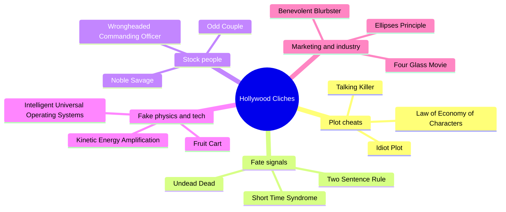
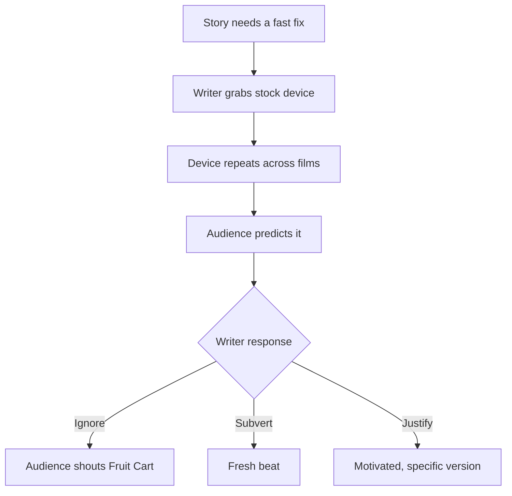
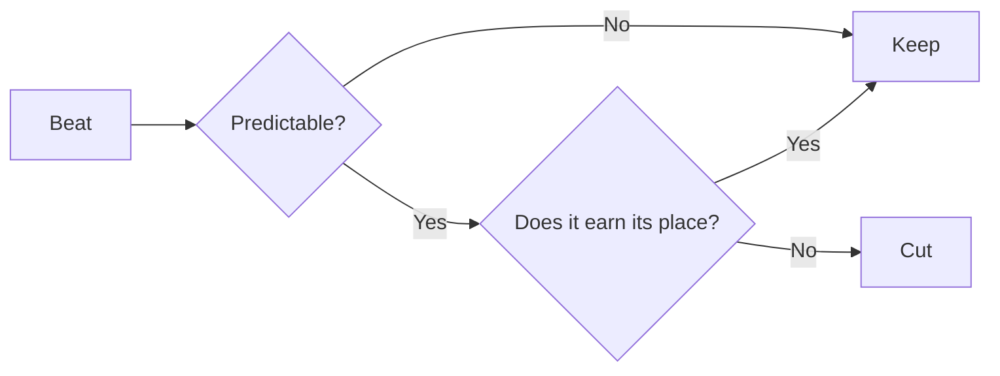

# BVX.1093 — The Little Book of Hollywood Cliches — Roger Ebert (1994)
### Knowledge Entry — Distill

An alphabetical glossary of about 400 movie cliches, named like laws and mostly contributed by readers. It is in the library as a spotting list: a catalogue of the predictable moves an editor should flag.

## TABLE OF CONTENTS
- [Core Thesis](#1-core-thesis)
- [Mind Models](#2-mind-models)
- [Framework](#3-framework--structure)
- [Key Concepts](#4-key-concepts)
- [Heuristics](#5-heuristics--decision-rules)
- [Invariants](#6-invariants)
- [Pitfalls](#7-pitfalls--myths)
- [Application](#8-application)
- [Cross-References](#9-cross-references)
- [Provenance](#10-provenance--confidence)

---

## 1 · CORE THESIS

A cliche is a move the audience can finish before the film does. Most come from convenience: characters act dumb, danger is staged, bodies and machines bend to the plot. Name the pattern, and a writer can see it, then choose to cut it or twist it.

---

## 2 · MIND MODELS

**Diagram 1 — the whole argument.**
Read off the five families of cliche, and notice that most are cheats that serve the plot rather than the character.

**Diagram 2 — the central mechanism.**
Read off how a cliche forms: a problem needing a fast fix, a stock fix, repetition until viewers call it, then either dodging or inversion.

**Diagram 3 — a cliche as a prediction test.**
Read off the quick question that sorts a beat: could the viewer have written the next line?

---

## 3 · FRAMEWORK / STRUCTURE

The book is a reference list, not an argument. A one-page introduction explains the origin: Ebert printed a cliche glossary in the Chicago Sun-Times in the early 1980s, grew it yearly in his Movie Home Companion until 1993, and then took reader submissions (mail, then CompuServe). The core is entries in alphabetical order, each a name, a definition, sometimes a film example, and a credited contributor. The entries fall into families that the book never labels. The families below are my own grouping.

| Family | What it covers | Example entries |
|---|---|---|
| Plot logic | Characters or villains act against sense so the plot can run | Idiot Plot, Fallacy of the Talking Killer, Penguin Error, Law of Inverse Wariness |
| Foreshadow and fate | Small tells that predict who dies or who matters | Two Sentence Rule, Unknown Team Member, Short Time Syndrome, Unmotivated Close-up, Law of Economy of Characters |
| Genre formulas | Whole-film templates | CLIDV1C, Odd Couple Formula, Clean Up Movie, Ark Movie, Wunza Movie, Dead Teenager Movie |
| Obligatory beats | Scenes a genre owes its viewers | Meet Cute, Training Sequence, Falling Villain, Impregnable Fortress Impregnated |
| Stock characters | Types reused without depth | Noble Savage, Scary Old Man, Baked Potato People, Perk Girl, Geek Ego Effect |
| Gender and ethnic stereotype | Roles assigned by sex or race | Weak-Ankled Female, Hand-in-Hand Rule, Ellis's Law, Asian Woman Rule, Joel Silver Rule |
| Convenient world | Coincidence and luck | Miracle of Available Parking Space, Convenient Cat, Info-on-Demand, Human Antennae |
| Fake physics and tech | Bodies, guns, cars, computers | Newton's Laws Repealed, Radar Bullet, Cat Sneeze Effect, Intelligent Universal Operating Systems |
| Dialogue tics | Lines no one says | "It's Over", "Wait Right Here!", "Thanks, but No Thanks", Poor Phone Manners |
| Industry and marketing | How films are sold and made | Benevolent Blurbster, Unattributed Critical Quotation, Fast Food Rule, Martini Shot |

---

## 4 · KEY CONCEPTS

1. **Idiot Plot** (James Blish): a plot whose problems vanish if the characters stop being idiots. It is the book's founding idea. Why it matters: the smartest check on a script is whether the people in it are at least as smart as the viewer.
2. **Fruit Cart**: the chase scene must overturn a cart in an exotic place (James Bond variant: the wedding buffet; rural variant: Hay Wagon). It is the name for any beat so expected that audiences shout it. It matters because it gives editors a one-word flag.
3. **Fallacy of the Talking Killer** (Siskel): the villain explains instead of shooting. It is the same family as the Penguin Error and Tucco's Advice. It matters because it shows a villain's competence being sacrificed for exposition.
4. **Law of Economy of Characters**: nothing and no one in a film is unnecessary, so the seemingly extraneous character is the secret. Related are Unmotivated Close-up and Odd Information Clue. It matters because it works against the writer too: a tell the audience can read is a spoiler.
5. **Law of Economy of Instruction**: whatever a character is taught, they later use. This is Chekhov's gun as a law, which makes it a setup-payoff check.
6. **Two Sentence Rule, Unknown Team Member, Mid-Wife Crisis, Short Time Syndrome, Deadly Change of Heart, Del Close's Rule**: the family of fate tells. A character introduced late, or given a family, a milestone, a photo, or a countdown, is marked for death. It matters because this is the most common unmotivated death signal.
7. **Undead Dead / Die Three Times Law**: the killer is not dead after the climax. Ebert grants it as part of the game in a plain thriller, and calls its use in Fatal Attraction unforgivable. That is an actual line: a cliche may be tolerated where the genre expects it and condemned where the film claims realism.
8. **Odd Couple Formula** plus **Sinatra's Law** and **Hollywood Cop Car**: opposed partners, the slob and the straight man, who solve the crisis "my way". The car carries the characterization.
9. **CLIDV1C**: three-part sports formula (defeat, training montage, victory freeze-frame). With **Training Sequence** and **Best Play of the Game Rule** it forms the template for the underdog arc.
10. **Meet Cute / Boy-Meets-Girl Rules**: a cute meet means a pairing at the end, an antagonistic one means the middle. It is a predictive rule about romance pacing.
11. **Noble Savage Syndrome**: swapping one stereotype for a flattering one is still a stereotype. "Natives seem noble, but never real."
12. **MacGuffin / O'Guffin**: the MacGuffin is a plot object whose identity is immaterial (Hitchcock); the O'Guffin is a scene with no bearing on plot, filler masking a lack of story.
13. **Possible Implausible Rule**: viewers accept the impossible more readily than the implausible. This is the book's one real craft principle about believability.
14. **Mission Control Syndrome**: cutting to a surrogate audience to tell viewers how to feel, when the film has not made them care.
15. **Invisible Protective Shield / Radar Bullet / Principle of Selective Lethality**: the lethality of damage depends on the importance of the person. The hero absorbs punishment, extras die at once.
16. **Clunky Exposition Complex**: backstory delivered through characters telling each other what both know.

---

## 5 · HEURISTICS & DECISION RULES

| Situation | Do this | Not this |
|---|---|---|
| A problem could be solved in five minutes | Make the obstacle one the smart character cannot just remove, or give the character a real reason for the delay | Make everyone stupid (Idiot Plot, Stupid Adult Rule, Dead Teenager skinny-dip) |
| Villain has the hero cornered | Let him act, or give a motive for delay the hero cannot use | Let him explain his plan first (Talking Killer, Penguin Error) |
| Introducing a character who will die | Give them a life and a function before the death, and vary the tell | Tag them with a photo, a family, a countdown (Two Sentence, Short Time, Del Close) |
| You need exposition | Put it in conflict, or in what a character wants to hide | Have characters recite shared history (Clunky Exposition, Grave Talk) |
| You need a minor character | Make sure the part serves the plot and looks it, or give them an actual scene | A bare Plot Pointer, Unknown Team Member, or the only extraneous face |
| A scene would be a genre staple | Ask what the audience expects, then give it a twist or a reason | Run it as written (Fruit Cart, Falling Villain, Training Sequence) |
| A female character is in danger | Let her act on a plan, with skill and consequence | Falls, sprains, waits right here, shoots and cries (Rising Sidewalk, Weak-Ankled, Wait Right Here) |
| Showing a foreign or marginal culture | Give individuals specific wants and flaws | Mystic aphorisms and perfect wisdom (Asian Grandfather, Noble Savage, Movie Medicine Men) |
| Showing a technical world | Check how the thing really works, or keep it plausible | Colorful flasks, green text, one global network (Law of Colorful Chemicals, Technopyromania) |
| Hero survives an impossible fight | Cost him something visible and lasting | Wear a bandage then forget (Invisible Protective Shield, Balls of Steel) |
| Need an ending jolt | Earn it from setup | A false climax with the villain rising again by default |
| Needing the audience to care | Build the stakes in the scene | Cut to a cheering room (Mission Control Syndrome) |

---

## 6 · INVARIANTS

1. A pattern becomes a cliche by repetition, not by being bad once. The first use was often fresh (Halloween, Hitchcock).
2. Whatever the audience can complete in advance carries no tension.
3. Convenience for the writer shows up as inconvenience for the logic: coincidence, weak villains, and bodies that obey the plot.
4. The status of a character predicts what happens to them: hero, extra, wife, sidekick, and token woman each have a script.
5. Setup must be paid off, so unpaid setup reads as a clue (Economy of Characters and of Instruction). Writers who know this can hide payoffs or fake them.
6. Cliche is judged against the film's claims. The same beat is forgivable in a pulp and fatal in a drama.
7. Audience intelligence is a given. Ebert's bar is characters "at least as smart as I was".

---

## 7 · PITFALLS / MYTHS

- Treating the book as a ban list. It is a humor book by many hands; most entries are jokes. Use it to spot, not to rule.
- Reading every entry as equally serious. Some are craft points (Possible Implausible Rule, Idiot Plot); many are pet peeves about props, sound and marketing with no story use.
- Assuming inversion fixes a cliche. A mechanical reversal is just a second cliche: the wise old Asian grandfather swapped for a tough one.
- Assuming a cliche needs to be avoided everywhere. Genre owes obligatory beats (see Meet Cute, Training Sequence); the sin is going through the motions.
- Dated: it dates from 1994. Computer, phone, and media jokes (microfiche, pay phone, CB, VHS boxes, CompuServe) belong to that era. The Asian, Black, and Italian entries record 1990s stereotypes; the gender entries are the clearest value for spotting lazy writing, though several themselves say "men as default".
- Contributor claims are anecdotal. Rule percentages ("always", "inevitably") are exaggeration, not data.
- Taking the marketing entries (Ellipses Principle, Fast Food Rule) as story advice. They concern selling a film, not writing it.

---

## 8 · APPLICATION

- **Spine level:** TEXTURE. The book works at scene and beat level (moves, lines, set pieces), not at the structure of the whole story.
- **12-layer character stack:** none directly; `feeds: []`. It is a craft reference, not character psychology.
- **plot_systems:** relevant as a flag list for scene-level mechanics of conflict, reversal, and threat.
- **Setting:** the world-convenience and fake-tech entries are a check on background realism.

For the OXO script editors the book is a pre-read checklist. A cold reader, or an editor, can run a draft against the families in section 3 and mark any hit with its entry name. The most useful families for the series are: plot logic (are the Outliers acting from a goal or out of idiocy?), fate tells (does a new character get a family, a milestone, or a close-up that gives away their fate?), stock people (does a school, a team, or a rival fall into Clean Up Movie, Nerd Rule, Stupid Adult Rule, Honor Code Rule?), and the gender rules for female and teen characters. A flagged beat is not automatically a fault. The check is the three-way choice in diagram 2: ignore, subvert, or justify. Where the story claims realism, hold it to the strict standard, as Ebert did with Fatal Attraction. The spoken "Fruit Cart" test is a cheap read-aloud flag: if a listener could name the next beat, say so.

---

## 9 · CROSS-REFERENCES

| Related entry | Relation |
|---|---|
| [[BVX.0068]] | Conventions and obligatory moments: the constructive counterpart to Ebert's list of obligatory scenes gone stale |
| [[BVX.0044]] | Fiction blunders: the prose-side equivalent of a catalogue of known errors |
| [[BVX.0050]] | Action writing: the craft behind the chase, fight, and escape cliches |
| [[BVX.0047]] | Side characters: the cure for Plot Pointer, Unknown Team Member, and stock supporting roles |
| [[BVX.0064]] | McKee on character: depth and dimension as the opposite of the stock types listed here |

---

## 10 · PROVENANCE & CONFIDENCE

Read in full from the pdftotext file (all of the introduction and all alphabetical entries A to Z, about 4,180 lines, 123 PDF pages). No chapter was skipped. The text has OCR damage (stray page numbers, broken hyphens, a few garbled names), which does not change the entries' sense. The family grouping in section 3, the heuristics table, and the OXO application are my inference; the entries, definitions, and attributed quotes are from the text. Quoted lines are short and attributed to Ebert's compendium. The cross-referenced BVX ids were confirmed to exist in KNOWLEDGE_AREAS. Confidence is high on content; the usefulness of any single entry is a judgment.

## META
- Template: BVX-LEARN-v4.0
- Source classification: book (reference glossary, crowd-sourced)
- Created / Updated: 2026-10-30
