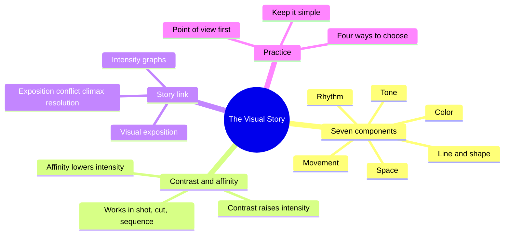
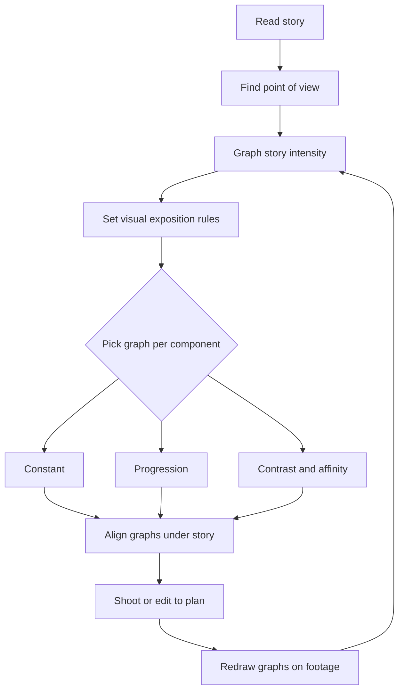
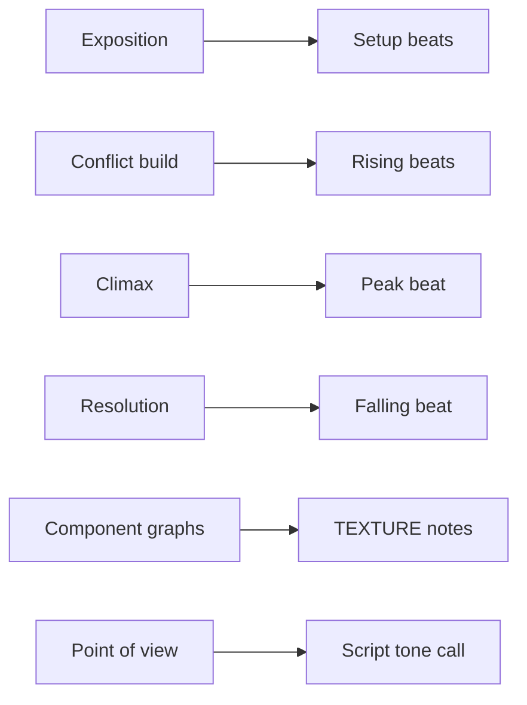

# BVX.1103 — The Visual Story — Bruce Block (2008)
### Knowledge Entry — Distill

Block's USC course in book form (2nd edition, Focal Press): a method for giving a picture its own structure, built from seven visual components and one principle, then tied to story intensity. It is the craft basis for the script editors' visual-beat checks.

## TABLE OF CONTENTS
- [Core Thesis](#1-core-thesis)
- [Mind Models](#2-mind-models)
- [Framework](#3-framework--structure)
- [Key Concepts](#4-key-concepts)
- [Heuristics](#5-heuristics--decision-rules)
- [Invariants](#6-invariants)
- [Pitfalls](#7-pitfalls--myths)
- [Application](#8-application)
- [Cross-References](#9-cross-references)
- [Provenance](#10-provenance--confidence)

---

## 1 · CORE THESIS

Every picture is built from seven visual components: space, line, shape, tone, color, movement, rhythm. Contrast raises visual intensity and affinity lowers it. Chart the story's intensity first, then give each component its own graph that rises and falls with it. Choose a point of view before choosing components.

---

## 2 · MIND MODELS

**Diagram 1 — the whole argument.**
Read it as three layers: the cast (components), the one law (contrast and affinity), and the link to story (graphs and point of view).

**Diagram 2 — the central mechanism.**
Read it as a loop: story intensity is plotted first, and each visual component gets one of three graph shapes (constant, progression, contrast/affinity) lined up under it.

**Diagram 3 — mapped onto the Command's systems.**
Read it as: Block's story graph is the same object as the spine's intensity curve, and his visual graphs are the texture layer riding on it.

---

## 3 · FRAMEWORK / STRUCTURE

The book runs in three movements.

1. **Setup (ch. 1–2).** Names the cast: space, line, shape, tone, color, movement, rhythm. States the one principle, Contrast & Affinity. Introduces the visual progression: point, line, plane, volume, simple to complex.
2. **The components (ch. 3–8).** One chapter each, always the same drill: define the component, list its subcomponents, then show how each makes contrast or affinity within a shot, from shot to shot, and from sequence to sequence.
   - Space: deep, flat, limited, ambiguous; aspect ratio; surface divisions; open and closed frame.
   - Line and shape: orientation, direction, quality; circle, square, triangle.
   - Tone: gray scale, reflective vs incident control, coincidence vs noncoincidence.
   - Color: hue, brightness, saturation; warm/cool; complementary and analogous; color interaction.
   - Movement: object, camera and eye movement; the continuum of movement.
   - Rhythm: stationary, moving and editorial; fast/slow, regular/irregular, continuous/fragmented.
3. **The link to story (ch. 9–10).** Story structure (exposition, conflict, climax, resolution) is graphed. Visual structure mirrors it. Chapter 10 supplies point of view and four ways to choose components, with worked cases (The Parallax View, Witness, Touch of Evil).

The appendix carries directorial beats and a sample scene for beat-level graphing.

---

## 4 · KEY CONCEPTS

| # | Concept | What it is | Why it matters |
|---|---|---|---|
| 1 | Visual components | Space, line, shape, tone, color, movement, rhythm. Present in every frame, even a blank one. | You cannot opt out; unplanned components still structure the shot. |
| 2 | Contrast & Affinity | Contrast = difference, affinity = similarity. More contrast, more intensity. | The single control knob for every component. |
| 3 | Visual intensity | The strength of the audience's emotional or physical reaction. | Gives a measurable axis to match against the story. |
| 4 | Visual progression | A change from simple to complex (point to volume). | Structure is progression; static pictures stall. |
| 5 | Depth cues | Perspective, overlap, size, atmospheric effects and others that fake depth on a flat screen. | Basis of deep, flat, limited, ambiguous space. |
| 6 | Linear motif | A picture reduced to its dominant lines (squint to see it). | Diagonal most intense, vertical less, horizontal least. |
| 7 | Tone coincidence | Whether tone matches the object's importance: coincidence means the key subject is the brightest or most visible. | Noncoincidence hides or disorients. |
| 8 | Color interaction | Complementary colors raise each other's saturation; analogous colors push apart; simultaneous and successive contrast. | A saturated red needs a cyan neighbor, in the shot or the previous shot. |
| 9 | Story structure graph | Time on x, conflict intensity on y, labeled EX, CO, CX, R. The jagged version shows rises and falls. | The master chart; everything else lines up under it. |
| 10 | Story sequence list | A numbered list of sequences tagged EX/CO/CX/R, plotted as points. | Turns a script into a curve; tested on North by Northwest, Bourne Identity, Howards End. |
| 11 | Visual exposition | Rules, set up early, that define what each component will mean. | Jaws: music, camera and story rules arrive together, then never change. |
| 12 | Three graph variations | Constant, progression, contrast/affinity. | The only three things a component can do over time. |
| 13 | Spike | A short burst of intensity, in story or visuals. | Used for external conflicts, also for memory or inner shocks. |
| 14 | Point of view | How the author wants the audience to feel about the subject. | Detectives as Holmes, Spade, Clouseau: same job, different look. |
| 15 | Directorial beat | A change in character relationship or intention. | The x-axis unit for graphing a single scene. |

---

## 5 · HEURISTICS & DECISION RULES

| Situation | Do this | Not this |
|---|---|---|
| Starting any visual plan | Graph the story's intensity first, line every other graph up under it | Pick visuals before you know where the story peaks |
| Opening of a story | Keep visuals in affinity so intensity is low; state the visual rules | Open on maximum contrast and have nothing left for the climax |
| Climax | Peak contrast across several components; alternate (flat/deep, diagonal/vertical) shot to shot | Let the climax look like the middle |
| Resolution | Return to affinity (Jaws: slow wide shot, no contrasts) | Keep climax-level contrast after the conflict ends |
| Story is a trap or fixed fate | Hold a component constant (flat space in Klute) | Vary it for variety's sake |
| Characters change | Use a progression linked to the arc (flat to deep as dislike turns to love) | Change a component with no story motive |
| Relationship merges | Run contrast to affinity (round and square shapes become all square) | Assume the visuals must always rise |
| A scene needs a spike | Spike one component at the conflict moment | Spike everything at once |
| No script | Substitute a beginning-middle-end graph | Shoot with no structure |
| Found footage or archival | Work backward: graph what is in the material, then fix with cutting and camera movement | Assume stock images fit the story curve |
| Unsure of choices | Try instinct, then a coin toss, then research, then analysis | Choose nothing |
| Many components to manage | Keep most constant, change few, change them sparingly | Over-elaborate the plan so it can't be seen |
| Judging a frame's lines | Squint or use a contrast glass | Trust the 3D real-world lines (the screen may flatten them) |
| Choosing a design logic from the script | Ask what space, tone and color the writing implies (long halls mean deep, cramped room means flat) | Ignore setting description |

---

## 6 · INVARIANTS

1. All seven components are in every picture; none can be removed except color.
2. More contrast raises intensity, more affinity lowers it, in every component.
3. Contrast and affinity can occur within a shot, between shots, and between sequences.
4. Story structure always has exposition, conflict, climax and resolution, whatever the length or medium.
5. Visual structure should support story structure; the story graph comes first.
6. A component can only be a constant, a progression, or contrast/affinity.
7. Meaning of a component is assigned in the exposition and then held.
8. Uncontrolled components structure themselves, usually against the story.
9. Visual assignments are arbitrary until defined: any color can mean danger, but only if the film teaches it.
10. A screen is two-dimensional; all depth is illusory.

---

## 7 · PITFALLS / MYTHS

- **Stereotype as the default.** "Red = danger" works but is the weakest, most dated use. Murder on the Orient Express can make blue mean murder by defining it.
- **Equating "visual" with scenery.** Props and costumes are made of components; they are not the building blocks.
- **All contrast.** Constant black/white flashing is unwatchable. **All affinity.** Constant gray is dull.
- **Theory as law.** Block warns the rules are guidelines; visual structure is not math.
- **Trusting real-world lines.** On screen the fountain's bowl lines are nearly straight. Analyze the flat picture.
- **Over-planning.** An elaborate structure is hard to control and hard for an audience to absorb.
- **Intensity mismatch from found material.** Archival exposition photographs may be more contrasting than the visual climax; the graph exposes this.
- **Color theory by word.** Tint, pastel, shade are vague; use hue, brightness, saturation.
- **Assuming visuals must always rise.** Some stories want affinity at the peak (harmony).
- **Treating instinct as proof.** "It seemed to work" is a lame defense; instinct can be habit.

---

## 8 · APPLICATION

- **Spine level:** TEXTURE. The story graph is a view of the spine's intensity curve, but the book's own contribution is how a beat is dressed, so it sits in texture rather than a structural level.
- **12-layer character stack:** none directly (`feeds: []`). The point-of-view exercise and shape motifs (round vs square as two characters) are craft, not psychology.
- **plot_systems:** the Sequence List (EX/CO/CX/R per sequence, plotted by number) matches how the editors can tag a script.
- **Setting:** location pairs (Witness: farm flat and slow, city deep and contrasting) can be reused for contrasting worlds in the OXO setting.

For the script editors, the use is concrete. Each editing pass can ask: is the exposition low-intensity and rule-setting? Does intensity climb to a single peak with spikes along the way? Does the resolution drop? Does any beat describe images that contradict its story intensity (a calm scene written in diagonal, shattering images)? Block's list of component graphs (flat/deep, ambiguous/recognizable, open/closed, line direction, color hue, saturation, warm/cool, object movement speed, editorial rhythm, continuous/fragmented) works as a checklist for the "how it looks" lines in a script.

A cold reader can use the point-of-view test: state in one sentence how the author wants the audience to feel, then check whether the staging, tone and pacing say the same thing. If not, the script lacks a point of view and the visual structure has nothing to attach to.

Keep this separate from the book itself: the mapping to OXO is inference, not Block's text.

---

## 9 · CROSS-REFERENCES

| Related entry | Relation |
|---|---|
| [[BVX.0064]] | McKee, Character: supplies character structure that Block's point of view and motifs dress |
| [[BVX.0001]] | Placeholder for the story-structure sources (exposition, conflict, climax) the graph assumes |

---

## 10 · PROVENANCE & CONFIDENCE

Sourced from the pdftotext of the full book: front matter, ch. 1–2 in full, ch. 3 openings (depth cues), ch. 4 (line, linear motif, orientation), ch. 6 (color, interaction), ch. 9 in full, ch. 10 through the Parallax View, Witness and Touch of Evil examples. Chapters 5, 7, 8 and the appendix were taken from the table of contents and the chapter 9 component list, not read in depth. Cross-reference ids are partly provisional; verify them against the index. Zotero key not supplied in the brief.

## META
- Template: BVX-LEARN-v4.0
- Source classification: craft textbook, practitioner (USC course)
- Created / Updated: 2026-10-30
