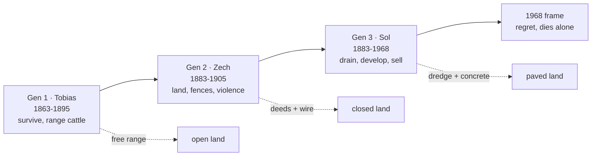
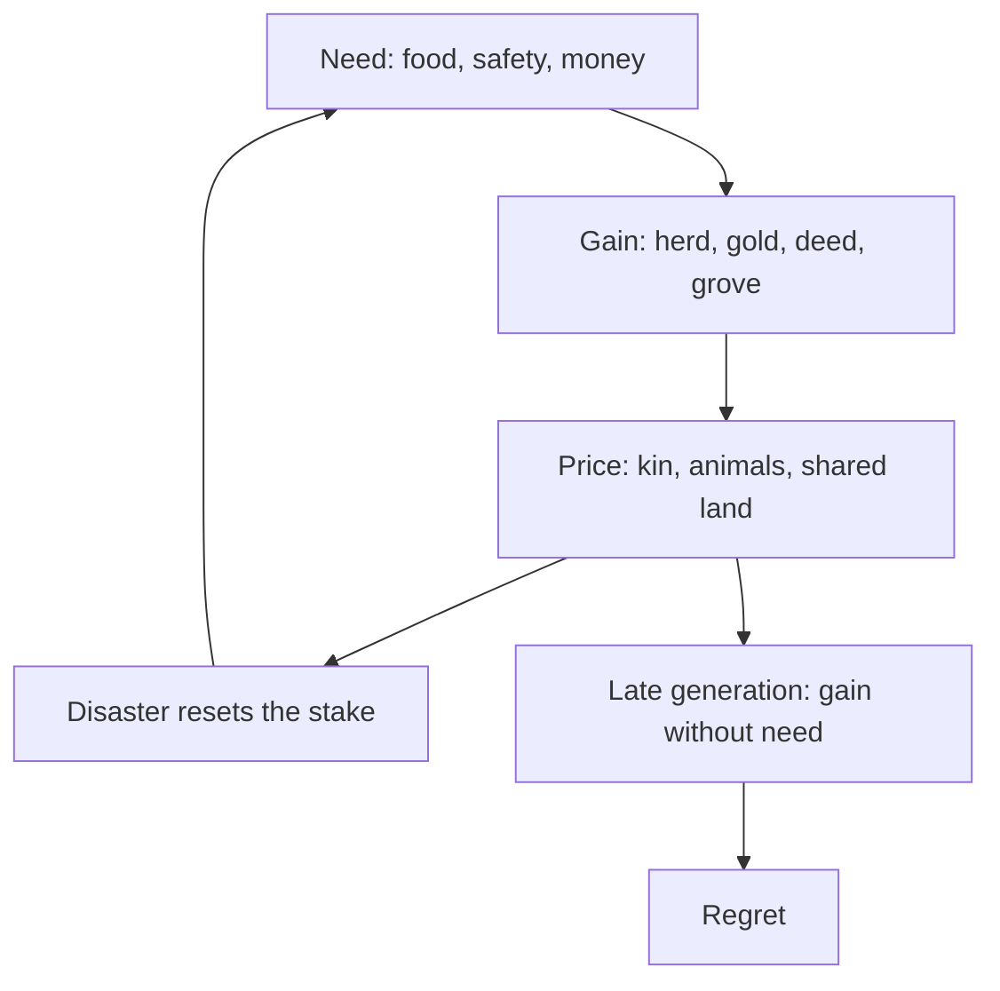
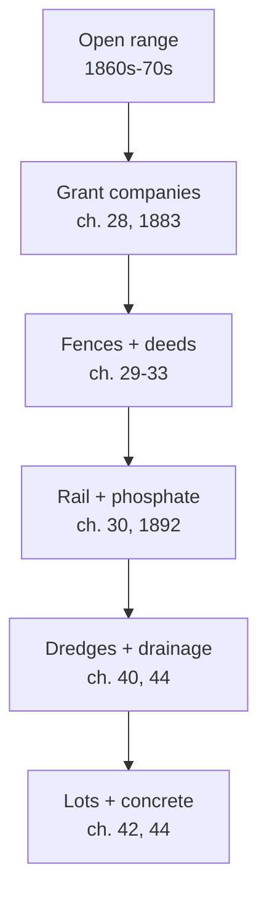

# BVX.1276 · A Land Remembered · Patrick D. Smith (1984)
### Knowledge Entry: Distill

A three-generation Florida family saga, 1863 to 1968. It serves the Command as the chosen skeleton for era 1 (Skeeter Creek). Section 8A holds the proposed translation. Every mapping there is provisional until Chief rules.

## TABLE OF CONTENTS
- [Core Thesis](#1-core-thesis)
- [Mind Models](#2-mind-models)
- [Framework](#3-framework--structure)
- [Key Concepts](#4-key-concepts)
- [Heuristics](#5-heuristics--decision-rules)
- [Invariants](#6-invariants)
- [Pitfalls](#7-pitfalls--myths)
- [Application](#8-application)
- [Era 1 Translation](#8a--era-1-translation-skeeter-creek)
- [Cross-References](#9-cross-references)
- [Provenance](#10-provenance--confidence)

---

## 1 · CORE THESIS

A family wins a wild land by hard work, and each win costs the land something it never gets back. The third heir inherits the fortune without the founders' values. He spends his old age regretting what the fortune destroyed.

Chief's own breakdown puts it in a line: they tamed the land but lost themselves.

---

## 2 · MIND MODELS

**Diagram 1 — the whole saga.**
Caption: *three generations carry one trade-off. Each gain in wealth removes a piece of the wild land, and the last heir counts the removed pieces.*

**Diagram 2 — the price engine.**
Caption: *every chapter runs the same loop. A gain arrives, a price is paid, and the price opens the next gain.*

**Diagram 3 — how the land closes.**
Caption: *the open range closes in a fixed order. Each stage removes one freedom the founders took for granted.*

---

## 3 · FRAMEWORK / STRUCTURE

The book has a frame and a body. Chapter 1 and chapter 45 are set in 1968 and show Sol, aged 85, going home to die. Chapters 2 to 44 tell the family story in order.

The body breaks into three parts by generation.

| Part | Chapters | Years | Lead | Movement |
|---|---|---|---|---|
| Founders | 2-15 | 1863-1868 | Tobias, with Zech as a boy | Failed farm, war losses, first cattle, first helpers |
| Cattle and gold | 16-30 | 1867-1892 | Tobias, then Zech | Punta Rassa drives, first grove, land bought, range closing |
| Fortune and fall | 31-45 | 1894-1968 | Zech, then Sol | Deaths of the founders, grove loss, fences, Sol's Miami fortune, regret |

The pacing is episodic. Each chapter is one self-contained trial, such as a hunt, a storm, a drive, or a wedding. The trials stack into an arc.

The sale does not happen in one scene. Sol sells land lot by lot in chapters 42 to 44, and the graves are nearly lost in chapter 41.

---

## 4 · KEY CONCEPTS

| Concept | What it is | Why it matters |
|---|---|---|
| **The skeleton, not the cast** | The book supplies a shape: survive, build, sell, regret. | Chief can reuse the shape with original people and a different coast. |
| **Gain with a price** | Every win names its cost in the same chapter. | It keeps the saga honest and gives each chapter a built-in ending. |
| **Free range** | Cattle and people roam on land nobody owns. | Its closing is the book's main plot of place. |
| **Brand and deed** | Ownership marks move from a brand on a cow to a deed on land. | They track the family's shift from use to property. |
| **Stake reset** | A disaster wipes out the family's wealth (flood, drought, freeze, hurricane). | It lets the saga restart without a villain. |
| **The ally debt** | The founders survive because others help them, and they never fully repay it. | It carries the book's moral weight and plants the later rift. |
| **The hidden kin** | Zech's son Toby grows up in the swamp village (ch. 31, 34). | He gives the family a second heir who keeps the old values. |
| **The frame heir** | Sol narrates the loss from the end. | He turns a family saga into an elegy. |
| **The hammock** | The family home on high ground with graves and a grove. | It holds the family's identity, and its near-destruction in ch. 41 is the hinge. |

---

## 5 · HEURISTICS & DECISION RULES

| Situation | Do this | Not this |
|---|---|---|
| Starting a founding stack | Open on a failed first attempt with a clear loss (ch. 2-7). | Open on success and explain the past later. |
| Showing a place's economy | State prices and trade goods in plain numbers. | Say only that the family grew rich. |
| Bringing in an ally | Let the ally solve a specific problem, such as a horse, dogs, or a worker (ch. 10-11). | Add a generic helper with no skill. |
| Writing a disaster | Let it take the herd or the house and keep the people (ch. 14). | Kill the cast to prove the danger. |
| Closing the frontier | Remove one freedom per stage, in order. | Close it in one scene with a villain. |
| Writing violence | Show its cost to the doer (ch. 26 hanging). | Treat it as clean or earned. |
| Writing the last heir | Give him the regret and the vault of money together (ch. 44). | Make him a cartoon villain. |
| Handling race | Give the Black and first-comer allies full weight and their own arcs. | Use them as the family's labor and conscience only. |

---

## 6 · INVARIANTS

1. **A gain always carries a named price.** The book never lets a win stand clean.
2. **The land closes in stages, never at once.** Each stage has a name: a company, a wire, a rail, a dredge.
3. **Violence stays in the story.** Rustlers, bushwhackers, and hangings recur from 1863 to 1896.
4. **Allies cross the color line, and the family still benefits.** The book shows both and judges neither.
5. **The founders die before the land is lost.** The reader sees the loss only through the heirs.
6. **The frame outlasts the story.** The 1968 scene proves the loss was permanent.
7. **Graves hold the family to the land.** Burial places recur as the family's anchor (ch. 32, 33, 39, 41).

---

## 7 · PITFALLS / MYTHS

- **The racism is part of the book.** Slurs, terror by hooded men, and a hanging of two boys appear on the page. This entry names them and does not repeat the words.
- **The violence is not clean.** Zech hangs a man (ch. 26) and leads a raid (ch. 36). The book wants the reader to feel it.
- **The allies are thin.** Skillit is loyal and strong, yet his inner life is mostly missing (ch. 11-12, 29). A reuse should fix this.
- **The women serve the men's plot.** Emma and Glenda carry the family's love and die early (ch. 32, 37). A reuse should give them more.
- **Tawanda's story is told by others.** She dies offstage in childbirth (ch. 34). A reuse should not copy this.
- **Sol's lies are not the book's.** In ch. 44 he invents a university degree and an old plantation past. Notes show the book contradicts him.
- **The folk etymology is a trap.** Ch. 35 says "Miami" means "very large." The book states it as fact, and it is not settled.
- **The book's Florida history is partly invented.** Treat dates and prices as the novel's, not the record's.
- **Part A's notes cut off mid-scene.** The chapter-15 excerpt in the notes ends early. Read the source before quoting.

---

## 8 · APPLICATION

- **Spine level:** SETTING and FABULA (a source for era 1 of Chief's story world)
- **Setting:** primary. It feeds founding, body, habit, economy, law, scar, and vector.
- **Fabula:** primary for the three-generation arc and the gain-and-price loop.
- **Theme:** progress as loss; land as kin.
- **LEECHSEED:** none directly. The book offers character types (the founder, the builder, the regretful heir) but not a layer system.
- **Plot systems:** the price loop and the stake reset are ready-made beat generators for the Red Hills century.

---

## 8A · ERA 1 TRANSLATION: SKEETER CREEK

*Chief's ruling (10/12): Skeeter Creek should be heavily based on this book. These are the open follow-up calls L1 to L4 turned into a working map. **Every mapping below is provisional: Chief rules.** The Delta Coast is Chief's to define. The options here are proposals only.*

### Rule L1 — translate the Florida, do not move to it

The story stays on the Delta Coast. The book's Florida elements each get a Delta Coast counterpart. *Provisional: Chief rules.*

| Book element | Role in the book | Delta Coast option A | Option B | Status |
|---|---|---|---|---|
| Scrub homestead and hammock | The first home and food source | A high ridge or levee island in a bayou | A cypress island with a spring | provisional: Chief rules |
| Wild Spanish cattle | The first trade | Free-range cattle and hogs on the marsh | Feral stock from earlier planters | provisional: Chief rules |
| Cuban cattle market at Punta Rassa | The cash port | A Gulf port with a cotton or sugar buyer | A river steamer landing | provisional: Chief rules |
| Spanish gold doubloons | The first real money | River-town coin and notes | Gold from a Gulf shipping house | provisional: Chief rules |
| Orange grove | The shift to farming | A pecan, satsuma, or sugar-cane tract | A rice field behind levees | provisional: Chief rules |
| Fort Drum, Kissimmee, Fort Pierce | The towns | Three bayou towns with a store, a hall, and a landing | A creek crossing named for the Skeeter Creek line | provisional: Chief rules |
| Okeechobee swamp village | The first-comer refuge | A deep delta swamp holding | A barrier-island settlement | provisional: Chief rules |
| Land bought at cents an acre | The fortune | Cut-over timber or tax-sale land | Swamp land sold by the state | provisional: Chief rules |
| Disston land grab | The first closing of the range | A land company with a state grant | A railroad right-of-way grant | provisional: Chief rules |
| Phosphate pits | Industry arrives | A timber mill or oil lease | A salt dome or sand pit | provisional: Chief rules |
| Dredges and dikes | The big loss | Levee and drainage works | A canal and floodgate board | provisional: Chief rules |
| Hurricane of 1928 | The last stake reset | A Gulf hurricane or river flood | A great river crevasse | provisional: Chief rules |

### Rule L2 — three generations span era 1

The book's three generations map onto the founding and the Red Hills century. The spans below are proposals. *Provisional: Chief rules.*

| Gen | Book model | Era 1 role | Book span | Proposed span | Status |
|---|---|---|---|---|---|
| 1 · Founders | Tobias and Emma (ch. 2-33) | Survive the founding on Skeeter Creek | 1863-1895 | The first decades, to the founders' deaths | provisional: Chief rules |
| 2 · Builders | Zech and Glenda (ch. 16-38) | Build the fortune in the Red Hills years | 1880s-1905 | The middle century | provisional: Chief rules |
| 3 · Sellers | Sol and Bonnie (ch. 28-45) | Sell the land that becomes DCUS | 1883-1968 | The last decades before the school | provisional: Chief rules |

The book itself spans 105 years, with a 1968 frame. Chief's era 1 is a century, so the match is close. The book's generations overlap, and the proposal keeps that.

### Rule L3 — the skeleton, not the cast

The family, the allies, and the places take original names. The book supplies the shape and the chapter-by-chapter trials. *Provisional: Chief rules.*

- Keep: the ten trials as beat types (hunt, theft, fire, drive, storm, drought, ambush, wedding, funeral, flood).
- Keep: the price loop and the three-generation order.
- Change: every name, brand, and landmark.
- Change: the dialect, because the book's period speech carries slurs.

### Allies and their weight

The book gives its allies large roles on the page and thin interior lives. The proposal gives them more. *Provisional: Chief rules.*

| Book ally | What they do | Weight in the book | Proposed weight in era 1 | Status |
|---|---|---|---|---|
| Keith Tiger and the Seminoles | Give the horse, dogs, and flour; shelter and heal; send the kin | Very high, but mostly in supply scenes | Full people with their own country and law | provisional: Chief rules |
| Skillit | Wrestles cows, guards the herd, becomes a landowner | High as muscle and loyalty | A founding partner with his own deed and storyline | provisional: Chief rules |
| Toby (Zech's son) | The hidden kin who keeps the old values | Low until ch. 31, then rising | The second heir and the conscience of the last act | provisional: Chief rules |
| Emma | Keeps the family, sets the moral line | High and steady | Same, with her own plot beyond the kitchen | provisional: Chief rules |
| Frog and Bonzo | The hired hands | Medium, comic | Same | provisional: Chief rules |
| Glenda | Zech's wife, who rides the drives | Medium | A builder in her own right | provisional: Chief rules |
| Hendry, Summerlin, Potter | Buyers and traders who open markets | Low | A trade house with a recurring face | provisional: Chief rules |
| Sol's Miami circle | Bonnie and the speculators | High for Gen 3 | The sale's buyers, and one confidante | provisional: Chief rules |

### The disasters as era beats

The book's disasters become era-1 beats on a fixed order. *Provisional: Chief rules.*

| Beat | Book chapter | What it takes | Delta Coast stand-in | Status |
|---|---|---|---|---|
| War losses | 4-7 | House, oxen, shotgun | A war raid or levee burning | provisional: Chief rules |
| Great flood | 14 | The herd, the wagon load | A river flood on the marsh | provisional: Chief rules |
| Drought and mosquitoes | 19 | 73 cows | A dry year and a fever season | provisional: Chief rules |
| Bushwhacker ambush | 26 | A dog, a horse, a baby | A road ambush or night raid | provisional: Chief rules |
| Land grant closure | 28 | The old drive route | A land company's gate | provisional: Chief rules |
| The great freeze | 33 | The grove and Tobias | A killing frost on the crop | provisional: Chief rules |
| Outlaw war | 36 | Peace and Zech's foot | A raid on a rustlers' camp | provisional: Chief rules |
| Brahma bull | 37 | Glenda and Frog | A herd accident that kills two | provisional: Chief rules |
| Creek drowning | 38 | Zech | A flooded crossing | provisional: Chief rules |
| Hurricane | 43 | Bonnie and the land | A Gulf storm or river break | provisional: Chief rules |

### The sale and regret hinge into DCUS

The book never sells the land to a school. Sol sells it to speculators and cannot get it back. The proposal reuses his arc. *Provisional: Chief rules.*

| Step | Book chapter | Era-1 proposal | Status |
|---|---|---|---|
| The last heir leaves the home place | 39 | He abandons the homestead and leaves a manager | provisional: Chief rules |
| A manager clears the graves | 41 | A manager nearly erases the family graves | provisional: Chief rules |
| He sees himself in the destroyer | 41 | The heir recognizes his own sales in the manager's act | provisional: Chief rules |
| He sells the land in lots | 42 | He sells the land that becomes the school site | provisional: Chief rules |
| He fences the graves | 41 | The graves end up inside the school grounds | provisional: Chief rules |
| He confesses at the banquet | 44 | A public admission that the family founding was a lie | provisional: Chief rules |
| He dies asking where it went | 45 | He dies on the Skeeter Creek ground | provisional: Chief rules |

**L4 — the regret becomes the hinge.** Sol's last line is a question, not an answer. Era 2 can open on that question: the school stands on the land, and the graves are inside it. *Provisional: Chief rules.*

---

## 9 · CROSS-REFERENCES

| Related entry | Relation |
|---|---|
| [[BVX.0562]] | Building Imaginary Worlds (Wolf). Gives the infrastructure order and the audit this entry's feeds use. |
| [[BVX.0458]] | Kobold Guide to Worldbuilding. A craft-side sibling for the setting fill. |
| [[BVX.0193]] | Truby, The Anatomy of Story. A story-spine sibling for the generational arc. |

---

## 10 · PROVENANCE & CONFIDENCE

Source text: a local copy of the novel, read in full by three chapter-note files (45 chapters). A detail check ran against the source where needed. Chief's own 2025 breakdown supplied the thesis wording.

Part A's notes cut off mid-chapter 15. The notes do not repeat slurs. Several years in chapters 3 to 15 are not stated in the book.

The feeds keys and the 8A mapping are this distill's synthesis against the SETTING variable names. No Command vocabulary appears in the source. The 8A map is a proposal; Chief has not ruled on any row.

Confidence is high on the plot facts. It is medium on the 8A mapping, because the Delta Coast is not yet defined.

## META
- Template: BVX-LEARN-v4.0
- Source classification: full-text novel, all 45 chapters read via chapter notes
- Created / Updated: 2026-10-12
- Spine: SETTING, FABULA
- Open calls: L1, L2, L3, L4 (recs, not ruled)
