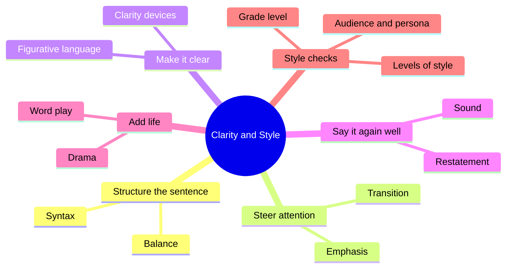
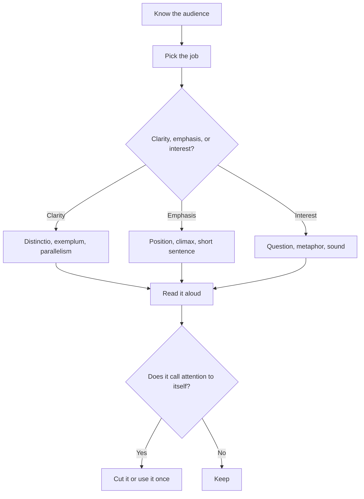
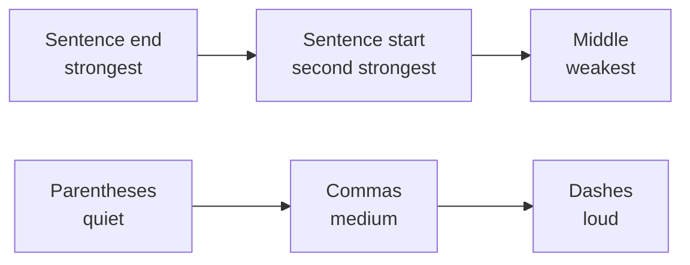
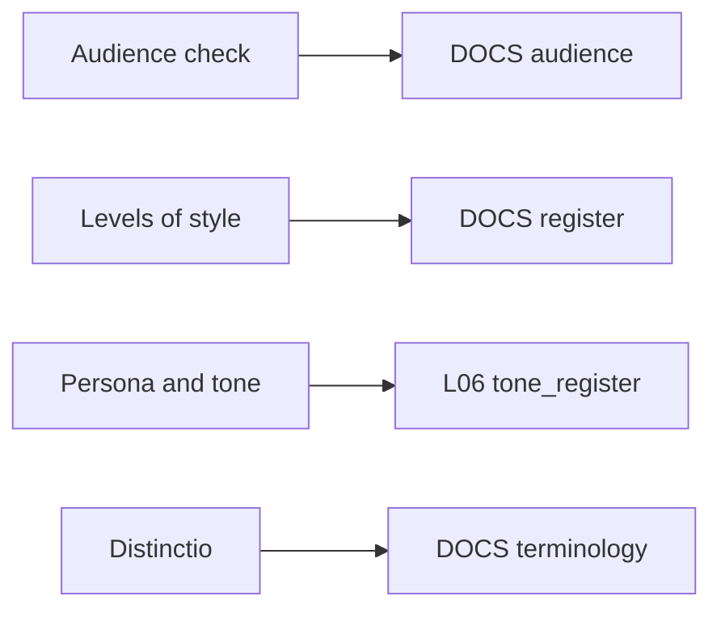

# 🧬 CRE.02 — Writing with Clarity and Style — Harris (2016)
### Knowledge Entry — Distill

A textbook of about fifty classical rhetorical devices, each shown as a cheap sentence-level move that adds clarity, emphasis or interest. It sits in the library as the sentence-level layer under the Command's plain register and the style-guide system.

## TABLE OF CONTENTS
- [Core Thesis](#1-core-thesis)
- [Mind Models](#2-mind-models)
- [Framework](#3-framework--structure)
- [Key Concepts](#4-key-concepts)
- [Heuristics](#5-heuristics--decision-rules)
- [Invariants](#6-invariants)
- [Pitfalls](#7-pitfalls--myths)
- [Application](#8-application)
- [For the Documentation SOP](#for-the-documentation-sop-bolo-95)
- [Cross-References](#9-cross-references)
- [Provenance](#10-provenance--confidence)

---

## 1 · CORE THESIS

Rhetorical devices are practical tools, not ornament. Clear, well-balanced sentences with the emphasis placed on purpose communicate better, and interesting writing gets read. Every choice depends on the audience, and the best craft goes unnoticed: "great art hides art."

---

## 2 · MIND MODELS

**Diagram 1 — the whole argument.**
Caption: *the book sorts its devices by the job they do for the reader (balance, emphasis, transition, clarity, and so on), and three ideas run under all of them: audience, persona and restraint.*

**Diagram 2 — the central mechanism (a decision loop for using a device).**
Caption: *a device earns its place only if it helps this reader; the test is a read-aloud, and restraint is the exit.*

**Diagram 3 — the emphasis gradient inside one sentence.**
Caption: *put the idea that matters at the end, the next most important at the start, and everything else in the middle; punctuation then sets how loud an interruption is.*

**Diagram 4 — mapped onto the Command's documentation systems.**
Caption: *four of the book's style checks become four settings in the doc and style-guide specs.*

---

## 3 · FRAMEWORK / STRUCTURE

Sixteen chapters, each a family of devices plus a closing Style Check. Each chapter also ends with Define Your Terms, It's in the Cloud, Salt and Pepper, Review Questions and Discussion Questions. Six appendices then rewrite real documents with devices added.

| Chapter | Family | What it does for the reader |
|---|---|---|
| 1 (p. 5) | Balance: parallelism, chiasmus, antithesis | Same grammar for same-weight ideas; easier to decode |
| 2 (p. 15) | Emphasis I: climax, asyndeton, polysyndeton, sentential adverb | Order and pause set what stands out |
| 3 (p. 27) | Emphasis II: irony, understatement, litotes, hyperbole | Emphasis by contrast; "one shot per paper" devices |
| 4 (p. 37) | Transition: metabasis, procatalepsis, hypophora | Tell the reader where you are going and answer the objection |
| 5 (p. 49) | Clarity: distinctio, exemplum, amplification, metanoia | Define, illustrate, expand, correct |
| 6-7 (pp. 61, 73) | Syntax: zeugma family, hyperbaton, anastrophe, appositive, parenthesis | Cut repeated words; control what comes first |
| 8-10 (pp. 85, 101, 113) | Figurative language: simile, analogy, metaphor, metonymy, allusion and more | Attach abstract ideas to pictures |
| 11-13 (pp. 125, 135, 147) | Restatement: anaphora, epistrophe, anadiplosis, conduplicatio, and more | Repetition as focus, not as fault |
| 14 (p. 157) | Sound: alliteration, onomatopoeia, assonance | Prose is heard, even when read silently |
| 15-16 (pp. 171, 181) | Drama and word play: rhetorical question, aporia, oxymoron, pun | Attention and wit, used sparingly |
| App. A-F (pp. 193-216) | Blog, business email, counselor's report, essay, story, Churchill | Before and after, with every device labeled |

The Style Checks are the part that outlives the device catalogue: rhythm (1), stress at start and end (2), emphatic position (3), logical transitions (4), clear vs opaque (5), cumulative vs periodic (6), parataxis vs hypotaxis (7), metaphor size (8), freshness (9), persona (10), short sentences (11), what style is (12), vividness (13), texture and tone (14), levels of style (15), the future of style (16).

---

## 4 · KEY CONCEPTS

| Concept | What it is | Why it matters |
|---|---|---|
| **Parallelism** (p. 5) | Same grammatical shape for ideas of equal weight | Breaking it is "usually considered a writing fault"; it gives clarity, balance, rhythm and elegance |
| **Emphatic position** (p. 33) | The end of a sentence is the most emphatic place, the start second | Tells you where to put the point, and where to move a transition to soften it |
| **Climax** (p. 15) | List items in order of rising importance | A random list sends attention at random |
| **Metabasis** (p. 37) | A short "what we covered, what comes next" hinge | Keeps a long document ordered; needs bulk to summarize |
| **Procatalepsis** (p. 39) | State the likely objection and answer it | Shows you considered it; the caution is the straw man |
| **Hypophora** (p. 42) | Ask a question, then answer it | Pulls the reader forward; the form behind FAQs; one of the easiest devices |
| **Distinctio** (p. 49) | Say which meaning a word carries, in the same sentence | Stops ambiguity ("quickly, that is, within three minutes") |
| **Exemplum** (p. 51) | A concrete example beside the abstract claim | Minds process ideas tied to pictures |
| **Analogy** (p. 89) | A multi-point comparison that explains an unfamiliar idea with a familiar one | Practical for technical processes; a faulty analogy stands in for an argument |
| **Persona** (p. 120) | The personality a text shows, whether chosen or not | One persona for all purposes is not effective |
| **Levels of style** (p. 178) | Formal, semiformal, familiar | The reader's expectation of formality is part of the message |
| **Freshness** (p. 109) | Worn-out images stop being seen | Cliches are dead weight |
| **Sentence-length drift** (p. 187) | Average length fell from 30+ words to under 20; a 15-word target can turn choppy | "Don't worry about sentence length. Worry about communicating clearly" |

---

## 5 · HEURISTICS & DECISION RULES

| Situation | Do this | Not this |
|---|---|---|
| A word could mean two things | Define it in the same sentence (distinctio) | Assume the reader shares your meaning |
| An abstract claim | Add one concrete example (exemplum) | Leave it abstract |
| Items in a list | Same grammatical form, rising importance | Mixed forms in random order |
| Something must stand out | Move it to the end or the start of the sentence | Add bold, caps or exclamation points |
| A long piece | Add a hinge sentence between sections | Let sections butt against each other |
| A likely reader question | Ask it and answer it | Wait for the reader to email you |
| A contrast | Put both halves in parallel form (antithesis) | Bury the contrast in a loose sentence |
| A technical idea for a general reader | Compare it to something familiar, on several points | A one-word simile |
| A short forceful sentence | Place it after a longer one | A whole paragraph of short ones |
| Choosing a title | Sum it up in about ten words, specific and short | Vague teasers or 30-word titles |
| Not sure it reads well | Read it aloud, or have someone read it aloud | Trust the eye alone |
| A softer transition | Move it inside the sentence | Start every sentence with However |

---

## 6 · INVARIANTS

1. The purpose of writing is to communicate, and clear writing communicates best.
2. Clarity is partly a function of the audience; ask what this reader will understand.
3. The end of a sentence is its most emphatic position, the start its second.
4. Where everything is emphasized, nothing is emphasized; strong devices are used once, not everywhere.
5. Every text has a persona and a tone, chosen or not.
6. Form is part of content: readers read spelling, grammar and style as evidence about the writer's reliability (ethos, p. 132).
7. Concrete, image-bearing words are processed more easily than abstract ones.
8. A device that draws attention to itself has failed.

---

## 7 · PITFALLS / MYTHS

- "Rhetoric is empty decoration." The book's claim is the opposite: devices are tools for clarity and interest (Introduction, pp. 1-2).
- Overusing emphasis devices, such as a sentential adverb in every paragraph (p. 21), or a string of strong transitions like however and nevertheless (p. 46).
- Thesaurusitis: big words used for rarity, not precision (pp. 55, 121).
- Euphemism used to hide the truth ("collateral damage," Tables 9.2 and 9.3, p. 110).
- Straw-man objections (p. 40), and faulty analogy used as evidence (p. 90).
- Jargon or abstraction used for posturing instead of precision (p. 55).
- Treating any sentence-length target as a rule; the book sets 15 or 22 words as a temporary aim, not a law (p. 188).
- Believing a grade-level score is exact; "probably impossible" to compute well (p. 189).
- Copying the book's own habits for docs: hyperbole, irony, puns and drama are one-shot devices and do not belong in a reference page.

---

## 8 · APPLICATION

- **Spine level:** CRAFT-PROCESS. It teaches sentence-level craft and revision habits, not story structure.
- **12-layer character stack:** none directly. Persona and tone (pp. 120, 165) can inform L08 voice as a checklist for how a character's diction shows attitude to subject, listener and self.
- **plot_systems:** none.
- **Setting:** none.

The book is a sentence-level toolbox, and the Command's writing standard already lives at one level up. The plain register says "write like the Claude Code docs, name first number second, define on first use, actor + verb every sentence." Harris backs each clause. Define on first use is distinctio. Name first, number second is emphatic position plus climax. Actor + verb is his short-sentence and concrete-word advice. What Harris adds is vocabulary and a few tests: read it aloud, check the audience question, and keep the strong devices rare. Where the plain register and this book disagree, the plain register wins. This is research written for a reader who wants to understand, so Chief's rule of young-adult reading level with depth by explanation applies to every doc we write, and Harris's caution about grade-level tools (p. 189) means we treat any score as a hint.

---

## FOR THE DOCUMENTATION SOP (BOLO 95)

Harris writes about prose, not doc types. The doc-type entries below list only where he speaks to them. Everything else is skipped on purpose.

- **tutorial** — not covered as a type. Closest: exemplum and analogy (Ch. 5, Ch. 8) for teaching a new idea with one concrete case; Appendix B (p. 197) shows a memo that explains "why are we doing this?" first.
- **how-to** — not covered as a type. Sentence-level help: parallel steps (Ch. 1, p. 5), one verb-led step per line, and the instruction-writing exercise in Salt and Pepper 14 (p. 167).
- **reference** — not covered as a type. Sentence-level help: parallelism keeps table rows and lists uniform; climax orders a list (p. 15); asyndeton drops conjunctions for a compact list (p. 16).
- **concept/explanation** — analogy (p. 89) is "a practical device" for explaining technical ideas; exemplum after every abstraction (p. 51); distinctio for the terms (p. 49); metabasis to hand off between sections (p. 37). Keep the analogy on its points and do not let it stand as the argument.
- **FAQ** — hypophora (pp. 42-44) is the question-then-answer form; Harris says it "explains the popularity of FAQs" (p. 43) and gives question stems (Table 4.3). Ask the question the reader has, in their words.
- **README** — not covered. Title and first-sentence advice applies: a title that sums up the piece in about ten words (p. 13).
- **architecture/design doc** — procatalepsis (p. 39) suits a design doc: state the likely objection to a choice and answer it; hypotaxis (p. 80) shows which ideas depend on which ("because," "so that").
- **API/code docs** — not covered. Distinctio helps with defining a parameter or a term at the point of use (p. 49).
- **release notes/changelog** — not covered as a type. The business email in Appendix B (p. 197) is a working model of announcing a change: name the change, define the term, answer "why are we doing this?", give the numbers.
- **troubleshooting** — not covered. Hypophora frames symptom-as-question; short sentences (p. 131) suit a step someone follows under stress.
- **glossary/terminology** — distinctio and Table 5.1 (p. 51); "tamper proof vs tamper evident" and "fail safe vs fail proof" (p. 50) show what a good definition rules out ("X here should not be taken to mean"); "Losing Distinction" (p. 12) on words drifting together.
- **style guide** — Style Checks 10, 12, 14, 15 and 16 (pp. 120, 140, 165, 178, 187) are the closest thing to a style-guide chapter: persona, the components of style (proficiency, sentence structure, diction, components), tone axes, levels, and where prose is heading. Table 12.2 (p. 140) is a menu of style adjectives.
- **review and maintenance of docs** — read aloud (p. 12); the audience question (p. 55); freshness check (p. 109); grade-level checkers with caution (p. 189); Appendix A to E model a before/after review with every change labeled.

**Rules we could adopt, in the book's own terms:**

1. Define any ambiguous term on first use, in the same sentence (distinctio, p. 49).
2. Put one concrete example next to every abstract claim (exemplum, p. 51).
3. Put the point at the end of the sentence and the topic at the start (emphatic position, p. 33); move "However" inside the sentence unless the contrast is the point (p. 46).
4. Write list items and steps in parallel form (p. 5); never mix forms in one list.
5. Read every doc aloud once before it ships (p. 12); state the reader in one line before writing (p. 55).
6. Keep strong devices (irony, hyperbole, puns, drama) out of reference and how-to pages; they are "one shot per paper" tools (p. 36).

---

## 9 · CROSS-REFERENCES

| Related entry | Relation |
|---|---|
| [[🧬 TEC.01 — Docs for Developers — Bhatti et al. (2021)]] | Doc-type side of the same subject; Harris supplies the sentence-level rules under its structure |
| [[🧬 TEC.02 — Microsoft Manual of Style — Microsoft Corporation (2012)]] | A worked style guide; Harris's style checks are the reasons behind rules like these |
| [[🧬 PSY.37 — The State of Sex — Brents, Jackson & Hausbeck (2010)]] | Shape reference only |

---

## 10 · PROVENANCE & CONFIDENCE

Full-text plain-text extraction of the book (about 10,800 lines). Read in full: the front matter and contents, the Introduction, Chapters 1 to 5 (balance, emphasis, transition, clarity), all sixteen Style Checks, the Salt and Pepper pieces on titles, fragments, punctuation, euphemism and pompous proverbs, and Appendices A to D. Read selectively: Chapter 6 opening and the zeugma family, Chapter 8 (analogy), Chapters 9 to 16 through the Style Checks and review questions. Skimmed for shape only: exercise sets, review quizzes, most of Chapters 9 to 16 devices (metonymy, anaphora, sound devices, rhetorical question and the rest), and Appendices E and F. Page numbers are printed page numbers from the contents. The extraction is the 2018 Routledge second edition; the library metadata carries year 2016 as supplied. The "FOR THE DOCUMENTATION SOP" section is this distill's own mapping: Harris does not discuss documentation types, so entries name where his sentence-level advice supports a doc type and mark the rest as not covered. `zotero_key` is blank pending a catalog sweep.

## META
- Template: BVX-LEARN-v4.0
- Source classification: full-text plain-text extraction, targeted deep read on clarity, style checks and appendices
- Created / Updated: 2026-09-30
