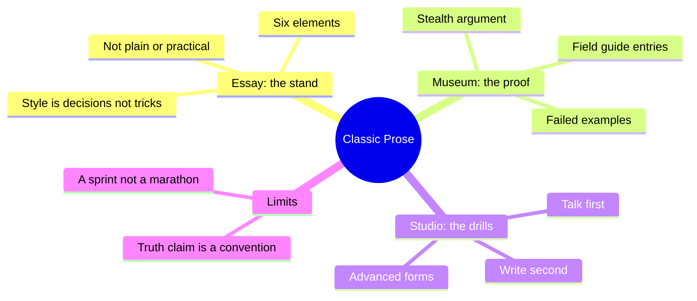
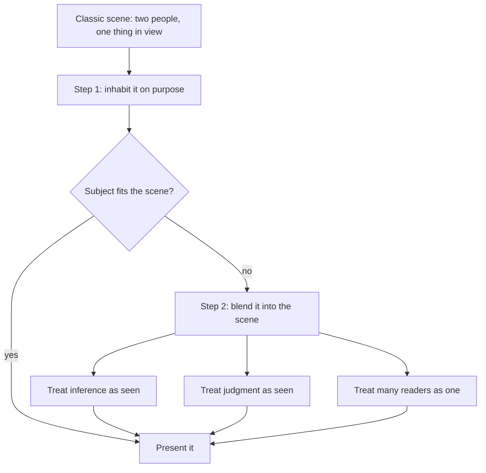
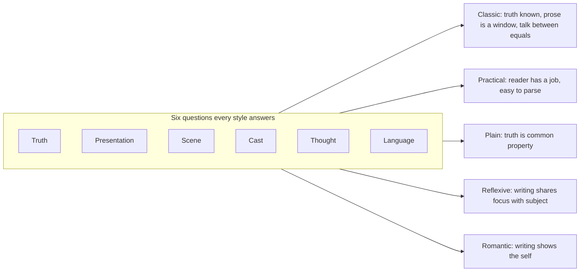
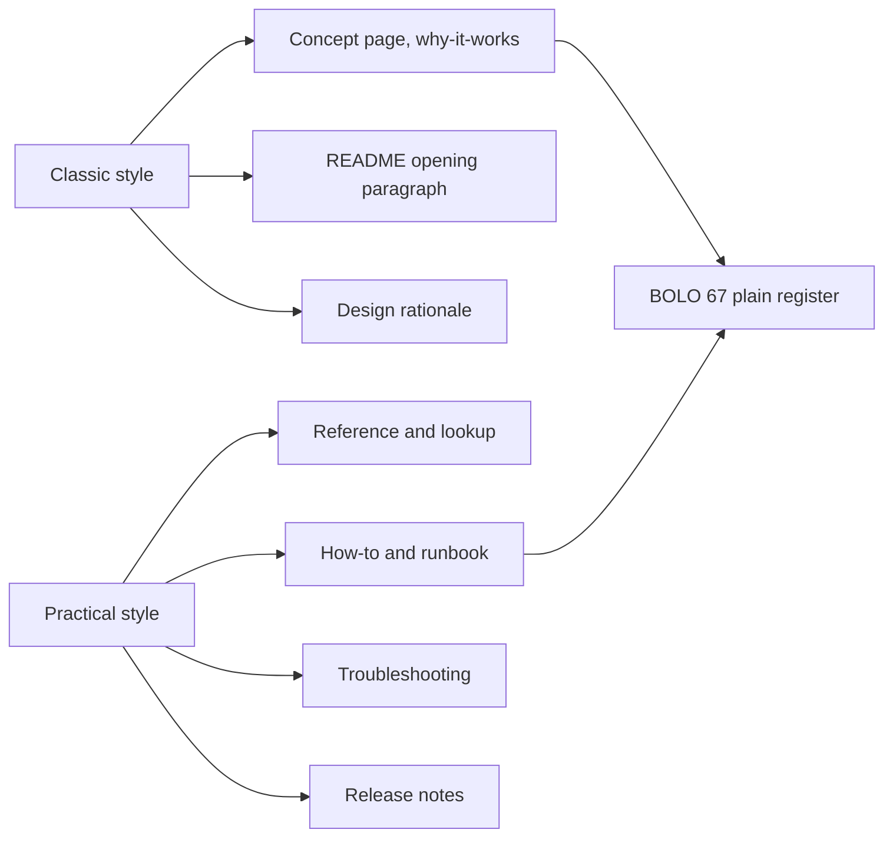

# 🧬 CRE.03 — Clear and Simple as the Truth — Thomas & Turner (2011)
### Knowledge Entry — Distill

A short book that treats writing style as a stand on six questions (truth, presentation, scene, cast, thought, language) instead of a list of tips, then teaches one style, the classic style, through an essay, a museum of examples, and a studio of drills.

## TABLE OF CONTENTS
- [Core Thesis](#1-core-thesis)
- [Mind Models](#2-mind-models)
- [Framework](#3-framework--structure)
- [Key Concepts](#4-key-concepts)
- [Heuristics](#5-heuristics--decision-rules)
- [Invariants](#6-invariants)
- [Pitfalls](#7-pitfalls--myths)
- [Application](#8-application)
- [For the Documentation SOP](#for-the-documentation-sop-bolo-95)
- [Cross-References](#9-cross-references)
- [Provenance](#10-provenance--confidence)

---

## 1 · CORE THESIS

A style is a set of decisions about truth, presentation, scene, cast, thought, and language. It is not a set of surface tricks. Classic style decides that the writer has seen something true and shows it to an equal reader, as in conversation. Writers can learn it on purpose, but it fits only some jobs.

---

## 2 · MIND MODELS

**Diagram 1 — the whole argument.**
Read off the four parts of the book and what each one does: the Essay defines the stand, the Museum shows it, the Studio drills it, the readings extend it.

**Diagram 2 — the central mechanism.**
Read off the two steps that make up the whole art: stand in the simple scene first, then pull every harder subject into that scene.

**Diagram 3 — six elements, and where five styles differ.**
Read off that each style answers the same six questions differently; two styles are close only when their answers agree.

**Diagram 4 — mapped onto the Command's systems.**
Read off which Command page types take which stance: what Chief reads to decide gets classic, what Chief runs at a desk gets practical.

---

## 3 · FRAMEWORK / STRUCTURE

The book has four parts (contents, p. v).

1. **The Essay (pp. 5–105).** Defines style (pp. 7–12), names the six elements (pp. 17–24), then gives the classic answer to each: Truth (pp. 24–32), Presentation (pp. 32–37), Scene (pp. 37–44), Cast (pp. 45–56), Thought and Language (pp. 57–66). Then it sets classic style against seven others (pp. 66–97): plain, reflexive, practical, contemplative, romantic, prophetic, oratorical. It ends with the "trade secrets" (pp. 97–102) and a short note that style is not etiquette (pp. 102–105).
2. **The Museum (pp. 107–185).** About forty exhibits with commentary. Success cases (field guide, Twain, Liebling, Dodd, Chastel, Borges). Failure cases (Mueller, Steiner, Morrison's sentence, Jouvenel). Deliberate non-classic cases (Milton, Greenspan), which show a bad style for one scene can be a good style for another.
3. **The Studio (pp. 187–227).** Twenty-four exercises. Twelve are talking drills (pp. 189–212). Then writing (pp. 212–214) and advanced forms (pp. 215–227).
4. **Further Readings (pp. 229–238).** A reading list by period and genre.

---

## 4 · KEY CONCEPTS

| # | Concept | What it is | Why it matters |
|---|---|---|---|
| 1 | **Style = stand** | A style is a consistent answer to six questions, not a list of surface features (pp. 2–4, 24). | Fixing commas never changes a style. Fix the stand first. |
| 2 | **Enabling convention** | A belief the writer adopts for the job ("truth can be known"), not a creed (pp. 3, 11). | Lets a writer stop apologizing and start writing. |
| 3 | **Classic scene** | Two people, one thing both can perceive, a spoken tone (pp. 37–39, 190). | The anchor. Every other subject is pulled into it. |
| 4 | **Window, not mirror** | Prose presents a subject that exists apart from it; language only draws notice when it is faulty (pp. 32–34). | Clarity is the main virtue. |
| 5 | **Symmetry of writer and reader** | The reader could take the next turn; the writer knows more only by position (pp. 46–52). | No talking down. No private evidence. |
| 6 | **Presenting, not arguing** | The writer shows where to look; the reader confirms (pp. 27–28, 113–114). | Persuasion happens by default. The book also warns this can hide an argument. |
| 7 | **Hedges of process, liability, worth** | The three hedges classic prose leaves out (pp. 35–36). | Cuts throat-clearing and self-protection. |
| 8 | **Browsing, not skimming** | Every word counts; you can enter anywhere but must read closely (p. 36). | Opposite of practical style, which is built to skim (p. 81). |
| 9 | **Image schema and stress position** | A sentence has a direction and a goal; the end carries the point (pp. 62–65). | Gives a cheap test for a bad sentence. |
| 10 | **Last-third test** | Block the last third of a sentence; a practical sentence is predictable, a classic one is not (pp. 81–82). | Separates skimmable from readable. |
| 11 | **Description vs. presentation** | Description fills a template someone else set; presentation is the writer's own selection (pp. 207–208). | Names the difference between a form and a page. |
| 12 | **Accidentals** | Spelling, usage, date format: real, arbitrary, and not style (pp. 103–104, 172–175). | Keep them in a short list; do not build the guide on them. |

---

## 5 · HEURISTICS & DECISION RULES

| Situation | Do this | Not this |
|---|---|---|
| Starting any page | Pick the scene and cast first: who reads, what for, on whose behalf | Draft, then "polish the style" (pp. 215–216) |
| Reader has a job to do now | Practical style: easy to parse, main point in the expected place (pp. 75–82) | Classic flourishes that force a close read |
| Reader wants to understand | Classic: one voice, one point per unit, fine distinctions in plain words | Outline-in-prose, "first we will cover X" (p. 38) |
| Feeling anxious about being wrong | Take the stand of competence; say what you know (pp. 54–55) | "As far as I know", "in my limited experience" (p. 35) |
| Explaining something abstract | Define it exactly enough to point at (pp. 58–59, 163–165) | Vague nouns that only the writer can see |
| Reader must act on your claim | Show the evidence in the open so they can check it (pp. 47–52) | "Trust me" or private evidence |
| A sentence feels off | Check direction, goal, and stress position (pp. 62–65) | Reorder words at random |
| Writing for a group | Write to one person; treat the group as an individual (pp. 211–212) | Address "all stakeholders" |
| Style question is really a spelling question | Settle it once in a short accidentals list (p. 103) | Argue it in every review |

---

## 6 · INVARIANTS

1. Every style takes a stand on truth, presentation, scene, cast, thought, and language, whether or not the writer notices (pp. 11, 19).
2. Surface marks do not define a style. The same sentence ("He died quietly") can sit in any of nine styles (p. 69).
3. Thought comes first in classic style. Writing presents what the writer already knows (pp. 59–60).
4. The reader stays in the writer's world only if the writer plays fair: shared evidence, no private claims (pp. 51–52).
5. Style cannot be revised in; a draft with no settled stand does not become classic by editing (p. 215).
6. Classic style fits some jobs and not others; there is no single good style (pp. 66–67).

---

## 7 · PITFALLS / MYTHS

- **"Style is decoration."** Wrong; nothing is written in no style (pp. 7–8).
- **"Write concretely, avoid abstractions."** Called shallow advice; what matters is whether the subject is treated as a clear, checkable "thing" (pp. 58, 165).
- **"There are good style and bad style."** Books like Strunk and White or Williams and Colomb each teach one style and present it as all of style (pp. 66–67, 79–80).
- **Fixing the surface.** Rewriting Milton or Greenspan to be "clearer" would destroy a style that fit its scene (pp. 167–172).
- **Fake classic.** Classic prose can be confident and wrong (Root, p. 142). The stand does not make a claim true.
- **Classic as a cover.** The book says outright that classic presentation can hide a sales or persuasion motive (pp. 112–114). It also flags this as a rhetorical trick.
- **Copying the great stylists.** Proust or Faulkner cannot be imitated; classic style can be learned (pp. 45–46).
- **Over-long use.** The classic distance is "a sprint" (p. 12). Nobody holds the pose for a whole manual.
- **Trade secrets.** The style cannot cover truths that are not short and clear, and its "God's-eye" claim to truth is a convention, not a fact (pp. 98–102).

---

## 8 · APPLICATION

*Prose carries the why; `feeds:` carries the wiring (D3). Both required, neither redundant.*

- **Spine level:** CRAFT-PROCESS. A craft book about how to choose and hold a stance while writing.
- **12-layer character stack:** none directly. Indirect use: the six elements can describe how a character writes or speaks (an expert who talks classic, a bureaucrat who talks official).
- **plot_systems:** none.
- **Setting:** none.

The Command already rules the plain register (BOLO 67, ruled 9/17): "write like the Claude Code docs, name first number second, define on first use, actor + verb every sentence." Research is written at a young-adult reading level, with depth by explanation and not jargon (ruled 9/24). This book explains why those rules work, and where they stop. "Name first, number second" and "actor + verb every sentence" fit the book's image-schema idea: a sentence with an agent and an action has a direction and a goal (pp. 62–65). "Define on first use" fits the claim that an abstraction must be exact enough to point at (pp. 58–59).

Where the book adds something the Command lacks:

- **A default stance for explanation pages.** The plain register says how to write a sentence. Classic style says who is talking to whom and why. Two answers cover most cases: Chief is an equal reader who could take the next turn; the writer only holds a different position.
- **A dividing line between page types.** A reader with a job wants practical style. A reader who wants to understand gets classic style. This gives BOLO 95 a rule for picking, per page, instead of one voice for everything.
- **A short list of forbidden hedges.** Process, liability, and worth hedges give BOLO 92 three concrete, checkable bans.
- **A caution.** The Command's plain register is closer to what the book calls practical style than to plain style; and where the book warns that plain style treats simplicity as truth (pp. 71–73), the Command should still keep its fine distinctions when a precise word is needed.

The stance has one limit worth stating for Chief. Classic prose hides the labor of thinking (pp. 34–35, 55–56). Session notes, DOPE SHEETs, and logs exist to show the labor. Do not write those in classic style.

---

## FOR THE DOCUMENTATION SOP (BOLO 95)

The book never mentions documentation as a genre. It does discuss manuals, memos, guides, and how-to pieces in passing, and it gives a clear rule for choosing a style by scene and cast (pp. 75–82, 112–113, 216–217). Page pointers below are to the printed book.

- **tutorial** — Not the book's target. It says instruction manuals have a practical motive but need not be impersonal: a "classic practical" mix with a real voice and a crisp start and end (Exercise 14, pp. 216–217). It also says a cookbook is read without doubting that cooking can be talked about (pp. 73–74), which supports writing tutorials without preambles about how hard the topic is.
- **how-to** — Practical style: "manual telling someone how to perform routine jobs" and "how-to book" are named as extensions of the practical scene (p. 77). The reader is doing a job, so the win is easy parsing and the point in the expected place (pp. 75–76, 79–81). Exercise 14 (pp. 216–217) tries a how-to with a classic voice. The result keeps the steps practical and lets the voice do the rest.
- **reference** — Practical style, fully. Readers skim; the format should let them find "the cream in the same place" (p. 81). Classic style would hurt here: every word counting is a cost when a reader needs one flag. The Audubon field-guide entry is the closest reference form that also reads well (pp. 109–111).
- **concept/explanation** — The best fit for classic style. It "presents absolutely anything" and abstractions can be treated as clear, checkable things (pp. 58–59, 116–119, 138–140). The Feynman, Murrin, and Dodd exhibits are concept pages: subject named, then one fine distinction (pp. 117–119, 47–50). Avoid the failure cases, where the writer's own abstraction is the only proof it exists (Steiner, Morrison, pp. 141–143, 162–166).
- **FAQ** — Not covered. Related idea: the classic writer does not raise the reader's doubts for them, and writes one answer per point (pp. 37–38).
- **README** — The opening paragraph is where classic style works: the Smithsonian dragoon-tie card uses a classic stance to sell, and its one flaw is "our exclusive" (pp. 112–115). The lesson for a README: open with what the thing is, in one voice, and leave "our" and marketing words out.
- **architecture/design doc** — Not covered by name. Close guidance: a design rationale is "presenting the result of an analysis" with the relationships stated exactly (pp. 135–137, Chastel). Do not write it as a case for the writer's side (Mueller, pp. 133–135).
- **API/code docs** — Not covered. The book's only rule that transfers is the difference between description and presentation: a description "fills a template", which is right for a signature table (pp. 207–208).
- **release notes/changelog** — Not covered. Related: obituaries and real estate prose are "template" genres where a writer can add one selected, classic detail (Exercises 19–20, pp. 221–222). A changelog is a template; a one-line "why this matters" is the classic addition.
- **troubleshooting** — Practical style. The reader has a problem and a deadline (pp. 75–76). Nothing more in the book.
- **glossary/terminology** — Not covered by name. Relevant: the classic writer uses ordinary words exactly and does not coin new ones (p. 62); nouns like "confidence" or "nation" already turn concepts into things (p. 199). Define each term so the reader can point at it.
- **style guide** — The book's main target. It attacks guides that treat style as surface marks (Chicago, MLA, Strunk and White, pp. 21–23) and says accidentals do not belong in the core (pp. 103–104, 172–175). It also says a guide must state which style it teaches and that others exist (pp. 66–67, 79–80). A style guide should list the stand first and keep the surface rules short.
- **review and maintenance of docs** — Two checks the book supports: (1) the last-third test (pp. 81–82) tells you whether a page is skimmable or readable; (2) the stress-position check (pp. 62–65) finds sentences whose point is not last. It also says style cannot be repaired by revision (Exercise 13, pp. 215–216), so review should catch a wrong stance early, before a rewrite. No advice on keeping docs current.

**Rules we could adopt, in the book's own terms**

1. Name the scene and cast on every page: who reads, what they are doing, and whether they have a job to do. If they have a job, write practical. If they want to understand, write classic (pp. 75–77, 112–113).
2. Concept and rationale pages use one voice, no metadiscourse ("as we will see", "the next section covers"), and no hedges of process, liability, or worth (pp. 35–38).
3. Reference, how-to, and troubleshooting pages are built to be skimmed. Put the point in the expected place and let readers stop early (pp. 79–81).
4. Show evidence in the open. A doc must not depend on a claim only the writer can check (pp. 47–52).
5. The style guide lists the stand first (truth, presentation, scene, cast, thought, language) and puts spelling, dates, and comma rules in one short appendix (pp. 21–24, 103).
6. Review checks the stance and the last-third and stress-position tests. Do not fix a wrong stance by editing sentences (pp. 62–65, 81–82, 215).

---

## 9 · CROSS-REFERENCES

| Related entry | Relation |
|---|---|
| [[BOLO 67]] | The plain register; this book explains why it works and where its limits are |
| [[BOLO 92]] | Style guide system; takes the stand-first model and the accidentals appendix |
| [[BOLO 95]] | Documentation SOP; takes the scene-and-cast rule for choosing a style per page |
| [[CRE.01]] | Other CRE distills on craft and process; read for sentence-level method to sit under this stance |

---

## 10 · PROVENANCE & CONFIDENCE

- **Sourced from full text:** all of the Essay, Museum, Studio, and reading-list front matter, read from the extracted text of the second edition (2011). Page numbers are the printed page numbers in the text.
- **Not read closely:** the bibliographic notes and index at the back (pp. 239–end); the Further Readings list was sampled.
- **Inference:** every "for docs" line applies a style book about literary and journalistic prose to technical writing. The book does not discuss docs. The mapping of practical style to reference, how-to, and troubleshooting is the distiller's reading, based on the book's own list of practical prototypes (p. 77). Types marked "not covered" have no source support.
- **Confidence:** high on the book's argument; medium on the docs mapping.

## META
- Template: BVX-LEARN-v4.0
- Source classification: book, prose stance and style theory
- Created / Updated: 2026-09-30 / 2026-09-30
