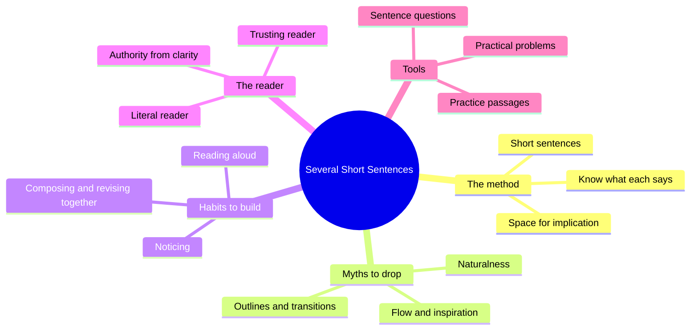
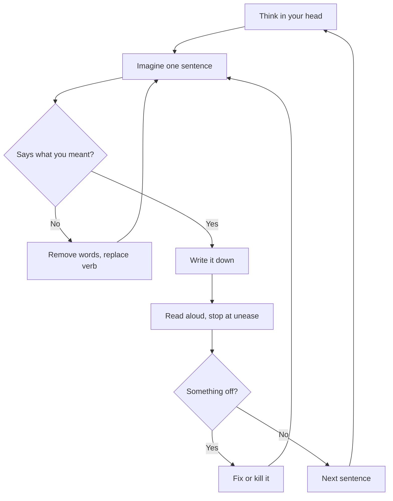

# 🧬 CRE.04 — Several Short Sentences About Writing — Klinkenborg (2012)
### Knowledge Entry — Distill

A short book about the sentence as the only unit a writer really controls. Written as a stack of short lines, it argues that most school advice about writing is wrong and gives a set of experiments to replace it.

## TABLE OF CONTENTS
- [Core Thesis](#1-core-thesis)
- [Mind Models](#2-mind-models)
- [Framework](#3-framework--structure)
- [Key Concepts](#4-key-concepts)
- [Heuristics](#5-heuristics--decision-rules)
- [Invariants](#6-invariants)
- [Pitfalls](#7-pitfalls--myths)
- [Application](#8-application)
- [For the Documentation SOP](#for-the-documentation-sop-bolo-95)
- [Cross-References](#9-cross-references)
- [Provenance](#10-provenance--confidence)

---

## 1 · CORE THESIS

A writer's real job is making sentences. Know what each one says, what it leaves out, and what it implies. Short sentences make that possible. Most received wisdom (outlines, transitions, flow, inspiration) hides the sentence and should be tested, not trusted.

---

## 2 · MIND MODELS

**Diagram 1 — the whole argument.**
Caption: *the book has five parts, and every one of them returns to the single sentence.*

**Diagram 2 — the central mechanism (the sentence loop).**
Caption: *there is no draft stage; each sentence is composed and revised until it is nearly final, then re-read against the others.*

**Diagram 3 — the sentence test as a fault ladder.**
Caption: *most bad sentences fail at one of these five rungs, checked from the bottom up.*

---

## 3 · FRAMEWORK / STRUCTURE

The book has no numbered chapters. It is built in this order:

| Part | What it does |
|---|---|
| Prologue | Says the book is "first steps." "There are no rules, only experiments." |
| First Page | A poem-like opening in short lines: know what each sentence says, doesn't say, and implies. |
| Main essay (long) | The argument, in short paragraphs. Covers short sentences, noticing, reading aloud, revision, thinking without an outline, the reader, authority, and "done." |
| Some Prose and Some Questions | Twelve passages by good writers (McPhee, Liebling, West, Orwell, Didion and others) with questions to ask of them. |
| Some Practical Problems | About sixty flawed student sentences, each with a short diagnosis and fix. |

The book is meant to be tried, not read once. The closing lines say: "Never stop reading."

---

## 4 · KEY CONCEPTS

| Concept | What it is | Why it matters |
|---|---|---|
| **Short sentences** | Sentences short enough to see their parts. Long sentences are "strong, short sentences joined." | Ambiguity shows up fast. You cannot hide weak syntax. |
| **Knowing what a sentence says** | What it says, what it does not say, what it implies. Not what you meant. | The reader has only the sentence. |
| **Implication** | Suggesting more than the words state. Needs empty space between sentences. | Lets the reader finish the thought. Long sentences leave no room for it. |
| **Volunteer sentence** | A sentence that offers itself with a ready shape and stock phrases. | Usually a cliche or a school habit. Do not accept it. |
| **Cliche** | "The debris of someone else's thinking." Any group of words that cluster "naturally." | You cannot fix it by using it ironically. |
| **Noticing** | Paying attention to what catches your eye or ear, and not assigning it a meaning. | Source of specific detail. Also the skill behind editing. |
| **Reading aloud** | Read plainly to an imaginary listener who is you and not you. Stop where something sounds funny. | The ear catches rhythm and repetition that the eye misses. |
| **The inner tremor** | A faint unease you feel when a sentence is off. | The most useful early evidence of a problem. |
| **Compose and revise together** | No drafts, no provisional sentences. Bring each sentence close to final before you write it. | Removes "revision after the fact," which never has enough time. |
| **Two readers** | The literal reader, who takes every ambiguity the wrong way. The smart reader, who follows anywhere if the prose is clear. | Write for both at once. |
| **Trusting the reader** | Do not over-explain, over-describe, or over-signal. | When you trust the reader, the "devices of distrust" (heavy transitions, false logic) fall away. |
| **Authority** | Comes from clarity of language and perception, not from the subject or from cited experts. | The reader can close the book at any moment. |
| **Logical indicators** | Words like "however," "thus," "moreover," "indeed." | They steer the reader from the front and hide what the sentence says. |
| **Chronology as a choice** | Order in time is one rhetorical choice among many, and often a dull one. | Do not report in the order you gathered things. |
| **Atomizing evidence** | Break notes and quotes into single details. Use only the bit that matters. | Stops clumps of source material from setting the order. |
| **The narrator as a role** | You are not "just yourself" on the page. You build a place from which you speak. | Sincerity has to be enacted by the sentences. Feeling it is not enough. |
| **Style** | An effect of interest in each sentence. Do not aim for it. | "Pursue clarity instead." |
| **Revision targets** | Brevity, directness, simplicity, clarity, rhythm, literalness, implication, variation, silence, the name of the world, presence. | The book's checklist for when to stop and what to push toward. |

---

## 5 · HEURISTICS & DECISION RULES

| Situation | Do this | Not this |
|---|---|---|
| A sentence feels long or vague | Break it in two or three | Add words to fix it |
| A sentence feels wrong | Stop and find the cause, even if you cannot name it | Ignore the unease |
| Subject is an abstraction | Give it an actor who can do the verb | Keep a noun that cannot act |
| Verb is "is," "are," "was," or a noun phrase | Look for an active verb | "The watching of," "an appreciation of" |
| A word might be unnecessary | Remove it and listen | Assume it stays because it is there |
| "As" or "with" joins two ideas | Split into separate sentences | Use them as fake conjunctions |
| Opening phrase before the subject | Make sure it modifies the subject | Dangling openers ("After seven hours of zooming... the day had come...") |
| You want a transition | Check if the gap is already clear | "However," "thus," "moreover" by habit |
| You want to explain what a phrase means | Try the plain word | Stack a second phrase on top |
| You cannot fix a sentence with its own words | Reimagine it with new words | Shuffle the same words like a puzzle |
| Piece feels bad or good as a whole | Fix sentences one at a time | Throw it out or call it done |
| Opening | Find one sentence that interests you | A "fantastic first sentence" that "grabs" |
| Stuffy prose | Rewrite as a letter to a friend | Add formality |
| You do not know a word | Look it up, along with words you think you know | Guess from context |
| Metaphor | Use sparingly, keep it literally accurate | Extend it over several sentences |
| Physical action | Check you can picture it | Accept "placed one arm on his left leg" |

---

## 6 · INVARIANTS

1. The sentence is the only link between writer and reader.
2. Every word is optional until it proves essential.
3. Every sentence could have been otherwise.
4. Changing words or word order changes meaning. No two sentences are the same unless identical.
5. Ambiguity always costs the writer, because the literal reader takes the wrong branch.
6. Writing is hard work for everyone. Difficulty is not failure.
7. Composition and revision are the same act.
8. The reader holds all the authority and can leave at any time.
9. Feeling sincere on your end does not make prose sound sincere.
10. Rhythm is part of meaning.

---

## 7 · PITFALLS / MYTHS

- **Short sentences are childish.** They are not. Long sentences are short ones joined.
- **Short sentences sound choppy.** "Only a string of choppy sentences sounds choppy." Vary length and shape.
- **"Flow," "inspiration," "natural," "genius."** Reader effects or myths. Not the writer's working state.
- **Writer's block.** The book calls it a loss of confidence, and a mix of failing to prepare, hastening, and not understanding sentences.
- **The outline and draft model.** It ranks sequence over sentences and blocks discovery. The book advises "squander your material."
- **Topic sentences and "nut grafs."** They announce what the reader can see for themselves.
- **Chronology is natural.** It is one choice.
- **Style and voice as self-expression.** They come from clarity, not effort.
- **Genre as method.** "Genres are merely outlines by another name."
- **Subject as authority.** "No subject is so good that it can redeem indifferent writing."
- **Grammar kills creativity.** Grammar and syntax knowledge lets you see your sentences.
- **Meaning as something you extract.** The sentence is not only a carrier.

---

## 8 · APPLICATION

- **Spine level:** not a story-spine source. Keys to CRAFT-PROCESS: how any text in the Command gets made and checked.
- **12-layer character stack:** none directly. Some use for the narrator-as-a-role idea when writing voice for a character.
- **plot_systems:** none.
- **Setting:** none.

The book is a method for the sentence. The Command writes for the eye and for the ear (JUDY reads pages aloud), so the book's ear-first checks apply directly. Its "actor + verb every sentence" habit matches the plain register in BOLO 67, and its rejection of jargon fits the ruling that research is written plain, at young-adult reading level, with depth by explanation and not by jargon. Two cautions. First, the book says "There are no rules, only experiments." The Command needs rules. Adopt the rules the experiments prove and test the rest. Second, the book writes for essays and stories. A reference page has readers who scan, so navigation aids the book distrusts are sometimes needed there.

---

## FOR THE DOCUMENTATION SOP (BOLO 95)

The book is about prose, so it touches documentation types only at the level of the sentence. Page pointers are by section, since the text has no chapter numbers. The types listed are those it speaks to.

- **how-to:** the Practical Problems section says physical action must be pictured: "Descriptions of physical action require incredible care because we read them with our bodies as well as our brains" (the seatbelt sentence). A step must be one thing a person can do. The main essay's advice on chronology says to use "the simple past tense" and clear time clues. For steps, this means one action per sentence, in order.
- **reference:** short sentences with one claim each. Main essay: "It's easier to tell what you're saying in a short sentence." Also its list of revision targets: brevity, directness, literalness. Cut "the," "truly," "sacred," and similar words that add nothing (Practical Problems: Super Bowl sentence).
- **concept/explanation:** trust the reader (main essay, "the other reader"). Do not over-narrate. Give one plain sentence per idea and let the space between sentences do work. It also warns that the second sentence must deliver on the first ("We hold a mythological view of soldiers." Then it never says what that view is).
- **README:** first-sentence advice. "You want to begin the piece, not introduce it." Start with what the thing is. Skip "clearing your throat" openers.
- **troubleshooting:** the Practical Problems section is itself a fault catalog. It lists a bad sentence, names the fault, and shows the fix. That pattern (symptom, cause, fix) is worth copying for docs.
- **glossary/terminology:** "It's your business to know the names of things." Use the real name, not a stand-in ("colorful flora" hides the flower names). Define words by looking them up, including familiar ones. The word "autopsia" story shows what happens when a writer guesses.
- **style guide:** the closing checklist ("revise toward brevity, directness, simplicity, clarity, rhythm, literalness, implication, variation, silence, the name of the world, presence") is a ready-made list of style goals. The sentence questions (subject first? actor? "to be" verbs? "as" and "with"?) are a lint list.
- **review and maintenance of docs:** "Turn every sentence into its own paragraph" to see length, shape, and repetition at once. Read aloud and stop where unease appears. Fix at the sentence level, in any order. "Only revision will tell you whether a sentence that offers itself is worth keeping." The book says nothing on version control, staleness, or ownership.

Not addressed by the book: tutorial, FAQ, architecture/design doc, API/code docs, release notes/changelog.

**Rules we could adopt, in the book's terms:**

1. One claim per sentence. If a sentence needs "with" or "as" to hold two ideas together, split it.
2. Every sentence has an actor and an active verb. Replace "is," "are," "was," and noun phrases ("the watching of") where a real verb fits. This is the plain register's "actor + verb every sentence."
3. Remove any word that can go. "Every word is optional until it proves to be essential."
4. Read every page aloud before it ships, because JUDY will. Stop at each stumble and fix it.
5. Run the sentence-per-line check on any page that feels dense. Look for repeated openers, long sentences, and unnamed actors.
6. Do not use logical indicators ("however," "thus," "moreover") as a habit. Keep one only when the sentence really turns.

---

## 9 · CROSS-REFERENCES

| Related entry | Relation |
|---|---|
| [[CRE.03]] | Another craft-of-writing source in the same subject. Compare method. |
| [[BOLO 67 plain register]] | Same target: plain, actor and verb, short. The book supplies the drills. |
| [[BOLO 92 style guide]] | Voice and rhythm sections feed the guide. |
| [[BOLO 95 documentation SOP]] | The FOR THE DOCUMENTATION SOP section above. |

---

## 10 · PROVENANCE & CONFIDENCE

Full text read (extracted text, about 5,300 lines, all sections: prologue, the short-line opening, the main essay, the twelve passages, the sixty-odd practical problems). Section pointers are by heading because the extracted text has no page numbers. The "for the documentation SOP" mapping is inference: the book never discusses documentation, and the connections are ours. Confidence high on extraction, medium on the documentation mapping.

## META
- Template: BVX-LEARN-v4.0
- Source classification: book, method/craft
- Created / Updated: 2026-09-30
