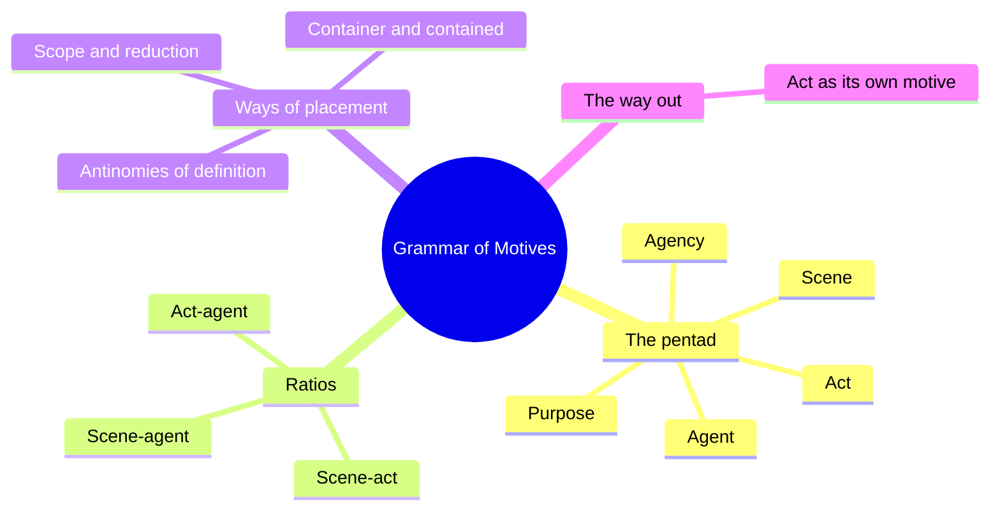
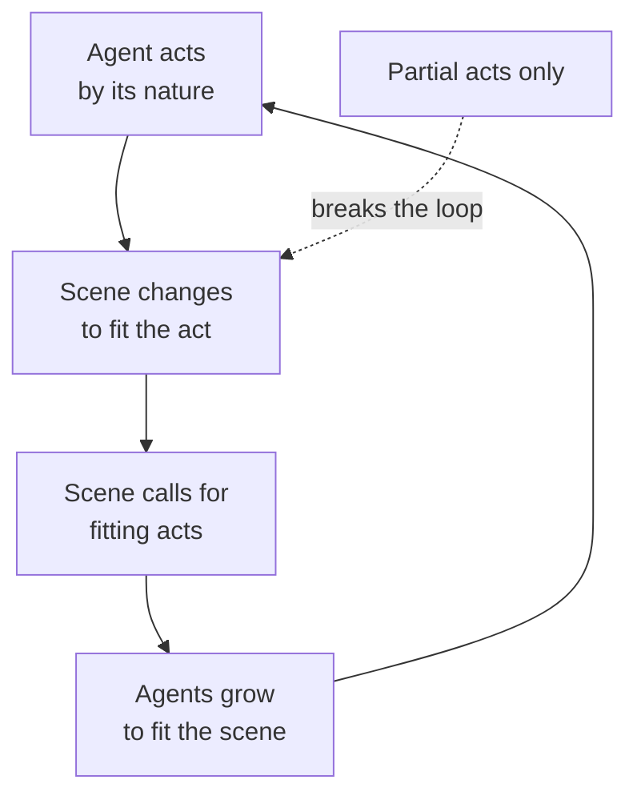
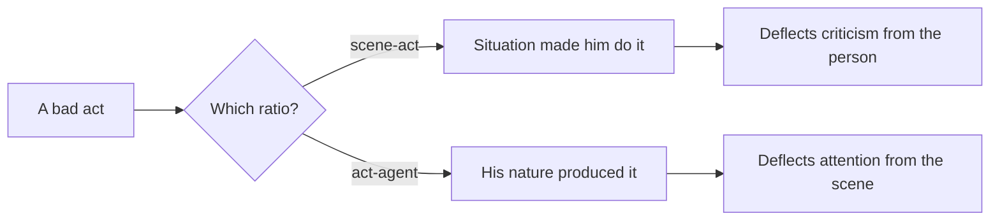
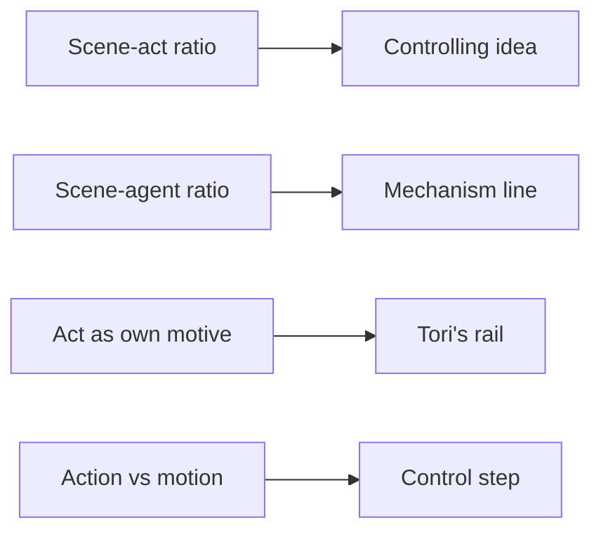

# 🧬 CRE.05 — A Grammar of Motives — Burke (1945)
### Knowledge Entry — Distill

A rhetoric-and-philosophy classic that gives five terms for asking why anyone acts. It is in the library because every theme argues a cause, and Burke shows how the choice of cause is itself a hidden argument.

## TABLE OF CONTENTS
- [Core Thesis](#1-core-thesis)
- [Mind Models](#2-mind-models)
- [Framework](#3-framework--structure)
- [Key Concepts](#4-key-concepts)
- [Heuristics](#5-heuristics--decision-rules)
- [Invariants](#6-invariants)
- [Pitfalls](#7-pitfalls--myths)
- [Application](#8-application)
- [Cross-References](#9-cross-references)
- [Provenance](#10-provenance--confidence)

---

## 1 · CORE THESIS

Burke says every statement about motives answers five questions: act, scene, agent, agency, purpose. Pairs of these terms form ratios, and each ratio is a theory of what causes what. Choose the pair, and you have already chosen where the blame goes.

---

## 2 · MIND MODELS

**Diagram 1 — the whole argument.**
Caption: *the five terms generate the ratios, the ratios need placement, and placement forces a choice of scope.*

**Diagram 2 — the central mechanism (the ratio loop).**
Caption: *an agent acts in keeping with its nature, changes the scene, and the scene then shapes the next agent; Burke calls the perfect version Edenic and says real acts are only partial.*

**Diagram 3 — where the blame goes.**
Caption: *the same bad act reads as excused or as guilty depending on which ratio the speaker reaches for.*

**Diagram 4 — mapped onto the Command's theme layer.**
Caption: *Burke's ratios land on the controlling idea, the mechanism line, and the rail debates.*

---

## 3 · FRAMEWORK / STRUCTURE

The Grammar names five terms in its Introduction (pp. xv-xvi). Part One, "Ways of Placement," then tests how the terms contain one another. Its three chapters are:

| Chapter | What it does | Pages |
|---|---|---|
| Container and Thing Contained | Defines the scene-act and scene-agent ratios and shows them in drama and politics | pp. 3-19 |
| Antinomies of Definition | Shows that defining a thing means placing it in a context | pp. 20-57 |
| Scope and Reduction | Shows that every vocabulary selects, and so deflects | pp. 58-79 |

The ratios are principles of determination (p. 15). Burke says five terms allow ten pairs. This text covers only the first two ratios in depth.

---

## 4 · KEY CONCEPTS

| Concept | What it is | Why it matters |
|---|---|---|
| **Pentad** | Act, scene, agent, agency, purpose. A rounded account of motives names all five (Intro., p. xv). | Gives a checklist for any claim about why someone did something. |
| **Scene-act ratio** | The scene is a container fit for the act. Burke writes that "the scene contains the act" (p. 3). | The core of "the system made them do it." |
| **Scene-agent ratio** | The scene also contains the agent. A brutal scene implies brutal agents (pp. 8-9). | Shows the cost of blaming only the scene: the agents become not worth saving. |
| **Act-agent ratio** | The agent is the author of the act, and the act can remake the agent (pp. 16-17). | Explains how a role changes the person who wears it. |
| **Deterministic vs. hortatory use** | A ratio can say a policy had to follow a situation, or that it should (pp. 12-13). | Shows that "the situation demands it" is often an argument for a choice. |
| **Action vs. motion** | Burke defines the basic unit of action as the human body in conscious, purposive motion (p. 15). | Names what a job can strip out of work. |
| **Job as scenic word** | Words like position, occupation, and office carry scenic overtones. Some jobs cut action to a minimum and raise motion to a maximum (pp. 14-15). | Direct plain words for how a role replaces choice. |
| **Representative anecdote** | A vocabulary should be built from a case typical of its subject (pp. 58-59). | Asks which story the theme system treats as typical. |
| **Circumference** | One picks the scope of the scene, and the scope changes the motive that shows (pp. 76-79). | Who draws the boundary around "the system" decides who looks guilty. |
| **Act as locus of motives** | If scene, agent, agency, and purpose are all given, novelty can only come from the act itself (pp. 64-67). | A philosophic basis for a refusal that the scene did not cause. |

---

## 5 · HEURISTICS & DECISION RULES

| Situation | Do this | Not this |
|---|---|---|
| A character blames the situation | Name the ratio in play and ask who benefits from it (pp. 16-17) | Accept the situation as a plain fact |
| A scene indicts a bad system | Let the agents keep some choice, or the system's victims read as not worth saving (pp. 8-9) | Make every agent a product of the scene |
| A role is described | Ask how much action is left and how much is only motion (pp. 14-15) | Treat every job as an act of will |
| A theme names its cause | State which term of the pentad it picks and what it leaves out (Intro., pp. xvi-xxiii) | Treat the cause as obvious |
| A turning point must feel new | Give the act a motive that no other term supplies (pp. 65-67) | Explain the turn entirely from the scene |
| A system needs a boundary | Pick the circumference on purpose and show who else could draw it (pp. 76-79) | Let the scope stay implicit |

---

## 6 · INVARIANTS

1. Any complete statement about motives answers what was done, where, who did it, how, and why (Intro., p. xv).
2. Ratios can run in both directions. The scene calls for acts, or acts remake the scene (pp. 9-11, 18-19).
3. Choosing one term as the cause deflects attention from the others (pp. 16-17).
4. A vocabulary that selects reality also deflects it when it does not fit its subject (pp. 58-59).
5. Real acts are partial. If every ratio were perfectly matched, nothing could change (pp. 18-19).

---

## 7 · PITFALLS / MYTHS

- Treating the scene-act ratio as a law of nature. Burke shows it is a rhetorical choice, used both to excuse and to exhort (pp. 12-13).
- Indicting a scene by showing only brutalized agents. Burke says the novelist then makes people "not worth saving" (pp. 8-9).
- Assuming "environment," "society," and "situation" are neutral words. Burke lists them as scenic terms that carry a motive (pp. 12-13).
- Reading this entry as the whole book. Only the Introduction and Part One's first chapters were available (see Provenance).

---

## 8 · APPLICATION

*Everything in this section is proposed, never ruled.*

- **Spine level:** L6, the argument's value layer.
- **Controlling idea.** The ruled sentence, "Nobody has to be evil when everyone does their job," is a scene-act claim. Burke gives it an exact name and a built-in warning. The warning is that the claim cuts two ways. It can excuse Anna's world, and it can indict it (pp. 16-17).
- **Mechanism line.** "It trains you, measures you, then calls the result your nature" is the scene-agent ratio plus a reversal. Burke's own line is that a scene can be stressed so the agent looks like the cause, or the reverse (pp. 16-17). The mechanism line names a third move: the scene makes the agent, then the agent's shape is blamed.
- **Rails.** Proposed: the world rail argues scene-act, as a deterministic claim ("they already know how you'll turn out"). Tori's rail argues the act as its own source of motive. The Stop is then the one act no ratio predicts (pp. 64-67).
- **Gauges.** Proposed plain words for the Control step: *"You still move, but you no longer act."* This borrows Burke's action versus motion (pp. 14-15).
- **Motifs.** Burke shows a room or a prop carrying a motive: Ibsen's torn clothes, O'Neill's closed shutters, which then command the next act (pp. 3-6, 9-11). The uniform and the mirror already do this work.
- **Strongest single addition (proposed).** Tag each scene card with the ratio it argues, scene-act or act-agent or act-as-motive. The tag keeps the story from sliding into pure scene-blame, which Burke says leaves characters "not worth saving."

---

## 9 · CROSS-REFERENCES

| Related entry | Relation |
|---|---|
| [[BVX.1201]] | Thematics: Burke asks what causes an act; Thematics asks how a theme is built from motifs |
| [[BVX.1202]] | Scott: shows the public performance that makes the scene-act claim look true |
| [[BVX.1203]] | Stangneth: tests the scene-act claim against one man who used it as a mask |
| [[BVX.0089]] | Dramatica: holds the same problem as structural position |
| [[MSX.36]] | Foucault: the mechanism line's source |

---

## 10 · PROVENANCE & CONFIDENCE

Source: a pdftotext extract of the 1969 California edition. The copyright page gives 1945 for the first edition.

**Read in full:** the Introduction (pp. xv-xxiii) and Part One, chapter 1, "Container and Thing Contained" (pp. 3-19). **Read in part:** the opening of "Antinomies of Definition" (the paradox of substance, pp. 20-25) and "Scope and Reduction" (the representative anecdote, the act as locus of motives, circumference, pp. 58-79). **Not read:** the extract ends near page 80. Nothing from Parts Two through Five was available. That includes the agency, purpose, and scene-purpose ratios, and the Appendix.

Page numbers are the printed folios seen in the running heads. Where two folios share one text page, the cite gives the range. The extract has OCR noise, so some wording was checked across both columns.

Confidence is medium. The core ratios are solid. The application to OXO is this entry's own proposal.

## META
- Template: BVX-LEARN-v4.0
- Source classification: full-text book, partial extract (Introduction and the first third of Part One)
- Created / Updated: 2026-10-04
