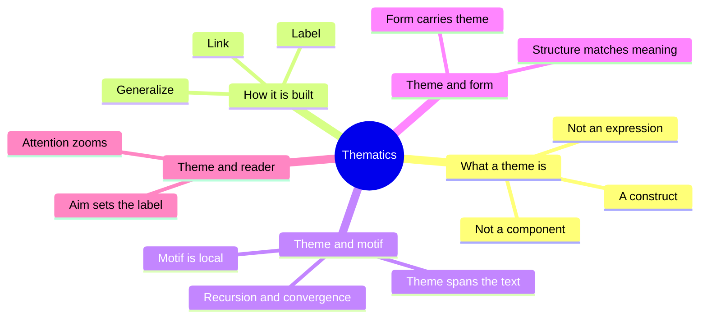
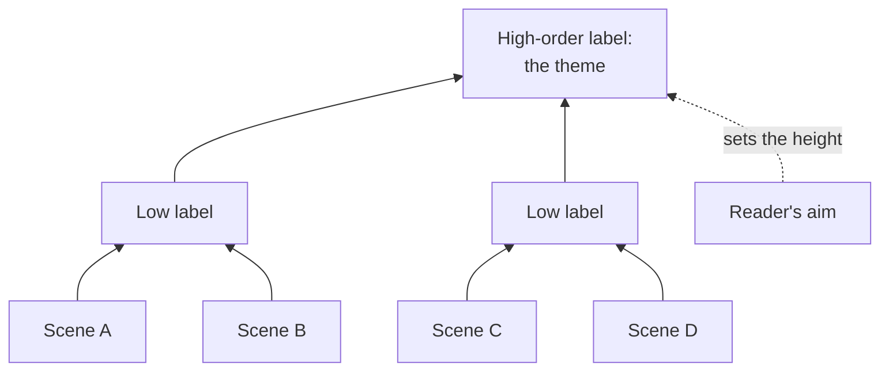
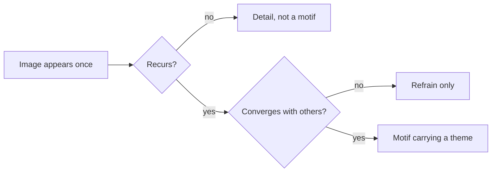
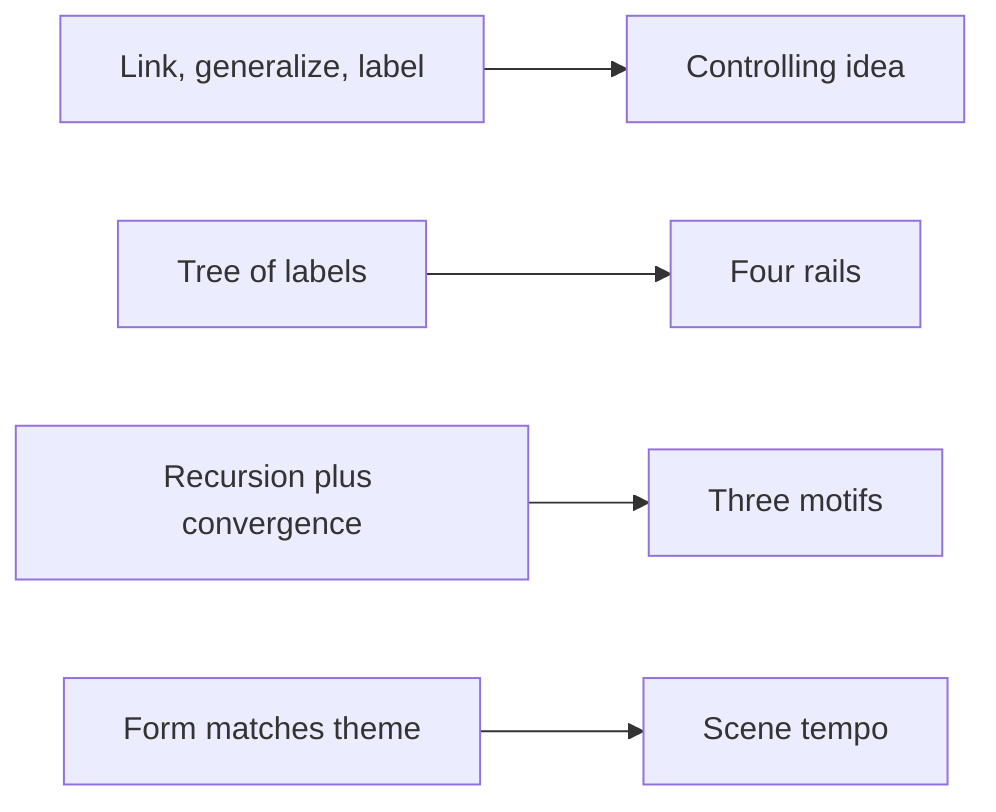

# 🧬 CRE.06 — Thematics: New Approaches — Bremond, Landy & Pavel (1995)
### Knowledge Entry — Distill

A collection of essays from three French symposia that asks what a theme is and how a reader finds one. It is in the library because the Command's theme system needs a plain account of how a theme, a motif, and a form relate.

## TABLE OF CONTENTS
- [Core Thesis](#1-core-thesis)
- [Mind Models](#2-mind-models)
- [Framework](#3-framework--structure)
- [Key Concepts](#4-key-concepts)
- [Heuristics](#5-heuristics--decision-rules)
- [Invariants](#6-invariants)
- [Pitfalls](#7-pitfalls--myths)
- [Application](#8-application)
- [Cross-References](#9-cross-references)
- [Provenance](#10-provenance--confidence)

---

## 1 · CORE THESIS

A theme is not a part of a text. A reader builds it by linking recurring elements and naming what they share. Motifs are the small recurring pieces. The theme is the label above them. The label depends on the reader's aim, so a good theme states its aim.

---

## 2 · MIND MODELS

**Diagram 1 — the whole argument.**
Caption: *the book's essays split into what a theme is, how it is built, and what it ties to outside the text.*

**Diagram 2 — the central mechanism (building a theme).**
Caption: *a reader climbs from scattered items to one label, and each step can fork, which is why the same text yields several themes.*

**Diagram 3 — the motif test.**
Caption: *a recurring image earns theme status only when its repetitions also converge on one meaning.*

**Diagram 4 — mapped onto the Command's theme layer.**
Caption: *the book supplies a build rule for the sentence, a tree for the rails, and a test for the motifs.*

---

## 3 · FRAMEWORK / STRUCTURE

The book has four parts (Contents, p. v).

| Part | Content | Pages |
|---|---|---|
| I. Reassessing Thematics | Five essays on what a theme is and how readers reach one | pp. 9-68 |
| II. Thematics in Literature | A motif study, a study of the double, Faust, and Racine | pp. 69-127 |
| III. Other Arts | Painting, classical music, contemporary music | pp. 129-179 |
| IV. Conclusion | Bremond and Pavel, "The End of an Anathema" | pp. 181-192 |

The Introduction lists the editors' open questions: how a theme is made prominent against background, whether a theme is a concept or a judgement, and how themes link to genre and culture (pp. 1-2).

---

## 4 · KEY CONCEPTS

| Concept | What it is | Why it matters |
|---|---|---|
| **Theme is a construct** | Rimmon-Kenan says a theme is not a component, not an expression, and not "within" the text (pp. 10-11). | Stops anyone from hunting for the theme as a line to quote. |
| **High-order label** | A reader links items, generalizes, then names the common ground. Labels nest in a tree (p. 14). | A build rule for the controlling idea and the rails. |
| **Latent theme** | An explicit key word can cover a more important hidden theme. Her case is "cynicism" in Conrad (p. 11). | A warning that a stated sentence may not be the whole theme. |
| **Theme and form** | A theme can match the story's formal pattern. In Tolstoy's Ivan Ilyich, forty-five years pass in sixteen pages and a few months in thirty-six (pp. 15-16). | Tempo can carry theme. |
| **Theme as grouping** | Brinker: a theme is "the principle of a possible grouping of texts" (p. 33). | Ties each rail to outside texts. |
| **Aim decides generality** | The reader's purpose sets how abstract the label is (pp. 33-34). | A theme should name its aim. |
| **Theme need not unify everything** | A theme may cover only a large or conspicuous portion (p. 34). | Frees the system from forcing every scene under one rail. |
| **Motif vs. theme** | Motifs are localized. Themes span the text. A theme is often the product of several motifs (Segre, p. 25). | Fixes the rank order for the motif section. |
| **Recursion and convergence** | Meaning grows when motifs repeat and when they converge (p. 26). | A two-part test for each motif. |
| **Heterogeneous motifs** | A motif can be an action, a relationship, or an object (p. 27). | Allows a thing like the Feed to count. |
| **Motivation clusters** | Dolezel names drive, emotion, and cognition. The master factor sets the mode of acting (pp. 62-63). | A way to say what a rail's agent runs on. |
| **Escape from a conflict chain** | When two agents feed each other's passion, one can break the chain by not retaliating. Myshkin does this (p. 64). | A literary pattern for a refusal. |
| **Ideological motif** | Sollors's fingernail sign came from science into fiction and fixed racial categories "against appearance" (pp. 84-86). | Shows a motif doing a system's work. |
| **Referential attention** | Attention has an adjustable aperture, so one text can be about a family, a passion, or fallen nature (Bremond and Pavel, p. 185). | Same text, many valid themes. |

---

## 5 · HEURISTICS & DECISION RULES

| Situation | Do this | Not this |
|---|---|---|
| Stating a theme | Link, generalize, then label, and name your aim (pp. 14, 33-34) | Quote one line as "the theme" |
| The theme sentence is already written | Ask what it might be covering (p. 11) | Assume the stated sentence is the deepest one |
| Choosing a recurring image | Check that it recurs and that its uses converge (p. 26) | Keep an image because it looks good once |
| Pacing a story | Match tempo to meaning, as in Ivan Ilyich (pp. 15-16) | Give every beat equal time |
| Naming what a rail argues | Link it to an outside text it meets (p. 36) | Treat each rail as self-contained |
| A character refuses to play along | Check whether the refusal breaks a conflict chain (p. 64) | Treat refusal as one more escalation |
| A motif is a sign read on the body | Track who reads it and who trained their eye (pp. 86-87) | Treat the sign as neutral fact |

---

## 6 · INVARIANTS

1. A theme is built by a reader, never found in one place (pp. 10-11).
2. A text can carry more than one valid theme at once (pp. 34-36, 185).
3. Motifs are the smaller unit and themes the larger (p. 25).
4. Form and content cannot be fully separated, so structure carries thematic weight (Bremond and Pavel, pp. 182-184).
5. Every formal notion draws on some reader's interpretation (pp. 182, 189).

---

## 7 · PITFALLS / MYTHS

- Treating a stated moral as the theme. Rimmon-Kenan says the explicit formula can be a cover (p. 11).
- Believing theme and form are separate. Bremond and Pavel say a pure structure theory runs up debts to interpretation (p. 182).
- Treating "theme" and "motif" as synonyms. Segre notes writers swap the words and urges the musicians' split (p. 25).
- Expecting one fixed definition. Bremond and Pavel say to put the protean theme "to good use" (p. 189).
- Over-reading. Brinker says recognizing a theme does not mean the work asserts a claim about the real world (pp. 38-39).

---

## 8 · APPLICATION

*Everything in this section is proposed, never ruled.*

- **Spine level:** L6.
- **Controlling idea.** The method in the theme SSOT already says the sentence is what survives cutting the story down. Rimmon-Kenan supplies the matching rule: link, generalize, label (p. 14). She also adds a test the SSOT lacks. Ask what the stated sentence covers (p. 11). One latent candidate is Tori's rail: believe the story or believe your eyes.
- **Rails.** Brinker's idea fits all four rails: each is a place where the story meets an outside text (p. 36). Proposed: give each rail one "meets" entry, such as Foucault for the world rail.
- **Gauges.** The book has no value ladder. Dolezel's master-factor idea (pp. 62-63) gives plain words for what each Freedom step removes: first choice, then feeling, then thought.
- **Motifs.** Proposed: each motif passes Segre's two checks, recursion and convergence (p. 26). The uniform and the mirror recur. The Feed recurs. Sollors adds one caution. A body sign read by a trained eye can drift until it "tells nothing" (p. 87). The setting mechanic that was kept out of the motifs, the legibility violation, is the nearest case.
- **Form.** Rimmon-Kenan's Ivan Ilyich case suggests a scene-card field for duration. Proposed: the job-life passes in summary, and the refusal gets full scenes (pp. 15-16).
- **Strongest single addition (proposed).** Add a "latent theme" line to the theme system, written after the sentence. It asks what the stated sentence is covering. The check follows the book's warning that a stated key word can hide the real theme (p. 11).

---

## 9 · CROSS-REFERENCES

| Related entry | Relation |
|---|---|
| [[BVX.1200]] | Burke: names the cause a theme argues; this book names how a theme is assembled |
| [[BVX.1202]] | Scott: a worked case of a public theme covering a hidden one |
| [[BVX.1203]] | Stangneth: a stated self-story that covered a different real one |
| [[BVX.0236]] | Coyne: the value spectrum the gauges borrow |
| [[BVX.0175]] | McKee: the controlling idea this book's "label" rule can check |

---

## 10 · PROVENANCE & CONFIDENCE

Source: a pdftotext extract with "Page N" markers that match the printed folios.

**Read in full:** the Introduction (pp. 1-6); Rimmon-Kenan, "What Is Theme" (pp. 9-17); Segre, "From Motif to Function" (pp. 21-29); Brinker, "Theme and Interpretation" (pp. 33-40); Dolezel, "A Thematics of Motivation and Action" (pp. 57-65); Bremond and Pavel, "The End of an Anathema" (pp. 181-190). **Read in part:** Sollors, "The Bluish Tinge" (pp. 69-71 and 84-87 only); Cryle (pp. 51-54 only).

**Not read:** the rest of Brinker (pp. 41-44), the end of Segre's fable analysis (pp. 30-32), Dolezel's essay on the double (pp. 89-102), Schaeffer on Faust, Pavel on Racine, and all of Part III on painting and music. Those essays are known only through the Introduction's summaries (pp. 3-5). The final two pages of the conclusion (pp. 191-192) and the endnotes were not read.

Confidence is medium. The theory claims are page-checked. The application to OXO is this entry's own proposal.

## META
- Template: BVX-LEARN-v4.0
- Source classification: full-text edited volume, partial extraction
- Created / Updated: 2026-10-04
