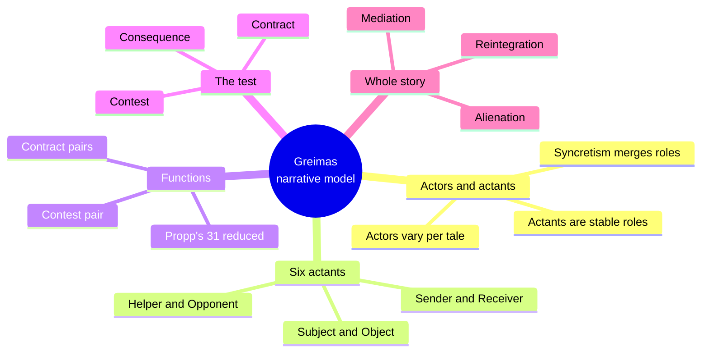
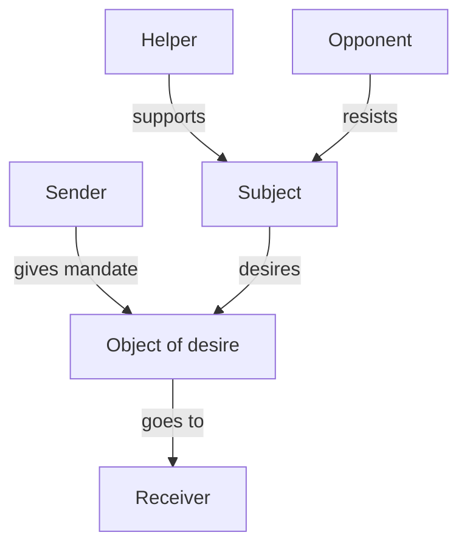
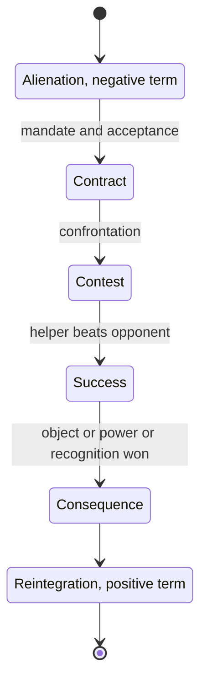
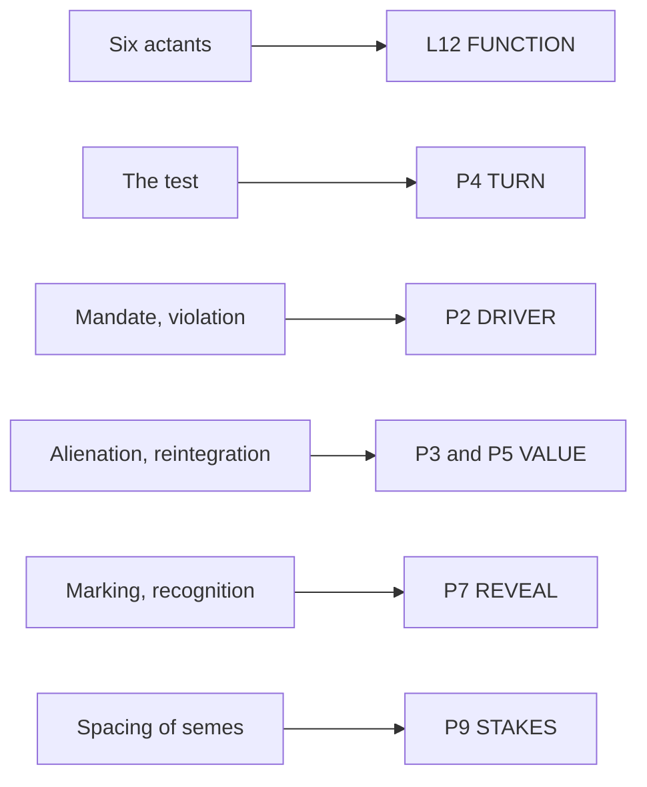

# CRE.07 — Structural Semantics — A.-J. Greimas (1983)
### Knowledge Entry — Distill

A dense French structuralist method book (1966; English edition 1983). It matters here for two small parts: the six-role actantial model and the Propp reduction that turns thirty-one folktale functions into one contract, contest and consequence pattern.

## TABLE OF CONTENTS
- [Core Thesis](#1-core-thesis)
- [Mind Models](#2-mind-models)
- [Framework](#3-framework--structure)
- [Key Concepts](#4-key-concepts)
- [Heuristics](#5-heuristics--decision-rules)
- [Invariants](#6-invariants)
- [Pitfalls](#7-pitfalls--myths)
- [Application](#8-application)
- [Cross-References](#9-cross-references)
- [Provenance](#10-provenance--confidence)

---

## 1 · CORE THESIS

A story is a drama of six fixed roles around one object of desire. Actors change from tale to tale; the roles do not. The plot is one test, a contract, a contest and a consequence, that replaces a world of privation with a world of restored values.

---

## 2 · MIND MODELS

*Required. Minimum two diagrams, maximum five.*

**Diagram 1 — the whole argument.**
Caption: *Greimas works at two levels, the stable roles (actants) and the ordered moves (functions), and joins them in the test.*

**Diagram 2 — the central mechanism (the six-role model).**
Caption: *the object of desire sits between sender and receiver, and the subject's will and resistance arrive as helper and opponent.*

**Diagram 3 — the test as a state change.**
Caption: *a unit moves from a negative term to a positive term, and only the contest does the changing.*

**Diagram 4 — mapped onto the Command's plot slice (P1–P12) and cast layer.**
Caption: *Greimas lands hardest on P4 TURN and L12 FUNCTION, and lightly on the value and reveal layers.*

---

## 3 · FRAMEWORK / STRUCTURE

The book has twelve chapters. Chapters I to IX build a semantics: meaning, semes, isotopy, and the description of a text. Chapters X to XII use the method on narrative.

| Chapter | Pages | What it does |
|---|---|---|
| VIII, section 2 | 140-152 | Splits predicates (what is done) from actants (who does it); proposes two actantial categories |
| X, Reflections on Actantial Models | 196-221 | Builds the six-role model from syntax, Propp and Souriau; tests it on theater, philosophy, business and psychoanalysis |
| XI, Searching for Models of Transformation | 222-256 | Reduces Propp's thirty-one functions; finds the test; reads the folktale as a transformation |
| XII, A Sample Description | 257-296 | Works the full method on the novelist Bernanos |

The reading here stays inside Chapters VIII.2, X and XI. Those chapters carry everything a plot system can use.

---

## 4 · KEY CONCEPTS

| Concept | What it is | Why it matters |
|---|---|---|
| **Actor versus actant** | An actor is a character in one tale. An actant is a class of actors across a whole corpus, defined by a shared sphere of action (X.3, p. 200) | One tale shows actors. Only a set of tales shows the actant. The model describes a genre, not one plot |
| **Subject / Object** | The first pair. The link between them is desire, which becomes a quest in manifested stories (X.5, p. 203) | Every story is centered on what the subject wants |
| **Sender / Receiver** | The second pair. The object passes between them as an object of communication (X.6, pp. 203-204) | The sender sets the quest and judges its end. A hero who sends himself has will (XI.2.e, p. 243) |
| **Helper / Opponent** | The third pair. Helpers act toward the desire; opponents block it (X.7, p. 205) | Greimas calls these circumstants, not true actants: the subject's own will and imagined resistance, projected outward (p. 206) |
| **Syncretism** | One actor fills two actants. In a love story the man is Subject plus Receiver and the woman is Object plus Sender (X.6, pp. 203-204) | Syncretism sorts story types. In the folktale Subject and Receiver merge; in the business case Object and Receiver merge (X.11, p. 211) |
| **Absence versus waiting** | An actant who has not yet appeared still counts. Tartuffe off stage for two acts sharpens his presence (X.11, p. 212) | A missing role is a suspense device, not a missing role |
| **Thematic investment** | The same six slots take different content: philosopher and world, militant and classless society (X.9, pp. 207-208) | The model is a frame. The content is the variable |
| **Contract** | Mandate (the sender's behest) paired with acceptance (the hero's decision). Interdiction and violation are their negatives (XI.1.d, pp. 225-226) | Stories begin by a contract made or broken and end by a contract restored |
| **The test** | Contract, contest, consequence. It comes three times: qualifying, main, glorifying (XI.1.e-h, pp. 227-234) | Greimas calls it the irreducible nucleus of the story (XI.2.b, p. 237) |
| **Alienation / Reintegration** | The opening run of privations and the closing run of acquisitions, mirror-paired (XI.1.g, pp. 230-233) | The story's frame: negative series first, positive series last |
| **Energy sources** | Quest, Request and Qualification: the pull created by spacing a lack from its liquidation (XI.2.c, pp. 238-239) | Tension is a distance between two linked beats |
| **Mediation** | The tale joins order with freedom, society with the individual (XI.2.g, pp. 245-246) | Two readings: the accepted order is explained, or the denied order is escaped |

---

## 5 · HEURISTICS & DECISION RULES

Rows marked "derived" are the distiller's inference from the cited passage. They are not Greimas's own advice.

| Situation | Do this | Not this |
|---|---|---|
| Casting a story | Name the six slots first, then assign actors to them (X.8, p. 207) | Start with a cast of named people and hope the roles sort themselves out |
| One character fills two roles | Record the merge, as in Subject plus Receiver (X.6, p. 203) | Treat the merge as a defect or as two characters |
| A helper or opponent feels flat | Read it as the subject's will or fear made external (X.7, p. 206); derived: ask what the subject wants or fears here | Write an independent villain with no tie to the subject |
| A key role is offstage | Keep it counted and let its delay build suspense (X.11, p. 212) | Cut the slot as absent |
| Building a unit's turn | Write the contract, the contest, then the consequence (XI.1.e, pp. 227-228) | Jump from setup to result with no contest |
| Judging a hero's rule-breaking | Read violation as will: sender and receiver merge (XI.2.e, p. 243) | Read violation as only a fault |
| Tuning tension | Set the lack and its liquidation far apart (XI.2.c, p. 239) | Resolve the lack in the next beat |
| Reusing a template across stories | Change the thematic investment, keep the slots (X.9, p. 208) | Rebuild the slots for each new subject |

---

## 6 · INVARIANTS

1. Actors vary and actants hold (X.3, p. 200).
2. Every actantial structure is built from two categories, Subject/Object and Sender/Receiver, plus the helper/opponent pair (X.8, p. 207).
3. The Subject-Object link is desire (X.5, p. 203).
4. A test needs a contract before it, a contest in it, and a consequence after it (XI.1.e, pp. 227-228).
5. The test is consecution, not strict implication: the contract does not force the contest (XI.2.b, p. 237).
6. The consequence is necessary once contract and contest have happened (XI.2.b, p. 237).
7. The opening series of privations mirrors the closing series of acquisitions (XI.1.g, pp. 230-233).
8. A transformation removes a negative term and leaves an assertion (XI.2.f, p. 244).

---

## 7 · PITFALLS / MYTHS

- Reading the model as a list of characters. Actants are slots; one actor may fill two (X.6, p. 203).
- Treating helper and opponent as equal to subject and object. Greimas calls them circumstants (X.7, p. 206).
- Assuming Propp's order is law. Greimas drops strict order and keeps consecution (XI.2.a-b, pp. 235-237).
- Overreading the evidence. The folktale model rests on one corpus, and Greimas says so (XI.3.a, p. 247).
- Mistaking the model for psychology. Greimas criticizes psychoanalytic readings that mix actors with situations (X.14, pp. 217-218).
- Ranking the six actants as equal in weight. The model is "centered entirely around the object" (X.7, p. 205).

---

## 8 · APPLICATION

*Everything in this section is PROPOSED, never ruled.*

- **Spine level:** L4. Greimas supplies plot shape, the test, not the argument the story makes.
- **12-layer character stack:** L12 FUNCTION is primary; L6 DRIVE is contextual.
- **plot_systems (TM 04):** P4 TURN primary; P2, P3, P5, P7 supporting; P9 contextual. See `feeds`.
- **Setting:** none directly. Greimas's Chapter X "microuniverse" is a semantic term, not a physical place.

**What the book adds to TM 04 (proposed).**

1. **A test phase on P4.** Proposed sub-field `test_phase`: contract, contest, or consequence. A unit then states which of the three it plays. Tests come in threes: qualifying, main, glorifying (p. 228).
2. **A role-slot card on L12.** Proposed: one six-slot line per storyform, with a flag for syncretism. Dramatica's eight and Schmidt's thirteen name cast functions differently, so this adds a third view without collision.
3. **An absent-actant flag.** Proposed: a slot may be marked "awaited." That keeps suspense roles on the card.
4. **A distance measure for P9.** Proposed: the ladder-address gap between a lack beat and its liquidation beat. It is cheap to compute and stays optional.
5. **Violation as will on P2.** Proposed reading note: when a hero breaks a contract, mark whether sender and receiver merge in one actor.

**What it adds to DCUS (proposed).** The M2 row 9 instance in ssot_04 has a reach-versus-pull-out choice and a "Verified" mark. Proposed reading: the school institution is Sender; the Sync rating is the object passing to Tori as Receiver. "Verified" then plays the consequence, a recognition. Pulling out would be violation, which Greimas reads as freedom (p. 243). This does not override the ruled story-level Driver of Action.

**Thin by default.** Fill the slot card only for units where a role is in doubt. A scene with no contest needs no `test_phase`.

---

## 9 · CROSS-REFERENCES

| Related entry | Relation |
|---|---|
| [[BVX.0089]] | Dramatica's eight Archetypal Characters bundle story elements into cast functions. Greimas's six are sparser slots |
| [[BVX.0045]] | Schmidt's sixteen archetypes and thirteen supporting types are persons; Greimas's actants are slots. Same portability point |
| [[BVX.0175]] | McKee's Gap and Greimas's contest both name the moment the value flips |
| [[BVX.0236]] | Coyne's Five Commandments and the test triple both break a unit into ordered moves |
| [[BVX.1126]] | Aristotle's recognition and Greimas's marking-recognition pair are close cousins |
| [[CRE.08]] | Ekman's ruler-realm link is a Sender-Object tie drawn across land |

---

## 10 · PROVENANCE & CONFIDENCE

Full-text pdftotext of the University of Nebraska Press edition (1983; translation of *Sémantique structurale*, Larousse 1966). Page numbers are the printed running heads in the extract.

**Read in full:** Chapter X (pp. 196-221, all fourteen sections) and Chapter XI sections 1 and 2 (pp. 222-246), plus section 3 as far as p. 248. Chapter VIII section 2, subsections e through i (pp. 146-152), read in full.

**Skimmed:** Schleifer's Introduction (pp. xi-liv), checked only where it discusses actants and Chapter X.

**Not read:** Chapters I to VII (the linguistic foundations, including isotopy and the semic apparatus), Chapter IX, Chapter XII (the Bernanos sample), XI.3 from p. 248 on, and the notes. The semiotic square, the book's headline device, was not read and is not used here.

Confidence is medium. The model is clear on the page, but the book is a method for linguists, and every plot use above is the distiller's translation.

## META
- Template: BVX-LEARN-v4.0
- Source classification: full-text method book; narrative chapters X and XI read in full, linguistic chapters not read
- Created / Updated: 2026-10-04
