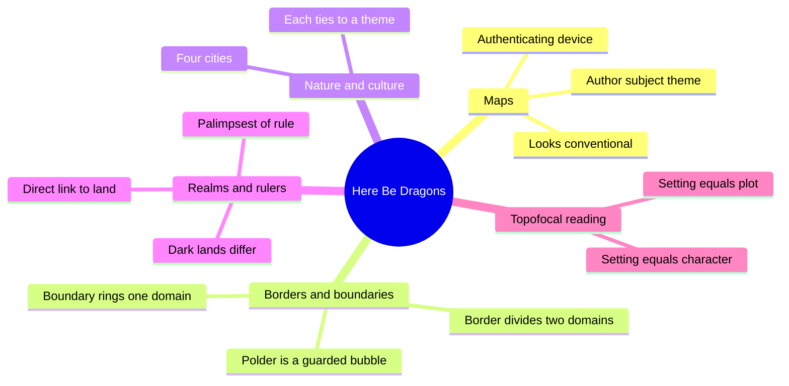
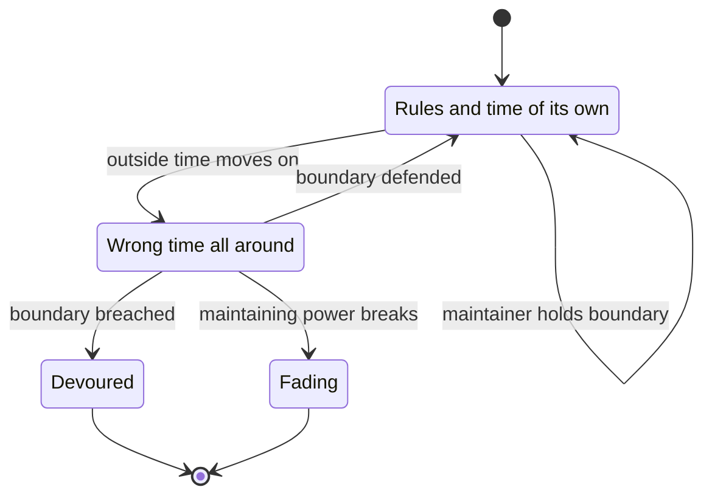
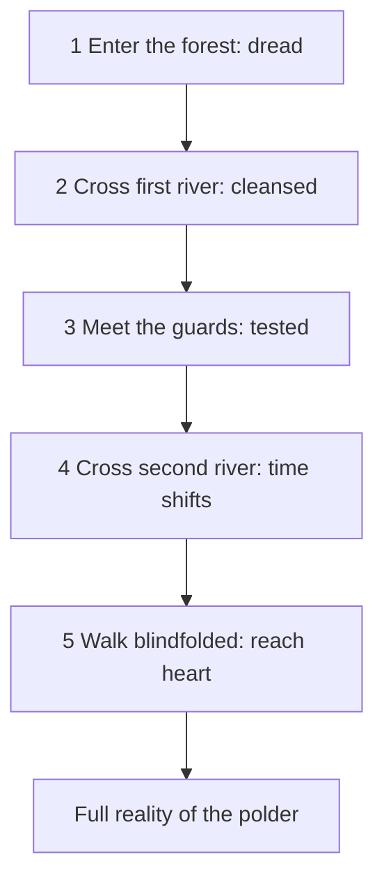
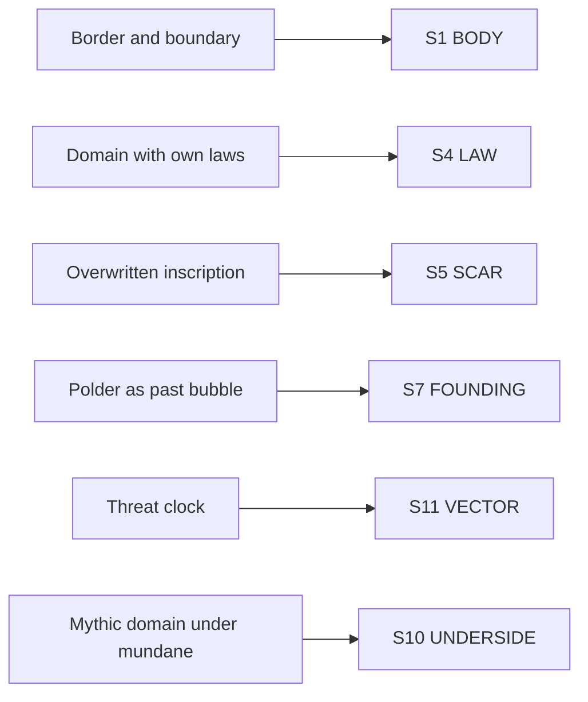

# CRE.08 — Here Be Dragons — Stefan Ekman (2013)
### Knowledge Entry — Distill

An academic study of fantasy settings (Wesleyan University Press, 2013). Ekman reads maps, borders, polders, nature-and-culture cities and ruler-realm links, and shows how each setting device carries a story's central concern.

## TABLE OF CONTENTS
- [Core Thesis](#1-core-thesis)
- [Mind Models](#2-mind-models)
- [Framework](#3-framework--structure)
- [Key Concepts](#4-key-concepts)
- [Heuristics](#5-heuristics--decision-rules)
- [Invariants](#6-invariants)
- [Pitfalls](#7-pitfalls--myths)
- [Application](#8-application)
- [Cross-References](#9-cross-references)
- [Provenance](#10-provenance--confidence)

---

## 1 · CORE THESIS

A fantasy world divides into domains with different rules of the possible, and the divisions carry the story's meaning. Borders join domains, boundaries guard them, and rulers bind to land. Read setting as an equal of character and plot, not as a backdrop.

---

## 2 · MIND MODELS

*Required. Minimum two diagrams, maximum five.*

**Diagram 1 — the whole argument.**
Caption: *four kinds of division, large scale to small, each reading the setting by its seams.*

**Diagram 2 — the central mechanism (a polder under threat).**
Caption: *a polder holds only while someone maintains its boundary, and it ends by being devoured or by fading.*

**Diagram 3 — the five-stage approach to a polder.**
Caption: *crossing is a gradient, not a line: dread, cleansing, challenge, shift of time, then the heart.*

**Diagram 4 — mapped onto the Command's SETTING SLICE (S1–S12).**
Caption: *Ekman lands on S1, S4 and S5 hardest; the rest is supporting texture.*

---

## 3 · FRAMEWORK / STRUCTURE

Six chapters. Chapters 2 to 5 stand alone and can be read in any order (Ch. 1, p. 11).

| Chapter | Pages | Division studied | Main cases |
|---|---|---|---|
| 1. Introduction | 1-13 | Defines fantasy, domain, world | Tolkien, Mendlesohn, Attebery |
| 2. Maps | 14-67 | Map versus world | Survey of 200 novels; Shire and Middle-earth maps |
| 3. Borders and Boundaries | 68-128 | Domain versus domain | Brust, Gaiman and Vess, Nix; Lothlorien, Mythago Wood, Djelibeybi |
| 4. Nature and Culture | 129-176 | Nature versus culture inside a city | Minas Tirith, Newford, New Crobuzon, Ombria |
| 5. Realms and Rulers | 177-215 | Ruler versus land | Last Call, Tourists, Mordor, Foul's Creche, the Blight |
| 6. Some Final Thoughts | 216-220 | Summary | |

Page ranges come from the Contents. The text extract carries no running page numbers.

---

## 4 · KEY CONCEPTS

| Concept | What it is | Why it matters |
|---|---|---|
| **Topofocal reading** | A reading that puts setting first, as an equal of character and plot (Ch. 1, p. 2; Ch. 6, p. 216) | Names the method: ask what the place does, not what it shows |
| **Domain** | A part of a world where the laws of nature and causality differ from the rest (Ch. 1, p. 11) | Gives S4 LAW a physical sense: different rules of the possible |
| **Actual, primary, secondary world** | Actual is the reader's. Primary imitates it. Secondary is a made world (Ch. 1, pp. 9-10) | Keeps real-world and invented settings apart |
| **Border** | A line or gradient between two areas. You are on one side or the other (Ch. 3, p. 69) | Separates and joins at once |
| **Boundary** | A perimeter around one area. You are inside or outside (Ch. 3, p. 69) | Guards a single place |
| **Threshold** | Clute's term: a gradient between two places or states, with four functions (Ch. 3, p. 68-69) | The umbrella term Ekman splits in two |
| **Three border types** | Life and death, Faerie and mundanity, magic and technology (Ch. 3, pp. 70-98) | A menu of what a border can divide |
| **Faerie relations** | Faerie is an Otherworld, a crosshatch, or surrounded by mundanity (Ch. 3, pp. 71-72) | Three ways two domains can lie together |
| **Polder** | An enclave of toughened reality kept up by a boundary, a maintained anachronism (Ch. 3, from p. 99) | The guarded bubble; its maintainer is the plot handle |
| **Direct link** | A ruler tied to the land itself, not only by politics (Ch. 5, p. 178ff) | Makes land and ruler share one fate |
| **Metonymic link** | Ruler and realm are one: the Childlike Empress is her realm (Ch. 5, pp. 179-180) | The strongest form of the link |
| **Palimpsest** | A surface erased and overwritten; the erasure shows ownership of history (Ch. 5, from p. 190) | A tool for setting a feud into streets and walls |
| **Landscape of evil** | A Dark Lord's land, often alike on the surface, different in cause (Ch. 5, from p. 194) | Warns against reading land as only the ruler's metaphor |
| **Map attributes** | Every map has an author, a subject and a theme (Ch. 2, from p. 43) | Even a map shows the mapmaker's attitude |

---

## 5 · HEURISTICS & DECISION RULES

Rows marked "derived" are the distiller's inference.

| Situation | Do this | Not this |
|---|---|---|
| Two places with different rules | Name the domain on each side and the line between (Ch. 3, p. 68) | Say only that the places "feel different" |
| Deciding border or boundary | Border if two areas meet; boundary if one area is ringed (Ch. 3, p. 69) | Use "threshold" for both |
| Writing a polder | Name who or what maintains it and what threatens it (Ch. 3, from p. 99) | Leave the bubble self-sustaining |
| Writing entry into a strange place | Stage the crossing in steps (Ch. 3, from p. 99); derived: use the staged approach only where the scene's pressure needs it | Cross in one sentence, or stage every door |
| A ruler and a land | Decide the link: none, political only, direct, or metonymic (Ch. 5, pp. 178-181) | Assume healing follows from politics alone |
| Showing a feud in a place | Overwrite signs and keep traces (Ch. 5, from p. 190) | Erase the old script without a trace |
| A dark land that looks familiar | Trace each land to its lord's own nature (Ch. 5, from p. 194) | Treat all evil land as one trope |
| Placing a map in a book | Ask who drew it and what it leaves out (Ch. 2, from p. 43) | Treat the map as a neutral view |

---

## 6 · INVARIANTS

1. A fantasy world keeps its own rules once set; even the author is bound (Ch. 1, p. 6).
2. Domains differ in what is possible, so a border joins different possibilities (Ch. 6, p. 216).
3. A border has two sides; a boundary has an inside (Ch. 3, p. 69).
4. A polder needs maintaining, or it collapses (Ch. 3, from p. 99).
5. A successful polder does not change; the outside does (Ch. 3, from p. 99).
6. The direct link between ruler and land is a fantastic element, accepted at face value in the story (Ch. 6, p. 216).
7. Each map has an author, a subject and a theme (Ch. 2, from p. 43).

---

## 7 · PITFALLS / MYTHS

- Reading the land as only a metaphor for its ruler (Ch. 5, p. 215).
- Assuming all Dark Lord lands are alike because they look alike (Ch. 5, from p. 194).
- Treating "threshold" as a plain line. Clute's own word also means a gradient and an intended crossing (Ch. 3, p. 69).
- Treating the map as neutral. It is chosen, signed and themed (Ch. 6, p. 216).
- Assuming the hero's courage is tested at the crossing alone. The return is often the real trial (Ch. 6, p. 216).
- Holding Ekman's sample to be the whole genre. He drew from the center of the fuzzy set, mid-1970s to mid-2000s (Ch. 1, p. 3; Ch. 6, p. 218).

---

## 8 · APPLICATION

*Everything in this section is PROPOSED, never ruled.*

- **Spine level:** SETTING.
- **12-layer character stack:** none directly. The ruler-realm link is a character-place tie, a candidate for a collision row.
- **plot_systems:** a crossing is a plot unit with stages. Ekman's "return is the real trial" fits a P1 pairing of entry and exit units.
- **Setting (TM 03):** primary on S1, S4, S5; supporting on S7, S10, S11.

**What the book adds to TM 03 (proposed).**

1. **A boundary kind on S1.** Proposed sub-field `boundary_kind`: border or boundary. The ssot already rates a seam's permeability. This adds the guarded-ring case.
2. **A maintainer on S1 or S4.** Proposed: for any ringed place, one line naming the maintainer and the outside threat. That turns a polder into a plot handle.
3. **Palimpsest fields on S5.** Proposed sub-fields: `overwritten_by` and `trace_kept` (yes or no). The Tourists case shows the trace is a choice.
4. **A threat-clock reading on S11.** Proposed: for a polder, S11 VECTOR records the outside force and the one thing that would collapse the boundary.
5. **A link type on S12.** Proposed: where a character is tied to a place, record `link`: none, political, direct or metonymic.

**What it adds to DCUS (proposed).**

- **Polder test.** Ask four questions of the school. Is there a ringed boundary? Who maintains it? What outside time or force would collapse it? What rules hold inside that do not hold outside? An honest answer on any one is enough; a blank on all four means DCUS is not a polder.
- **Palimpsest reading of the rename lattice.** The ssot_03 lattice runs Red Stick Creek, then Red Hills, then DCUS. Ask whether each rename kept a trace of the old name. If it did, mark `trace_kept: yes` on S5.
- **Entry as stages.** The M2 newcomer entry could use a staged approach, if that scene needs it.
- **Reader mode on L7.** A newcomer entering a group reads as portal-quest. Proposed: record the mode per movement.

**Thin by default.** Run the polder test and the staged entry only for scenes whose pressure needs them. A mere location needs a header and S12.

---

## 9 · CROSS-REFERENCES

| Related entry | Relation |
|---|---|
| [[BVX.1138]] | Midgard's ley lines are costed geography; Ekman's polders are costed boundaries. Both tie rules to place |
| [[BVX.0458]] | The Kobold Guide to Worldbuilding: Baur's tribe and city-state binding principles pair with Ekman's domains |
| [[BVX.1122]] | Renaissance Venice worked at city scale; Ekman's nature-culture cities work the same scale in fiction |
| [[CRE.09]] | Trevena builds culture inside a place; Ekman builds the place's divisions |
| [[CRE.07]] | Greimas's Sender-Object tie is the ruler-realm link seen as plot grammar |

---

## 10 · PROVENANCE & CONFIDENCE

Full-text pdftotext of the Wesleyan University Press edition (2013). The extract has no running page numbers. Page cites are section-start pages from the printed Contents, so a cite means "from that page on" and may be off by a few pages.

**Read in full:** Chapter 1 (introduction, fantasy definition, key terms). Chapter 3's opening (threshold, border, boundary), the border-type overview, and the polder definition with the whole Lothlorien section. Chapter 5's overview of ruler-realm links, the opening of Last Call, the Tourists palimpsest section, and the closing note on dark lands. Chapter 6 in full.

**Sampled:** Chapter 2 (the opening, the survey summary in Ch. 6, and the first pages of the Shire map reading).

**Not read:** the quantitative map survey details, Appendices A and B, Chapter 4's four city readings (known only from the Chapter 6 summary), the Brust, Gaiman and Vess, and Nix border readings, the Mythago Wood and Djelibeybi polder readings, and the Donaldson and Jordan dark-land readings.

Confidence is medium: the concepts are solid, but page cites are approximate and the fiction cases were read selectively.

## META
- Template: BVX-LEARN-v4.0
- Source classification: full-text academic study; theory and two case chapters read, other case readings not read
- Created / Updated: 2026-10-04
