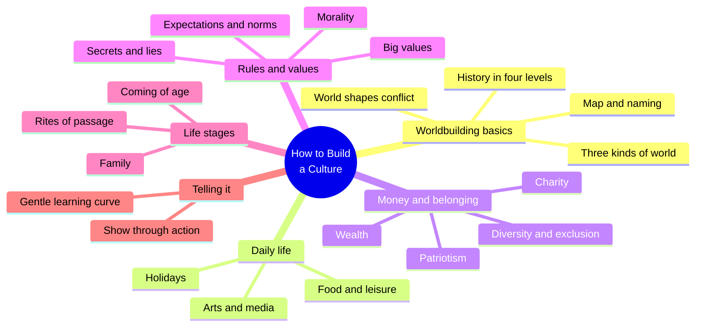
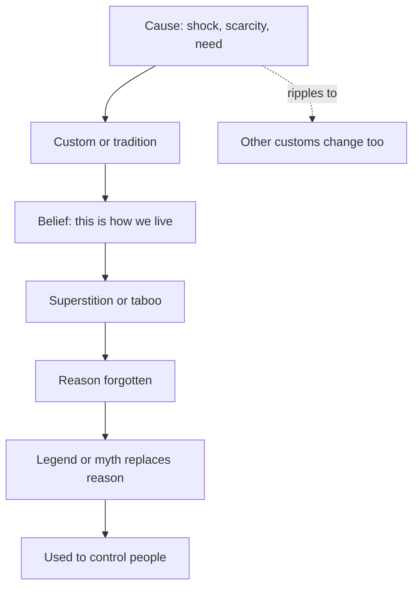
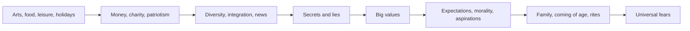
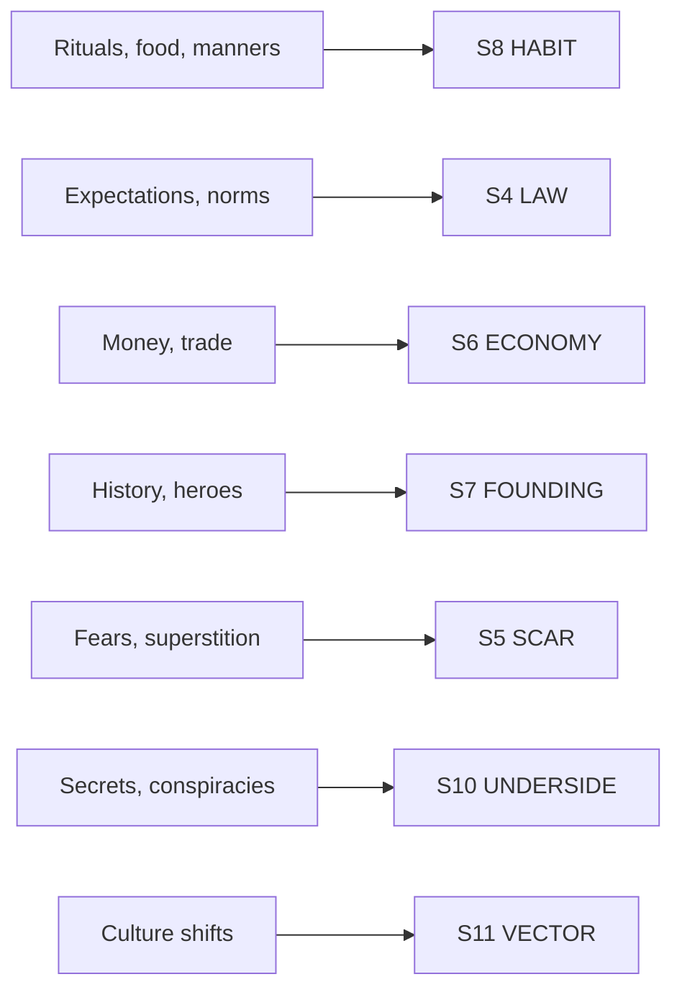

# CRE.09 — How to Build a Culture — Angeline Trevena (2022)
### Knowledge Entry — Distill

A thirty-one-prompt self-published workbook (Maythorne Press, 2022) for building a fictional culture one question list per day. It is a practitioner checklist, not a theory; it is in the library as a ready prompt set for the habit and law layers of the setting slice.

## TABLE OF CONTENTS
- [Core Thesis](#1-core-thesis)
- [Mind Models](#2-mind-models)
- [Framework](#3-framework--structure)
- [Key Concepts](#4-key-concepts)
- [Heuristics](#5-heuristics--decision-rules)
- [Invariants](#6-invariants)
- [Pitfalls](#7-pitfalls--myths)
- [Application](#8-application)
- [Cross-References](#9-cross-references)
- [Provenance](#10-provenance--confidence)

---

## 1 · CORE THESIS

A culture is a chain of reasons: a need or a shock makes a custom, the custom hardens into belief, and the belief outlives its reason. Build the chain, then use only the links a scene needs. Every quirk must earn its place in plot, character or theme.

---

## 2 · MIND MODELS

*Required. Minimum two diagrams, maximum five.*

**Diagram 1 — the whole argument.**
Caption: *the book runs from the arts and daily life, through money and rules, to deep values, then to how little reaches the page.*

**Diagram 2 — the central mechanism (the reason chain).**
Caption: *a practical cause becomes a tradition, then a belief, then a superstition, and the cause drops out of memory while the custom stays.*

**Diagram 3 — the prompt order, from surface to depth.**
Caption: *Trevena puts the big values after the arts, food, money and diversity prompts, so values read as a tally of earlier choices.*

**Diagram 4 — mapped onto the Command's SETTING SLICE (S1–S12).**
Caption: *the workbook covers the human-facing layers well; it is silent on weather, sensorium and allure.*

---

## 3 · FRAMEWORK / STRUCTURE

The book is a workbook of thirty-one prompts, one per day. Each prompt has a short essay and a "Questions:" list (PDF pp. 11-12).

| Part | PDF pages | Content |
|---|---|---|
| Using this Guidebook | 11-12 | One prompt a day; keep a "worldbuilding bible" |
| Worldbuilding Basics | 13-20 | World types, map making, naming, history, how the world affects story |
| A Note About Culture | 21-22 | Culture is fluid and stubborn |
| Prompts: arts to patriotism | 23-56 | Arts, popular and high culture, communication, food, leisure, holidays, money, charity, patriotism |
| Prompts: society | 57-83 | Diversity, integration, news, secrets, big values, expectations, morality, aspirations, superstitions, manners |
| Prompts: people | 84-114 | Heroes and villains, subcultures, family, birth, coming of age, rites, love, sexuality, gender, health and beauty, fears |
| Telling it | 115-118 | Info dumping, learning curves, ideas dump |

---

## 4 · KEY CONCEPTS

| Concept | What it is | Why it matters |
|---|---|---|
| **Three world types** | A wholly new world, a real place with an altered past or future, or a real place with a hidden parallel world (PDF pp. 13-14) | Picks how much of the map and culture is already done |
| **Settlement siting** | Towns stand where there is fresh water, varied food, resources, farmland, safe access, a trade route, and few predators (p. 16) | Gives every place on the map a reason to exist |
| **Four event levels** | International, national, local and individual events (p. 19) | A small event can ripple up; a large one can ripple down |
| **The ripple rule** | Every change affects everything else (pp. 18-19) | Culture is linked; one edit forces others |
| **Culture as fluid but stubborn** | It shifts by generation or shock, yet people resist change even when it helps (p. 21) | Gives a place built-in friction |
| **Three economy parts** | Production, distribution and consumption (p. 48) | A minimum frame, with the human effect as the real subject |
| **Expectations: formal, informal, unspoken** | Written rules, peer-policed rules, and silent ones (p. 68) | Three volumes of the same law |
| **Norms** | The benchmark of normal, from the Latin for a carpenter's square (p. 70) | Breaking a norm draws gossip or pity |
| **Big values** | The traits a culture admires, built from all earlier prompts (pp. 66-67) | A tally of choices, and a guide for characters |
| **Heroes and villains of the culture** | Founders, saints and monsters; status can flip (p. 84) | History carries moral weight |
| **Subculture** | A group inside the culture, from choice, need, or opposition (p. 87) | A culture with one layer reads flat |
| **Universal fears** | Fears picked up by a whole people through experience and influence (p. 112) | Turns a scar into a custom |
| **Learning curve** | Every new creature, tech or jargon word steepens it (p. 117) | The brake on what reaches the page |
| **Quirk purpose test** | Ask whether a quirk pushes the plot, reveals character, or explores theme (p. 35) | The filter on all the rest |

---

## 5 · HEURISTICS & DECISION RULES

| Situation | Do this | Not this |
|---|---|---|
| Placing a town | Give it water, food, resources and a trade route, or a reason to risk their absence (PDF pp. 16-17) | Scatter towns at random |
| A custom needs a root | Trace it to a cause, even if no one remembers it (pp. 36, 79) | Add a ritual with no history |
| Writing the past | Know enough to explain the present; skip five million years (p. 18) | Write a full chronicle for its own sake |
| Adding a quirk | Test it for plot, character or theme (p. 35) | Keep it only because it is cute |
| Building inequality | Tie it to the plot and a character's journey (p. 31) | Add it for its own sake |
| Deciding values | Build them after the earlier prompts, as a tally (p. 66) | Pick values first and force the rest to fit |
| Showing the world | Show through action first, dialogue second, plain telling last (pp. 115-116) | Open with a history lecture |
| Easing readers in | Tell only what the reader needs now (p. 117) | Load chapter one with the whole world |
| A world with real-world roots | Use the real map and alter only what the story needs (p. 14) | Redraw what you do not need |
| A moral gray zone | Show that morality is not black and white even if law tries to make it so (p. 73) | Hand out clean right and wrong |

---

## 6 · INVARIANTS

1. Every change touches other parts of the culture (PDF pp. 18-19).
2. Worldbuilding, story and character are not independent (p. 20).
3. A world is the product of everything that happened in it (p. 18).
4. Expectations come with consequences for stepping out of line (p. 69).
5. A belief can outlive the reason it began (p. 79).
6. Most of the built world never reaches the page, and that is by design (p. 115).
7. Culture is imprinted from birth and corrected by reproach and punishment (p. 21).

---

## 7 · PITFALLS / MYTHS

- Info dumping history as a textbook, even through a character's mouth (PDF pp. 115-116).
- Making a culture entirely fair or entirely cruel; real ones mix (pp. 49, 59).
- Using inequality or prejudice as decoration with no effect on plot (p. 31).
- Treating popular culture as dumb or high culture as better; the divide is itself a worldbuilding choice (pp. 27-30).
- Assuming everyone in a culture agrees; opinions differ by age, class, gender and religion (p. 20).
- Treating the book as a full model. Trevena says her prompts are "not, by any means, exhaustive" (p. 11).
- Expecting depth from the prompt text. Each prompt gives a short essay and a question list; there is no mechanism beyond the reason chain.

---

## 8 · APPLICATION

*Everything in this section is PROPOSED, never ruled.*

- **Spine level:** SETTING.
- **12-layer character stack:** none directly. The imprint idea (p. 21) parallels L8 IMPRINT, but this source stays setting-side.
- **plot_systems:** the world-affects-story passage (p. 20) names the standard conflict engine, the goal interrupted by law, magic limits, norms or landscape. It is a candidate seed for P8 COLLISION rows.
- **Setting (TM 03):** primary on S8 and S4; supporting on S5, S6, S7, S10, S11.

**What the book adds to TM 03 (proposed).**

1. **A reason-remembered flag on S8.** Proposed sub-field `reason_remembered`: yes, partly, or no. It records whether a custom's cause is still known. The reason chain (Diagram 2) is the model.
2. **Three volumes on S4.** Proposed: tag each rule formal, informal or unspoken. The ssot already splits permission and forbiddance; this splits by how it is stated.
3. **A purpose test as the S12 gate.** Proposed: no S8 or S4 line is filled unless it passes the plot, character or theme question (p. 35). This is the same idea as the thin-by-default fill rule.
4. **A prompt bank.** Proposed: the 31 question lists are a pick-list for a scene card's S8 and S4 lines, drawn only on demand.

**What it adds to DCUS (proposed).**

- **Expectations at DCUS.** Sort DCUS's rules into formal, informal and unspoken. The phrase "Digital Puberty," used in-world to dismiss the M2 grief outbursts (ssot_04, THE INSTANCE), reads as an informal norm-policing label. It tells people to treat the outbursts as normal growing pains. This is a reading to test, not a ruling.
- **Reason chain for the rename lattice.** Red Stick Creek, then Red Hills, then DCUS may leave customs whose cause is forgotten. Mark each as `reason_remembered: no` only where a scene uses it.
- **Rites at DCUS.** The Sync rating could be read as a coming-of-age marker (PDF pp. 95-99) or as the school's money-like unit of worth (p. 48). Both are open questions for Chief.

**Thin by default.** Treat the 31 prompts as a bank, not a form. Pull one only when a scene's pressure needs it. Trevena herself says most built material never reaches the book (p. 115).

---

## 9 · CROSS-REFERENCES

| Related entry | Relation |
|---|---|
| [[BVX.1138]] | Midgard's regional traits make belonging a mechanical choice. Trevena supplies the prompts behind such traits |
| [[BVX.0458]] | The Kobold Guide to Worldbuilding: Baur's present-tense-history rule matches Trevena's "know enough to explain the present" |
| [[BVX.1122]] | Renaissance Venice is a worked culture; Trevena's prompts could be run against it as a check |
| [[CRE.08]] | Ekman divides the place; Trevena fills a domain with custom |
| [[CRE.07]] | Greimas's Sender frames the institution that issues expectations |

---

## 10 · PROVENANCE & CONFIDENCE

Full text, pdftotext extraction of a 121-page ebook-style PDF. The book has no printed page numbers in the extract. Every page cite above is a **PDF page**, taken from form-feed breaks in the text.

**Read in full:** Introduction, Using this Guidebook, Worldbuilding Basics and A Note About Culture (PDF pp. 1-22). The Arts, Popular Culture, High Culture, and Communication (pp. 23-35). Info Dumping and Learning Curves, and Ideas Dump (pp. 115-118).

**Read in part (the opening of each prompt only):** Food, Holidays, Money and Wealth, Charity and Welfare, Patriotism, Integration and Exclusion, Secrets, Big Values, Expectations and Norms, Morality, Superstitions, Heroes and Villains, Subcultures, Coming of Age, and Universal Fears.

**Not read:** Leisure, Diversity, News, Aspirations, Bad Manners and Insults, Family Structures, Pregnancy and Birth, Rites of Passage, Love and Romance, Sexuality, Gender and Gender Roles, and Health, Fitness and Beauty Standards; also the Questions lists in most prompts and the back matter.

Confidence is medium. The mechanism claims rest on the read pages. The coverage claims for the unread prompts rest on the Table of Contents only.

## META
- Template: BVX-LEARN-v4.0
- Source classification: full-text practitioner workbook; framing and communication prompts read, most later prompts read at the opening only
- Created / Updated: 2026-10-04
