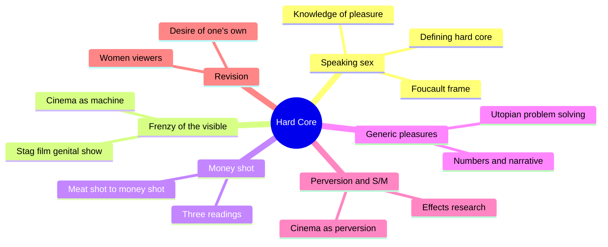
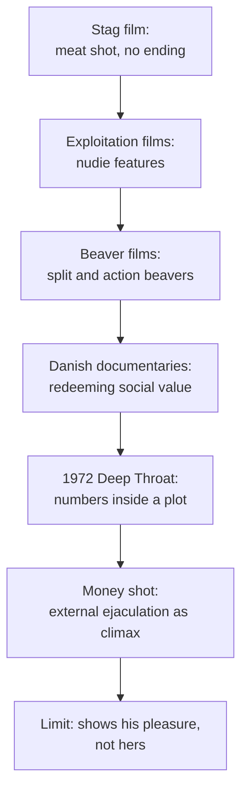
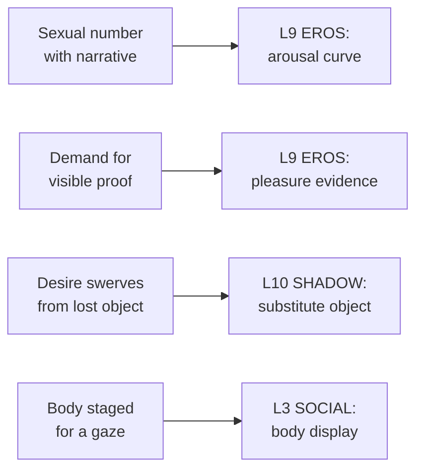

# 🧬 MSX.42 — Hard Core — Williams (1989)
### Knowledge Entry — Distill

Linda Williams wrote the first book-length study of hard-core film and video as a genre, using Foucault, Freud, and Marx to ask what the genre does for its viewers. It sits on the shelf as the foundational account of how explicit sex gets staged for a camera.

## TABLE OF CONTENTS
- [Core Thesis](#1-core-thesis)
- [Mind Models](#2-mind-models)
- [Framework](#3-framework--structure)
- [Key Concepts](#4-key-concepts)
- [Heuristics](#5-heuristics--decision-rules)
- [Invariants](#6-invariants)
- [Pitfalls](#7-pitfalls--myths)
- [Application](#8-application)
- [Cross-References](#9-cross-references)
- [Provenance](#10-provenance--confidence)

---

## 1 · CORE THESIS

Hard-core film does not simply show sex. It builds a system of visual evidence, the "frenzy of the visible," that tries to prove pleasure and always falls short. Williams reads that failure as a genre with rules, not an aberration.

---

## 2 · MIND MODELS

*Required. Minimum two diagrams, maximum five.*

**Diagram 1 — the whole argument.**
Caption: *the book moves from a theory of speaking about sex, through the camera's hunt for proof, to a revision of who gets to speculate about pleasure.*

**Diagram 2 — the central mechanism (how the genre reached the money shot).**
Caption: *each legal and technical step pushed hard core toward feature-length narrative, and the money shot arrived as the proof of an ending.*

**Diagram 3 — the money shot's double bind.**
Caption: *the shot promises proof of pleasure, delivers only the male performer's climax, and so keeps the quest for women's pleasure running.*

**Diagram 4 — mapped onto the Command's 12-layer character stack.**
Caption: *four of Williams' devices land on four layers: the number builds the arousal curve, the proof demand shapes EROS, perversion feeds SHADOW, and the staged body sits in SOCIAL.*

---

## 3 · FRAMEWORK / STRUCTURE

Eight chapters and a conclusion. Williams reads the genre in historical order.

| Chapter | Governing move |
|---|---|
| 1. Speaking Sex (from p. 1) | Opens with Diderot's talking jewels and Foucault's compulsion to make sex speak. Defines the problem: pornography is a discourse about pleasure, not a special case |
| 2. Prehistory (page not legible in the extract) | Cinema's early machines of the visible (Muybridge, Edison) set up the drive to see bodies move |
| 3. The Stag Film (p. 58) | Early silent hard core is a "genital show" with no ending |
| 4. Fetishism and Hard Core (p. 93) | The feature-length film adds narrative, sound, and the money shot. Marx, Freud, and feminism each read the shot |
| 5-6. Generic Pleasures; Hard-Core Utopias (pp. 120-183) | Sexual numbers inside a plot. Each number poses a problem and offers a utopian solution |
| 7. Power, Pleasure, and Perversion (p. 184) | Tests the claim that hard core equals sadism, using the Snuff case and effects research |
| 8. Sequels and Re-Visions (p. 229) | Women viewers and women directors revise the genre from inside |
| Conclusion (p. 265) | Perversion is a continuum. Pornography speculates about pleasure |

Williams limits her sample to mainstream heterosexual hard core and says why (pp. 6-7).

---

## 4 · KEY CONCEPTS

| Concept | What it is | Why it matters |
|---|---|---|
| **Frenzy of the visible** | The drive, built into cinema, to see bodies and prove their pleasure (Comolli's "machines of the visible") | Names why explicit scenes keep escalating their detail |
| **Maximum visibility** | The genre shows more of bodies and organs with each cycle of convention | Explains close-ups, overlit genitals, and chosen positions (p. 48, quoted by Dyer in MSX.66) |
| **Meat shot** | The stag film's proof of penetration. It cannot show what it penetrates | The first limit of visibility (p. 94) |
| **Money shot** | External ejaculation as the climax of each sex act | Gives the number an ending. Proves his pleasure and only his (pp. 93-102) |
| **Number** | A set-piece sex scene inside a feature, like a number in a musical | Lets writers treat a scene as a unit with a problem and a solution (ch. 5-6) |
| **Utopian problem solving** | Following Dyer, a genre offers energy, abundance, intensity, transparency, community as answers to real lacks (p. 155) | Gives each explicit beat a job beyond arousal |
| **Hard core vs. erotica** | Williams rejects the clean split between "erotic" and "pornographic" (p. 277) | The erotic stresses desire. The pornographic stresses satisfaction |
| **Perversion (neutral sense)** | A swerving away from direct forms of pleasure (p. 102) | Lets her describe the money shot without stigma |
| **Speaking sex** | Foucault's compulsion to confess and question sex (pp. 2-3) | Ties pornography to the same machinery as medicine and law |

---

## 5 · HEURISTICS & DECISION RULES

| Situation | Do this | Not this |
|---|---|---|
| Writing an explicit scene | Give it a build, a problem, and a climax that the story can see | Let it float free of the plot with no stakes |
| Showing a character's pleasure | Decide what counts as proof, and let the gap between proof and feeling stay open | Treat a visible climax as full knowledge of the partner |
| Writing a watcher (voyeur, camera, audience) | Name who the body is staged for | Write display as neutral |
| Writing a "lesbian number" or similar warm-up | Ask who it serves and what else it does (p. 274) | Assume one reading, for or against |
| Handling the erotic/pornographic split | Let one scene carry desire and another carry satisfaction | Rank the explicit below the suggestive |
| Writing a reader or character who objects to explicit sex | Keep their gut reaction real and let analysis follow (pp. 5-6) | Write the objection as stupidity |

---

## 6 · INVARIANTS

1. **Explicit sex is a way of speaking about sex.** It has conventions, so it can be studied and written deliberately.
2. **The proof of pleasure never equals the pleasure.** The genre keeps hunting because the target keeps moving.
3. **The money shot ends the number.** It gives the scene a narrative stop, and it shows his pleasure.
4. **Gut reactions are cultural.** Arousal, tears, and laughter all feel automatic and are all shaped by genre (p. 5).
5. **Desire swerves.** Some substitution sits inside all sexual fantasy (pp. 271-272).
6. **More kinds of speech widen what can be said.** Williams argues that more pornographic discourses mean more differences get expressed, though not equal freedom (pp. 274-275).

---

## 7 · PITFALLS / MYTHS

- Treating all hard core as one thing. Williams sampled mainstream heterosexual titles from 1972 to 1987 and said so (pp. 6-8).
- Reading her sample as a theory of gay porn. She brackets gay and lesbian work and defers it to others (pp. 6-7).
- Assuming porn causes violence. She cites Donnerstein's lab studies as inconclusive on behavior and stronger on attitudes (pp. 187-188).
- Treating the Snuff panic as evidence about porn. Williams shows Snuff was a slasher film with a tacked-on coda (pp. 189-192).
- Taking 1989 research as current. Her effects data and her titles are thirty-five years old.
- Reading the Hera and Teiresias myth as a fact about women. Williams reads it as men's fantasy (pp. 153-154).

---

## 8 · APPLICATION

*Proposed, never ruled.*

- **Spine level:** L5.
- **12-layer character stack:** L9 EROS (primary, arousal curve and pleasure evidence); L10 SHADOW (supporting, substitute objects); L3 SOCIAL (supporting, body display for a gaze); L6 DRIVE (contextual, "more, more, more").
- **plot_systems:** a sex number works as a plot unit with a problem and an answer.
- **Setting:** none.

Williams gives the ORANGE work a scene engine. A number has a want, an obstacle, a build, and a sign that the want was met. That structure fits fantasy-first prose under the 06.1 ruling, because it treats the explicit beat as story, not as a break from story.

Her second gift is the proof question. Each lover in a scene needs some evidence the other is gone with it. A character who always demands the visible sign tells the reader something about their trust. A character who accepts less tells the reader something else. Writers can put that choice on L9 as a named variable.

Her closing wish is also usable. She hopes explicit work will someday probe male pleasure with the scrutiny it gives female pleasure, beyond erection and ejaculation (p. 276). A character whose pleasure the story cannot reduce to a climax is a proposed target for the male leads on the Command's shelf.

---

## 9 · CROSS-REFERENCES

| Related entry | Relation |
|---|---|
| [[🧬 MSX.36 — The History of Sexuality — Foucault (1978)]] | Williams builds on Foucault's speaking-sex frame, confession, and implantation of perversions |
| [[🧬 MSX.33 — The Space of Sex — Waldrep (2021)]] | Waldrep's staged, licensed space is the mainstream-film cousin of Williams' number |
| [[🧬 MSX.66 — The Culture of Queers — Dyer (2002)]] | Dyer's "Idol Thoughts" chapter applies Williams' maximum visibility to gay porn (pp. 191-192) |
| [[🧬 MSX.26 — Pornographic Art and the Aesthetics of Pornography — Maes (2013)]] | A second view of what explicit work does as art |
| [[🧬 MSX.24 — Bareback Porn — Florêncio (2020)]] | Extends the proof-of-pleasure question to bareback work |

---

## 10 · PROVENANCE & CONFIDENCE

Full-text pdftotext extraction, about 340 pages, University of California Press, Berkeley and Los Angeles, 1989. The front matter confirms author, title, publisher, and the 1989 copyright. Page numbers below come from running heads in the extract and may be off by a page where OCR dropped a header.

Read in full or near-full: the Foreword; chapter 1 to p. 12 (Foucault frame, scope, hard/soft split); chapter 4 from its opening through p. 102 (stag to feature, the money shot); the opening of chapter 6 and its Marilyn Chambers case (pp. 153-158); the opening of chapter 7 through the Snuff case (pp. 186-192); the Conclusion (pp. 271-279).

Skipped: chapters 2, 3, and 5 beyond their descriptions in the chapter 1 roadmap (pp. 7-8); the rest of chapters 6 and 7, including the S/M readings; chapter 8; the notes and bibliography. The S/M claims here rest only on the Conclusion (p. 273).

Contested or dated: the study is heterosexual and mainstream by design. Her effects literature is from the 1980s. Her reading of the money shot is a critic's argument, not an observation of viewers.

The `feeds:` keying is this distill's own synthesis. Williams does not use the Command's layer vocabulary. The `pleasure_evidence` variable is proposed here and is not yet in the schema.

## META
- Template: BVX-LEARN-v4.0
- Source classification: full-text pdftotext extraction, targeted read of chapters 1, 4, 6, 7 and the Conclusion
- Created / Updated: 2026-10-04
