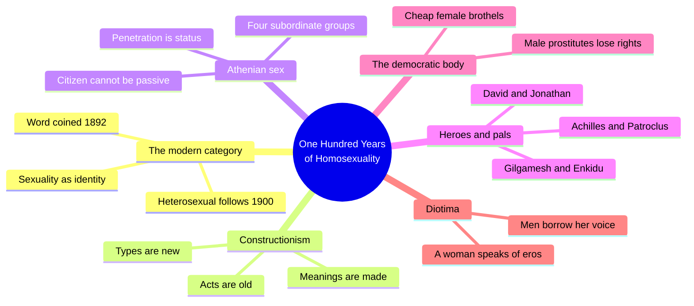
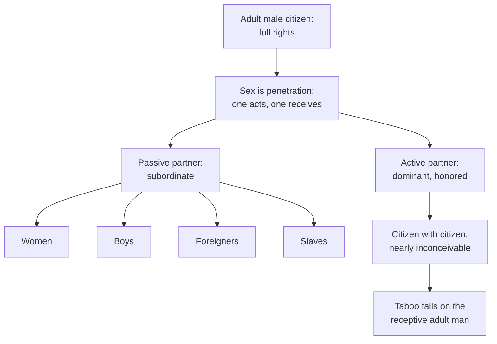
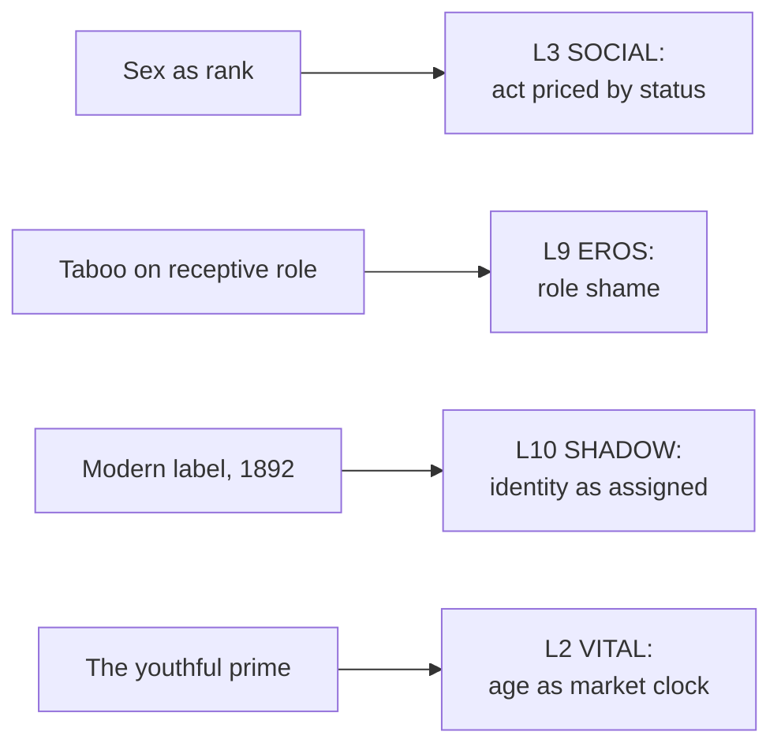

# 🧬 MSX.43 — One Hundred Years of Homosexuality — Halperin (1990)
### Knowledge Entry — Distill

David Halperin's 1990 essay collection (Routledge, New York) argues that "homosexual" is a modern category, about a century old, and that classical Athens organized sex by status and role instead. It joins MSX.36 as this shelf's second constructionist anchor.

## TABLE OF CONTENTS
- [Core Thesis](#1-core-thesis)
- [Mind Models](#2-mind-models)
- [Framework](#3-framework--structure)
- [Key Concepts](#4-key-concepts)
- [Heuristics](#5-heuristics--decision-rules)
- [Invariants](#6-invariants)
- [Pitfalls](#7-pitfalls--myths)
- [Application](#8-application)
- [Cross-References](#9-cross-references)
- [Provenance](#10-provenance--confidence)

---

## 1 · CORE THESIS

"Sexuality" is a modern way of sorting people by the sex of their partners, invented about 1892. Classical Athens sorted sex by status instead: who penetrates is the master, who receives is the inferior. Same-sex acts existed everywhere; "homosexuals" did not.

---

## 2 · MIND MODELS

**Diagram 1 — the whole argument.**
Caption: *the book runs one claim through six essays, from the modern label back to the Athenian status system and out to friendship, prostitution, and philosophy.*

**Diagram 2 — the central mechanism (sex as a status system).**
Caption: *every Athenian sex act maps onto the citizen's rank, so the same act means domination from one side and submission from the other.*

**Diagram 3 — Greek terms mapped onto the Command's layers.**
Caption: *Halperin's Athenian mechanisms land on SOCIAL, EROS, and SHADOW; his modern label lands on SHADOW again, as a category the character is assigned.*

---

## 3 · FRAMEWORK / STRUCTURE

The book has two parts. Part I (chs. 1-3) argues the theory. Part II (chs. 4-6) applies it to three Greek cases.

| Chapter | Governing move |
|---|---|
| 1. One Hundred Years of Homosexuality (pp. 15-40) | Halperin shows Plato's Aristophanes and Caelius Aurelianus lack the modern binary. He then sketches Athenian sex as a status system |
| 2. "Homosexuality": A Cultural Construct (pp. 41-53) | An interview with Richard Schneider. Halperin answers the standard objections to constructionism |
| 3. Two Views of Greek Love (pp. 54-74) | Halperin sets Harald Patzer's essentialism against Foucault's historicism |
| 4. Heroes and their Pals (pp. 75-87) | He reads Achilles and Patroclus beside Gilgamesh and David as a cultural label for male friendship |
| 5. The Democratic Body (pp. 88-112) | Athenian democracy regulates male prostitution to build a masculine citizen body |
| 6. Why is Diotima a Woman? (pp. 113-151) | Plato gives the theory of eros to a female teacher; Halperin asks what that borrowing does |

---

## 4 · KEY CONCEPTS

| Concept | What it is | Why it matters |
|---|---|---|
| **Constructionism** | The claim that sexual categories are made by cultures, not found in nature (ch. 1, p. 28) | Halperin says contingent does not mean false. Homosexuals and heterosexuals exist now |
| **The 1892 date** | The word "homosexuality" enters English as a technical coinage; "heterosexuality" follows about 1900 (ch. 1, pp. 16-18) | Many ordinary men did not know the words until the 1950s |
| **Sexuality as a concept** | A separate sexual domain of the self that produces a sexual identity (ch. 1, pp. 24-25) | It splits sexual identity from gender, which the ancients never did |
| **Aristophanes' myth** | Plato's origin story of split humans (Symposium 191e-192b) | It yields three groups, not two, and the male-male group splits by age (ch. 1, pp. 19-21) |
| **The molles** | "Soft" men in Caelius Aurelianus, who want the receptive role (ch. 1, pp. 22-24) | The disease is gender deviance. Desiring males is not the problem |
| **Sex as non-relational** | Athenian sex is an act one person does to another (ch. 1, pp. 30-33) | The Greeks counted sex among acts like fist-fighting that need no partner's cooperation |
| **Phallic hierarchy** | Active is dominant; passive is subordinate; both mirror social rank (ch. 1, p. 30) | Halperin quotes Paul Veyne: the Athenians were "puritans about virility" |
| **The hora** | The "prime" between puberty and the beard (ch. 5, pp. 89-90) | A male was desirable to other males only in this window |
| **The democratic body** | Cheap female prostitution plus disenfranchised male prostitutes (ch. 5, pp. 100-103) | Together they gave every citizen a masculine, assertive public image |
| **Heroic pairs** | Two warriors, isolated, bound for action and glory (ch. 4, p. 77) | The bond is a cultural form with a purpose beyond itself |

---

## 5 · HEURISTICS & DECISION RULES

| Situation | Do this | Not this |
|---|---|---|
| Writing a historical or secondary-world culture | Ask what each act means for rank in that society | Sort characters by modern gay and straight boxes |
| Writing a character's first label | Show the label arriving from outside: a word, a doctor, a rumor | Show a hidden fixed nature surfacing whole |
| Writing shame | Tie it to the role taken: receptive, submissive, "soft" | Tie it only to the partner's sex |
| Writing a male-dominated institution | Let sex declare who outranks whom | Treat sex as separate from the hierarchy |
| Writing a bond between two men | Give the pair a purpose beyond itself, such as war, a quest, or a school | Make the bond only a private feeling |
| Writing a sex market | Give it a price curve tied to age and a legal status | Treat it as a hidden vice in the margins |

---

## 6 · INVARIANTS

1. Same-sex acts appear in many cultures (ch. 1, p. 29). The identity "homosexual" does not.
2. Sexuality is a cultural production. Sex is a natural fact (ch. 1, p. 25).
3. The Athenians sorted by gender role and status, not by the sex of the partner (ch. 1, pp. 23-25).
4. Classical Athenian sex is hierarchical: active is dominant, passive is subordinate (ch. 1, p. 30).
5. Concepts in the human sciences partly constitute what they describe (ch. 1, p. 29).
6. A reading of the past is always written from present interests (ch. 1, p. 29).

---

## 7 · PITFALLS / MYTHS

- Reading "contingent" as "unreal." Halperin states the category is not false, only not natural (ch. 1, p. 28).
- Reading Aristophanes' myth as an ancient orientation theory (ch. 1, pp. 19-21).
- Reading Athenian sexual restraint as modern prudery. Halperin says the Athenians feared lost virility, not sex (ch. 1, p. 31).
- Treating Athens as the whole of Greece. Halperin warns the surviving evidence mostly covers Athenian citizens (ch. 1, p. 29).
- Calling this a settled consensus. Halperin published it as an argument, and critics such as John Boswell push back (ch. 1, p. 18).

---

## 8 · APPLICATION

*Proposed for the ORANGE work, not ruled.*

- **Spine level:** L5.
- **12-layer character stack:** L10 SHADOW (primary, the label as assigned); L3 SOCIAL (primary, sex as rank); L9 EROS (supporting, shame on the role); L7 ORIGIN (supporting, a system that sells male privilege); L2 VITAL (contextual, the age-price window).
- **plot_systems:** a school or a house with a visible rank ladder gives every sex scene a power reading before any dialogue.
- **Setting:** a polity can tie its civic body to a sexual protocol, as Athens tied citizenship to the masculine body.

Halperin gives a writer a second axis to the constructionist toolkit in MSX.36. Foucault explains how a label gets made. Halperin shows a whole society running on a different sort of label, one about status and role. A character in a rank-based world can want men, take a lover, and never think of himself as a type of person. A character handed the modern label has to decide what the label owes him.

Halperin's Athenian evidence is about public speech among elite men. He says himself that it does not describe what sex felt like (ch. 1, p. 32). Proposed use: write feeling in the scene and rank in the frame.

---

## 9 · CROSS-REFERENCES

| Related entry | Relation |
|---|---|
| [[🧬 MSX.36 — The History of Sexuality — Foucault (1978)]] | Foucault supplies the naming mechanism. Halperin supplies a datable case and an alternate system |
| [[🧬 MSX.33 — The Space of Sex — Waldrep (2021)]] | Waldrep's licensed spaces show a modern society still zoning sex. Halperin shows an old one zoning it by rank |
| [[🧬 MSX.19 — The Routledge Handbook of Male Sex Work — Scott, Grov & Minichiello (2021)]] | Ch. 5's male prostitution in Athens is the earliest case in the same line of work |

---

## 10 · PROVENANCE & CONFIDENCE

Full text by pdftotext, 240 pdf pages; book page = pdf page minus 12. Title page and copyright confirm David M. Halperin, *One Hundred Years of Homosexuality and Other Essays on Greek Love*, Routledge, New York and London, 1990. The Preface says the essays were revised from three years of earlier publications.

Read in full: Preface and Introduction; ch. 1, pp. 16-33; ch. 4's opening comparison (pp. 75-77); ch. 5, pp. 89-103. Skipped: chs. 2 and 3 (the Schneider interview and the Patzer-Foucault critique), the second half of ch. 4, all of ch. 6 on Diotima, the endnotes, the addendum, and the bibliography. The chapter 2 to 3 arguments are known only from the preface summary. Ch. 6 feeds nothing here.

Contested: Halperin's thesis is a strong version of constructionism. John Boswell reads Plato and other texts as showing an ancient homosexual category (ch. 1, p. 18). Halperin answers him in the same chapter, but the dispute stays open. Treat the 1892 date as the book's argument, not an uncontested fact.

The `feeds:` keying is this distill's own synthesis. Halperin uses no layer vocabulary. The `spine: [L5]` value follows the shelf's standing assignment.

## META
- Template: BVX-LEARN-v4.0
- Source classification: full-text pdftotext, deep read on ch. 1 and ch. 5, partial on ch. 4, unread on chs. 2, 3, 6
- Created / Updated: 2026-10-04
