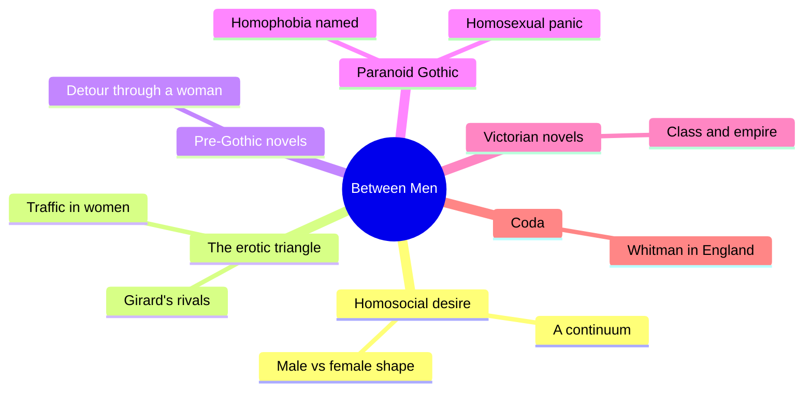
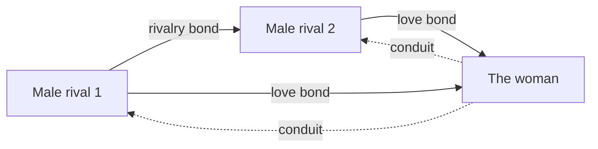
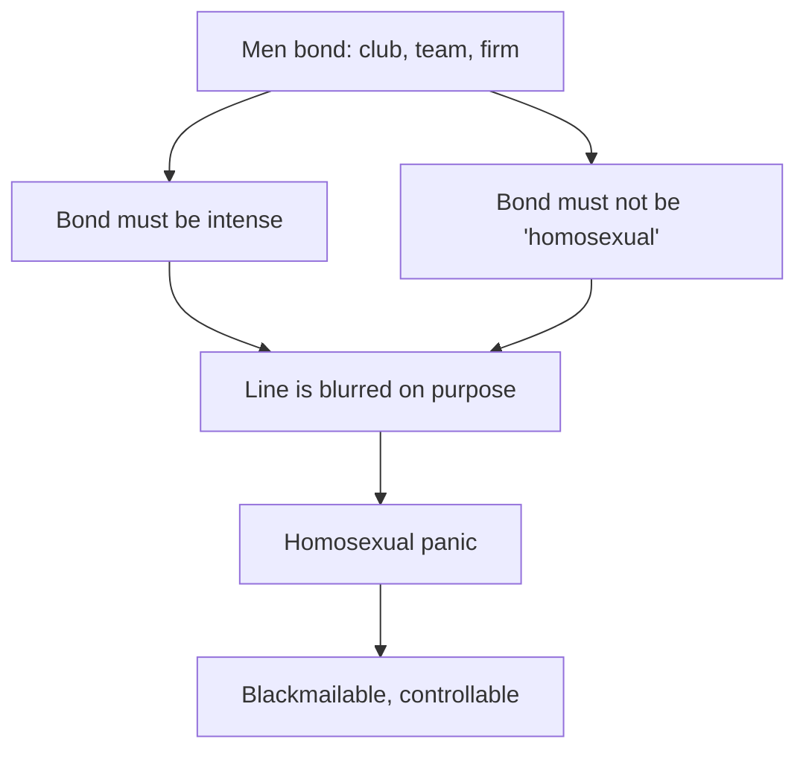
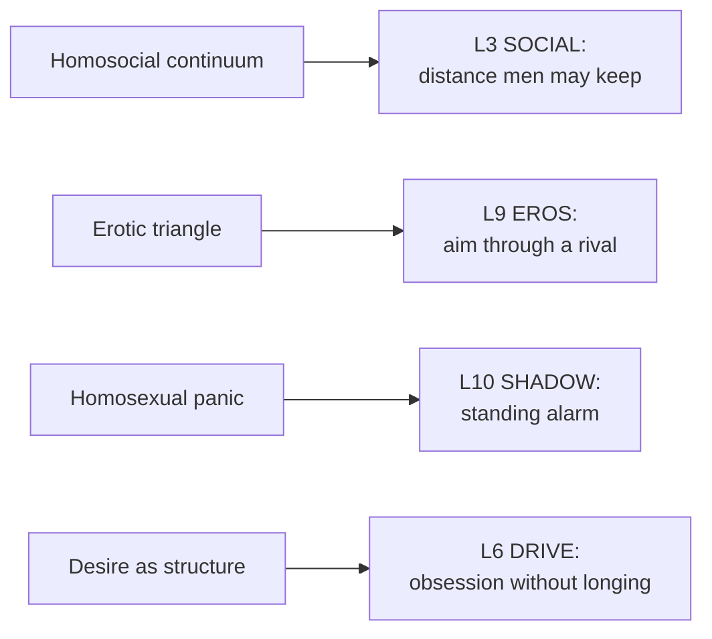

# 🧬 MSX.44 — Between Men — Sedgwick (1985)
### Knowledge Entry — Distill

Sedgwick's 1985 book reads the English novel from the mid-18th to mid-19th century. It argues that bonds between men shape social power, and that homophobia polices them.

> *Fantasy, not a how-to: what happens in these pages stays in them. Reader discretion advised.*

## TABLE OF CONTENTS
- [Core Thesis](#1-core-thesis)
- [Mind Models](#2-mind-models)
- [Framework](#3-framework--structure)
- [Key Concepts](#4-key-concepts)
- [Heuristics](#5-heuristics--decision-rules)
- [Invariants](#6-invariants)
- [Pitfalls](#7-pitfalls--myths)
- [Application](#8-application)
- [Cross-References](#9-cross-references)
- [Provenance](#10-provenance--confidence)

---

## 1 · CORE THESIS

Men's bonds with men, from friendship to rivalry to sex, form one continuum that holds up patriarchy. In modern Western society homophobia cuts that continuum in two, and the cut controls every man.

---

## 2 · MIND MODELS

**Diagram 1 — the whole argument.**
Caption: *one idea, the homosocial continuum, is traced through theory, then through six kinds of novel.*

**Diagram 2 — the central mechanism (the triangle).**
Caption: *a man reaches a man through a woman, so the woman is a conduit and the male bond is the real one.*

**Diagram 3 — the double bind (how the lever works).**
Caption: *a man must prove his bonds are not homosexual, so whoever defines the line can steer all male bonds.*

**Diagram 4 — mapped onto the Command's 12-layer stack.**
Caption: *Sedgwick's terms land on SOCIAL, EROS and SHADOW, and they give DRIVE a way to hold hostility.*

---

## 3 · FRAMEWORK / STRUCTURE

An introduction and ten chapters plus a coda. The book reads texts in order of time.

| Part | What it does |
|---|---|
| Introduction (four sections) | Defines male homosocial desire. Sets the sexual-politics question. Pits history against structure. States the plan |
| Ch. 1 | Builds the triangle from Girard, Freud, Lacan and Rubin, then shows why gender breaks its symmetry |
| Ch. 2-4 | Shakespeare's Sonnets, *The Country Wife*, *A Sentimental Journey*: the detour through a woman is taken as the norm |
| Ch. 5-6 | The paranoid Gothic. Homophobia becomes an explicit subject, in Hogg's *Confessions of a Justified Sinner* among others |
| Ch. 7-10 | Tennyson, Eliot, Thackeray, Dickens: class, women's historical place, capital, empire |
| Coda | Whitman as English readers took him |

---

## 4 · KEY CONCEPTS

| Concept | What it is | Why it matters |
|---|---|---|
| **Homosocial** | A bond between people of the same sex (Intro, PDF p. 11) | The word leaves open whether a bond is sexual |
| **Homosocial desire** | The force that shapes a bond, including hostility. Sedgwick uses it like "libido" (PDF p. 12) | Rivalry and love share one structure |
| **The continuum** | A line from men-loving-men to men-promoting-men (PDF p. 13) | For women it looks smooth. For men it is broken |
| **Asymmetry** | Female and male homosocial lines differ in shape (Ch. 1, PDF p. 35) | The difference tracks the gap in power between women and men |
| **Erotic triangle** | Girard's figure of two rivals and a beloved (Ch. 1, PDF p. 31) | The rivals' bond can outweigh the bond to the beloved |
| **Traffic in women** | Rubin's term: women as exchange between men (PDF p. 35-36) | It makes the woman a conduit, and the bond between men the real one |
| **Homophobia** | Fear and hatred bound into the structure of family, class, race (Intro, PDF p. 13-14) | The Greeks show patriarchy does not require it (PDF p. 14) |
| **Homosexual panic** | The private form of a man's exposure to the lever (Ch. 5, PDF p. 99) | The man is controlled by the question, not by any act |
| **Paranoid Gothic** | Novels of two men locked in persecution and pursuit (Ch. 5-6) | Sedgwick reads them as about prohibition, so about heterosexuality |
| **Minimal difference** | The schism rests on a small difference, so it is fortified harder (Coda, PDF p. 211) | A thin line needs a thick wall |
| **Sexual meaning is not constant** | Sex is not a fixed charge added to a social bond (Intro, PDF p. 16) | A scene must say what sex does to this bond |

---

## 5 · HEURISTICS & DECISION RULES

| Situation | Do this | Not this |
|---|---|---|
| Two male characters bound by rivalry | Write the bond as intense as a love bond, and let the woman between them carry it | Treat the rivalry as plot and the woman as the prize |
| A team, fraternity or unit | Let its rituals look "homosexual" at a slight tilt of the camera (PDF p. 99) | Treat every such look as sublimated lust |
| A male mentor and a younger man | Mark what class and age make the bond lawful | Assume mentorship is always innocent or always erotic |
| A man who panics over a friend's touch | Show the check he runs on himself, and who might see | Write the panic as proof of hidden desire |
| A male friendship that must stay legible | Give it a prop: a shared woman, a rival, a case | Let it stand alone in a world that polices it |
| A female friendship | Let the line between friend and lover blur easily (PDF p. 12-13) | Mirror the male rift on the female side |

---

## 6 · INVARIANTS

1. Male and female homosocial lines have different shapes (Intro, PDF p. 15).
2. The shape of the line is made by history and by who holds power, not by nature.
3. In a male-dominated society, male bonds carry power between men.
4. The definition of "the sexual" is political, and its blur is its power (PDF p. 99).
5. A plot that routes desire through a woman keeps the male bond as its hidden subject.
6. A threat to the line works as control long before any act occurs.

---

## 7 · PITFALLS / MYTHS

- Do not read "homosocial" as a polite word for "closeted." Sedgwick means a structure.
- The book covers English literature from 1750 to 1850 and a coda. It is a reading of texts, not of living communities.
- Sedgwick says herself that she knew only one openly gay man while writing (Preface, PDF p. 6). Later readers have contested her focus on male bonds and her use of homophobia as a lever.
- Her claim that the Gothic is "about" heterosexuality is a reading, not a finding (Ch. 6, PDF p. 126).
- The Greek counterexample comes from Dover's 1978 study. Later historians dispute its details.
- Do not turn "panic" into a diagnosis. The book treats it as a social position.

---

## 8 · APPLICATION

*Proposed, not ruled.*

- **Spine level:** L5.
- **12-layer character stack:** L3 SOCIAL (primary: where a man stands on the continuum); L10 SHADOW (primary: panic as a standing alarm); L9 EROS (primary: aim through a rival); L6 DRIVE (supporting: obsession that reads as hostility); L7 ORIGIN (contextual: men's institutions); L5 WOUND (contextual: queer childhood in the family mirror).
- **plot_systems:** a triangle is a ready scene-engine. Two men, one woman, and the real plot runs between the men.
- **Setting:** DCUS can carry its own rift. Team, band, crew and club each draw the line in a different place.

For OXO, Sedgwick gives the rivalry between boys a place to live. A boy can hate another boy for a year, and the reader can feel the bond under it. The triangle also lets a story keep a girl at the center while the male bond drives the choices. Because desire here means structure, the character sheet needs no "does he like men" box. It needs the distance a character may stand from another man before his world reads it. A scene that moves that distance is a scene about SOCIAL, EROS and SHADOW at once.

---

## 9 · CROSS-REFERENCES

| Related entry | Relation |
|---|---|
| [[🧬 MSX.36 — The History of Sexuality — Foucault (1978)]] | Sedgwick builds on Foucault's claim that sexual categories are made, and on the 1870 turn |
| [[🧬 MSX.48 — Gender Trouble — Butler (1990)]] | Butler reads the same compulsory frame as a performance |
| [[🧬 MSX.56 — Coming Out — Weeks (1977)]] | Weeks gives the history of the homosexual role that Sedgwick cites (PDF p. 95) |
| [[🧬 MSX.60 — Tearoom Trade — Humphreys (1970)]] | Humphreys studies men who live inside the line she describes |

---

## 10 · PROVENANCE & CONFIDENCE

Full text, pdftotext extraction, 252 PDF pages. Title page: Eve Kosofsky Sedgwick, *Between Men*, Columbia University Press, copyright 1985, with a new preface dated November 1992. Page cites here are PDF pages. In the early chapters the printed page is the PDF page minus ten.

Read: the preface in part, the whole Introduction, Ch. 1 through its Freud, Lacan and Rubin discussion, the opening of Ch. 5 (Bray and the molly houses, the lever, homosexual panic), a passage from Ch. 6, the opening of Ch. 9, and the opening of the Coda.

Skipped: Ch. 2 to 4 and 7 to 8 (the close readings of Shakespeare, Wycherley, Sterne, Tennyson, Eliot and Thackeray), most of Ch. 6 and 9, Ch. 10, the notes and the bibliography. The `feeds:` keying is this distill's own work. Sedgwick uses no 12-layer vocabulary.

## META
- Template: BVX-LEARN-v4.0
- Source classification: full-text pdftotext extraction, deep read of the Introduction and Ch. 1, targeted passages of Ch. 5, 6, 9 and the Coda
- Created / Updated: 2026-10-04
