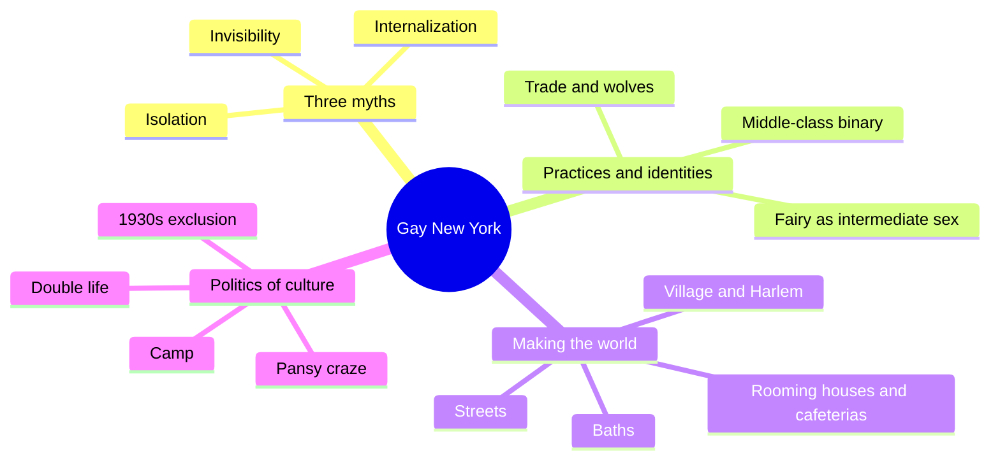
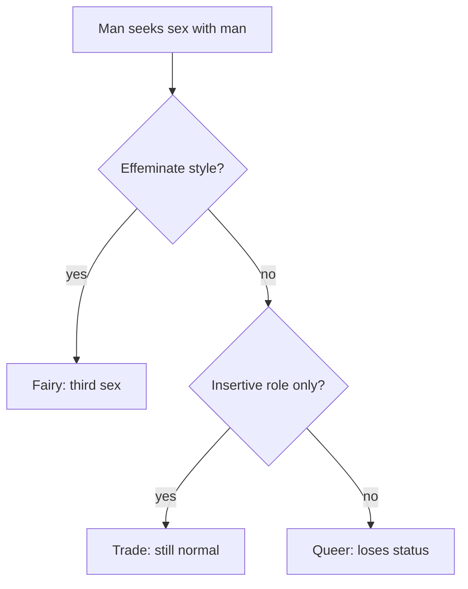
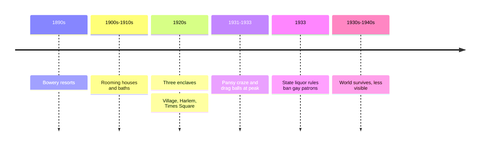
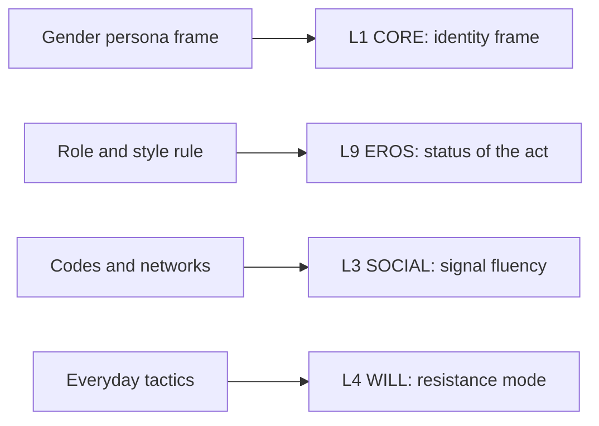

# 🧬 MSX.45 — Gay New York — Chauncey (1994)
### Knowledge Entry — Distill

Fantasy, not a how-to: what happens in these pages stays in them. Reader discretion advised.

George Chauncey's history reconstructs the gay male world of New York between 1890 and 1940 from police files, doctors' case notes, and more than seventy interviews. It is the library's main period source for how men found one another before Stonewall.

## TABLE OF CONTENTS
- [Core Thesis](#1-core-thesis)
- [Mind Models](#2-mind-models)
- [Framework](#3-framework--structure)
- [Key Concepts](#4-key-concepts)
- [Heuristics](#5-heuristics--decision-rules)
- [Invariants](#6-invariants)
- [Pitfalls](#7-pitfalls--myths)
- [Application](#8-application)
- [Cross-References](#9-cross-references)
- [Provenance](#10-provenance--confidence)

---

## 1 · CORE THESIS

Before World War II, New York had a large, visible gay world. It was not isolated, invisible, or self-hating. Men built it from street codes, baths, and neighborhoods, until the 1930s laws pushed it out of public life.

---

## 2 · MIND MODELS

**Diagram 1 — the whole argument.**
Caption: *the book replaces three myths with a social history in three parts: how men were classed, how they built a world, and how law pushed it underground.*

**Diagram 2 — the central mechanism (who counts as a "man").**
Caption: *the old working-class rule sorted men by gender style and sexual role; only the receptive, effeminate man lost his status.*

**Diagram 3 — the arc of the world, 1890 to 1940.**
Caption: *the world grew in plain view, peaked during Prohibition, and then law moved it indoors rather than ending it.*

**Diagram 4 — mapped onto the Command's 12-layer character stack.**
Caption: *three Chauncey findings land on three layers: the era's frame on CORE, the role-and-style rule on EROS, and codes plus networks on SOCIAL.*

---

## 3 · FRAMEWORK / STRUCTURE

| Part | What it does |
|---|---|
| Introduction (pp. 1-30) | Names three myths and the thesis. |
| I. Practices and Identities (Ch. 1-4, pp. 33-130) | Gives the Bowery, the fairy, trade and wolves, and the middle-class shift toward a straight-gay split. |
| II. Making the Gay World (Ch. 5-9, pp. 131-270) | Covers policing, rooming houses, street culture, the baths, and the Village and Harlem. |
| III. Politics of Gay Culture (Ch. 10-12, pp. 271-354) | Covers the double life, the pansy craze, and the 1930s exclusion. |
| Epilogue (pp. 355-364) | Argues the "closet" is a later image. |

---

## 4 · KEY CONCEPTS

| Concept | What it is | Why it matters |
|---|---|---|
| **Three myths** | Isolation, invisibility, internalization (Intro, pp. 1-5) | The book exists to correct them with evidence. |
| **Fairy** | An effeminate man treated as a "third sex" (Ch. 2, p. 47) | The fairy set the line that defined normal manhood for everyone. |
| **Gender before sexuality** | Identity rested on gender persona, not on who one desired (p. 48) | The straight-gay binary was not yet common sense in working-class life. |
| **Trade** | A "normal" man who took the insertive role with a fairy (Ch. 3, pp. 69-70) | The term later widened to any straight man who responded. |
| **Wolf** | A man who pursued younger men (Ch. 3) | A named role in the sexual system. |
| **Double life** | Passing in one world, living openly in another (Intro, p. 6) | Men called it wearing a mask or letting the hair down. |
| **Dropped hairpins** | Small signals only insiders notice (p. 7) | Coded speech made a hidden network. |
| **Coming out** | First, a debut at a drag ball (p. 7); later, self-recognition | The word moved from social entry to private truth. |
| **Gay world** | Overlapping networks linked by shared "queerness" (p. 3, note) | The unit of life was the network, not the couple. |
| **Public as private** | "Privacy could only be had in public" (Ch. 7) | Men used streets and baths because homes were watched. |
| **Informal understanding** | Gay men could be public if they drew no attention (Epilogue, p. 356) | The 1930s turned this into law. |
| **Closet** | A later metaphor; gay people before the 1960s did not use it (p. 6) | It hides how wide the earlier world was. |

---

## 5 · HEURISTICS & DECISION RULES

| Situation | Do this | Not this |
|---|---|---|
| Setting a story before 1940 | Show a visible, networked world with codes and venues | Make every man isolated and afraid |
| Writing a "straight" man who sleeps with queer men | Let role and style decide his status, as the era did | Apply a modern straight-gay label |
| Writing a closeted man | Use "double life" and "mask," with a hidden circle | Use "closet" as an era word |
| Writing a newcomer | Give him a chain of contacts for work, rooms, friends | Give him no network |
| Writing resistance | Let dress, space, and passing count | Wait for a march |
| Writing a crackdown | Show codes adapting, not a clean disappearance | End the world on the day of the law |

---

## 6 · INVARIANTS

1. **A gay world existed and was visible.** Chauncey documents it by street, bar, and ball (Intro, pp. 2-4).
2. **The unit of identity changes by era.** Gender persona came first; object choice later (pp. 47-49).
3. **Networks do the practical work.** Jobs, rooms, and friends came through them (p. 171).
4. **Resistance includes everyday tactics.** Formal politics is one form among several (p. 5).
5. **Law raised the cost of visibility.** It did not remove the world (Epilogue, pp. 356-357).

---

## 7 · PITFALLS / MYTHS

- **The evidence skews to the arrested and the studied.** Police, vice-society, and clinical records over-sample working-class and Black men and under-sample the private.
- **Chauncey's reading is an interpretation.** Other historians dispute how widely the "fairy and trade" system applied, and the interview group is small.
- **The book covers one city.** New York in 1890-1940 is a single case, not a national average.
- Reading the closet as the whole past. Chauncey argues the term is anachronistic (p. 6).
- Reading silence as consent. Chauncey reads many silences as strategy (p. 5).
- Reading fairy and trade as modern categories. The words carried a different logic (pp. 47-48).

---

## 8 · APPLICATION

*Proposed, not ruled.*

- **Spine level:** L5.
- **12-layer character stack:** L1 CORE (identity frame, primary); L9 EROS (desire status rule, primary); L3 SOCIAL (signal fluency, primary; network, supporting); L4 WILL (resistance, supporting); L7 ORIGIN (initiation rite, contextual).
- **plot_systems:** a drag ball, a bath raid, or a rooming house gives ready scene frames.
- **Setting:** period texture. The 1890-1940 world is a template for any "hidden but visible" subculture.

For the ORANGE work, the main gift is a period-accurate way to let characters name themselves. A character in an older setting can hold an identity built on style and role, and the story need not force a modern label on him. The coded-signal system gives a ready tool for scenes where two strangers recognize each other. The network model adds a quiet engine: a newcomer's survival depends on who vouches for him. A proposed variable, `era_identity_frame`, would hold which naming system the character lives in. It would let OXO, set in a different era, state its own frame.

---

## 9 · CROSS-REFERENCES

| Related entry | Relation |
|---|---|
| [[🧬 MSX.36 — The History of Sexuality — Foucault (1978)]] | Foucault says naming creates a species; Chauncey shows the naming system shifting by class and decade. |
| [[🧬 MSX.57 — Queer London — Houlbrook (2005)]] | A parallel city study with a sharper method on the police record. |
| [[🧬 MSX.61 — Times Square Red, Times Square Blue — Delany (1999)]] | Delany takes the same Times Square as a place of contact. |

---

## 10 · PROVENANCE & CONFIDENCE

Full-text pdftotext extraction, 502 pdf pages. Title page confirms George Chauncey, Basic Books (HarperCollins), New York, 1994. Printed page equals pdf page minus 14. Read: the Introduction (pp. 1-8), Ch. 2 opening (pp. 47-50), Ch. 3 opening (pp. 66-70), Ch. 8 opening (pp. 207-209), Ch. 10 opening (pp. 171 and 173 in the extraction), and the Epilogue (pp. 355-358).

Skipped: Ch. 1, 4 to 7, 9, 11, 12, the notes, and the index. Ch. 3's later pages on wolves and Ch. 7 on street life were not read. The extraction has small OCR errors, and some page headers show the wrong chapter. Confidence is high for the thesis and medium for the detail. The `feeds:` keying is this distill's synthesis.

## META
- Template: BVX-LEARN-v4.0
- Source classification: full-text extraction, targeted read of introduction, Ch. 2-3, 8, 10, epilogue
- Created / Updated: 2026-10-04
