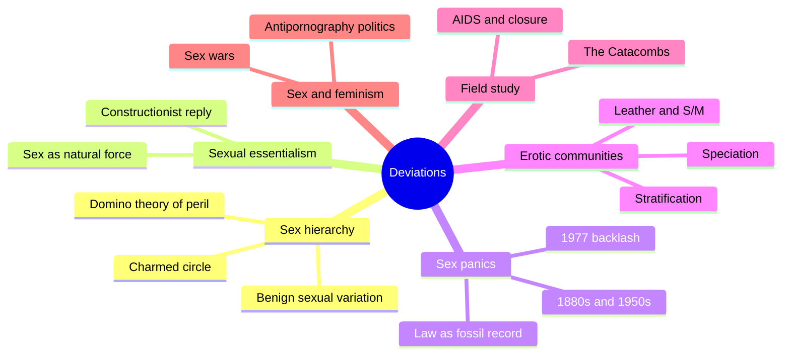
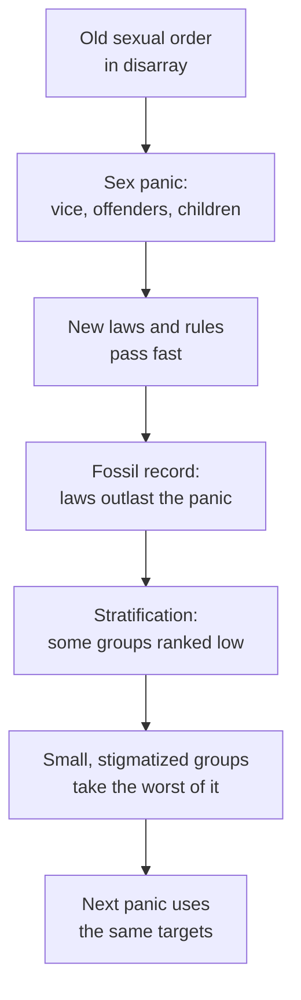
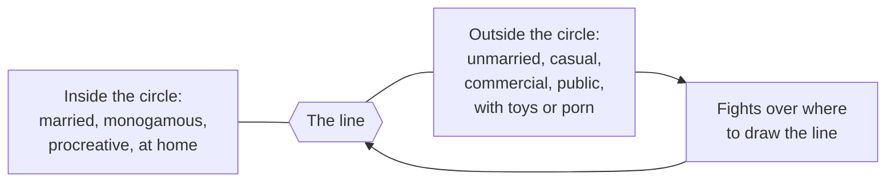
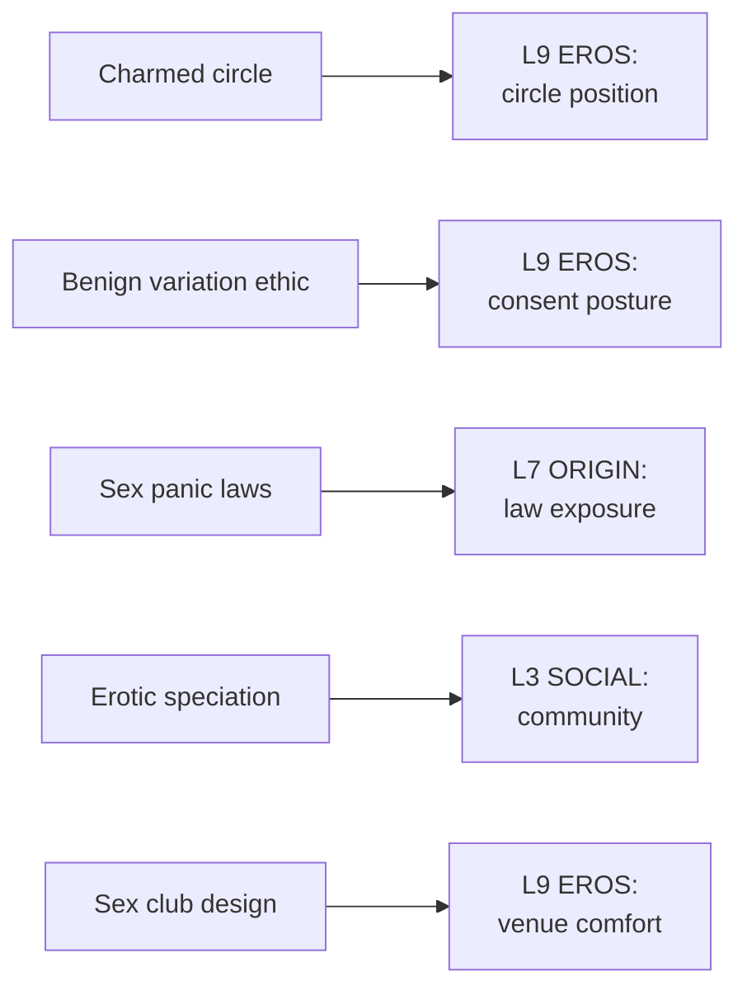

# 🧬 MSX.46 — Deviations — Rubin (2011)
### Knowledge Entry — Distill

Gayle Rubin's collected essays, published by Duke University Press in 2011, span four decades of writing on sex, gender, and sexual subcultures. The shelf keeps it for "Thinking Sex," the essay that gave the sex-politics argument its working tools, and for her field study of a San Francisco leather sex club.

## TABLE OF CONTENTS
- [Core Thesis](#1-core-thesis)
- [Mind Models](#2-mind-models)
- [Framework](#3-framework--structure)
- [Key Concepts](#4-key-concepts)
- [Heuristics](#5-heuristics--decision-rules)
- [Invariants](#6-invariants)
- [Pitfalls](#7-pitfalls--myths)
- [Application](#8-application)
- [Cross-References](#9-cross-references)
- [Provenance](#10-provenance--confidence)

---

## 1 · CORE THESIS

Societies rank sex acts on a scale from blessed to damned, and they punish the people on the low end with law, medicine, and panic. Sex needs its own politics, one that treats erotic variety as benign and studies sexual communities as communities.

---

## 2 · MIND MODELS

*Required. Minimum two diagrams, maximum five.*

**Diagram 1 — the whole argument.**
Caption: *Rubin works on three fronts at once: a theory of sexual hierarchy, a history of how panics build it, and field notes on how a stigmatized community builds itself.*

**Diagram 2 — the central mechanism (how a sex panic builds the hierarchy).**
Caption: *a panic erupts when an old sexual order is in disarray, and what it leaves behind keeps punishing people long after the panic ends.*

**Diagram 3 — the charmed circle.**
Caption: *the line between good and bad sex is drawn on many axes at once, and a person's desires usually cross it on several.*

**Diagram 4 — mapped onto the Command's 12-layer character stack.**
Caption: *Rubin's hierarchy sets a character's position on L9, panic laws shape L7, the community builds L3, and a venue shapes what L9 will risk.*

---

## 3 · FRAMEWORK / STRUCTURE

The reader has fourteen chapters. Four carry this distill.

| Part | Governing move |
|---|---|
| Introduction (pp. 1-32) | Rubin's life in the field and the sex-panic paradigm. She credits Weeks, Cohen, and Vance for the term (pp. 24-25) |
| Ch. 4, The Leather Menace (pp. 109-135) | She argues that police and press use S/M and cross-generational sex as wedges against the gay movement (pp. 111-113) |
| Ch. 5, Thinking Sex (pp. 137-181) | The core essay. Sets out essentialism, the sex hierarchy, speciation, stratification, and a politics of sex |
| Ch. 6-8 (pp. 182-223) | An afterword, a postscript, and "Blood under the Bridge," her later look back at the sex wars (closing p. 223) |
| Ch. 9, The Catacombs (pp. 224-240) | A history of a San Francisco fisting and S/M club, 1975 to its end |
| Ch. 1-3, 10-14 | Traffic in Women, trafficking, butch, antipornography, Butler interview, ethnography. Not read here |

"Thinking Sex" runs in five movements:

1. The 1880s, 1950s, and 1977-on panics (pp. 137-144).
2. Axioms that block thought, including sexual essentialism, the sex hierarchy, and the domino theory (pp. 144-153).
3. Erotic speciation and ethnogenesis (pp. 154-157).
4. Sexual stratification: sex law, bureaucratic rules, and everyday control (pp. 157-162).
5. A call for a pluralist sexual ethics (pp. 152-153 and after).

---

## 4 · KEY CONCEPTS

| Concept | What it is | Why it matters |
|---|---|---|
| **Sexual essentialism** | The idea that sex is a natural force that exists before society (p. 145) | Rubin's main target. Medicine and psychology reproduce it |
| **Constructionism** | Sexuality is made in society and history, with the body as a prerequisite and not a script (pp. 145-146) | Her line: "Kantianism without a transcendental libido" |
| **Charmed circle** | A diagram of approved sex versus the outer limits (p. 150) | Gives writers a map of how a society ranks acts |
| **Domino theory of sexual peril** | The fear that one step over the line brings everything down (p. 150) | Explains why "where to draw the line" fights never end |
| **Moral complexity only inside the line** | Approved sex gets a full range of human experience. Disapproved sex is drawn as uniformly bad (p. 150) | Gives a writer a test: does the stigmatized scene get nuance? |
| **Benign sexual variation** | People differ in what they love, and the difference is not a flaw (p. 152) | The base of her pluralist ethic |
| **Democratic morality** | Judge sex by how partners treat each other, consideration, coercion, and pleasure (p. 152) | A conduct standard that skips the act list |
| **Erotic speciation** | Modern sexual types and their communities appear in the industrial city (pp. 154-157) | Explains why a gay district feels like an ethnic neighborhood |
| **Sex panic** | A burst of public fear about sex that remakes law (introduction pp. 24-25; ch. 5) | The engine of her history |
| **Fossil record** | Each panic deposits laws and rules that stay on the books (pp. 158-159) | Shows why old fear still shapes present life |
| **Sex without friction** | The Catacombs design goal: warm, clean, padded, and uncluttered (ch. 9, pp. 229-230) | A craft model for building a safe, intense venue |

---

## 5 · HEURISTICS & DECISION RULES

| Situation | Do this | Not this |
|---|---|---|
| Writing a stigmatized sex scene | Give it the same range of feeling as a married-couple scene: tender, funny, rough, boring, sublime | Draw it as joyless by default |
| Deciding if a scene is "fine" | Ask how the partners treat each other, whether anyone is coerced, and what pleasure each gets | Sort by the act's name |
| Writing a character's desires | Place each desire against the circle, and let several cross it | Give the character one clean label |
| Writing an era's rules | Name which panic deposited which law | Write "the law" as timeless |
| Writing a sex venue | Design the room, the list, the hours, the lube, the music, the exits | Treat the venue as a backdrop |
| Writing a community | Give it institutions: bars, parties, a press, a district | Write it as a loose crowd |
| Writing a character who thinks his taste is universal | Let a partner meet his taste with a different one (p. 152) | Make taste a ranking of maturity |

---

## 6 · INVARIANTS

1. **Sex is always political.** In some eras it is renegotiated openly (p. 137).
2. **Every sex hierarchy rationalizes the comfort of the favored and the cost to the rest** (pp. 149-150).
3. **Panics leave laws behind.** The laws outlast the fear that made them (pp. 158-159).
4. **Smaller, less organized groups take the worst of any crackdown** (ch. 4, p. 111).
5. **Variation is normal.** What one person finds repulsive, another treasures (p. 152).
6. **Communities form around stigmatized desire.** They build bars, parties, and neighborhoods (pp. 155-157; ch. 9).
7. **Design lowers the cost of risk.** Padding, heat, hours, and a guest list make intense play possible (ch. 9, pp. 226-230).

---

## 7 · PITFALLS / MYTHS

- Treating the charmed circle as Rubin's own ranking. She draws it to attack it (pp. 149-150).
- Reading "benign variation" as "anything goes." Her standard is conduct: consideration, no coercion, pleasure (p. 152).
- Taking her 1980s legal survey as current law. It describes the United States and Canada around 1983 (pp. 138-144, 158-162).
- Taking her sex-law claims as a full legal picture. They are a scholar's summary, and the laws vary by place (p. 158).
- Taking ch. 9 as a general portrait of leather or fisting. It describes one club, one city, one era, and it is a participant's account (ch. 9, pp. 224-236).
- One contested position, stated once. In "The Leather Menace" Rubin argues that not every adult-minor sexual contact harms the minor and defends the civil liberties of adult men who love youth (pp. 111-112). Many scholars and advocates reject that view. This distill applies her hierarchy and ethic to adult characters only.
- Reading her as against feminism. She argues against one feminist position, antipornography politics, and uses feminist tools throughout (ch. 8, p. 223; introduction, p. 25).

---

## 8 · APPLICATION

*Proposed, never ruled.*

- **Spine level:** L5.
- **12-layer character stack:** L9 EROS (primary, circle position and consent posture); L7 ORIGIN (primary, law exposure); L3 SOCIAL (supporting, community membership); L10 SHADOW (contextual).
- **plot_systems:** the panic cycle is a plot engine. A story can open at the point where an old order frays and a new fear arrives.
- **Setting:** the fossil record is a layer on the SETTING shelf's S4 LAW.

Rubin gives each character a position on the circle, one per desire. A character who loves an act the world ranks low can carry that placement as quiet pride, steady cost, or both. The circle also gives an antagonist a form: a person or institution that applies the line.

Her conduct standard fits the 06.1 ruling directly. A scene earns its explicitness by how the partners treat each other, and the story can show that treatment on the page. This proposes a consent posture that comes from behavior and not from a checklist.

The Catacombs chapter is a craft file. It names the front room and back room, the guest list, the closing of the door, the heat, the padding, the soundtrack, and the humor. A writer building a venue for the ORANGE work can lift that structure and swap the specifics.

---

## 9 · CROSS-REFERENCES

| Related entry | Relation |
|---|---|
| [[🧬 MSX.36 — The History of Sexuality — Foucault (1978)]] | Rubin quotes Foucault on the "species" and uses his constructionism, then adds a political map |
| [[🧬 MSX.20 — Sex on Premises Venues — Smith, Grierson & von Doussa (2010)]] | A social-science study of venue practice. Rubin gives the earlier ethnographic case |
| [[🧬 MSX.22 — The Ultimate Guide to Kink — Taormino (2012)]] | The how-to side of the S/M world Rubin describes as history |
| [[🧬 MSX.58 — The Straight State — Canaday (2009)]] | Canaday shows how federal law built the category Rubin ranks |
| [[🧬 MSX.54 — Intimate Matters — D'Emilio & Freedman (2012)]] | The long history behind Rubin's 1880s and 1950s panics |
| [[🧬 MSX.62 — Gay Macho — Levine (1998)]] | A 1970s New York ethnography of the community Rubin studied in San Francisco |

---

## 10 · PROVENANCE & CONFIDENCE

Full-text pdftotext extraction, about 497 pages, Duke University Press, Durham and London, 2011, copyright Gayle S. Rubin. The front matter confirms author, title, and year. The essays date from 1975 to 2010. "Thinking Sex" was presented in 1982 and first published in 1984. "The Leather Menace" first appeared in 1981.

Read: the contents page; the introduction's sex-panic section (pp. 24-25); chapter 4 pp. 111-113; chapter 5 from p. 137 through p. 162 (panics, essentialism, hierarchy, speciation, sex law); the closing of chapter 8 (p. 223); chapter 9 from its start through p. 236 (the Catacombs, its end, and the start of the AIDS discussion).

Skipped: chapters 1, 2, 3, 6, 7, 10, 11, 12, 13, 14; chapter 5 after p. 162 (sex law's social controls, the call for a politics); chapter 9 after p. 236; the notes. Chapter 5's closing recommendations are described from the argument's frame and not read line by line.

Contested or dated: the legal survey is from the early 1980s. The Catacombs chapter is a single participant-observer's account. One position in chapter 4 is contested (see Pitfalls).

The `feeds:` keying is this distill's own synthesis. The `charmed_circle_position` and `sex_law_exposure` variables are proposed here and are not yet in the schema.

## META
- Template: BVX-LEARN-v4.0
- Source classification: full-text pdftotext extraction, targeted read of chapters 4, 5, 9 and the introduction
- Created / Updated: 2026-10-04
