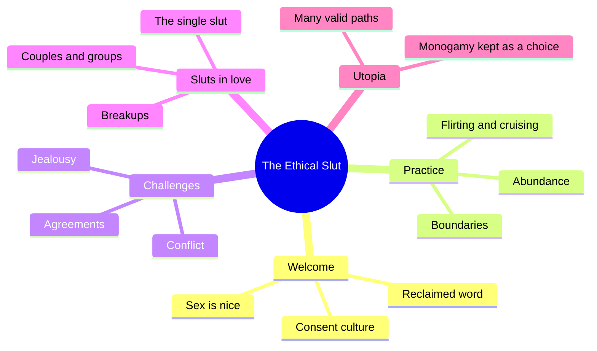
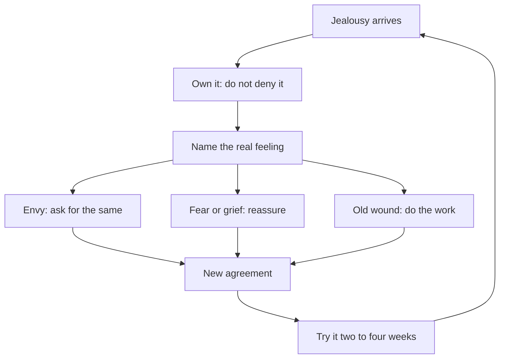
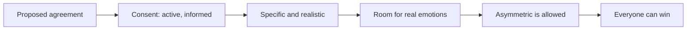

# 🧬 MSX.47 — The Ethical Slut — Easton & Hardy (2017)
### Knowledge Entry — Distill

Dossie Easton and Janet Hardy wrote this practical guide to open relationships. It first appeared in 1997 and reached its third edition in 2017 from Ten Speed Press. It sits beside their two craft books on this shelf, MSX.14 and MSX.15.

## TABLE OF CONTENTS
- [Core Thesis](#1-core-thesis)
- [Mind Models](#2-mind-models)
- [Framework](#3-framework--structure)
- [Key Concepts](#4-key-concepts)
- [Heuristics](#5-heuristics--decision-rules)
- [Invariants](#6-invariants)
- [Pitfalls](#7-pitfalls--myths)
- [Application](#8-application)
- [Cross-References](#9-cross-references)
- [Provenance](#10-provenance--confidence)

---

## 1 · CORE THESIS

An ethical slut is a person of any gender who treats sex as good, and who keeps consent, honesty, and self-ownership as the rules. Jealousy is feeling to be worked through, not a verdict on the relationship. Agreements, made in good faith, replace inherited monogamy.

---

## 2 · MIND MODELS

**Diagram 1 — the whole argument.**
Caption: *four parts of the book run from belief, through skills, through trouble, to the shapes love takes.*

**Diagram 2 — the central mechanism (working through jealousy).**
Caption: *the path runs from feeling, to naming, to the real need underneath, to a new agreement, and it loops because jealousy returns.*

**Diagram 3 — the agreement test.**
Caption: *a good agreement passes five checks, and a loophole or a pressured yes fails the first one.*

---

## 3 · FRAMEWORK / STRUCTURE

The book has four parts and a conclusion, plus exercises and a glossary.

| Part | What it does |
|---|---|
| One: Welcome (chs. 1-7, pp. 1-72) | Defines the word, answers myths, states the beliefs, builds a culture of consent |
| Two: The Practice of Sluthood (chs. 8-14, pp. 75-131) | Abundance, skills, boundaries, flirting, safer sex, and raising children |
| Three: Navigating Challenges (chs. 15-18, pp. 135-199) | Jealousy, conflict, agreements, opening an existing relationship |
| Four: Sluts in Love (chs. 19-24, pp. 201-290) | Connection, couples and groups, the single slut, breakups, pleasure, public and group sex |
| Conclusion: A Slut Utopia (pp. 292-295) | The authors' wish for a world with enough love for everyone |

---

## 4 · KEY CONCEPTS

| Concept | What it is | Why it matters |
|---|---|---|
| **Reclaimed "slut"** | A person of any gender who celebrates sexuality because sex is nice (ch. 1, p. 2) | The authors point at the double standard: a "stud" is praised, a "slut" is shamed |
| **Ethical** | Consent, honesty, and awareness of how choices land on others (ch. 3, pp. 23-24) | Sex without consent is not ethical, "period" |
| **Sex is whatever the people engaging in it think it is** | A flexible definition of sex (ch. 3, p. 25) | It lets partners write agreements about what counts |
| **Denial versus fulfillment** | Puritan values breed self-loathing; free pleasure heals (ch. 3, pp. 25-26) | The authors call pleasure "a complete and worthwhile goal in and of itself" |
| **You are already whole** | The fundamental sexual unit is one person (ch. 3, pp. 27-28) | Locus of control sits inside the self |
| **Starvation economy** | The belief that love is a fixed pie (ch. 3, p. 28) | The authors split it from real limits such as time |
| **Consent culture** | Community response to violations without pathologizing, splitting, truth-seeking, or blaming (ch. 6, pp. 54-57) | The authors name these four as strategies that fail |
| **Jealousy as umbrella** | An umbrella word for many feelings (ch. 15, p. 138) | The authors define it as projection of an uncomfortable feeling onto a partner (p. 139) |
| **Agreements** | Negotiated, specific, revisable, not always equal (ch. 17, pp. 172-178) | The purpose is that "everybody can win" (p. 178) |
| **Positive agreements** | "Let's have a special date" beats "do not kiss her" (ch. 17, p. 177) | Restrictive rules mostly guard against pain and fit only as a bridge |

---

## 5 · HEURISTICS & DECISION RULES

| Situation | Do this | Not this |
|---|---|---|
| A character feels jealous | Name the feeling under it: envy, fear, grief, old wound | Write jealousy as proof the relationship is wrong |
| A character breaks an agreement on a technicality | Show the other person feeling cheated by the loophole | Write the loophole as clever and victorious |
| Two partners want different things | Write an asymmetric agreement that both can live with | Force a symmetric rule |
| A "no" is heard as an invitation | Show it as a trained cultural script, then break it | Write it as natural male pushiness |
| A conflict erupts | Have each person state feelings with "I" statements, then brainstorm | Have them trace whose fault it was |
| A character is a trauma survivor | Write collaboration on safety: stop, recover, resume | Write the fear as unreasonable |
| A relationship ends | Let it end for several reasons, not one (ch. 15, p. 138) | Blame openness for every ending |

---

## 6 · INVARIANTS

1. Sex without consent is not ethical (ch. 3, p. 24).
2. Consent is active collaboration. Pressure and ignorance void it (ch. 17, p. 174).
3. A person controls only himself: his reactions, desires, and behaviors (ch. 3, p. 27).
4. Jealousy is survivable. Feeling it is the first lesson (ch. 15, p. 143).
5. No set of agreements covers every contingency (ch. 17, p. 174).
6. Time is a real limit. Love is not (ch. 3, p. 28).
7. Monogamy stays a valid choice for those who truly choose it (conclusion, p. 293).

---

## 7 · PITFALLS / MYTHS

- Reading the book as a dating manual. It describes a practice, and the authors say to "take what you want and leave the rest" (ch. 1, p. 3).
- Assuming openness avoids intimacy. The authors say it often reduces pressure on the primary bond (ch. 3, p. 29).
- Trying to pre-write rules for every case. The authors favor agreements made by hindsight (ch. 17, p. 173).
- Treating jealousy as a crime or a disease (ch. 15, p. 143).
- Believing the practice is tidy. Dossie's own story ends with no resolution (ch. 15, pp. 136-138).
- Treating the data as research. The book is a practitioners' guide built on the authors' work and stories. It is advocacy by sex educators, with anecdotes, not a controlled study.

---

## 8 · APPLICATION

*Proposed for the ORANGE work, not ruled.*

- **Spine level:** L5.
- **12-layer character stack:** L3 SOCIAL (primary, agreement style); L5 WOUND (primary, jealousy as mask); L9 EROS (primary, consent as a posture); L4 WILL (supporting, locus of control); L6 DRIVE (supporting, abundance or scarcity); L1 CORE (contextual, pleasure as a value).
- **plot_systems:** renegotiation is a plot engine. A character proposes a rule, a partner accepts under pressure, a scene breaks it, and a new agreement follows.
- **Setting:** a community with a consent-culture protocol, such as a club or a house, can carry its own rules, its own violations, and its own repair rituals.

This book gives the ORANGE character system the relationship half that MSX.14 and MSX.15 leave open. Those two cover roles inside a scene. This one covers the arrangements around the scene: who agreed to what, who is hurting, and what changes next.

The strongest use is the jealousy ladder. A character feels jealousy, names it, finds fear or envy or an old wound, and acts. Each step is a different scene. Writers get a layered emotion with a mapped exit, instead of "he got jealous."

Proposed use: give each partner a different agreement style, and make the friction between styles the story.

---

## 9 · CROSS-REFERENCES

| Related entry | Relation |
|---|---|
| [[🧬 MSX.14 — The New Bottoming Book — Easton & Hardy (2001)]] | Same authors, scene craft for the receptive partner |
| [[🧬 MSX.15 — The New Topping Book — Easton & Hardy (2003)]] | Same authors, scene craft for the active partner |
| [[🧬 MSX.17 — Mating in Captivity — Perel (2006)]] | Perel studies desire inside long monogamy. This book studies desire in many arrangements |
| [[🧬 MSX.22 — The Ultimate Guide to Kink — Taormino (2012)]] | Both books treat negotiation as the base of kink and open practice |

---

## 10 · PROVENANCE & CONFIDENCE

Full text by pdftotext, 324 pdf pages; book page = pdf page minus 10. Copyright page confirms Janet W. Hardy and Dossie Easton, *The Ethical Slut*, 3rd edition, Ten Speed Press, 2017. Dossie Easton coined "ethical slut" in 1995 (ch. 4, p. 31). Janet Hardy appeared as Catherine A. Liszt in the first edition (ch. 1, p. 3).

Read in full: ch. 1 opening; ch. 3 (pp. 23-30); the consent chapter's closing sections (pp. 54-57); ch. 15 on jealousy (pp. 135-143, the diagnostic half); ch. 17 on agreements (pp. 172-178); the Conclusion (pp. 292-294). Skipped: chs. 2, 4, 5, 7 to 14, 16, 18 to 24, the glossary, and further reading. The second half of the jealousy chapter, on practical work, was not read.

Contested: no sampling issue, but the evidence is the authors' practice and friends' anecdotes. The book's claims about jealousy as projection are a therapist's theory, not a measured finding. Treat it as a craft source for character arrangement and feeling.

The `feeds:` keying is this distill's own synthesis. The book uses no layer vocabulary.

## META
- Template: BVX-LEARN-v4.0
- Source classification: full-text pdftotext, targeted read of six chapters, remainder skipped
- Created / Updated: 2026-10-04
