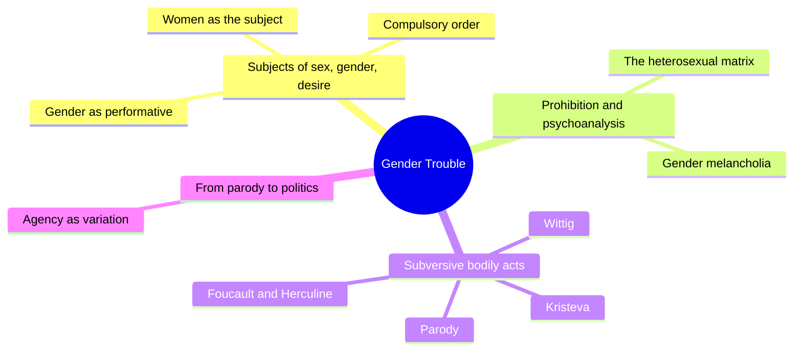
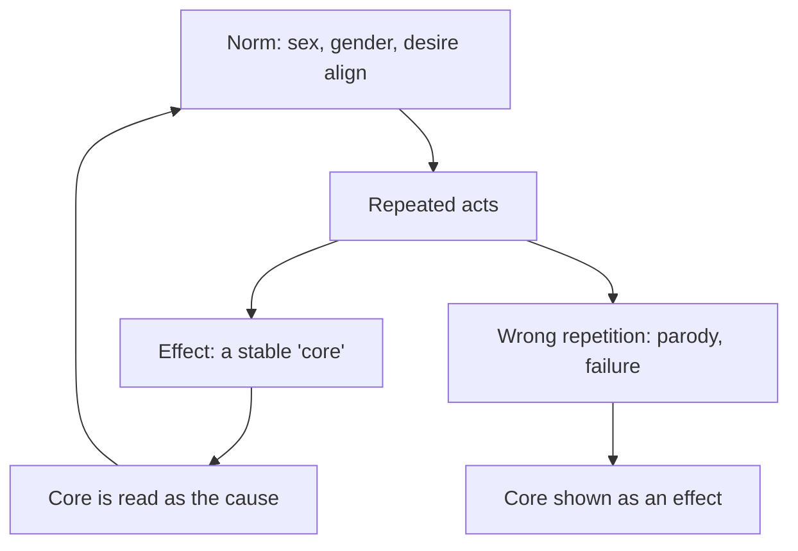
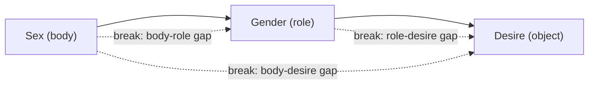
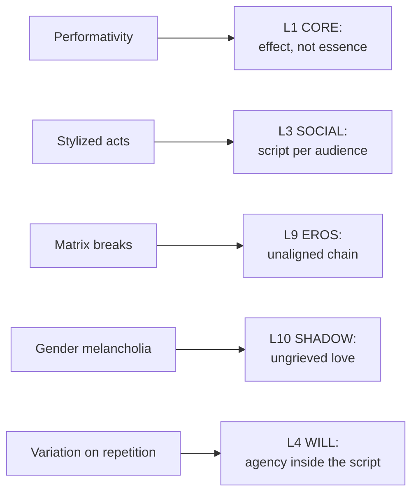

# 🧬 MSX.48 — Gender Trouble — Butler (1990)
### Knowledge Entry — Distill

Butler's 1990 book, reissued with a 1999 preface, argues that gender is performed. It is a founding text of queer theory.

> *Fantasy, not a how-to: what happens in these pages stays in them. Reader discretion advised.*

## TABLE OF CONTENTS
- [Core Thesis](#1-core-thesis)
- [Mind Models](#2-mind-models)
- [Framework](#3-framework--structure)
- [Key Concepts](#4-key-concepts)
- [Heuristics](#5-heuristics--decision-rules)
- [Invariants](#6-invariants)
- [Pitfalls](#7-pitfalls--myths)
- [Application](#8-application)
- [Cross-References](#9-cross-references)
- [Provenance](#10-provenance--confidence)

---

## 1 · CORE THESIS

Gender is not what a person is. It is what a person repeatedly does, under pressure from a system that treats sex, gender and desire as one chain. Identity is an effect of that repetition, and so repetition is where change happens.

---

## 2 · MIND MODELS

**Diagram 1 — the whole argument.**
Caption: *the book attacks the idea of a stable subject in three places: in feminism, in psychoanalysis, in the body.*

**Diagram 2 — the central mechanism (the performative loop).**
Caption: *the repeated act produces the inner "core" it is said to express, and a wrong repetition breaks the loop.*

**Diagram 3 — the matrix and its breaks.**
Caption: *the order links body, role and desire in a line, and each link can fail on its own.*

**Diagram 4 — mapped onto the Command's 12-layer stack.**
Caption: *Butler turns CORE into a repeated effect, gives SOCIAL a script, and gives WILL a method.*

---

## 3 · FRAMEWORK / STRUCTURE

A 1999 preface, a 1990 preface, three chapters and a conclusion.

| Part | What it does |
|---|---|
| Ch. 1, Subjects of Sex/Gender/Desire (p. 3-44) | Questions "women" as the subject of feminism. Shows the sex/gender split cannot hold. Defines gender as performative |
| Ch. 2, Prohibition, Psychoanalysis and the Heterosexual Matrix (p. 45-100) | Reads structuralism, Lacan, Riviere and Freud. The incest taboo and the taboo on homosexuality form gender |
| Ch. 3, Subversive Bodily Acts (p. 101-180) | Kristeva, Foucault on Herculine Barbin, Wittig, and a theory of bodily inscription and parody |
| Conclusion, From Parody to Politics (p. 181-190) | Agency lives in variation of repetition |

---

## 4 · KEY CONCEPTS

| Concept | What it is | Why it matters |
|---|---|---|
| **Sex/gender/desire order** | The assumed chain: a sexed body, its gender, its desire for the opposite (Ch. 1 ii, p. 9) | The rest of the book breaks this chain |
| **Heterosexual matrix** | The grid of intelligibility that makes bodies, genders and desires readable (Ch. 1, p. 9-10; preface xxviii) | A person outside it reads as unintelligible, not as wrong |
| **Sex is already gender** | "Natural sex" is itself produced as prior to culture (Ch. 1 ii, p. 11) | The sex/gender split fails because sex is not a raw base |
| **Performativity** | Gender constitutes the identity it is said to express (Ch. 1 v, p. 33) | It is "a doing, though not a doing by a subject who might be said to preexist the deed" |
| **Metaphysics of substance** | The habit of treating a person as a noun with attributes (p. 31-32) | It makes dissonant traits look accidental |
| **Genealogy** | A critique that traces categories to institutions, not origins (preface xxix) | It turns "inner truth" into a political stake |
| **Gender melancholia** | A prohibited love is taken in as an identification (Ch. 2 iii, p. 78-80) | A masculinity can be made from a refused same-sex love |
| **Masquerade** | Joan Riviere's case: a woman performs femininity to avert reprisal (Ch. 2 ii, p. 55-73) | Role is a defense, so it can be worn on purpose |
| **Herculine Barbin** | Foucault's nineteenth-century memoirist, a body that disorders the binary (Ch. 3 ii, p. 119-140) | Butler calls the case "the sexual impossibility of an identity" (p. 31) |
| **Parody** | Repetition that shows the "original" is a copy (Ch. 3 iv, p. 186-187) | Drag turns the script into a visible object |
| **Agency as variation** | Agency is "a variation on that repetition" (Conclusion, p. 185) | Construction is "the necessary scene of agency" (p. 187) |

---

## 5 · HEURISTICS & DECISION RULES

| Situation | Do this | Not this |
|---|---|---|
| Writing a character's gender | Show it as acts he repeats for an audience | State it as an inner fact the narration reports |
| A scene where the script slips | Let one wrong repetition expose the script to the others | Make the slip a confession of "true self" |
| A character whose body, role and desire do not line up | Treat each gap as its own gap, with its own cost | Fold the gaps into one label |
| A harsh, hyper-masculine character | Ask what he lost and took in (melancholia) | Write cruelty as mere nature |
| A drag, camp or costume scene | Let the performance show that the "real" is also staged (p. 186) | Write it as only a joke or only a disguise |
| A character's resistance | Build it from repeating the norm differently | Build it from a clean exit outside the norm |
| A world that marks bodies as polluting | Name the taboo that draws the line (p. 166-167) | Treat disgust as natural |

---

## 6 · INVARIANTS

1. Gender is made by repeated acts, not by an inner substance (p. 33).
2. "Sex" is produced as prior to culture by the same apparatus it is said to precede (p. 11).
3. Identity categories are effects of institutions, practices and discourses (preface xxix).
4. Agency is possible only inside repetition (p. 185).
5. Construction is not opposed to agency (p. 187).
6. A group that defines itself by exclusion depends on what it excludes (Ch. 3 iii, p. 162-163).

---

## 7 · PITFALLS / MYTHS

- Butler says gender is performed under constraint, not freely picked like clothes.
- The 1999 preface says the book was misread as voluntarism. A reader should read the Conclusion, not a slogan.
- Butler reads Foucault's Herculine Barbin as suspect: she says his use of the case is "suspect" (p. 32).
- The book is written for feminist theory and philosophy. It is not a manual for characters.
- Drag is not always subversive. Butler says parody can also serve "a politics of despair" (p. 186).
- A character built from "gender is a performance" can read as hollow. The theory says the performance is compelled, so the stakes stay real.
- The text is dense and abstract. This distill states its arguments in plain terms, and the quotes carry the exact claims.

---

## 8 · APPLICATION

*Proposed, not ruled.*

- **Spine level:** L5.
- **12-layer character stack:** L1 CORE (primary: identity as a repeated effect); L3 SOCIAL (primary: the script he repeats for each audience); L9 EROS (primary: body, role and desire as separate links); L10 SHADOW (supporting: the love he took inside); L4 WILL (supporting: resistance by variation); L2 VITAL (contextual: bodily taboo).
- **plot_systems:** a "slip" scene. One wrong repetition shows the script to the room.
- **Setting:** DCUS can carry a visible script for each role: the athlete, the pastor's son, the quiet one. A scene can show who is allowed to vary it.

For OXO, Butler gives CORE a method that does not need a secret. A character does not hide a self. He performs a pattern so well that the pattern becomes his face. The story's pressure then comes from where the pattern cracks. Her melancholia chapter also gives SHADOW a concrete form: a boy who refuses a love can become the man who copies the person he refused. The book is abstract, so its best use is as a check. For each scene, ask which act the character repeats, for whom, and what a wrong repetition would cost.

---

## 9 · CROSS-REFERENCES

| Related entry | Relation |
|---|---|
| [[🧬 MSX.36 — The History of Sexuality — Foucault (1978)]] | Butler uses Foucault's genealogy and his Herculine Barbin, and she turns his critique on sex itself (p. 31-33) |
| [[🧬 MSX.44 — Between Men — Sedgwick (1985)]] | Sedgwick describes the male line. Butler describes the repetition that keeps it |
| [[🧬 MSX.52 — Female Masculinity — Halberstam (1998)]] | Halberstam takes performance theory to masculinity without men |
| [[🧬 MSX.56 — Coming Out — Weeks (1977)]] | Weeks gives the history of the identity categories Butler treats as effects |

---

## 10 · PROVENANCE & CONFIDENCE

Full text, pdftotext extraction, 256 PDF pages. Title page: Judith Butler, *Gender Trouble: Feminism and the Subversion of Identity*, Routledge, 1999 edition, copyright 1990 and 1999. The 1999 edition adds a new preface. Printed page equals PDF page minus 35 in the body. Preface cites use roman numerals.

Read: the 1999 preface opening, the 1990 preface in full, Ch. 1 sections i to ii and v to vi (the performative passage, p. 31-34), Ch. 2 on Freud and melancholia (p. 77-80), Ch. 3 section iii closing and section iv opening (p. 162-167), and the Conclusion (p. 184-187).

Skipped: Ch. 1 iii and iv, Ch. 2 on Lacan and Riviere in detail, Ch. 2 iv and v, Ch. 3 on Kristeva, Wittig and Foucault in full, the rest of the Conclusion and the notes. The `feeds:` keying is this distill's own work. Butler uses no 12-layer vocabulary.

## META
- Template: BVX-LEARN-v4.0
- Source classification: full-text pdftotext extraction, targeted read of the prefaces, Ch. 1, the melancholia pages, Ch. 3 iv and the Conclusion
- Created / Updated: 2026-10-04
