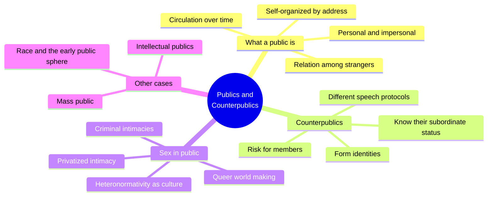
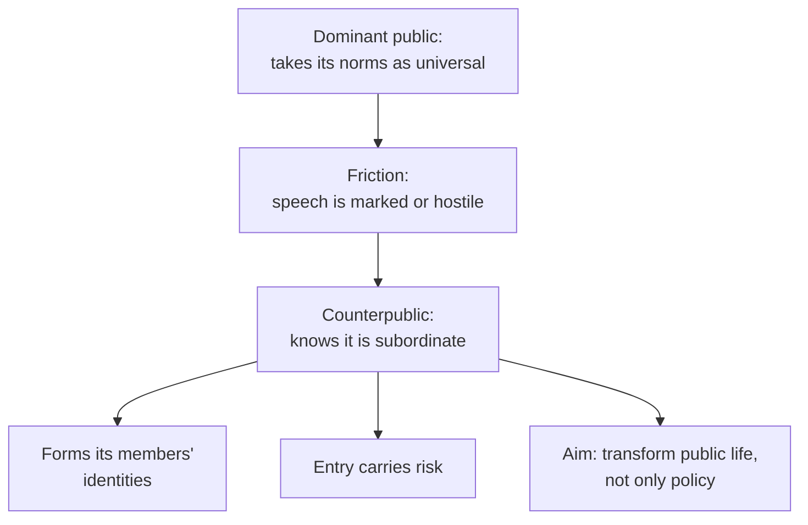
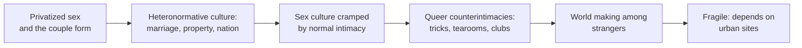
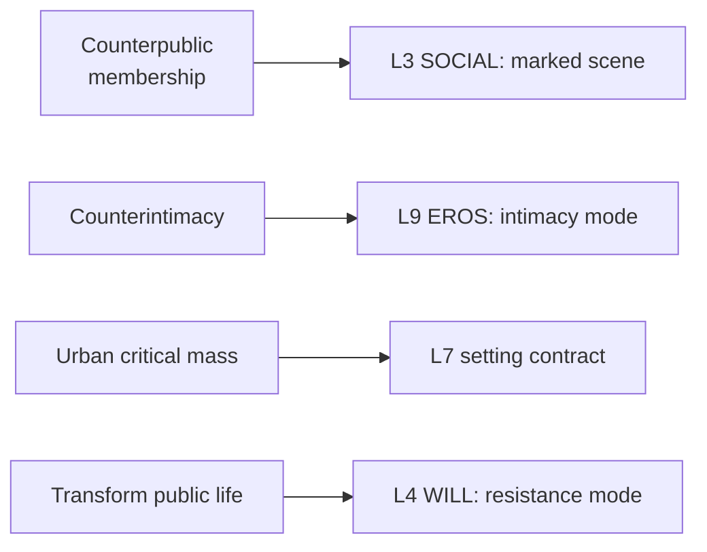

# 🧬 MSX.49 — Publics and Counterpublics — Warner (2002)
### Knowledge Entry — Distill

Fantasy, not a how-to: what happens in these pages stays in them. Reader discretion advised.

Michael Warner's 2002 book asks what a "public" is and who counts as a "counter" one. Chapter 5, "Sex in Public," written with Lauren Berlant, turns the theory onto queer life and gives this shelf its core argument about intimacy among strangers.

## TABLE OF CONTENTS
- [Core Thesis](#1-core-thesis)
- [Mind Models](#2-mind-models)
- [Framework](#3-framework--structure)
- [Key Concepts](#4-key-concepts)
- [Heuristics](#5-heuristics--decision-rules)
- [Invariants](#6-invariants)
- [Pitfalls](#7-pitfalls--myths)
- [Application](#8-application)
- [Cross-References](#9-cross-references)
- [Provenance](#10-provenance--confidence)

---

## 1 · CORE THESIS

A public is a relation among strangers, made real by being addressed. A counterpublic is one that knows its place is subordinate and tries to build a different world of strangers. Queer culture is its best example.

---

## 2 · MIND MODELS

**Diagram 1 — the whole argument.**
Caption: *the book moves from the idea of a public, to the counter kind, to the queer case that shows why intimacy and publicness collide.*

**Diagram 2 — the central mechanism (how a counterpublic differs from a subgroup).**
Caption: *a counterpublic is not just a smaller public with a reform program; its friction with a dominant public shapes its speech and its members.*

**Diagram 3 — the sex-in-public argument.**
Caption: *the authors link private sex, the couple form, and the nation, then show queer culture building intimacy outside all three.*

**Diagram 4 — mapped onto the Command's 12-layer character stack.**
Caption: *the book hands SOCIAL a model of membership, EROS a model of intimacy outside the couple, and SETTING a place-based critical mass.*

---

## 3 · FRAMEWORK / STRUCTURE

| Essay | What it does |
|---|---|
| Introduction (pp. 7-20) | Asks "what is a public?" and treats it as a cultural form. |
| I. Public and Private (pp. 21-64) | Lays out the public/private split in its many senses. |
| II. Publics and Counterpublics (pp. 65-124) | Gives seven features of a public, then the counterpublic. |
| III. Styles of Intellectual Publics (pp. 125-158) | Treats the critic's public. |
| IV. Mass Public and Mass Subject (pp. 159-186) | Treats mass media and the mass subject. |
| V. Sex in Public (pp. 187-208), with Berlant | Argues for queer counterpublic intimacy. |
| VI-VIII (pp. 209-290) | Cover the nation-state, race in 1821 New York, and Whitman. |

---

## 4 · KEY CONCEPTS

| Concept | What it is | Why it matters |
|---|---|---|
| **A public is self-organized** | It exists by being addressed, not by place (Ch. 2, p. 73) | The audience is made by the speech. |
| **Relation among strangers** | A public includes people one cannot name in advance (p. 74) | Strangerhood is the medium, not a flaw. |
| **Personal and impersonal address** | Public speech is aimed at me and at strangers at once (p. 76) | A reader feels singled out and also one of many. |
| **Circulation** | A public needs time and repeated uptake (Ch. 2) | One post is a text; a public is its circulation. |
| **Counterpublic** | A public aware of its subordinate status (p. 119) | Friction with the dominant public marks its speech. |
| **Dominant public** | One that takes its norms for universal (p. 122) | It reads its own style as normal. |
| **Heteronormativity** | The web of acts, from taxes to wills, that treat the couple as normal (Ch. 5, p. 195) | It shows that "sexual" norms reach far past sex. |
| **Criminal intimacies** | Nonstandard intimacies that bear no tie to home, kin, or couple (p. 199) | They are real intimacy under another form. |
| **World making** | A project including more people than one can identify (p. 198) | Queer culture is a world, not a group. |
| **Critical mass** | Enough sex commerce to hold a queer street together (p. 204) | Place makes the world possible. |

---

## 5 · HEURISTICS & DECISION RULES

| Situation | Do this | Not this |
|---|---|---|
| Writing a subculture scene | Treat it as a public of strangers with its own protocols | Treat it as a circle of friends |
| Writing a character's first visit | Show risk at entry and a change in him after | Make joining free |
| Writing a casual encounter | Let it carry real knowledge and care (pp. 201-202) | Label it empty release |
| Writing a straight family scene | Show the institutions behind it: law, zoning, money | Treat the family as nature |
| Writing a crackdown | Hit the shops and bars that hold the world together (p. 204) | Hit only the "adult" business named in the law |
| Writing an activist | Show the choice between policy wins and changing public life | Treat the choice as obvious |

---

## 6 · INVARIANTS

1. **A public is made by address to strangers.** It cannot be a list of friends (Ch. 2, p. 74).
2. **A counterpublic knows its status.** That awareness shapes its speech (p. 119).
3. **Entry to a counterpublic forms the member.** It does not only express a prior identity (p. 121).
4. **Normal intimacy is a bundle of institutions.** Law, property, and the nation sit inside it (Ch. 5, pp. 195-196).
5. **Queer worlds rest on fragile sites.** They need place and critical mass (pp. 202-204).

---

## 7 · PITFALLS / MYTHS

- **Warner is writing theory, not history or data.** The queer-world claims rest on argument and examples, not on a survey.
- **Chapter 5 is political advocacy and says so.** The authors argue for a project ("We are trying to bring that world into being," p. 198), so treat the claims as a position.
- **Counterpublic is a narrow term.** Warner insists a subgroup with a reform program is not enough (p. 118).
- **Dated frame.** The sex-commerce zoning case is New York in the 1990s, and later critics dispute parts of the privacy argument.
- Reading "public" as "in the street." Warner means address and circulation (p. 73).
- Reading anti-normativity as anti-ordinary. The authors say they are not against norms or ordinariness (p. 197).

---

## 8 · APPLICATION

*Proposed, not ruled.*

- **Spine level:** L5.
- **12-layer character stack:** L3 SOCIAL (counterpublic membership, primary; stranger address, supporting); L9 EROS (intimacy mode, primary); L4 WILL (resistance, supporting); L7 (setting contract, contextual).
- **plot_systems:** an entry scene, with risk and change, gives a ready first-act beat for any OXO character who joins a scene.
- **Setting:** a school or town needs one fragile site where the subculture can gather, so a loss of that site is a clear stake.

The book gives the ORANGE work a way to write belonging without making it a family. A character can belong to a world of strangers, and the story can honor that as real intimacy. The idea also names a plot engine: a place that holds the world together can be zoned, raided, or closed. Chapter 5's claim that casual contact can carry care gives writers a counter to the "empty encounter" trope. A proposed variable, `counterintimacy_modes`, would list the non-couple intimacies a character keeps on L9.

---

## 9 · CROSS-REFERENCES

| Related entry | Relation |
|---|---|
| [[🧬 MSX.36 — The History of Sexuality — Foucault (1978)]] | Warner cites Foucault on privatized sex and calls counterpublics more than "reverse discourse" (Ch. 2, p. 121). |
| [[🧬 MSX.45 — Gay New York — Chauncey (1994)]] | Chauncey shows the historical world that Warner theorizes as a counterpublic. |
| [[🧬 MSX.61 — Times Square Red, Times Square Blue — Delany (1999)]] | Delany argues the same loss of contact sites in the same zoning fight. |

---

## 10 · PROVENANCE & CONFIDENCE

Full-text pdftotext extraction, 327 pdf pages. Front matter confirms Michael Warner, Publics and Counterpublics, Zone Books, New York, 2002 (Chapter 5 co-authored with Lauren Berlant). Printed page equals pdf page plus 3 to 4. Read: the Introduction (pp. 7-12), Ch. 2 pp. 73-82 and pp. 118-124 (counterpublic), Ch. 5 pp. 195-204.

Skipped: Ch. 1 in full, the middle of Ch. 2 (pp. 83-117, including the seven features of a public in detail), Ch. 3, 4, 6, 7, 8, and the notes. The seven-feature list is cited from the chapter's opening only. Confidence is high for the counterpublic and queer-world claims and medium for the full seven-part model. The `feeds:` keying is this distill's synthesis.

## META
- Template: BVX-LEARN-v4.0
- Source classification: full-text extraction, targeted read of introduction, Ch. 2, Ch. 5
- Created / Updated: 2026-10-04
