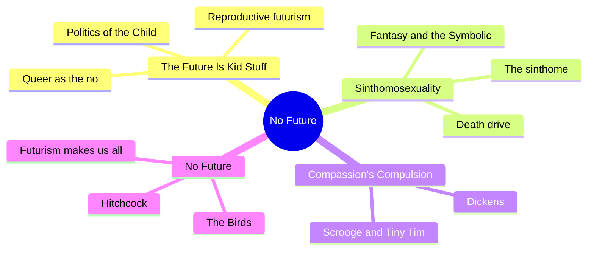
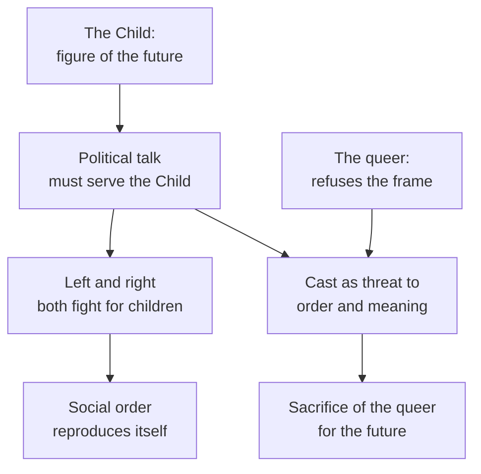
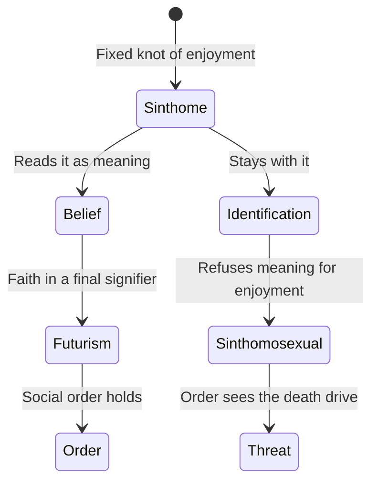
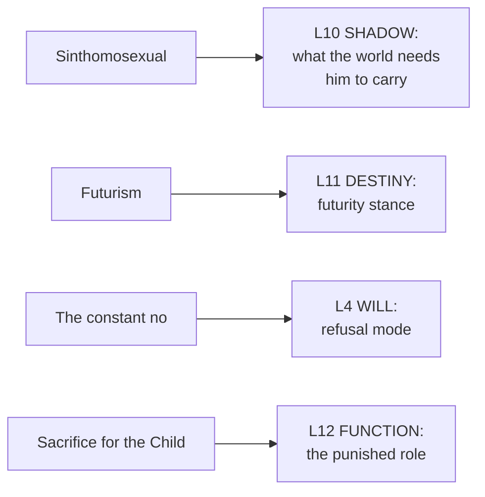

# 🧬 MSX.50 — No Future — Edelman (2004)
### Knowledge Entry — Distill

Lee Edelman's 2004 polemic argues that queerness names the place in politics that refuses the future. It sits on the shelf as the sharpest statement of queer negativity, and as a theory of why stories keep sacrificing the queer figure for the sake of a Child.

## TABLE OF CONTENTS
- [Core Thesis](#1-core-thesis)
- [Mind Models](#2-mind-models)
- [Framework](#3-framework--structure)
- [Key Concepts](#4-key-concepts)
- [Heuristics](#5-heuristics--decision-rules)
- [Invariants](#6-invariants)
- [Pitfalls](#7-pitfalls--myths)
- [Application](#8-application)
- [Cross-References](#9-cross-references)
- [Provenance](#10-provenance--confidence)

---

## 1 · CORE THESIS

Every political side promises a better future for the Child, so politics always serves "reproductive futurism." Queerness stands for the refusal of that promise, the death drive of the social order. Edelman argues queers should accept that role instead of begging for a place in the future.

---

## 2 · MIND MODELS

*Required. Minimum two diagrams, maximum five.*

**Diagram 1 — the whole argument.**
Caption: *four chapters build one claim, that the figure of the Child organizes politics and the figure of the queer is its sacrificed opposite.*

**Diagram 2 — the central mechanism (how the Child rules political talk).**
Caption: *the Child stands in for the future, the future promises meaning, and anyone who refuses the Child gets cast as a threat to meaning itself.*

**Diagram 3 — believing in the sinthome versus identifying with it.**
Caption: *the subject either reads its fixed enjoyment as pointing to a final meaning, or it stays with the enjoyment and drops the meaning.*

**Diagram 4 — mapped onto the Command's 12-layer character stack.**
Caption: *Edelman's figures land on the stack as a shadow role, a futurity stance, a will that refuses, and a plot role that the story punishes.*

---

## 3 · FRAMEWORK / STRUCTURE

Four chapters. Each reads a cultural text against the logic of the Child.

| Chapter | Governing move |
|---|---|
| 1. The Future Is Kid Stuff (pp. 1-31) | Uses a 1997 Clinton ad, anti-abortion posters, and the novel *Children of Men* to show how every politics aims at the Child. Sets out the death drive and the Lacanian frame |
| 2. Sinthomosexuality (pp. 33-66) | Defines the sinthomosexual. Reads fantasy as the place where the subject lives, and queerness as fantasy turned inside out. Includes a Tiny Tim reading (about p. 41) |
| 3. Compassion's Compulsion (pp. 67-110) | Reads Dickens. Scrooge's queerness and compassion's demand for the Child. Not read here |
| 4. No Future (pp. 111-153) | Reads Hitchcock, from *North by Northwest* to *The Birds*. Closes on futurism making "sinthomosexuals, not humans, of us all" (p. 152) |

Edelman's method runs in four moves:

1. Name the figure of the Child that shapes the political frame (pp. 2-3).
2. Show that the right sees queerness as a threat to that frame more clearly than the left does (pp. 13-16).
3. Use Lacan to say what the queer figure stands for: the drive that meaning cannot absorb (pp. 8-9, 34-37).
4. Refuse the offer of a better future as the price of admission (pp. 3-4, 28-31).

---

## 4 · KEY CONCEPTS

| Concept | What it is | Why it matters |
|---|---|---|
| **Reproductive futurism** | The belief that politics exists to secure a future shaped like a Child (pp. 2-3) | Edelman's name for the frame all sides share |
| **The Child** | A figure, "not to be confused with the lived experiences of any historical children" (p. 10) | Keeps the argument about a symbol, not about actual kids |
| **Sacralization of the Child** | The Child's value is treated as beyond question, so refusing it looks monstrous (pp. 2, 27) | Explains why the stakes feel absolute |
| **Queerness as negativity** | The queer names the side that refuses the future and the order of meaning (pp. 3-4) | The book's central ethical claim |
| **Death drive** | The pressure inside the social order that exceeds meaning and pulls against it (pp. 8-9) | What the queer figure is asked to carry |
| **The Symbolic** | Lacan's order of language, law, and meaning (p. 7) | The structure the Child is meant to protect |
| **Jouissance** | Enjoyment beyond meaning, the Real surplus (pp. 9, 15) | What futurism tries to keep out |
| **Sinthome** | The fixed knot that holds a subject together, with no meaning to exchange (pp. 34-37) | Gives the sinthomosexual its shape |
| **Sinthomosexual** | Edelman's coined figure: the queer who identifies with the sinthome and refuses futurism (pp. 37-38) | The character type of the book |
| **"Fuck the social order and the Child"** | A deliberate rhetorical refusal of the social contract (p. 29) | Shows the register Edelman chooses, not a program |
| **Fascism of the baby's face** | The authority the Child holds in any political program, of any color (pp. 150-151) | Extends the claim past the right wing |

---

## 5 · HEURISTICS & DECISION RULES

| Situation | Do this | Not this |
|---|---|---|
| Writing a plot that sacrifices a queer character | Notice what future the sacrifice serves and name it | Treat the death as tragic accident |
| Writing a politics inside a story | Ask who is invoked as "the children" and who pays for it | Give every side a clean, lovable cause |
| Writing a queer character who refuses hope | Let the refusal stand without a redemption beat | Redeem them with a baby, a marriage, or a lesson |
| Writing a character whose pleasure has no meaning | Let it stay senseless and fixed, as the sinthome does | Force it to mean something by the last chapter |
| Writing an antagonist who defends the future | Give them real conviction and a real cost | Make them stupid or cruel on purpose |
| Writing a character's shadow | Ask what their community needs them to carry | Assume the shadow is private |
| Writing a story that must end | Decide whether it ends in futurity or against it, and say so | Slide into futurity by default |

---

## 6 · INVARIANTS

1. **Political talk takes the Child as its horizon.** Left and right differ on the means and agree on the end (pp. 2, 13).
2. **The Child is a figure.** It is not any actual child (p. 10).
3. **The queer is cast as the Child's opposite.** Refusing futurity reads as refusing life (pp. 27, 148).
4. **Hope is always hope for an order.** It affirms a structure and screens out its limit (pp. 3-4).
5. **Meaning never closes.** The signifier defers, and the future is the promised end of that deferral (pp. 7-9).
6. **Enjoyment exceeds meaning.** The sinthome is the proof that no reading exhausts a subject (pp. 35-37).
7. **Futurism makes everyone a sinthomosexual in the end.** The figure it expels is its own drive (p. 152).

---

## 7 · PITFALLS / MYTHS

- Reading "the Child" as real children. Edelman says it is a figure (p. 10), and his target is the symbol, not minors.
- Reading "Fuck the social order" as advice. It is a rhetorical gesture inside an argument (pp. 28-29).
- Reading the book as a policy for queer politics. Edelman says negativity offers no program and no "good" (pp. 3-4).
- Treating Lacan's terms as common words. "Symbolic," "Real," "jouissance," and "sinthome" are technical. A writer who uses them loosely will misuse them.
- Assuming the book is representative of queer theory. It is one polemical position that the field contests. This distill reports the argument and not the debate.
- Treating the death drive as a wish to die. In Edelman it names an excess in the order of meaning (pp. 8-9).
- Assuming the examples carry the argument. His readings of ads, novels, and films are illustrations. A reader can reject a reading and keep the frame.

---

## 8 · APPLICATION

*Proposed, never ruled.*

- **Spine level:** L5.
- **12-layer character stack:** L10 SHADOW (primary, the carried excess); L11 DESTINY (primary, futurity stance); L4 WILL (supporting, refusal); L12 FUNCTION (supporting, the punished role); L6 DRIVE (contextual).
- **plot_systems:** the sacrifice-for-the-future pattern is a plot sorter. It shows which characters the story spends.
- **Setting:** an institution that runs on a Child (a school, a family firm, a cult) is a ready antagonist frame.

Edelman gives the ORANGE work a stance variable that the stack lacks. L11 now asks what a character must learn. A futurity stance asks something else: does this character invest in a future, refuse it, or live without one, and does the story let that stand? It gives writers a way to end a queer character's arc on refusal and still call the arc finished.

His second gift is a plot audit. A writer can check each plot for whom it sacrifices to a future. If the answer is always the queer figure, the plot has joined the machinery Edelman describes. Choosing otherwise is a craft decision, and the audit makes it visible.

The sinthomosexual is a character type, not a rule. A character who holds a fixed, senseless enjoyment and will not turn it into a lesson fits the ORANGE shelf's interest in desire that exceeds meaning. The writer keeps the choice to soften it, and the distill records the option.

---

## 9 · CROSS-REFERENCES

| Related entry | Relation |
|---|---|
| [[🧬 MSX.36 — The History of Sexuality — Foucault (1978)]] | Foucault shows how power makes sexual identities. Edelman asks what the made identity is asked to bear |
| [[🧬 MSX.46 — Deviations — Rubin (2011)]] | Rubin names the hierarchy and its panics. Edelman names the figure the hierarchy sacrifices |
| [[🧬 MSX.58 — The Straight State — Canaday (2009)]] | Canaday shows the state making the homosexual an "anticitizen," the legal form of Edelman's expelled figure |
| [[🧬 MSX.66 — The Culture of Queers — Dyer (2002)]] | Dyer's sad young man and vampire are earlier versions of the queer as figure of doom |
| [[🧬 PSY.55 — Pleasure Consuming Medicine — Race (2009)]] | Race argues for pleasure and practical ethics where Edelman argues for negativity |
| [[🧬 PSY.13 — Psychology of the Unconscious — Jung (1916)]] | A different psychoanalytic route to the shadow |

---

## 10 · PROVENANCE & CONFIDENCE

Full-text pdftotext extraction, about 199 pages, Duke University Press, Durham and London, 2004. The front matter confirms the author, title, subtitle, and 2004 copyright. The text is noisy OCR. Page numbers come from running heads and may be off by a page.

Read in full or near-full: the contents page; chapter 1 from its opening through p. 16, then the passage on Bernard Law and "Fuck the social order" (pp. 27-29); chapter 2's opening and its core definition of the sinthome and the sinthomosexual (pp. 33-38); a passage of chapter 2 on Baudrillard and a Tiny Tim reference (about pp. 41-63); the closing pages of chapter 4 (pp. 148-153).

Skipped: chapter 1 pp. 17-26 and the end past p. 29; most of chapter 2; all of chapter 3 (Dickens, Scrooge); most of chapter 4, including the Hitchcock readings of *North by Northwest* and the rest of *The Birds*; the notes. The chapter 3 summary rests on the contents page and passing references.

Contested: the book is one polemical position in queer theory. Its psychoanalytic base (Lacan) is itself disputed. This distill reports what the book argues.

The `feeds:` keying is this distill's own synthesis. The `futurity_stance` variable is proposed here and is not yet in the schema.

## META
- Template: BVX-LEARN-v4.0
- Source classification: full-text pdftotext extraction, targeted read of chapters 1, 2 and the close of chapter 4
- Created / Updated: 2026-10-04
