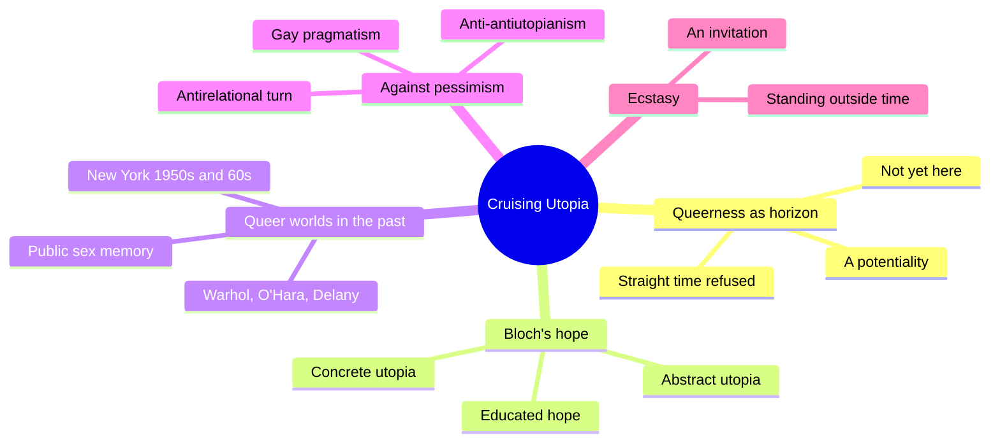
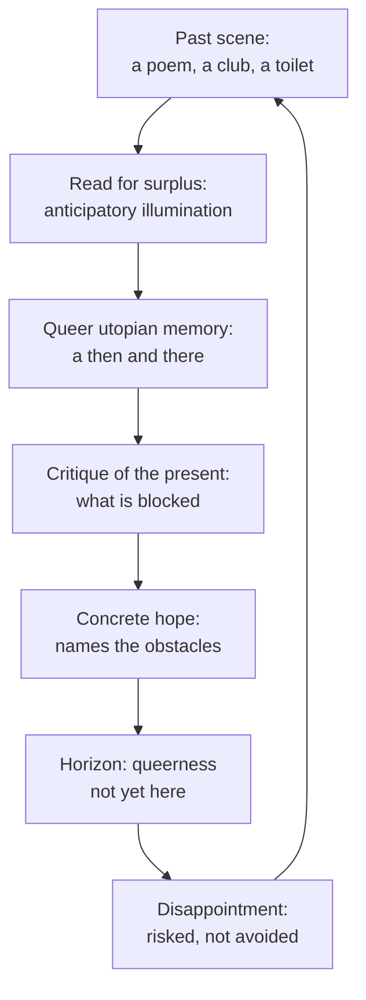
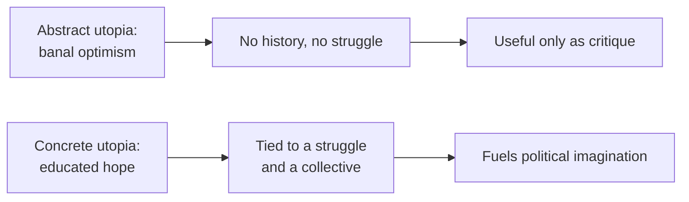

# 🧬 MSX.51 — Cruising Utopia — Muñoz (2009)
### Knowledge Entry — Distill

José Esteban Muñoz published this book of queer theory with NYU Press in 2009. The 10th Anniversary Edition (2019) is the copy on the shelf. It argues that queerness is a future still to be built and that hope is a method.

## TABLE OF CONTENTS
- [Core Thesis](#1-core-thesis)
- [Mind Models](#2-mind-models)
- [Framework](#3-framework--structure)
- [Key Concepts](#4-key-concepts)
- [Heuristics](#5-heuristics--decision-rules)
- [Invariants](#6-invariants)
- [Pitfalls](#7-pitfalls--myths)
- [Application](#8-application)
- [Cross-References](#9-cross-references)
- [Provenance](#10-provenance--confidence)

---

## 1 · CORE THESIS

Queerness is not yet here. It is a horizon, reached through acts of hope that read the past for traces of a better world. Straight time says the present is all there is. Muñoz answers with concrete utopia: hope that names its obstacles.

---

## 2 · MIND MODELS

**Diagram 1 — the whole argument.**
Caption: *the book reads art and sex from the past to build a critique of the present, then turns that critique into an invitation.*

**Diagram 2 — the central mechanism (how a past scene becomes a political tool).**
Caption: *a remembered queer scene is read for its surplus, the surplus criticizes the present, and the critique opens a future that is not yet here.*

**Diagram 3 — two kinds of utopia.**
Caption: *Muñoz keeps only the concrete kind, which has a history and a crowd behind it.*

---

## 3 · FRAMEWORK / STRUCTURE

The book has an introduction, nine chapters, a conclusion, and two essays added in 2019. Muñoz moves by association between a past scene and the present, not by case study (pdf p. 27).

| Part | Governing move |
|---|---|
| Foreword (2019) | Three editors frame Muñoz's death and say "hope is work" (pdf pp. 12-13) |
| Introduction: Feeling Utopia (pdf pp. 25-43) | Introduces Bloch, concrete versus abstract utopia, and the "wow" of Warhol and O'Hara |
| 1. Queerness as Horizon (pdf pp. 44-58) | Sets the thesis against gay marriage politics and defines straight time |
| 2. Ghosts of Public Sex (pdf pp. 59-75) | Reads John Giorno and Douglas Crimp on public sex as utopian memory |
| 3. The Future Is in the Present (pdf pp. 76-92) | Reads Samuel Delany's memoir of the Christopher Street trucks as a sexual avant-garde |
| 4-9. Aviance, Baraka, punk stages, Ray Johnson, Queer art, Fred Herko (pdf pp. 93-228) | Gesture, ephemera, and utopian feeling in performance and visual art |
| Conclusion: Take Ecstasy with Me (pdf pp. 229-234) | Ecstasy as standing outside straight time |
| Two added essays (2019) | Gary Fisher with Eve Sedgwick; "Hope in the Face of Heartbreak" |

---

## 4 · KEY CONCEPTS

| Concept | What it is | Why it matters |
|---|---|---|
| **Queerness as horizon** | Queerness "is not yet here"; it is a potentiality (ch. 1, pdf p. 47) | It keeps queerness from hardening into a present-tense identity |
| **Straight time** | A self-naturalizing time that says the here and now is all there is (ch. 1, pdf p. 47) | Its only future is reproduction; queers live outside it |
| **Concrete utopia** | Bloch's hope tied to history and struggle, a collective's "educated hope" (intro, pdf p. 27) | It separates real hope from "banal optimism" |
| **Anticipatory illumination** | A surplus of feeling and meaning in art that points toward the not-yet (intro, pdf p. 27) | It gives a method for reading past objects as futures |
| **No-longer-conscious / not-yet-conscious** | Bloch's terms for what the past still does and what the future has not yet become (ch. 1, pdf p. 44; intro, pdf p. 27) | Muñoz can treat a 1971 manifesto as live |
| **Queer utopian memory** | Retelling past public-sex culture as a force for the present (ch. 2, pdf pp. 59-62) | It reads erotic memory as political, not as nostalgia |
| **Anti-antirelationality** | Muñoz's reply to Bersani and Edelman, who refuse relational hope (intro, pdf p. 39) | Hope can be hard-won and still relational |
| **Cruising** | Not only cruising for sex but a political way of searching for potentialities (intro, pdf p. 43) | The book calls glamorizing cruising "simply boring" |
| **Ecstasy** | Ekstasis, "standing outside" straight time, a request to stand out of time together (conclusion, pdf pp. 230-231) | The ending offers an invitation, not a program |
| **Hope as a method** | A critical affect that can be disappointed and is still needed (intro, pdf p. 34) | Disappointment is part of the practice |

---

## 5 · HEURISTICS & DECISION RULES

| Situation | Do this | Not this |
|---|---|---|
| Writing a character's dream | Tie it to a struggle and a crowd | Write it as a free-floating wish |
| Writing a past sex scene a character remembers | Let the memory fuel a present refusal or invitation | Write it as nostalgia only |
| Writing a character's despair | Let disappointment sit beside hope in the same scene | Let despair cancel hope |
| Writing a "pragmatic" gay politics | Show what it leaves out: those without capital | Treat inclusion as the whole of freedom |
| Writing a club, bar, or toilet | Give the room a surplus: something it promises beyond its use | Write it as a backdrop |
| Writing an everyday object between lovers | Treat it as a signal of a world: a Coke, a shirt, a song | Treat it as a prop |

---

## 6 · INVARIANTS

1. Utopia criticizes the present before it pictures a future (ch. 2, pdf pp. 63-64).
2. Hope can be disappointed and is still necessary (intro, pdf p. 34).
3. Concrete utopia attaches to a historical struggle (intro, pdf p. 27).
4. Queerness is a potentiality, not a present identity (ch. 1, pdf p. 47).
5. A "we" can name what a collective could be, not only who it is (ch. 1, pdf p. 45).
6. Straight time is not the only time (conclusion, pdf p. 230).

---

## 7 · PITFALLS / MYTHS

- Reading the book as uncritical optimism. Muñoz's friends say he disliked that reading, and the foreword says hope is work (foreword, pdf p. 13).
- Reading "cruising" as sex only. Muñoz says the book's mode of cruising is "not only or even primarily" that (intro, pdf p. 43).
- Reading Muñoz as a historian. He says he follows "an associative mode" that leaps between a site and the present (intro, pdf p. 27).
- Treating the book as a sex study. It concerns art and memory. The sex scenes serve a philosophic argument.
- Reading its sources as clean. Muñoz admits Bloch was reportedly not progressive on gender and sexuality, and he chooses to use him anyway (intro, pdf p. 26).
- Treating the book as settled. Its method is contested; Bersani's and Edelman's antirelational readings remain a live rival, and Muñoz's treatment of them is a polemic, not a neutral review (intro, pdf p. 39).

---

## 8 · APPLICATION

*Proposed for the ORANGE work, not ruled.*

- **Spine level:** L5.
- **12-layer character stack:** L11 DESTINY (primary, the horizon); L8 IMPRINT (primary, utopian memory); L4 WILL (primary, the will that it be different); L10 SHADOW (supporting, disappointment); L3 SOCIAL (supporting, belonging in difference); L9 EROS (contextual, public sex as world-making).
- **plot_systems:** a recurring scene told and retold by a character is a plot engine. Each retelling changes what it asks of the present.
- **Setting:** a bar, a back room, or a club can carry a surplus: a room whose purpose is sex and whose effect is a social world.

The shelf has foundations of how sexual identity is made (MSX.36, MSX.43). Muñoz gives the other direction: how a character reaches toward a world that has not been made. For a gay or bi man in the OXO work, this is the DESTINY layer written as a taste, not a plan. He wants something he cannot yet name, and he finds fragments of it in a night, a song, a room.

Proposed use: give a character one remembered scene that he treats as proof the world can be different. Let the scene be explicit if the story is. Muñoz reads explicit scenes as carrying a political charge.

---

## 9 · CROSS-REFERENCES

| Related entry | Relation |
|---|---|
| [[🧬 MSX.36 — The History of Sexuality — Foucault (1978)]] | Muñoz resists Foucault as over-mined (intro, pdf p. 40). Reverse discourse is the nearest overlap |
| [[🧬 MSX.43 — One Hundred Years of Homosexuality — Halperin (1990)]] | Halperin shows the category is recent. Muñoz asks what a better category could be |
| [[🧬 MSX.33 — The Space of Sex — Waldrep (2021)]] | Both treat sex spaces as more than their use |
| [[🧬 MSX.20 — Sex on Premises Venues — Smith, Grierson & von Doussa (2010)]] | Muñoz reads the venues' cultural meaning. Smith et al. study the venues as operating spaces |

---

## 10 · PROVENANCE & CONFIDENCE

Full text by pdftotext, 304 pdf pages; printed page numbers did not extract, so citations use pdf pages. Title page and copyright confirm José Esteban Muñoz, *Cruising Utopia: The Then and There of Queer Futurity*, 10th Anniversary Edition, NYU Press, 2019; first published 2009. The edition adds a foreword and two essays.

Read in full: the introduction (pdf pp. 25-43); ch. 1's opening (pdf pp. 44-47); ch. 2 (pdf pp. 59-66); ch. 3's opening (pdf pp. 76-78); the conclusion (pdf pp. 229-234); the foreword's first pages. Skipped: ch. 3's rest, chs. 4 to 9, the two 2019 essays, the notes, and the bibliography. Chs. 4 to 9 carry Muñoz's art readings and are known only from the introduction's summary.

Contested: this is a polemical book of theory. Its reading of Bersani and Edelman is Muñoz's own, and its use of Bloch is selective by his own admission. Confidence is medium for that reason.

The `feeds:` keying is this distill's own synthesis. The book uses no layer vocabulary.

## META
- Template: BVX-LEARN-v4.0
- Source classification: full-text pdftotext, deep read on intro, ch. 1 to 2, conclusion; skim on the rest
- Created / Updated: 2026-10-04
