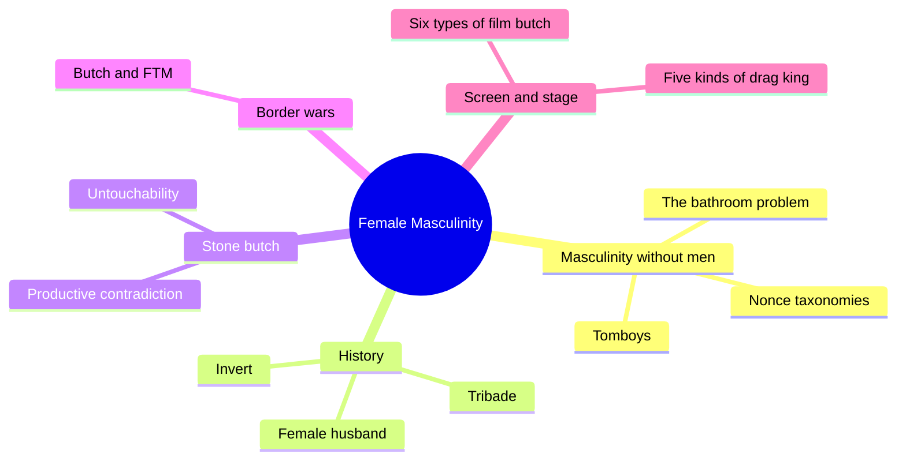
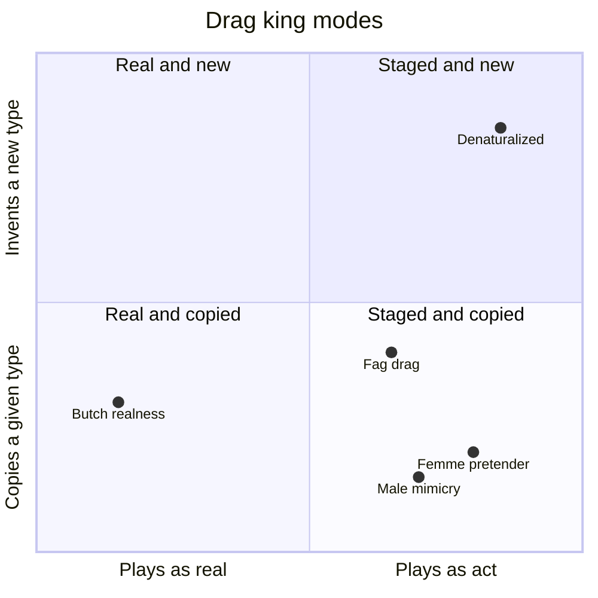
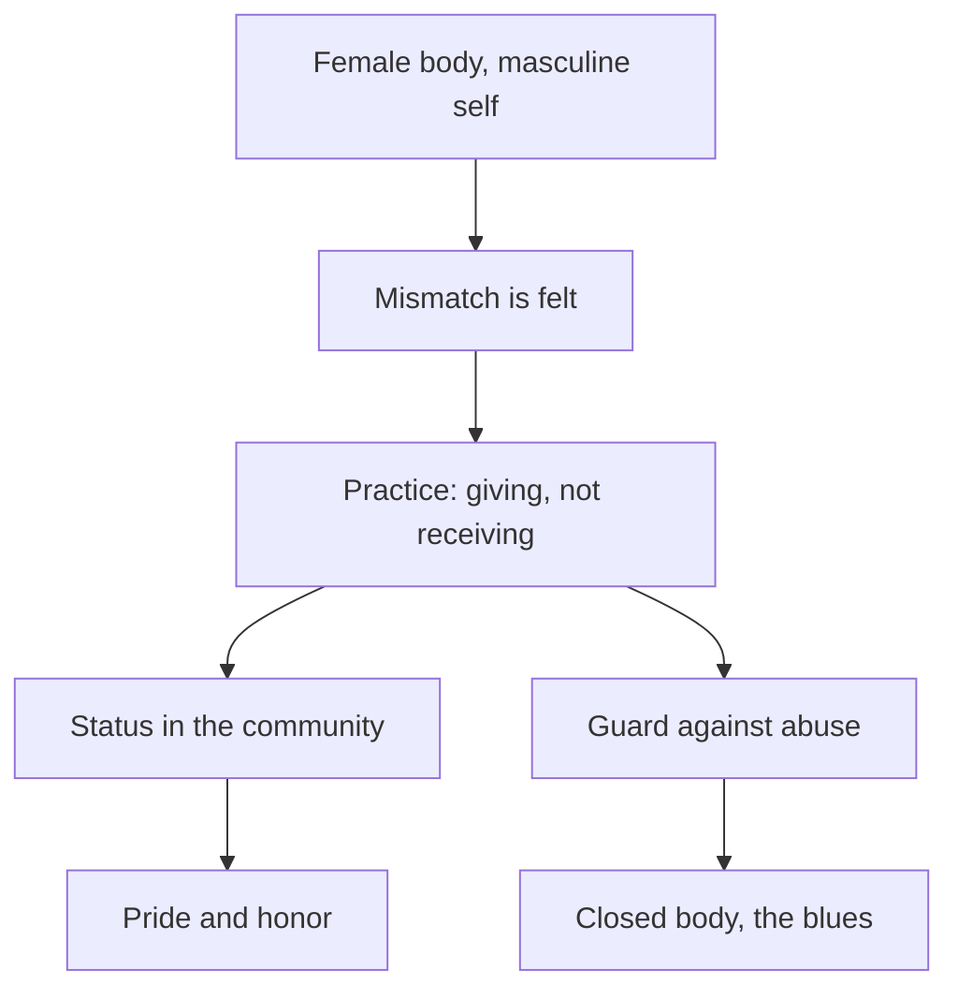
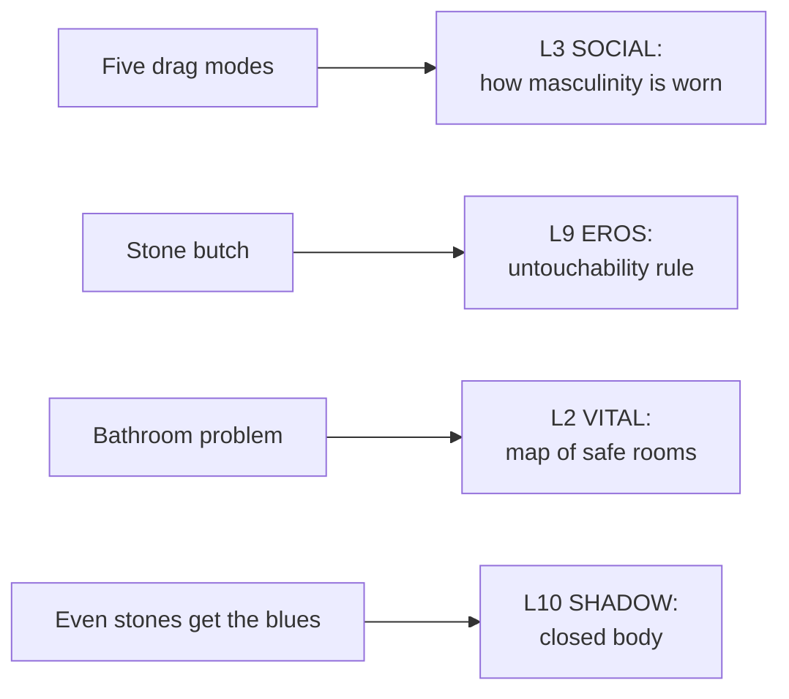

# 🧬 MSX.52 — Female Masculinity — Halberstam (1998)
### Knowledge Entry — Distill

Halberstam's 1998 book studies masculinity carried by female-born people. It argues that this masculinity shows how masculinity is built at all.

> *Fantasy, not a how-to: what happens in these pages stays in them. Reader discretion advised.*

## TABLE OF CONTENTS
- [Core Thesis](#1-core-thesis)
- [Mind Models](#2-mind-models)
- [Framework](#3-framework--structure)
- [Key Concepts](#4-key-concepts)
- [Heuristics](#5-heuristics--decision-rules)
- [Invariants](#6-invariants)
- [Pitfalls](#7-pitfalls--myths)
- [Application](#8-application)
- [Cross-References](#9-cross-references)
- [Provenance](#10-provenance--confidence)

---

## 1 · CORE THESIS

Masculinity is not the expression of a male body. Female masculinity shows how masculinity is made, because dominant masculinity casts it as the "rejected scraps" so male masculinity can look like the real thing.

---

## 2 · MIND MODELS

**Diagram 1 — the whole argument.**
Caption: *the book builds a taxonomy of masculinities from history, then from bars and screens.*

**Diagram 2 — the central mechanism (the drag-king taxonomy).**
Caption: *five modes sit on one axis: how far a performance is a real masculinity, and how far it is a visible act.*

**Diagram 3 — the stone butch as a system.**
Caption: *a mismatch between body and self becomes a stable practice, and the practice carries both pride and cost.*

**Diagram 4 — mapped onto the Command's 12-layer stack.**
Caption: *Halberstam hands SOCIAL a taxonomy, EROS a practice, and VITAL a daily map of rooms.*

---

## 3 · FRAMEWORK / STRUCTURE

Eight chapters, built from case to taxonomy.

| Part | What it does |
|---|---|
| Ch. 1, An Introduction to Female Masculinity (p. 1-44) | States the claim. Uses tomboys, the Bond film *Goldeneye*, the bathroom problem and "nonce taxonomies" |
| Ch. 2, Perverse Presentism (p. 45-74) | The androgyne, the tribade, the female husband. Reads the past without calling every case "lesbian" |
| Ch. 3, "A Writer of Misfits" (p. 75-110) | Radclyffe Hall and the discourse of inversion |
| Ch. 4, Lesbian Masculinity (p. 111-140) | The stone butch |
| Ch. 5, Transgender Butch (p. 141-174) | Butch and female-to-male borders, and a masculine continuum |
| Ch. 6, Looking Butch (p. 175-230) | Six types of butch on film |
| Ch. 7, Drag Kings (p. 231-266) | Five modes of drag-king performance |
| Ch. 8, Raging Bull (Dyke) (p. 267-278) | Boxing, normative masculinity and a personal close |

---

## 4 · KEY CONCEPTS

| Concept | What it is | Why it matters |
|---|---|---|
| **Masculinity without men** | Masculinity detached from the male body (Ch. 1, p. 1) | It lets a character own masculinity with no claim on maleness |
| **Dominant masculinity** | The tie of maleness to power, wealth and legitimacy (p. 2) | Halberstam says it needs minority masculinities to look real |
| **Legible where it leaves the body** | Masculinity shows as masculinity when it is not on the white male middle-class body (p. 2) | Class and race change what reads as too much or too little |
| **Tomboyism** | An extended childhood stage of female masculinity (p. 5-6) | It is tolerated until puberty, then corrected |
| **Nonce taxonomies** | Sedgwick's term for working categories that help for the moment (p. 8) | Halberstam builds new ones in place of fixing old labels |
| **The bathroom problem** | A gender-ambiguous person is policed as "not-woman" and then "not-man" (p. 21-22) | It makes gender binarism visible in daily life |
| **Perverse presentism** | A method that reads the past without projecting present labels (Ch. 2, p. 52) | A tribade or female husband is not a "pre-lesbian" |
| **Inversion** | Early twentieth-century medical term for gender-crossed same-sex desire (Ch. 3, p. 75) | Halberstam says models of inversion must be diversified |
| **Stone butch** | A butch who does not let a partner touch her sexually (Ch. 4, p. 120) | The role has been honored in 1950s bar culture and later ridiculed |
| **Butch-FTM border wars** | Conflict over the line between lesbian butchness and transsexual maleness (Ch. 5, p. 141) | It asks what makes one body allowed and another refused |
| **Five drag-king modes** | Butch realness, femme pretender, male mimicry, fag drag, denaturalized masculinity (Ch. 7, p. 246-253) | The modes differ in how they treat masculinity as real |
| **Masculine privilege lesson** | Torr's workshop: women learn to take up space, and then return to femininity (p. 251-252) | It shows male privilege, and it leaves masculinity tied to men |

---

## 5 · HEURISTICS & DECISION RULES

| Situation | Do this | Not this |
|---|---|---|
| A masculine female character | Give her a masculinity with its own history, class and race | Write her as a copy of a man |
| A tomboy in her teens | Show the year the permission ended, and who ended it | Treat tomboyism as a lasting shield |
| A character who needs a public restroom | Make the room a planned risk with an exit | Treat it as a minor inconvenience |
| A butch character with a no-touch rule | Let the rule carry pride, history and cost (p. 125-126) | Read it as dysfunction alone |
| A drag or costume scene | Pick one of the five modes and let the audience read it that way | Call it "drag" with no mode |
| A man who copies a gay male look | Name it as fag drag, with its clone aesthetic (p. 253) | Treat it as costume only |
| A character who passes some days and not others | Write identity as a process with several sites (p. 21) | Force a stable pass or fail |

---

## 6 · INVARIANTS

1. Masculinity does not reduce to the male body (p. 1).
2. Dominant masculinity depends on minority masculinities (p. 4).
3. Female masculinity is received as pathology by hetero-normative and homo-normative cultures alike (p. 9).
4. Categories from one period must not be projected on another (p. 52).
5. A performance can be a nonperformance as well: stone butchness refuses a body's assigned role (p. 126).
6. Gender is a rough match between bodies and subjectivities (p. 126).

---

## 7 · PITFALLS / MYTHS

- The book is about female masculinity. It does not give a theory of male-bodied gay men, so use it for contrast and for structure.
- The book is from 1998. Language on trans and butch identities has moved since, and some terms here read as dated.
- Halberstam describes a drag-king scene from 1996 and 1997 in three cities. It is a snapshot.
- Halberstam disputes Butler's reading of the stone butch (p. 126-127). The two books do not agree on every point.
- The book says the stone butch is "legible." It does not say every butch is a stone butch.
- The five drag-king categories overlap, and Halberstam says so. A performer can move among them (p. 253).
- Her treatment of Radclyffe Hall rests on letters and on partners' memories, so a character built from it is an interpretation.

---

## 8 · APPLICATION

*Proposed, not ruled.*

- **Spine level:** L5.
- **12-layer character stack:** L3 SOCIAL (primary: five modes of public masculinity); L1 CORE (primary: masculinity without a male claim); L9 EROS (primary: the untouchability practice); L10 SHADOW (supporting: the closed body); L2 VITAL (supporting: the room map); L7 ORIGIN (contextual: the year permission ended).
- **plot_systems:** a "mode swap" scene. A character who wears one mode at school wears another at night, and someone sees both.
- **Setting:** a DCUS bar, club or stage can host all five modes in one night.

Halberstam's use to the ORANGE work is indirect. The shelf's main subject is gay and bi men. But the book gives the 12 layers a list of ways to carry masculinity that do not rely on the male body. A male character can use the same list. He can wear butch realness, male mimicry, fag drag or a denaturalized mode. The stone butch gives EROS a practice with a rule and a reason. The bathroom problem gives VITAL a cheap, strong way to show a body under watch. The sentence to keep is the title of Ch. 4: even stone butches get the blues. A strong character can have pride and a closed place at once.

---

## 9 · CROSS-REFERENCES

| Related entry | Relation |
|---|---|
| [[🧬 MSX.48 — Gender Trouble — Butler (1990)]] | Halberstam builds on Butler's performativity and corrects it on the stone butch (p. 126-127) |
| [[🧬 MSX.44 — Between Men — Sedgwick (1985)]] | Halberstam takes "nonce taxonomies" from Sedgwick |
| [[🧬 MSX.36 — The History of Sexuality — Foucault (1978)]] | Halberstam borrows Foucault's method and his "reverse discourse" (Ch. 2, PDF p. 66) |
| [[🧬 MSX.56 — Coming Out — Weeks (1977)]] | Weeks gives the history of the inverts and the subcultures she cites |

---

## 10 · PROVENANCE & CONFIDENCE

Full text, pdftotext extraction, 345 PDF pages. Title page and imprint: Judith Halberstam, *Female Masculinity*, Duke University Press, 1998. Printed page equals PDF page minus 15 in the body.

Read: the preface opening, Ch. 1 in its first third plus the bathroom problem (p. 1-9, 20-22), the Ch. 1 chapter summary (p. 42-43), the opening of Ch. 2 (p. 51-52), the opening of Ch. 3, Ch. 4 on the stone butch (p. 124-127, 139), the opening of Ch. 5, and Ch. 7 on the drag-king modes (p. 246-253).

Skipped: the rest of Ch. 1, most of Ch. 2 and 3, the Ch. 4 critique and history of butch-femme, the body of Ch. 5, all of Ch. 6 (the six film types are taken from the chapter summary), the rest of Ch. 7, Ch. 8, the notes and filmography. The `feeds:` keying is this distill's own work. Halberstam uses no 12-layer vocabulary.

## META
- Template: BVX-LEARN-v4.0
- Source classification: full-text pdftotext extraction, targeted read of Ch. 1, 4 and 7, openings of Ch. 2, 3 and 5
- Created / Updated: 2026-10-04
