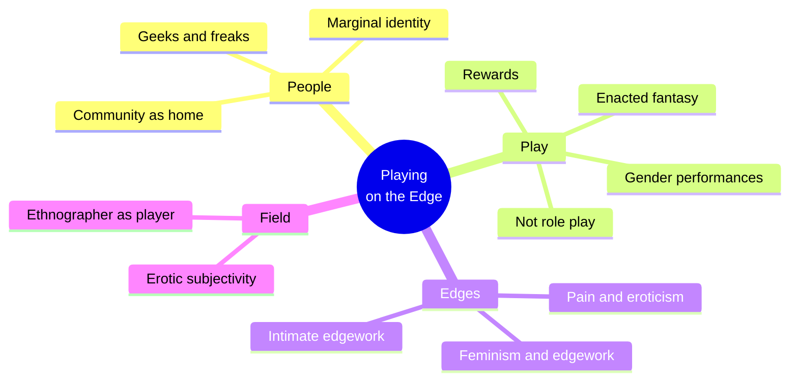
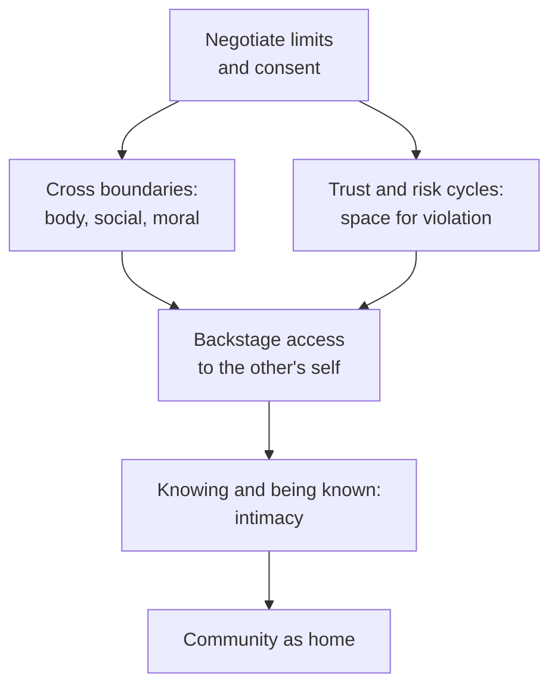
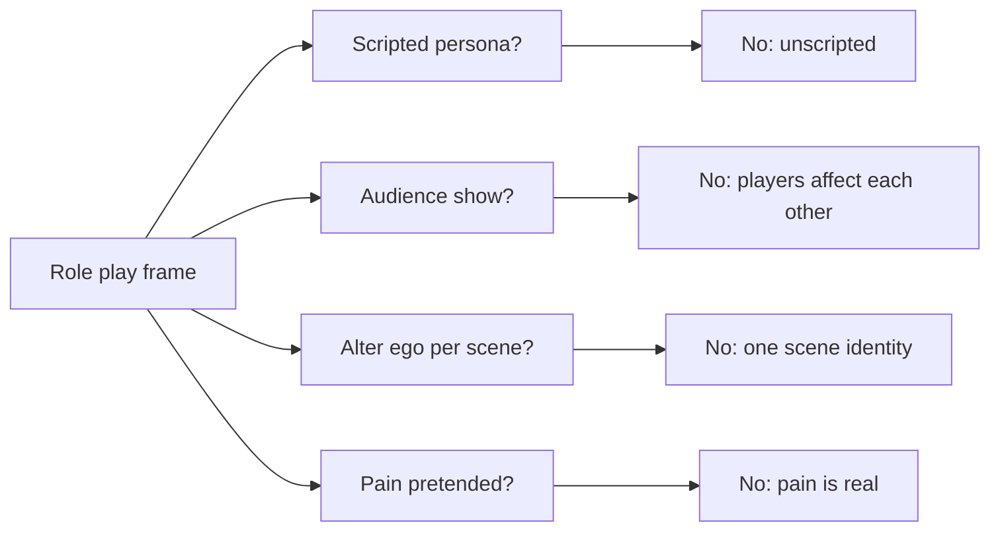
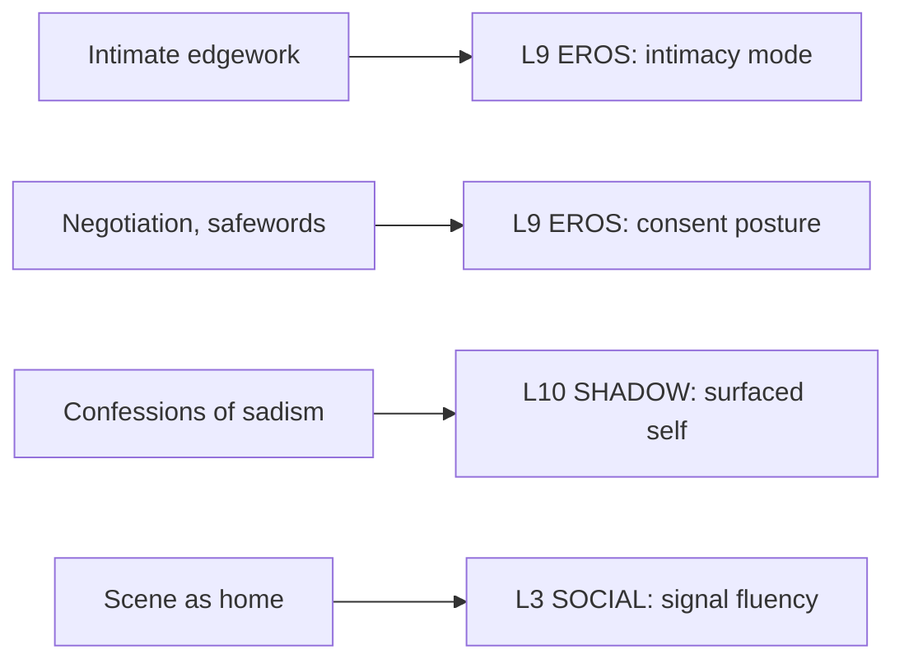

# 🧬 MSX.53 — Playing on the Edge — Newmahr (2011)
### Knowledge Entry — Distill

Fantasy, not a how-to: what happens in these pages stays in them. Reader discretion advised.

Staci Newmahr spent about four years inside a pansexual SM club scene in a northeastern American city she calls Caeden. Her book treats SM as "edgework," a form of risk-taking, and argues it builds intimacy more than it stages sex or role play.

## TABLE OF CONTENTS
- [Core Thesis](#1-core-thesis)
- [Mind Models](#2-mind-models)
- [Framework](#3-framework--structure)
- [Key Concepts](#4-key-concepts)
- [Heuristics](#5-heuristics--decision-rules)
- [Invariants](#6-invariants)
- [Pitfalls](#7-pitfalls--myths)
- [Application](#8-application)
- [Cross-References](#9-cross-references)
- [Provenance](#10-provenance--confidence)

---

## 1 · CORE THESIS

SM is not role play or alternative sex. It is "intimate edgework": two people cross boundaries and cycle through trust and risk, and that builds a sense of knowing and being known. The scene gives marginal people a home.

---

## 2 · MIND MODELS

**Diagram 1 — the whole argument.**
Caption: *the book runs from who the players are, to what play is, to the edges it works, and ends on intimacy.*

**Diagram 2 — the central mechanism (intimate edgework).**
Caption: *two axes, boundary crossing and trust-risk cycles, meet in the scene, and the meeting is what produces the sense of being known.*

**Diagram 3 — why SM is not simply role play.**
Caption: *the book tests SM against role play and improv, and it fails the test on four points: no script, no audience, one consistent identity, and real pain.*

**Diagram 4 — mapped onto the Command's 12-layer character stack.**
Caption: *the book gives EROS an intimacy route, SHADOW a surfaced self, and SOCIAL a community with its own capital.*

---

## 3 · FRAMEWORK / STRUCTURE

| Part | What it does |
|---|---|
| Introduction (pp. 1-20) | Sets the field: a pansexual scene in Caeden, with a short history of the U.S. SM community. |
| Part 1, People (Ch. 1-2) | Describes bodies, marginality, and the community's identity. |
| Part 2, Play (Ch. 3-5) | Tests SM against role play, lists its rewards, and treats gender performances. |
| Part 3, Edges (Ch. 6-8) | Covers pain, eroticism, violence, feminism, and intimate edgework. |
| Concluding Notes | Treats the researcher's own erotic subjectivity as data. |

---

## 4 · KEY CONCEPTS

| Concept | What it is | Why it matters |
|---|---|---|
| **The scene** | The SM community, a set of clubs, groups, and lists (Intro, p. 6) | The unit of life is the community, not the couple. |
| **Play** | The word for an SM interaction, meant as leisure with serious rules (p. 9) | It signals fun and skill at once. |
| **Edgework** | Voluntary risk-taking, like skydiving, at the line between order and chaos (Ch. 8, p. 216) | It reframes kink as a risk practice. |
| **Collaborative edgework** | Risk that depends on a partner for success (p. 216) | Trust becomes the thrill. |
| **Intimate edgework** | Collaborative edgework whose aim is access to the other's self (p. 221) | This is the book's main claim. |
| **Enacted fantasy** | SM is "not fantasy, but the enactment of fantasy" (Ch. 3, p. 72) | Scenes are real events with real pain. |
| **Safeword** | A code word to change a scene's course (p. 76) | The community uses it widely; some experts reject it. |
| **Top and bottom** | The giver and receiver in a scene | The roles are positions in a scene, not fixed persons. |
| **Marginal identity** | Many members lived on the social fringe before the scene (Ch. 2, p. 9) | Kink fits into a life already shaped at the edge. |
| **Intimacy capital** | Social skill, hygiene, weight, and gender conformity as cultural capital (Ch. 8, p. 220) | Intimacy is a market, and some start with less. |
| **Emotional edgework** | Seeking the line between emotional order and chaos (p. 219) | The risk is inner as well as bodily. |

---

## 5 · HEURISTICS & DECISION RULES

| Situation | Do this | Not this |
|---|---|---|
| Writing a scene | Open with negotiation and let the scene improvise inside it | Script it like a play |
| Writing a partner's reaction | Show a real body response and a real after-state | Treat the pain as pretend |
| Writing a club | Give it clock-time rules: who watches, who guards the private spots | Make it a free-for-all |
| Writing intimacy | Let the crossing of limits, plus aftercare, make the bond | Treat the scene as separate from the bond |
| Writing a newcomer | Show the scene's vocabulary and reputations as a thing to learn | Give him instant fluency |
| Writing a top | Show the risk to the top: a confession of sadism and the duty of care | Make the top safe |
| Writing a bottom | Give her agency, including a refusal to safeword | Make her passive |

---

## 6 · INVARIANTS

1. **Play rests on negotiation and consent.** The scene improvises inside agreed limits (Ch. 3, p. 73).
2. **There is no audience show.** Players aim at each other, not at onlookers (p. 73).
3. **The scene identity is consistent.** A pseudonym covers all scene time, not one scene (p. 74).
4. **Intimacy is the aim.** The book places it above sex (Ch. 8, p. 220).
5. **Marginality comes first.** It shapes why the scene becomes home (pp. 219-220).

---

## 7 · PITFALLS / MYTHS

- **One site, one researcher.** The study covers a single pansexual scene in one city, from 2002 to 2006, and about twenty interviews. It cannot speak for all SM.
- **The author took part.** Newmahr was a player and the book treats her own subjectivity as data, so some claims rest on participant observation.
- **The scene is self-selected.** The book excludes pro-dommes and their clients and, by the author's note, the gay leather scene (pp. 74-75).
- **Role play is not absent.** Newmahr says some D/s practice comes close to role play (p. 75).
- Reading SM as pathology. The book treats it as a practice with rules, not a symptom.
- Reading all SM as one thing. The book finds different norms in the gay and pansexual scenes (p. 75).

---

## 8 · APPLICATION

*Proposed, not ruled.*

- **Spine level:** L5.
- **12-layer character stack:** L9 EROS (intimacy mode and consent posture, primary); L3 SOCIAL (signal fluency, supporting); L10 SHADOW (supporting); L7 (marginal formation, contextual).
- **plot_systems:** a club closure, a raid, or a safeword failure gives a ready high-stakes beat.
- **Setting:** a scene space with rules, a door, and a private corner gives a place for DCUS-era or later stories.

The book gives ORANGE a way to write kink as a language of trust. A character who plays can be shown as careful, skilled, and exposed. The top and the bottom each carry risk, so both can be written as full people. The "intimacy market" idea gives a quiet reason a marginal character reaches for play: it is a route to being known that costs less than conventional paths. A proposed variable, `play_contract`, would hold a character's negotiation style, limits, and aftercare on L9.

---

## 9 · CROSS-REFERENCES

| Related entry | Relation |
|---|---|
| [[🧬 PSY.54 — Lovemaps — Money (1986)]] | Money treats S/M as a paraphilia from damage; Newmahr treats it as a practice. |
| [[🧬 MSX.49 — Publics and Counterpublics — Warner (2002)]] | Warner's counterintimacies fit Newmahr's scene as a home among strangers. |
| [[🧬 MSX.17 — Mating in Captivity — Perel (2006)]] | Perel and Newmahr both treat risk and the known partner as erotic fuel. |

---

## 10 · PROVENANCE & CONFIDENCE

Full-text pdftotext extraction, 287 pdf pages. Front matter confirms Staci Newmahr, Indiana University Press, Bloomington, 2011. Printed page equals pdf page minus 13, by the Introduction's start. Read: the Introduction in full (pp. 1-13), Ch. 3 pp. 70-76 (role play problem), and Ch. 8 pp. 215-221 (intimate edgework, feminist question, marginality and intimacy), plus the Concluding Notes opening.

Skipped: Ch. 1, 2, 4, 5, 6, 7, the rest of Ch. 3, the glossary, the notes, and the bibliography. Page numbers are inferred from the extraction, which lacks running heads, so they may be off by one or two. Confidence is medium. The `feeds:` keying is this distill's synthesis.

## META
- Template: BVX-LEARN-v4.0
- Source classification: full-text extraction, targeted read of introduction, Ch. 3, Ch. 8
- Created / Updated: 2026-10-04
