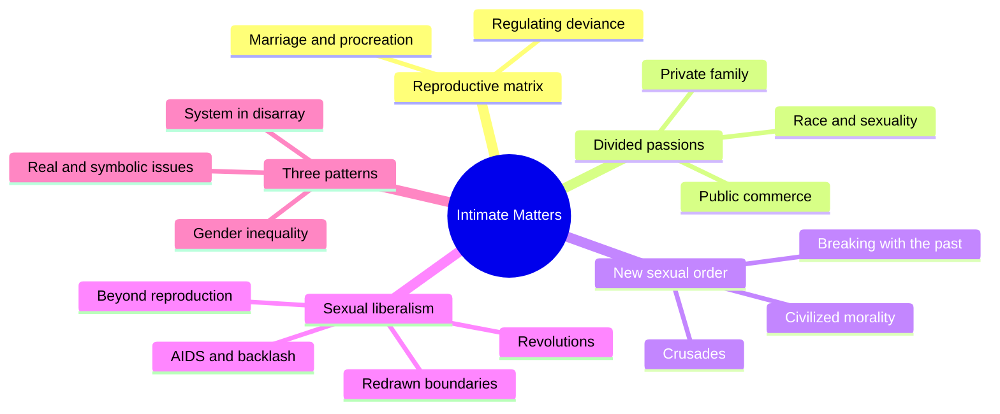
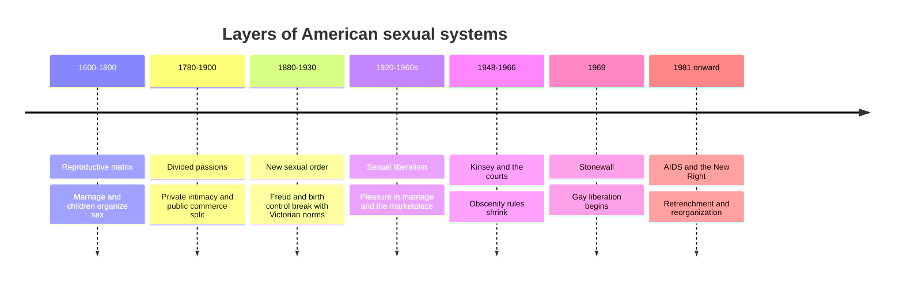
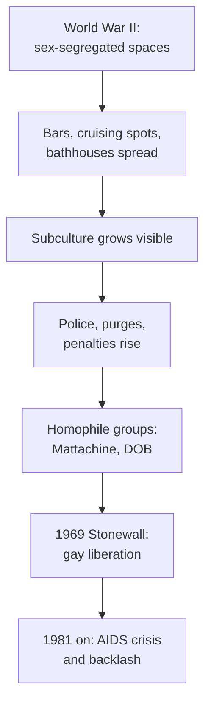
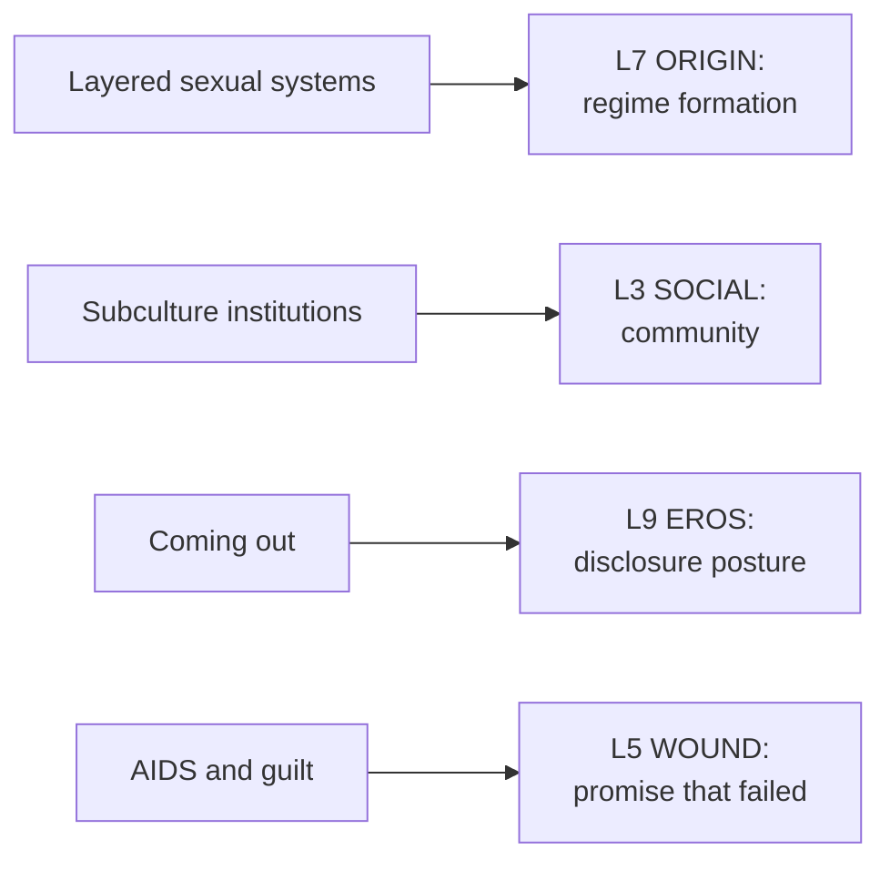

# 🧬 MSX.54 — Intimate Matters — D'Emilio & Freedman (2012)
### Knowledge Entry — Distill

John D'Emilio and Estelle Freedman's survey is the standard one-volume history of sexuality in the United States. The third edition runs from the colonial period to the early twenty-first century and puts gay and lesbian history inside the larger story of marriage, commerce, gender, and race.

## TABLE OF CONTENTS
- [Core Thesis](#1-core-thesis)
- [Mind Models](#2-mind-models)
- [Framework](#3-framework--structure)
- [Key Concepts](#4-key-concepts)
- [Heuristics](#5-heuristics--decision-rules)
- [Invariants](#6-invariants)
- [Pitfalls](#7-pitfalls--myths)
- [Application](#8-application)
- [Cross-References](#9-cross-references)
- [Provenance](#10-provenance--confidence)

---

## 1 · CORE THESIS

American sexual life moves through layered systems, from reproduction in the family to private intimacy to commercial pleasure. Sexual politics flares when one system frays and another forms, runs through inequalities of gender, and attaches to real and symbolic fears.

---

## 2 · MIND MODELS

*Required. Minimum two diagrams, maximum five.*

**Diagram 1 — the whole argument.**
Caption: *four periods, each a layer on the last, with three patterns of sexual politics running through all of them.*

**Diagram 2 — the central mechanism (layering of sexual systems).**
Caption: *each era adds a layer and keeps the old ones, so a person in 1960 lives inside several systems at once.*

**Diagram 3 — how a gay subculture and state pressure fed each other.**
Caption: *wartime freedom built the subculture, the subculture became visible, visibility drew penalties, and penalties pushed some toward organizing.*

**Diagram 4 — mapped onto the Command's 12-layer character stack.**
Caption: *the book maps onto the stack through origin (which regime), social (which community), eros (which disclosure), and wound (which promise failed).*

---

## 3 · FRAMEWORK / STRUCTURE

Four parts, sixteen chapters, an afterword. The authors state three recurring patterns in the Introduction.

| Part | Governing move |
|---|---|
| I. The Reproductive Matrix, 1600-1800 (ch. 1-3) | Marriage and procreation organize sex. Deviance is regulated to protect the family |
| II. Divided Passions, 1780-1900 (ch. 4-7) | Sex splits into private family intimacy and public commerce, along lines of gender, race, and class |
| III. Toward a New Sexual Order, 1880-1930 (ch. 8-10) | Middle-class respectability is strained. Crusades for order and rebels for change both rise |
| IV. The Rise and Fall of Sexual Liberalism, 1920 to the present (ch. 11-16) | Pleasure becomes part of happy marriage, then of the open marketplace. A conservative backlash and AIDS follow |

The three patterns, from the Introduction:

1. **Movements flourish when an older system is in disarray and a new one forms.**
2. **Sexual politics follows gender inequality.** Male authorities define female sexuality, and women resist or reshape it.
3. **Sex answers to real and symbolic issues.** Prostitution, rape, homosexuality, and disease all carry both kinds of weight.

The authors add that eras layer. Old motifs stay influential after new ones take over.

---

## 4 · KEY CONCEPTS

| Concept | What it is | Why it matters |
|---|---|---|
| **Reproductive matrix** | The colonial system in which marriage and procreation organized sex | The baseline the later layers move away from |
| **Divided passions** | The split between private, intimate family sex and public, commercial sex (Part II) | Explains double standards of class and gender |
| **Sexual liberalism** | Acceptance of sexual pleasure as a critical part of personal happiness (Introduction) | The dominant mid-century system and the target of both revolution and backlash |
| **Layering** | New sexual motifs join old ones and overtake them slowly (Introduction) | Warns against clean periodization |
| **Sexual politics** | Fights over the meaning and regulation of sex (Introduction) | The unit of the book's story |
| **Symbolic targets** | Rape, homosexuality, and disease serve as stand-ins for social stress (Introduction) | Explains why panics outrun the facts |
| **Gay subculture** | The bar, park, and bath network of postwar cities (ch. 12) | The built environment of gay life |
| **Wartime as coming out** | World War II placed millions in same-sex settings and gave desire a name and a group (ch. 12) | Shows how a mass event rewrites private life |
| **Homophile movement** | Mattachine (1950) and Daughters of Bilitis, then 1960s picketing and lawsuits (ch. 13) | The pre-Stonewall layer of resistance |
| **Gay liberation** | A post-Stonewall movement that rejected marriage and heterosexual primacy and adopted "coming out" as tactic (ch. 13) | The turn from reform to revolt |
| **Sex-segregated institutions** | Army, women's work housing, and similar settings that gave same-sex life room (ch. 12) | A ready source for origin stories |

---

## 5 · HEURISTICS & DECISION RULES

| Situation | Do this | Not this |
|---|---|---|
| Setting a story in a decade | Name which sexual systems overlap in that decade | Write one clean "era of repression" or "era of freedom" |
| Writing a character's family sex ethic | Ask which layer it comes from: reproductive, private-romantic, or liberal | Treat family sex rules as timeless |
| Writing a young gay character's first community | Give the institution a real history: a bar, a service camp, a rooming house | Place them in an undefined "scene" |
| Writing a crackdown | Show it hitting a visible, growing community | Show it falling on random individuals |
| Writing a coming-out beat | Separate private recognition from public declaration, and date each | Treat coming out as one event |
| Writing AIDS-era characters | Let freedom and loss coexist, with fear, guilt, and organizing all present | Write only tragedy or only defiance |
| Writing a sex-panic plot | Look for the real problem and the symbolic one inside it | Write the panic as pure invention |

---

## 6 · INVARIANTS

1. **Sexual systems layer.** Old ones stay while new ones form (Introduction).
2. **Sexual politics grows where an older order frays** (Introduction, first pattern).
3. **Gender inequality runs through sexual politics** (Introduction, second pattern).
4. **Sex attaches to other fears.** Disease, race, and disorder ride on it (Introduction, third pattern).
5. **Visibility draws penalties.** The growth of the gay subculture met tougher laws and raids (ch. 12).
6. **Wartime reshapes intimate life.** The war made same-sex life possible for a generation (ch. 12).
7. **Movements build on earlier ones.** Stonewall grew from homophile groups, media coverage, and the 1960s protest cultures (ch. 13).
8. **Epidemics are shaped by culture.** AIDS drew both moral blame and mass organizing (ch. 15).

---

## 7 · PITFALLS / MYTHS

- Treating the book as global. It covers the United States, and its sources are mostly American.
- Taking Kinsey's figures as fixed. The book reports his findings: over a third of men with a postadolescent homosexual experience to orgasm, and four percent exclusively homosexual as adults (ch. 12). His sample was a large set of volunteered case histories and not a random sample, and later surveys give lower rates. The book itself calls it a description of "ordinary white Americans." This is outside context, stated once.
- Taking Stonewall as the origin. The book shows the movement rested on earlier groups, media, and protest cultures (ch. 13).
- Reading the gay liberation quotes as a settled program. They are movement rhetoric from 1969 and 1970 (ch. 13).
- Taking the AIDS section as the full history. The part read covers the 1980s only, and later treatment is not read here.
- Assuming the periods are sharp. The authors say they are not (Introduction).
- Assuming the chapter on race and sexuality is a side topic. The authors treat it as central to white supremacy and control (ch. 5). Not read here.

---

## 8 · APPLICATION

*Proposed, never ruled.*

- **Spine level:** L5.
- **12-layer character stack:** L7 ORIGIN (primary, regime formation and law exposure); L3 SOCIAL (primary, community membership); L9 EROS (primary, disclosure posture); L5 WOUND (supporting, AIDS-era promise failed); L4 WILL (supporting, resistance modes).
- **plot_systems:** the sex-panic and layering patterns work as period engines.
- **Setting:** the layering rule is a SETTING-shelf tool for dating a story's law and habit (S4 LAW, S8 HABIT).

The book gives the ORANGE work a dating tool. Each character was shaped by a sexual regime, and the regime has a name and a year. The L7 variable `sexual_regime_formation` asks which layer taught them what sex is for. A character raised in a reproductive household and sent into a liberal marketplace carries a built-in friction that a writer can use.

Its second gift is the infrastructure of gay life: the war camps, the bars, the parks, the baths, the picket lines. A writer can place a character's first community in a real institution with a real history. That choice grounds the L3 variable `community_membership` in something a reader can see.

The third gift is the coming-out line. The book's two-stage meaning, to oneself and to other gay people, then public, lets L9 carry a disclosure posture with a before and an after.

---

## 9 · CROSS-REFERENCES

| Related entry | Relation |
|---|---|
| [[🧬 MSX.36 — The History of Sexuality — Foucault (1978)]] | Foucault's theory of how sexual categories form. D'Emilio and Freedman supply the American case |
| [[🧬 MSX.46 — Deviations — Rubin (2011)]] | Rubin's 1880s and 1950s panics are the same events from a theorist's side |
| [[🧬 MSX.58 — The Straight State — Canaday (2009)]] | Canaday explains how the federal state built the 1950s penalties this book describes |
| [[🧬 MSX.62 — Gay Macho — Levine (1998)]] | A 1970s ethnography of the subculture that followed Stonewall |
| [[🧬 MSX.20 — Sex on Premises Venues — Smith, Grierson & von Doussa (2010)]] | The later, social-science account of the baths and clubs |

---

## 10 · PROVENANCE & CONFIDENCE

Full-text pdftotext extraction, about 584 pages, third edition, University of Chicago Press, 2012, copyright 1988, 1997, 2012. Front matter confirms the authors, title, and edition. This extract carries no page numbers in the text, so citations are by chapter and section heading.

Read in full or near-full: the Introduction's three patterns and part summaries; chapter 12, from the Kinsey passage through "The Homosexual Menace"; chapter 13's gay-liberation section (Stonewall, the homophile movement, the radical cohort, coming out); chapter 15's "The AIDS Crisis."

Skipped: Parts I to III entirely; chapters 11 and 14; chapter 16 and the Afterword; the rest of chapters 12, 13, and 15; the notes and bibliography. The distill therefore covers a small part of the book, the gay-history strand, and it says nothing of the colonial, race, reform, or birth-control chapters beyond their titles.

Contested or dated: Kinsey's sampling (see Pitfalls). The 1988 core text is thirty-seven years old, and the third edition updates only the last chapters.

The `feeds:` keying is this distill's own synthesis. The `sexual_regime_formation` variable is proposed here and is not yet in the schema.

## META
- Template: BVX-LEARN-v4.0
- Source classification: full-text pdftotext extraction, targeted read of the Introduction and chapters 12, 13, 15
- Created / Updated: 2026-10-04
