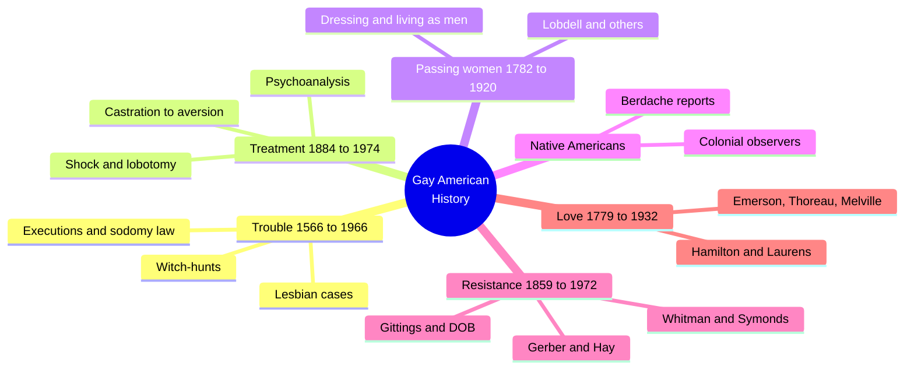
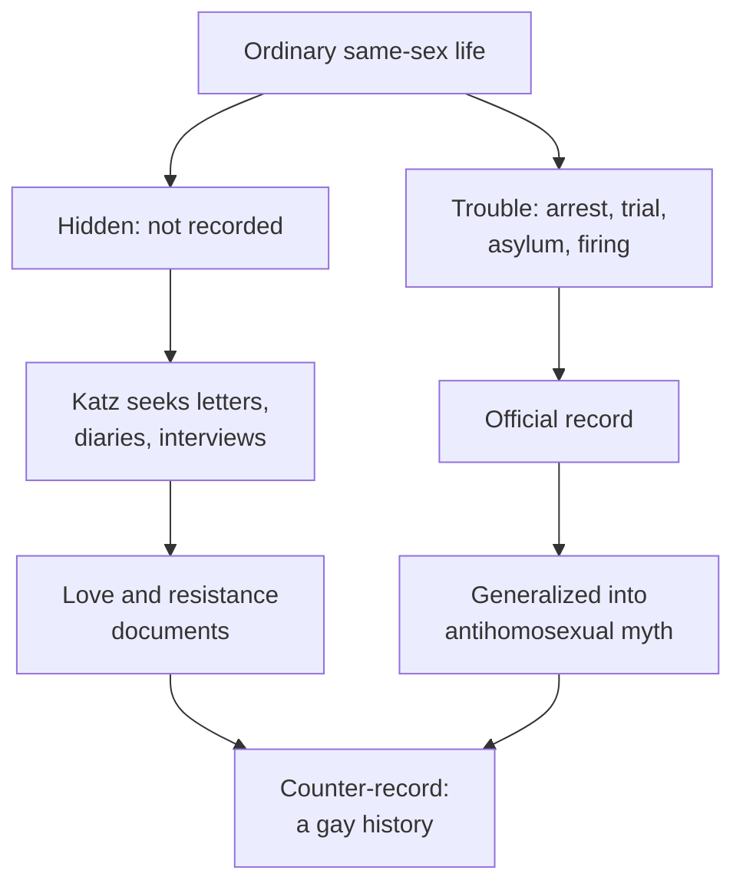
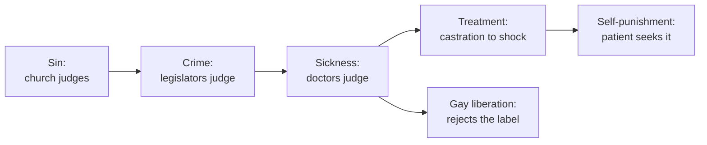

# 🧬 MSX.55 — Gay American History — Katz (1976)
### Knowledge Entry — Distill

Jonathan Ned Katz collected four centuries of primary documents on same-sex life in the United States. The shelf copy is the revised Meridian edition (1992) of the 1976 Crowell original. It is the library's main archive of how gay lives were recorded, punished, treated, resisted, and loved.

## TABLE OF CONTENTS
- [Core Thesis](#1-core-thesis)
- [Mind Models](#2-mind-models)
- [Framework](#3-framework--structure)
- [Key Concepts](#4-key-concepts)
- [Heuristics](#5-heuristics--decision-rules)
- [Invariants](#6-invariants)
- [Pitfalls](#7-pitfalls--myths)
- [Application](#8-application)
- [Cross-References](#9-cross-references)
- [Provenance](#10-provenance--confidence)

---

## 1 · CORE THESIS

A hidden gay American history exists in plain documents: trials, medical files, letters, and organizing papers. Homosexuality has no single timeless form. Each society and era produced its own, shaped by an antihomosexual culture that recorded gay people mostly when they were in trouble.

---

## 2 · MIND MODELS

**Diagram 1 — the whole argument.**
Caption: *six sections give six views of one hidden history, from the worst records to the best, so the same people appear as targets, patients, resisters, and lovers.*

**Diagram 2 — the central mechanism (how the record gets made).**
Caption: *the record exists only where a trial, a doctor, or a witch-hunt touched a gay person, so the archive over-represents trouble and Katz counters it with love and resistance.*

**Diagram 3 — sin, crime, sickness.**
Caption: *each stage hands authority to a new class of experts, and the last stage turns the gay person into a patient who may ask for the cure.*

---

## 3 · FRAMEWORK / STRUCTURE

The book has six parts, each with an introduction and dated documents, plus notes and bibliographies. Katz reprints primary sources and adds short comments (Introduction, pp. 3-4).

| Part | Governing move |
|---|---|
| I. Trouble: 1566-1966 (pp. 11-127) | Executions, sodomy trials, prison reports, asylum and military cases, the 1950s witch-hunt |
| II. Treatment: 1884-1974 (pp. 129-207) | Doctors' own reports on castration, psychoanalysis, aversion therapy, shock, and lobotomy |
| III. Passing Women: 1782-1920 (pp. 209-279) | Women who lived as men, with Lucy Ann Lobdell the central case |
| IV. Native Americans/Gay Americans: 1528-1976 (pp. 281-331) | Colonial and anthropological reports on berdache and same-sex life, ending with Gay American Indians |
| V. Resistance: 1859-1972 (pp. 333-443) | Whitman's influence, the Chicago Society for Human Rights, the Mattachine Society, the Daughters of Bilitis |
| VI. Love: 1779-1932 (pp. 445-562) | Letters and diaries of intimate same-sex bonds |

---

## 4 · KEY CONCEPTS

| Concept | What it is | Why it matters |
|---|---|---|
| **Homosexuality as historical** | "There is no such thing as homosexuality in general, only particular historical forms" (Introduction, p. 6) | It sets the book against any timeless essence |
| **Documents of trouble** | Records made only when gay people were in jail, on trial, or in treatment (Part I, p. 11) | Katz warns these fed bigotry by generalizing from individuals in difficulty |
| **Sin, crime, sickness** | Church, then legislature, then doctors claimed authority (Part II, p. 130) | Each shift handed power to a new class of experts |
| **Self-punishment** | Some patients, guilt-ridden, sought cruel treatment as punishment (Part II, p. 131) | Katz links internal guilt to external law and castration |
| **Situational homosexuality (rejected)** | The idea of a "true" nonsituational type (Part VI, pp. 446-447) | Katz says all homosexuality is situated in a time, society, and class |
| **Deactivation of the homosexual** | Biographers turn lovers into "emotional attachments" (Part VI, p. 448) | The pattern hides sexual bonds in plain sight |
| **Characterization, not categorization** | Study each relation's features instead of sorting it hetero or homo (Part VI, p. 446) | It is a writer's method as well as a historian's |
| **The radical tradition** | Many early emancipationists leaned anticapitalist (Introduction, p. 5) | Gay politics before the 1950s was not only assimilationist |
| **Whitman as founding father** | Whitman's "Calamus" resolution of 1859 as the start of an international resistance (Part V, p. 337) | The poet inspired Symonds and Carpenter |
| **Created documents** | Katz's own taped interviews with Hay, Gittings, Routsong, and two victims (Introduction, p. 5) | Oral history joins the archive |

---

## 5 · HEURISTICS & DECISION RULES

| Situation | Do this | Not this |
|---|---|---|
| Writing a period character | Check what the law, the church, and the doctor of that year could do to him | Give him a modern identity and modern safety |
| Writing a doctor | Show him sure of his cure, and show the patient's guilt feeding it | Write a cartoon villain |
| Writing two men's love in the past | Let the letters carry erotic charge and do not label the bond "friendship" | Let the bond stay "pure" and unnamed |
| Writing an institution | Make the setting shape the form: army, college, prison, ship | Treat same-sex life as the same everywhere |
| Writing a resister | Give him a lineage: a poet, a pamphlet, an organizer | Make him an isolated hero |
| Writing a character who passes | Give the passing a reason in work, money, or love | Reduce it to disguise |

---

## 6 · INVARIANTS

1. Gay people appear in older records mostly when in trouble (Part I, p. 11).
2. Each society produces its own historical form of homosexuality (Introduction, p. 6).
3. Authority over homosexuality passed from church to law to medicine (Part II, p. 130).
4. Resistance to oppression began long before Stonewall (Part V, p. 337).
5. Love between people of the same sex appears in many institutions and occupations (Part VI, p. 446).
6. Same-sex relations were shaped by the pressure of an antihomosexual society (Part VI, p. 447).

---

## 7 · PITFALLS / MYTHS

- Treating the trouble documents as the whole picture. Katz warns they were generalized to "give credence to antihomosexual bigotry" (Part I, p. 11).
- Reading the book as a narrative history. Katz says it is an anthology of documents and "not definitive" (Introduction, p. 7).
- Reading it as the gay viewpoint. Katz says it is "only one of many Gay viewpoints" (Introduction, p. 6).
- Dating: it is a 1976 work, revised in 1992. Terms such as "Lesbian and Gay," Katz's term "berdache," and his treatment of Native American material are of their time. Later scholars use other terms.
- Reading letters of love as proof of sex, or as proof of its absence. Katz says to avoid both; both involve a judgment (Part VI, pp. 447-448).
- Reading literary sources as fact. Katz says to avoid assuming a correlation between fiction and society (Introduction, p. 4).
- Katz's selection is his own and weighted by what survived. Katz states that his choices follow his own emotional reaction (Introduction, p. 5-6).

---

## 8 · APPLICATION

*Proposed for the ORANGE work, not ruled.*

- **Spine level:** L5.
- **12-layer character stack:** L5 WOUND (primary, treatment and self-punishment); L3 SOCIAL (primary, era legal exposure); L7 ORIGIN (primary, situatedness); L10 SHADOW (supporting, the scrubbed half of a bond); L4 WILL (supporting, a resistance lineage); L9 EROS (contextual, the sex versus affection split).
- **plot_systems:** the dated document is a plot device. A letter, a file, or a charter can be found, hidden, or burned.
- **Setting:** the six-section lens gives an alternate-world writer six institutions to invent: a court, a clinic, a camp, a mission, a movement, a letter-writing circle.

The ORANGE work needs period texture that avoids two failures. One is the modern character dropped in the past. The other is the past as pure victimhood. Katz offers both halves: the machinery of punishment (Parts I and II) and the proof that people loved and organized anyway (Parts V and VI).

Proposed use: set a character's WOUND by asking which of Katz's six sections his early life touched. A boy who met the doctor has a different wound than a boy who met the sheriff. A boy who read Whitman has a different will.

---

## 9 · CROSS-REFERENCES

| Related entry | Relation |
|---|---|
| [[🧬 MSX.36 — The History of Sexuality — Foucault (1978)]] | Foucault's sin to crime to sickness story is the theory. Katz's Part II is the paper trail |
| [[🧬 MSX.43 — One Hundred Years of Homosexuality — Halperin (1990)]] | Halperin and Katz share the line that homosexuality has no single timeless form |
| [[🧬 MSX.51 — Cruising Utopia — Muñoz (2009)]] | Muñoz reads past queer scenes as a futurity. Katz supplies the documents |
| [[🧬 MSX.38 — We Too — West, Horn & Selena, eds. (2021)]] | Both are collected testimony: Katz's from the past, We Too from the present |

---

## 10 · PROVENANCE & CONFIDENCE

Full text by pdftotext, 724 pdf pages; the first pages of the scan are damaged by library stamps. Book page = pdf page minus 20 from the Introduction onward. The copyright page confirms Jonathan Ned Katz, *Gay American History: Lesbians and Gay Men in the U.S.A.*, revised edition, Meridian (Penguin), April 1992; copyright 1976, 1992.

Read in full: the Preface to the Revised Edition; the Introduction (pp. 1-7); Part I's introduction (pp. 11-14) and its first document headnote; Part II's introduction (pp. 129-131); Part V's introduction (pp. 335-337); Part VI's introduction (pp. 445-448). Skipped: the dated documents themselves, Parts III and IV's introductions, the notes, and the bibliography. The distill argues from Katz's own framing, and the documents are not independently checked.

Dated and contested: Katz says the book is not definitive (Introduction, p. 7). His 1976 framing of Part II ("psychiatrists and psychologists are among the major ideologues of homosexual oppression," p. 130) is a movement-era polemic. Later scholarship has refined his terms and some of his readings. Treat Parts V and VI as archive, and the intros as an argument.

The `feeds:` keying is this distill's own synthesis. Katz uses no layer vocabulary.

## META
- Template: BVX-LEARN-v4.0
- Source classification: full-text pdftotext, introductions read, documents sampled by listing only
- Created / Updated: 2026-10-04
