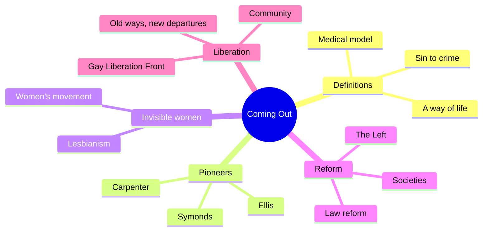
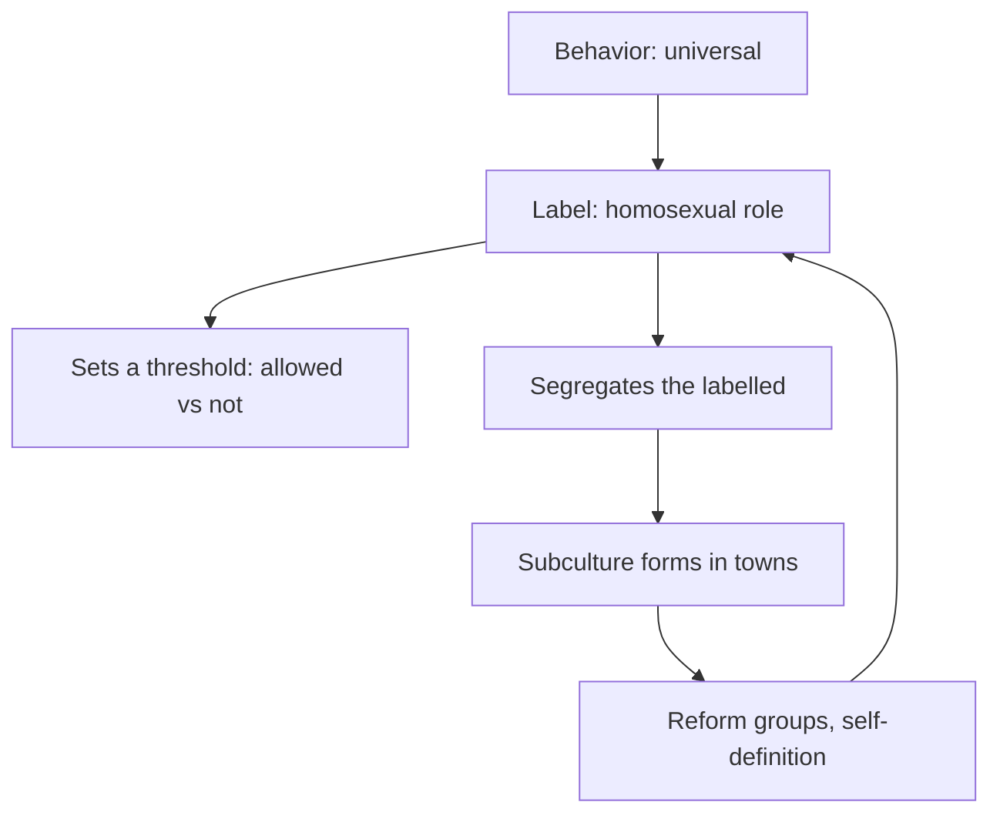
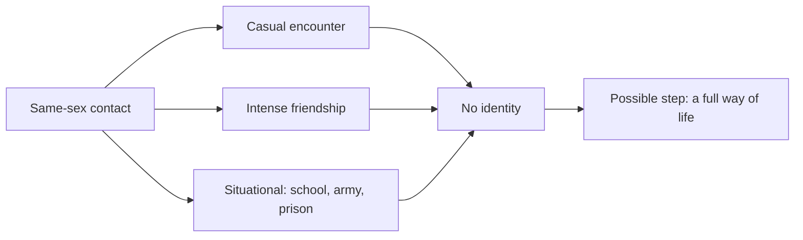
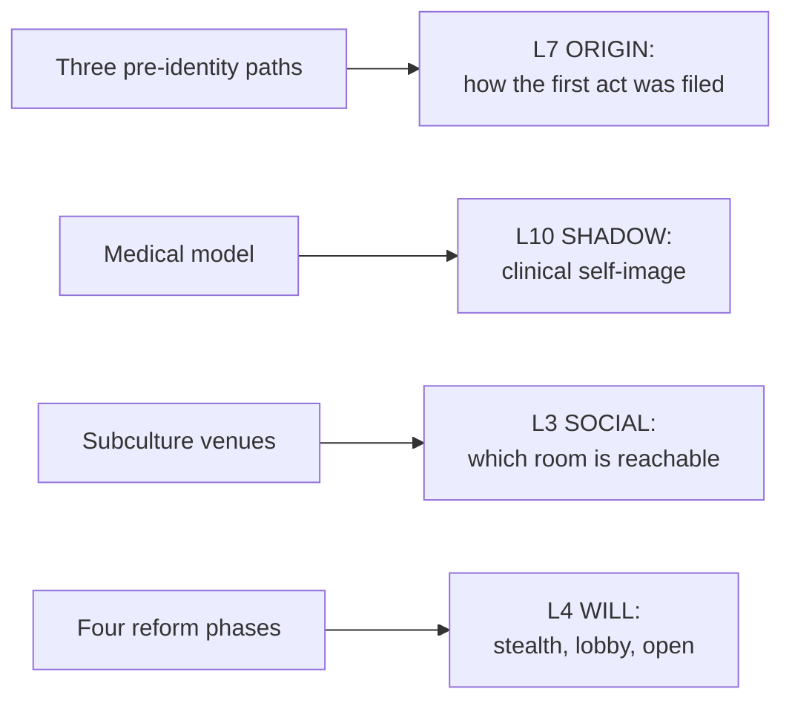

# 🧬 MSX.56 — Coming Out — Weeks (1977)
### Knowledge Entry — Distill

Weeks's 1977 book traces British homosexual reform movements from the late 1800s to the 1970s. It shows how a modern homosexual identity formed in response to law, medicine and the family.

> *Fantasy, not a how-to: what happens in these pages stays in them. Reader discretion advised.*

## TABLE OF CONTENTS
- [Core Thesis](#1-core-thesis)
- [Mind Models](#2-mind-models)
- [Framework](#3-framework--structure)
- [Key Concepts](#4-key-concepts)
- [Heuristics](#5-heuristics--decision-rules)
- [Invariants](#6-invariants)
- [Pitfalls](#7-pitfalls--myths)
- [Application](#8-application)
- [Cross-References](#9-cross-references)
- [Provenance](#10-provenance--confidence)

---

## 1 · CORE THESIS

Homosexual behavior is universal, and homosexual identity is a recent product of history. In Britain, law, medicine and the family shaped the label, and homosexual people answered it with subcultures and reform movements.

---

## 2 · MIND MODELS

**Diagram 1 — the whole argument.**
Caption: *the book runs from imposed definitions, to self-definition, to organized reform, to liberation.*

**Diagram 2 — the central mechanism (the homosexual role).**
Caption: *a despised role marks the line of acceptable conduct and also keeps the deviants apart, so labels and subcultures grow together.*

**Diagram 3 — the three paths of behavior before an identity.**
Caption: *the same act can sit in a casual episode, a close friendship, or a situation, with no label attached.*

**Diagram 4 — mapped onto the Command's 12-layer stack.**
Caption: *Weeks gives ORIGIN a list of pre-identity paths, SHADOW a clinical frame, and SOCIAL a map of venues.*

---

## 3 · FRAMEWORK / STRUCTURE

Five parts, eighteen chapters, in time order.

| Part | What it does |
|---|---|
| Intro (p. 1-7) | Separates behavior (universal) from identity (historical). Describes four phases of reform |
| I. Definitions and Self-Definitions (Ch. 1-3, p. 11-44) | Sin to crime, the medical model, and a way of life |
| II. Pioneers (Ch. 4-6, p. 47-84) | Symonds, Havelock Ellis and Sexual Inversion, Edward Carpenter and friends |
| III. Invisible Women (Ch. 7-9, p. 87-112) | Lesbianism and the position of women, and the women's movement |
| IV. Approaches to Reform (Ch. 10-15, p. 115-182) | Consciousness, reform societies, the Left, Norman Haire, the prelude to reform and law reform |
| V. The Gay Liberation Movement (Ch. 16-18, p. 185-238) | The Front 1970 to 1972, a community, old ways and new departures |

---

## 4 · KEY CONCEPTS

| Concept | What it is | Why it matters |
|---|---|---|
| **Behavior vs. identity** | Homosexual behavior is universal. Homosexual identity is historically specific (Intro, p. 3) | The same act can mean different things in different decades |
| **Homosexual role** | Mary McIntosh's idea of a despised role that marks a line and segregates (p. 3-4) | It explains why labels and subcultures grow together |
| **Sodomy as a portmanteau** | The word covered all non-procreative sex (Ch. 1, p. 14) | Even birth control was once called an unnatural crime |
| **Labouchere Amendment** | The 1885 law that made male acts short of buggery illegal, in public or private (Ch. 1, p. 14) | It widened the law and created the blackmail climate |
| **The medical model** | Sickness, degeneration and contagion replace sin (Ch. 2, p. 23-26) | It set the "homosexual condition" in twentieth-century minds |
| **Innate vs. acquired** | Casper's split: born that way, or learned vice (Ch. 2, p. 26) | The first made an argument against penalty; the second kept it |
| **Three kinds of behavior** | Casual, intense friendship, situational (Ch. 3, p. 33-35) | They need no identity |
| **Subculture** | A venue-and-manners world that forms under hostile norms and in towns (Ch. 3, p. 35-36) | The molly houses of 1709 are an early case (p. 36) |
| **Four phases of reform** | Identity, legal change, liberation, and a militant movement with limited aims (Intro, p. 6-7) | Each phase has its own tactics and cost |
| **Gay Liberation Front** | A 1970 radical movement built on openness, pride and self-activity (Ch. 16, p. 185-188) | It moved homosexuality from private shame to public politics |
| **Repressive desublimation** | Marcuse's term for token freedoms that tie people to the system (Ch. 18, p. 231) | Weeks uses it to read the commercial gay scene of the mid-1970s |

---

## 5 · HEURISTICS & DECISION RULES

| Situation | Do this | Not this |
|---|---|---|
| A character in a boys' school or barracks | Let same-sex contact be a local custom with no label (p. 34-35) | Make it a sign of identity at once |
| A man with a close male friend | Let the friendship be public and respectable, with the risk rising by decade (p. 34) | Treat every close friendship as a secret |
| A character who meets a subculture | Show the venue's manners, risks and watchers (p. 36) | Treat it as a free zone |
| A character under legal threat | Name the law and its year (1885, 1967) | Leave the threat vague |
| A reform group in the story | Pick a phase: identity, lobbying, defiance, or limited militancy | Make every group a protest group |
| A commercial gay venue | Show the owners profiting, and the clients glad of it (p. 232) | Cast it as pure liberation or pure exploitation |
| A doctor or priest labelling a character | Give the label a source: sin, sickness, crime | Treat the label as neutral |

---

## 6 · INVARIANTS

1. Behavior is universal, and identity is local to a time and place (p. 3).
2. A label sets a line of conduct and segregates the labelled (p. 3-4).
3. Subcultures form where hostile norms meet town anonymity (p. 36).
4. Law, medicine and the family each shape the category (Intro, p. 2-6).
5. Hostile definitions provoke self-definitions (Ch. 3, p. 33).
6. Each reform phase wins some gains and has a cost (Ch. 18, p. 231).

---

## 7 · PITFALLS / MYTHS

- The book covers Britain and mostly male homosexuality. Weeks adds sections on women, and he notes their different history (Intro, p. 5).
- It stops in 1977. Later laws, movements and language are outside it.
- Weeks says the story is partial. It follows reform groups, not every homosexual life (Preface, p. ix).
- The three-kinds scheme is Weeks's own, and it rests on a few sources such as Symonds and the anonymous *Secret Life*. Later historians have revised the picture of the eighteenth-century subculture.
- Weeks reads the 1970s through a Marxist lens, and some readers reject that frame.
- "Coming out" in this book is a historic process as well as a personal act. Do not collapse the two.
- Weeks treats Oscar Wilde's case as a turning point. That is an interpretation.

---

## 8 · APPLICATION

*Proposed, not ruled.*

- **Spine level:** L5.
- **12-layer character stack:** L7 ORIGIN (primary: pre-identity paths); L10 SHADOW (primary: clinical self-image); L3 SOCIAL (primary: venue map); L4 WILL (supporting: reform phase as method); L9 EROS (supporting: a disclosure posture with a date); L5 WOUND (contextual: the law).
- **plot_systems:** a "label scene." Someone applies a word to a character, and the scene shows its source and its cost.
- **Setting:** the Command's eras can reuse Weeks's date list. Each era has its own laws, venues, and phase of reform.

Weeks helps the ORANGE work by dating the word. A character in 1890, 1970 and 2025 each lives in a different frame. The book also gives ORIGIN a rule that avoids early labels: a boy's first contact may have been a school custom, and the character may remember it that way. For SOCIAL, the molly house and the beat are two venue types the setting can borrow, with manners and watchers attached. The strongest single use is the three-kinds list. It lets a writer say what kind of encounter a character had before the story gave it a name.

---

## 9 · CROSS-REFERENCES

| Related entry | Relation |
|---|---|
| [[🧬 MSX.36 — The History of Sexuality — Foucault (1978)]] | Foucault and Weeks tell the same turn: the act becomes a type of person in the late nineteenth century |
| [[🧬 MSX.44 — Between Men — Sedgwick (1985)]] | Sedgwick cites Weeks on the homosexual role (PDF p. 95) |
| [[🧬 MSX.48 — Gender Trouble — Butler (1990)]] | Butler treats the categories Weeks dates as effects of repetition |
| [[🧬 MSX.60 — Tearoom Trade — Humphreys (1970)]] | Humphreys studies a hidden venue in America at the same decade |
| [[🧬 PSY.50 — Sexual Behavior in the Human Male — Kinsey (1948)]] | Kinsey's data are the science of behavior that Weeks's history sits beside |

---

## 10 · PROVENANCE & CONFIDENCE

Full text, pdftotext extraction, 292 PDF pages. Title page and imprint: Jeffrey Weeks, *Coming Out*, Quartet Books, London, first published 1977, reprinted 1979. Printed page equals PDF page minus 12 in the body.

Read: the Preface and the whole Introduction (p. 1-7), Ch. 1 on the Labouchere Amendment (p. 14), Ch. 2 on the medical model (p. 23-26), Ch. 3 on the three kinds and the subculture (p. 33-36), Ch. 16 opening (p. 185-188), Ch. 17 opening (p. 207-208) and Ch. 18 (p. 231-234).

Skipped: Ch. 4 to 15 (Symonds, Ellis, Carpenter, lesbianism, reform societies, the Left, Haire, law reform), most of Ch. 16 and 17, the rest of Ch. 18, the bibliography and the notes. The chapter list for Part Four is from the contents page. The `feeds:` keying is this distill's own work. Weeks uses no 12-layer vocabulary.

## META
- Template: BVX-LEARN-v4.0
- Source classification: full-text pdftotext extraction, deep read of the Introduction and Ch. 1 to 3, targeted read of Ch. 16 to 18
- Created / Updated: 2026-10-04
