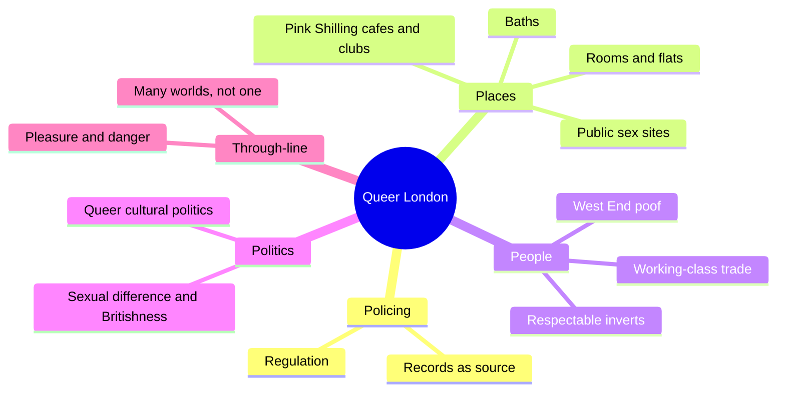
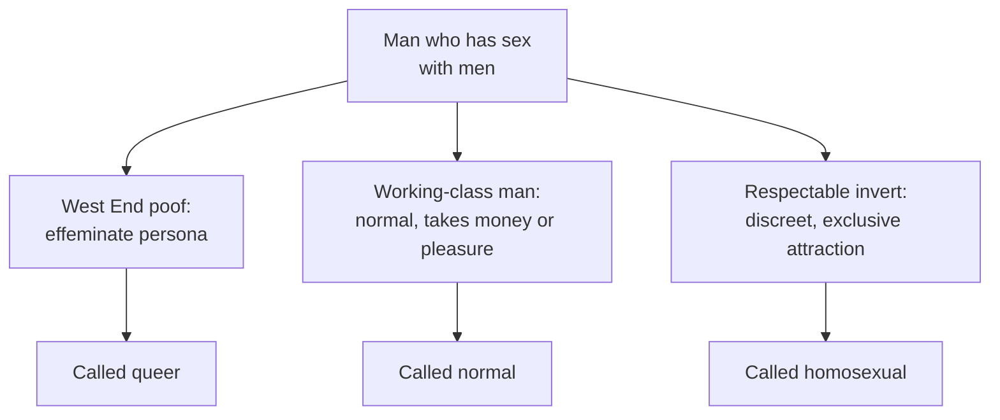
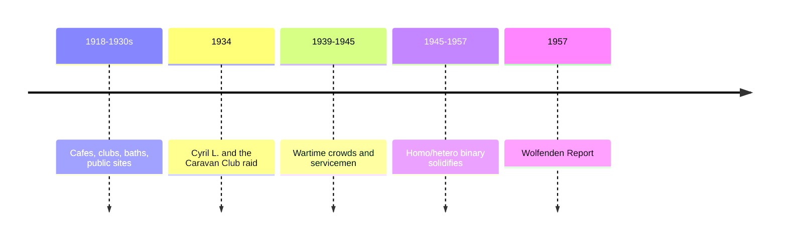
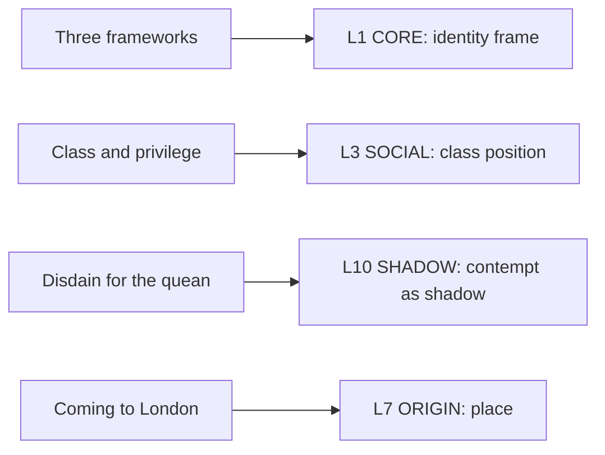

# 🧬 MSX.57 — Queer London — Houlbrook (2005)
### Knowledge Entry — Distill

Fantasy, not a how-to: what happens in these pages stays in them. Reader discretion advised.

Matt Houlbrook's 2005 history maps queer male life in London between the world wars and the Wolfenden Report of 1957. It uses police and court files, so it sees men at the moment the law touched them, and it argues the city made many queer worlds, not one.

## TABLE OF CONTENTS
- [Core Thesis](#1-core-thesis)
- [Mind Models](#2-mind-models)
- [Framework](#3-framework--structure)
- [Key Concepts](#4-key-concepts)
- [Heuristics](#5-heuristics--decision-rules)
- [Invariants](#6-invariants)
- [Pitfalls](#7-pitfalls--myths)
- [Application](#8-application)
- [Cross-References](#9-cross-references)
- [Provenance](#10-provenance--confidence)

---

## 1 · CORE THESIS

Queer London was many worlds, split by class, age, race, and place. It was not one gay world. Men moved between pleasure and danger, and many who joined it never called themselves queer.

---

## 2 · MIND MODELS

**Diagram 1 — the whole argument.**
Caption: *the book runs through policing, places, and people to politics, and its through-line is difference among men in one city.*

**Diagram 2 — the central mechanism (three ways to be a man who has sex with men).**
Caption: *three frameworks coexisted, one by gender style, one by class-coded manliness, one by exclusive object choice, and only the third matches today's binary.*

**Diagram 3 — the arc of the city.**
Caption: *the world grew between the wars, the war itself opened it further, and the postwar years pushed it toward a single binary and a crackdown.*

**Diagram 4 — mapped onto the Command's 12-layer character stack.**
Caption: *Houlbrook gives CORE a class-coded identity frame, SOCIAL a class position, and SHADOW a contempt for the visible type.*

---

## 3 · FRAMEWORK / STRUCTURE

| Part | What it does |
|---|---|
| Introduction: This Is London | Opens with Cyril L.'s 1934 letter and names the book's argument against the "city as queer space" story. |
| Part 1, Policing (Ch. 1) | Sets out how the state regulated queer life. |
| Part 2, Places (Ch. 2-5) | Maps public sex sites, cafes and clubs, baths, and private rooms. |
| Part 3, People (Ch. 6-8) | Gives the West End poof, the working-class "bad boys," and the respectable invert. |
| Part 4, Politics (Ch. 9-10) | Covers sexual difference and Britishness, and queer cultural politics. |
| Conclusion | Restates the argument about difference and the pleasure-danger tension. |

---

## 4 · KEY CONCEPTS

| Concept | What it is | Why it matters |
|---|---|---|
| **Queer London** | The overlapping worlds of men with same-sex desire (Intro, pdf p. 21) | The city is a set of worlds, not one community. |
| **Being queer is not being homosexual** | The labels did not match (Intro, pdf p. 21) | Modern labels distort the period. |
| **West End poof** | A visible, camp, effeminate man (Ch. 6, pdf p. 166) | He stood for sexual difference in popular view. |
| **Quean** | A flamboyant, often working-class queer man (Ch. 6) | Respectable queer men set themselves against him. |
| **Trade, roughs, renters** | Men who took part but kept a "normal" label (Intro, pdf p. 21) | They made up much of queer London while not calling themselves queer. |
| **Normal** | A status held through manner and role (Ch. 7, pdf p. 196) | It could include sex with men. |
| **Respectable homosexual** | A discreet middle-class man defined by exclusive attraction (Ch. 8, pdf p. 226) | He repudiated the quean and the working-class man. |
| **Pink Shilling** | The commercial queer economy of cafes and clubs (Ch. 3) | Money shaped who was welcome. |
| **Pleasure and danger** | The persistent tension in queer urban life (Conclusion, pdf p. 300) | Spaces that helped one man excluded another. |
| **Records as source** | Police files exist because men were arrested (Intro, pdf p. 18) | The archive is made of failures to evade the law. |
| **Spatial turn** | Space is part of social formation, not a backdrop (Intro, pdf p. 17) | The city shapes selfhood and is shaped by it. |

---

## 5 · HEURISTICS & DECISION RULES

| Situation | Do this | Not this |
|---|---|---|
| Setting a story in the 1930s-50s | Give three kinds of men, with three labels and three class worlds | Give one "gay community" |
| Writing a working-class man | Let him sneer at "pansies" and still take what is offered (Ch. 7, pdf p. 196) | Make his contempt prove he is closeted |
| Writing a middle-class man | Make privacy and discretion his main values | Make him a street figure |
| Writing a raid | Show the record it makes: names, letters, newspapers | End the scene at the arrest |
| Writing a newcomer to a city | Let the city feel like release and risk at once | Make it only liberation |
| Writing two men who meet | Let them differ in class and meaning, not only in desire | Assume a shared identity |

---

## 6 · INVARIANTS

1. **The labels do not map to modern ones.** Queer, normal, and homosexual differed in meaning (Intro, pdf p. 21).
2. **Class sets safety.** Middle-class men found privacy and avoided arrest more often (Conclusion, pdf p. 301).
3. **Difference among men is the rule.** No single stable community existed (pdf p. 301).
4. **The city and the self shape each other.** The relation changes by decade (Intro, pdf p. 22).
5. **Pleasure and danger travel together.** The same space can hold both (pdf p. 300).

---

## 7 · PITFALLS / MYTHS

- **The archive is the arrested.** Police, court, and newspaper files over-sample the working-class and the visible, and the author says so (Intro, pdf pp. 18-19).
- **It is one city in one era.** London in 1918-1957 is a case, not a rule, and the author warns against fitting other cities to it (Intro, pdf p. 23).
- **The reading is an interpretation.** The claim that the homo/hetero binary set only after 1945 is argued from this record, and other historians date it differently.
- Reading the city as always liberating. The author calls that "deeply problematic" (Intro, pdf p. 18).
- Reading "queer" as a modern word. In the period it meant something else (pdf p. 20).
- Assuming a trade man was a closeted gay man. The book treats him as normal in his own frame (pdf p. 21).

---

## 8 · APPLICATION

*Proposed, not ruled.*

- **Spine level:** L5.
- **12-layer character stack:** L1 CORE (identity frame, primary); L3 SOCIAL (class position, primary); L9 EROS (desire vector, supporting); L10 SHADOW (supporting); L7 ORIGIN (place, contextual).
- **plot_systems:** a letter, a raid, and a trial give a ready paper trail for a mid-century plot.
- **Setting:** period texture: cafes, clubs, baths, parks, and furnished rooms, each with its class.

Houlbrook gives ORANGE a way to avoid one flat "gay character." In an older setting, two men can sleep together and still hold opposed labels and class worlds. The man who sneers at pansies and takes a stranger's hand in a dark hall is a ready study. The respectable man's contempt for the quean is an inner shadow that a writer can use. A proposed variable, `class_safety`, would record how a character's class changes the price of being caught.

---

## 9 · CROSS-REFERENCES

| Related entry | Relation |
|---|---|
| [[🧬 MSX.45 — Gay New York — Chauncey (1994)]] | The sister city study; Houlbrook argues against its tidier shift to one binary. |
| [[🧬 MSX.36 — The History of Sexuality — Foucault (1978)]] | Houlbrook builds on Foucault but rejects the single "making of the modern homosexual." |
| [[🧬 MSX.61 — Times Square Red, Times Square Blue — Delany (1999)]] | Delany writes the contact sites that Houlbrook's records only glimpse. |

---

## 10 · PROVENANCE & CONFIDENCE

Full-text pdftotext extraction, 412 pdf pages. Front matter confirms Matt Houlbrook, University of Chicago Press, Chicago, 2005 (paperback 2006). The extraction carries no running page numbers, so citations give the chapter and the pdf page. Read: the Introduction (pdf pp. 14-23), the end of Ch. 6 (pdf pp. 194-195), the opening of Ch. 7 (pdf pp. 196-197), the opening of Ch. 8 (pdf pp. 226-228), and the Conclusion (pdf pp. 300-302).

Skipped: Ch. 1 to 5, most of Ch. 6 to 10, the appendix of cases, and the notes. The place chapters on public sex and baths were not read. Confidence is medium. The `feeds:` keying is this distill's synthesis.

## META
- Template: BVX-LEARN-v4.0
- Source classification: full-text extraction, targeted read of introduction, Ch. 6-8, conclusion
- Created / Updated: 2026-10-04
