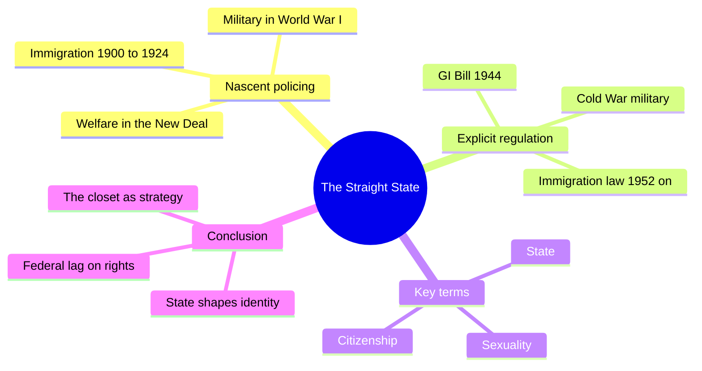
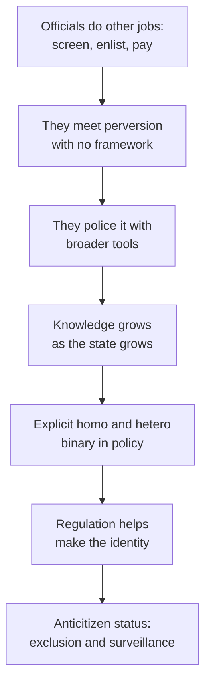
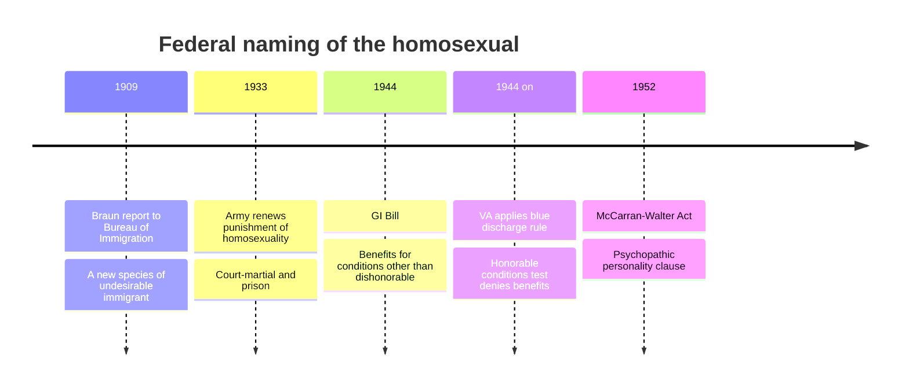
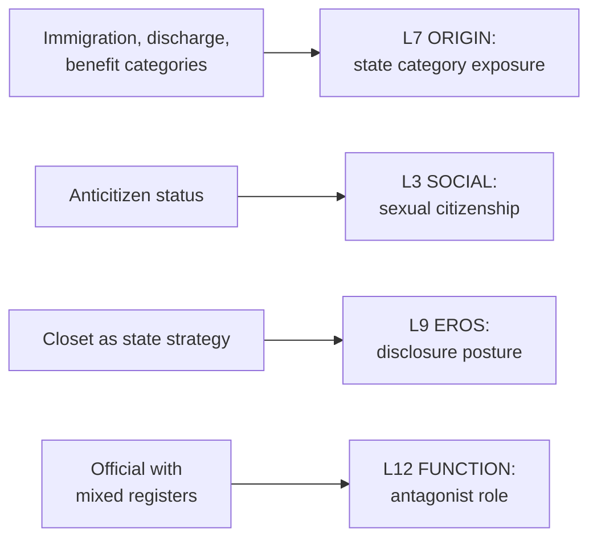

# 🧬 MSX.58 — The Straight State — Canaday (2009)
### Knowledge Entry — Distill

Margot Canaday's 2009 history shows the American federal government building a category called "homosexual" through immigration, military, and welfare rules. It sits on the shelf as the account of how law, not only culture, made sexual identity a matter of paper.

## TABLE OF CONTENTS
- [Core Thesis](#1-core-thesis)
- [Mind Models](#2-mind-models)
- [Framework](#3-framework--structure)
- [Key Concepts](#4-key-concepts)
- [Heuristics](#5-heuristics--decision-rules)
- [Invariants](#6-invariants)
- [Pitfalls](#7-pitfalls--myths)
- [Application](#8-application)
- [Cross-References](#9-cross-references)
- [Provenance](#10-provenance--confidence)

---

## 1 · CORE THESIS

The American federal state grew up just as sexologists named the homosexual, so it wrote that category into its rules. Immigration, the military, and welfare each helped make the identity they policed. By midcentury the law defined the homosexual as the anticitizen.

---

## 2 · MIND MODELS

*Required. Minimum two diagrams, maximum five.*

**Diagram 1 — the whole argument.**
Caption: *the book follows three arms of the state through two phases, from clumsy policing to an explicit homosexual and heterosexual line.*

**Diagram 2 — the central mechanism (how the state made a category).**
Caption: *officials met sexual difference while doing other jobs, learned to name it, and then wrote the name into policy, which produced the category they meant to find.*

**Diagram 3 — key dates.**
Caption: *the dates show the state's lag: awareness around 1909, a military ban reaffirmed in 1933, explicit benefit and entry rules in 1944 and 1952.*

**Diagram 4 — mapped onto the Command's 12-layer character stack.**
Caption: *the state's categories land on origin, social status, and eros, and the official on the function layer.*

---

## 3 · FRAMEWORK / STRUCTURE

Six chapters in two parts, plus an introduction and conclusion. Each part rotates through three state arms.

| Part and chapter | Governing move |
|---|---|
| Introduction (from p. 1) | Asks how a late-forming state built a huge apparatus to police homosexuality. Defines state, citizenship, and sexuality |
| I. Nascent Policing. Ch. 1, Immigration, 1900-1924 (p. 19) | Officials meet "perverse aliens" and use the public charge clause and other broad tools |
| Ch. 2, Military, 1917-1933 (p. 55) | World War I era officials manage sexual stigma. The focus is sodomy as an act |
| Ch. 3, Welfare, 1933-1935 (p. 91) | New Deal programs for "unattached persons" meet transient men and perversion (pp. 117-119) |
| II. Explicit Regulation. Ch. 4, Welfare and the 1944 GI Bill (p. 137) | The VA turns the blue discharge into a bar on benefits |
| Ch. 5, Military, 1947-1959 (p. 174) | Women's integration into the Cold War military and "homosexual tendencies" |
| Ch. 6, Immigration, 1952-1983 (p. 214) | "Who is a homosexual?" The McCarran-Walter psychopathic personality clause and its examinations |
| Conclusion (p. 255) | The state shaped the category, the closet was a strategy, and federal rights still lag |

Canaday's method is "a social history of the state": the state is "what officials do," seen from a VA office or a border booth (pp. 5-6).

---

## 4 · KEY CONCEPTS

| Concept | What it is | Why it matters |
|---|---|---|
| **The straight state** | A state structured by sexual norms, not only acting on sexual subjects (pp. 5-6) | Makes the state a character in sexual history |
| **Sexual citizenship** | The degree of rights and standing a person's sexuality allows (pp. 7-9, 256) | Moves the question from tolerance to legal status |
| **Anticitizen** | The homosexual as defined outside the nation's ideals by midcentury (p. 9) | The legal endpoint of the book |
| **"Puzzle before they power"** | States must understand a problem before they regulate it (p. 3) | Explains the slow, uneven early response |
| **Public charge clause** | An immigration rule that officials used against aliens judged sexually deviant (pp. 21-22) | A broad tool aimed at a narrow target |
| **Degeneracy** | A racial and economic idea that lumped gender inversion, anatomy, and sodomy together (p. 22) | Shows the category was not yet "homosexual" |
| **Blue discharge** | A military separation between honorable and dishonorable, used for suspected homosexuality (pp. 145-146) | Turned a paper category into lost benefits |
| **Psychopathic personality clause** | The 1952 immigration category that covered "sexual deviation" (ch. 6, p. 220) | Vague language chosen to catch homosexuals |
| **Class A certification** | A Public Health Service form that served as sole evidence at a hearing (p. 221) | A life reduced to a "static and schematic" form |
| **The closet as strategy** | The state lets people pass, which shapes the citizenry more than exclusion would (p. 256) | Reframes hiding as something the system asks for |
| **Federal personhood vs. local behavior** | Federal officials policed status. States and cities policed acts (p. 257) | Explains why federal rights lag |

---

## 5 · HEURISTICS & DECISION RULES

| Situation | Do this | Not this |
|---|---|---|
| Writing a character who deals with the state | Name the office, the form, and the category | Write "the government" as a blank wall |
| Writing a discharge, a denial, or a deportation | Show the paper, the clerk, and the standard used | Show only the emotional blow |
| Writing a character who passes | Give them an official rule that rewards passing | Write passing as pure personal choice |
| Writing an official antagonist | Give them mixed motives, and some colleagues who resist | Make every official a zealot |
| Writing a loophole | Let a vague category catch the wrong people and miss the right ones (p. 256) | Write the state as all-seeing |
| Writing an exam or interview | Make the burden of proof fall on the subject (p. 222) | Make the interviewer neutral |
| Setting a story before 1940 | Show officials who see and do little | Retrofit mid-century purges backward |

---

## 6 · INVARIANTS

1. **The state helps make what it regulates.** Identity came partly from rules (pp. 4, 256).
2. **States puzzle before they power.** Early policy was patchy because understanding was thin (pp. 3, 21).
3. **Broad tools hit narrow targets.** Public charge and similar clauses did the early work (pp. 21-22).
4. **The category tightens over time.** A vague opposition became a hard line by midcentury (p. 9).
5. **Federal power worked on status, local power on acts** (pp. 6-7, 257).
6. **Repression and toleration coexist.** Both are part of the state (pp. 256-257).
7. **Passing is part of the system.** The closet was invited and used (p. 256).

---

## 7 · PITFALLS / MYTHS

- Treating the 1950s purges as a McCarthy-era accident. Canaday argues they rest on a longer, quieter state-building story (p. 256).
- Treating the book as a personal history. She writes "through the state's eyes," and she says the human costs may seem muted (p. 256).
- Treating federal records as the whole of gay life. They show what officials saw and wrote. Her archive is the administrative record.
- Reading "anticitizen" as a legal term of art. It is her analytic phrase for the effect of several policies (p. 9).
- Taking early cases as proof of a modern identity. Officials before 1950 often saw degeneracy, not "homosexuality" (p. 22).
- Assuming the military and welfare were consistent. The Civilian Conservation Corps, run by the army, drew far less notice of homosexuality than the transient program did (pp. 117-119).
- Assuming her story is the last word on gay rights law. The book ends before the twenty-first-century federal changes, and it states that local gains came first (pp. 259-261).

---

## 8 · APPLICATION

*Proposed, never ruled.*

- **Spine level:** L5.
- **12-layer character stack:** L7 ORIGIN (primary, state category exposure); L3 SOCIAL (primary, sexual citizenship); L9 EROS (primary, disclosure posture; supporting, exposure shame); L12 FUNCTION (supporting, official role); L5 WOUND (contextual, the lost paper).
- **plot_systems:** a form, a hearing, or a certificate is a plot device that fixes a status.
- **Setting:** the federal rules are a SETTING-shelf LAW source for any American period piece after 1900.

Canaday gives the ORANGE work a paperwork layer. A character's origin can include the specific category the state put on them: a discharge, a medical certificate, a denied benefit. The L7 variable `state_category_exposure` records which one, and when. That choice turns an abstract "persecution" into a scene with a desk.

She also gives the closet a mechanism. In her account the state asks people to hide and then points to their hiding as proof of no harm. A writer can put that rule inside a character's disclosure posture and show the character working around it. The posture has an outside cause, so it stops reading as private weakness.

Her officials are not one voice. Some hunt, some resist, and some just process. A story can use all three. The variable on L12 asks which register an official speaks in.

---

## 9 · CROSS-REFERENCES

| Related entry | Relation |
|---|---|
| [[🧬 MSX.36 — The History of Sexuality — Foucault (1978)]] | Foucault's "species" thesis gets a legal-administrative case here |
| [[🧬 MSX.46 — Deviations — Rubin (2011)]] | Rubin's sex-law stratification is the theory of what Canaday documents |
| [[🧬 MSX.54 — Intimate Matters — D'Emilio & Freedman (2012)]] | The broader American history of the same period and its penalties |
| [[🧬 MSX.50 — No Future — Edelman (2004)]] | Edelman's expelled figure has a legal form in the anticitizen |
| [[🧬 MSX.62 — Gay Macho — Levine (1998)]] | The community life that grew inside the state's pressure |

---

## 10 · PROVENANCE & CONFIDENCE

Full-text pdftotext extraction from a JSTOR copy, about 294 pages, Princeton University Press, Princeton and Oxford, 2009. The front matter confirms the author, title, subtitle, series, and 2009 copyright. Page numbers come from running heads in the extract. The extract carries JSTOR download banners and heavy footnote text.

Read in full or near-full: the contents page; the Introduction (pp. 1-9, state, citizenship, and the argument); the opening of chapter 1 (the Braun report, public charge, pp. 19-22); part of chapter 3 (the Civilian Conservation Corps and the transient program, pp. 117-119); part of chapter 4 (the GI Bill and blue discharge, pp. 145-146); part of chapter 6 (psychopathic personality and the Public Health Service, pp. 220-222); the Conclusion (pp. 255-261).

Skipped: chapter 2 (military, 1917-1933) and chapter 5 (Cold War military, women), apart from chapter titles; most of chapters 1, 3, 4, and 6; the notes. Claims about those chapters rest on the contents page and the Introduction's roadmap.

Contested or dated: the archive is administrative, and the author flags the muted human cost. The book ends before later federal change.

The `feeds:` keying is this distill's own synthesis. The `state_category_exposure` and `sexual_citizenship` variables are proposed here and are not yet in the schema.

## META
- Template: BVX-LEARN-v4.0
- Source classification: full-text pdftotext extraction, targeted read of the Introduction, Conclusion, and parts of chapters 1, 3, 4, 6
- Created / Updated: 2026-10-04
